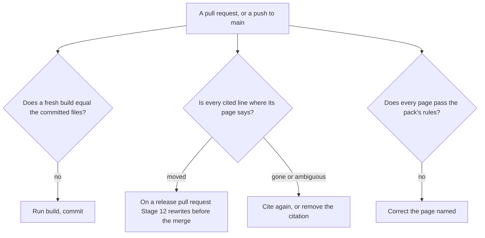

# Process Catalog (`core/process-catalog/`)

The process catalog is the platform's system documentation: one page per process node (universe, value stream, sub-process, activity), with each activity's steps as rows in its page, and an index, a graph and cross-cutting views generated from the pages' frontmatter.

The catalog is a derived, descriptive index: skills, specs and code govern execution, and where a page disagrees with them the page is corrected. Agents execute from skills and specs; pages serve orientation, impact analysis, design and review.

The rules live in [the design-artifact standard](../standards/design-artifact-standard.md), in its section on the generated process catalog: where pages live, the levels and what earns a node a page, page identity and frontmatter, link types, the generated surfaces, the lifecycle and retire step, and how a page cites its sources so that its references stay current. What a page must contain to pass the validator — its sections, table columns and vocabularies, and the authoring rules the standard does not state — is in the [definitions pack](definitions/definitions-pack.md), which names the owner of every rule it carries. The decision behind the model is ADR-224.

| Path | Written or generated |
|---|---|
| `README.md` (this file) | Written. Orientation only; it never lists pages. |
| `<universe-id>/<node-id>.md` | Written, or seeded from source and corrected: one page per node |
| `INDEX.md`, `graph.json`, `views/` | Generated from page frontmatter; never edited by hand |
| `definitions/` | Written. The definitions pack, its `pack.json`, the page templates, the registers and the tables the tools read. Not pages. |

## How to read the catalog

Start at [`INDEX.md`](INDEX.md). It lists each published universe and its value streams, and nothing deeper. Every deeper page is reached from its parent: a value stream links its sub-processes, and a sub-process links its activities. Each page ends with a navigation line: up, previous, next, down.

| If you want… | Read |
|---|---|
| what a process is for and where it starts and ends | the page's Summary, and its entry and exit rows |
| who does what, in order | the Flow diagram and the Steps table |
| which rules bind it, and how strongly | the Controls column or table; the class says whether code blocks, code warns, or only prose asks |
| whether the system does what its documents say | the Evidence table, and the page's `lens_status` |
| the source behind a statement | the link in the row; it lands on the cited line |

A reader with a small context can skip the Evidence table and the Sources list: the Summary, the Flow and the Steps table stand without them.

A page describes the system as of its `last_verified_commit`. A page whose `status` is `DRAFT` has not passed its publication gate. A node named in a page with no link has no page yet. A page never holds a number measured on one install; the section on your install's figures says where those are.

## Writing a page

A page is written from the template for its level, in `definitions/templates/`, against the [definitions pack](definitions/definitions-pack.md). The pack explains the fields, sections and rules a page must meet and names the standard or decision that owns each rule; its values are held in [`pack.json`](definitions/pack.json), which the validator reads. A node's ID is minted in the [ID registry](definitions/id-registry.tsv) before its page is written, and a Controls row takes its control ID and class from the [controls register](definitions/controls-register.tsv).

## Registers and evidence

| What | Where | Rule |
|---|---|---|
| ID registry | `definitions/id-registry.tsv` | A node's ID is minted here before its page is written: one row per node, never reused. A row with no page is a node that is registered and not yet published. |
| Controls register | `definitions/controls-register.tsv` | The control IDs and enforcement classes that a page's Controls rows are checked against. A row is admitted only when it meets the register contract: a tracked source, a published kind and class, and no private source named in any cell. A control that lives outside the corpus, or that repository-host settings enforce, has no row here. The catalog check fails on a register that breaks the contract; run the register check before pushing a change to this file. |
| Publication evidence | The release plan of the pages milestone that published the pages, under `release/releases/plans/` | Results on the pull-request head are in the plan's Verification Evidence section; the re-run on the merge commit is in its Deployment Execution Log. Evidence names what was measured and by which script, never a figure measured on one install. |

**Minting a control ID.** Some IDs are held: they have no row here and are never used again. The held ranges and the highest ID ever minted are recorded in `pack.json`. A new control takes the number after the highest minted ID, and the same change raises that value. The value is never lowered.

**Class cells are a snapshot.** Each row's enforcement class was read from its cited source at commit `cebcf6c2`. A row whose source changed after that commit may be out of date until it is read again, and the rows have not been re-read since.

**Correcting a row.** Change the cell in the pull request that moved the source or changed the gate's declared posture, or in the fix that follows a red catalog check. A row is never deleted without adding its ID to the held ranges in `pack.json` in the same change. The catalog check fails otherwise — unless the same change also lowers the highest minted ID or narrows a held range, which no check sees and no change may do. Run the register check with the pattern arm before pushing. The pattern file is not in the repository. The workspace owner holds it with its digest, and the check counts only when it was run with both.

## Regenerating and validating
<!-- design-artifact: flow-class=data-flow; name=process-catalog-generation; depicts=core/deploy/tools/build-process-catalog.py,core/deploy/tools/check-process-catalog.py,core/deploy/tools/build-element-inventory.py,core/deploy/tools/_process_catalog.py -->

| Input | Read by | Produces | Read by |
|---|---|---|---|
| pages, the definitions pack, the ID registry, the controls register, the element-kinds table | `build-process-catalog.py build` | `INDEX.md`, `graph.json`, `views/`, each page's navigation block and derived `lens_status` | readers; planning reads; `build --check` |
| the same inputs and the committed output | `build-process-catalog.py build --check` | the files that differ | the author; CI |
| pages and their cited sources | `build-process-catalog.py anchors resolve` | moved citations rewritten, or citations to cite again | the author; CI |
| pages, the pack, the registers | `check-process-catalog.py` | findings by rule code; the registers are checked on every run | the author |
| a diff or a list of paths | `build-process-catalog.py impact` | the pages that depict them, with parents and downstream nodes | planning reads |

A run that examined nothing — no page published, or an input it could not read — exits 3 and says so; it is not a pass. Checking the registers needs `--pattern-arm`: `not-run` in CI, `run` with the pattern file before a push that changes a register.

The generated files are a function of those inputs alone: no commit, date or staleness. Staleness is a query (`build-process-catalog.py stale`), never a stored value. After a page edit run `build`, then `check-process-catalog.py`, and commit the regenerated files with the page. `build-process-catalog.py` and `check-process-catalog.py` share one library, [`core/deploy/tools/_process_catalog.py`](/core/deploy/tools/_process_catalog.py).

**Publishing pages.** Page text is pushed for the first time only after `check-process-catalog-publication.py gate` passes on the commit that carries it. The gate's term lists and its listing are not in the repository; whoever holds them runs it.

## Your install's figures
<!-- design-artifact: flow-class=data-flow; name=process-catalog-figures-overlay; depicts=core/process-catalog/definitions/measures.tsv,core/deploy/tools/build-process-catalog.py -->

A page states what is measured and which script measures it. It never states the number: a figure is true only for the install that measured it. Each install generates its own.

| Input | Read by | Produces | Read by |
|---|---|---|---|
| the measures register, `definitions/measures.tsv` | the validator | a finding for an executed row that names no registered measure, or that carries a figure | the author; CI |
| git, this repository's host records, event log and analysis folders | each measure script, started by `build-process-catalog.py overlay` | `local-state/process-catalog/measures/<measure-id>.txt` and `figures.json`, git-ignored | you, on this install |
| a page and the overlay | `build-process-catalog.py overlay --show <page-id>` | the figures behind that page's executed rows | you |

Run `python3 core/deploy/tools/build-process-catalog.py overlay --overlay-root <folder>`. The folder must exist; the command has no default. Pass each input your install has: `--input event-log=<file>`, `--input analysis-home=<folder>`, and `--host live` to read this repository's records from its host. Where each lives on an install is in the placement standard's surface register. An input you do not pass is not looked for, and every measure that needs it reads `not-evaluated`; that is not a zero. In the main checkout the folder is `local-state/process-catalog`; from a session worktree, name a folder outside every work tree. A row marked `held local` names a measure that reads data about the whole install; its script is not published. A row marked `no measure` says why nothing tracked can observe the activity. A measure that reads one install's working state supports no verdict on a page. A row that supports `conformant` ends with `covers:` and the steps its workflow runs. A row that supports `conformant` links the workflow it relies on. The deploy-check warn log has no registered measure until that surface is homed inside the repository.

## What CI checks, and how to fix a failing run
<!-- design-artifact: flow-class=decision-tree; name=process-catalog-ci-gates; depicts=.github/workflows/process-catalog-check.yml -->

Three checks run on every pull request and on every push to `main`. Each fails the run when it finds something, and each failing run's summary names the fix.

| Check | Fails when | Fix |
|---|---|---|
| Generated-output gate | `INDEX.md`, `graph.json`, a view, or a page's generated region differs from what the generator produces | `python3 core/deploy/tools/build-process-catalog.py build`, then commit |
| Citation gate | a committed line number is no longer where the cited text is | `python3 core/deploy/tools/build-process-catalog.py anchors resolve --write`, then commit |
| Page-validation gate | a page breaks a rule of the definitions pack at error severity | correct the page; for a moved or deleted depicted file, update `depicts` and run `build` |

**If you changed a source file and never opened this folder,** the citation gate is the one you will meet: you moved lines a page cites. On a release pull request the pipeline makes the rewrite: Stage 12 runs the second command on the release branch before the merge and commits the pages it rewrites. Where a release holds pushes of catalog text for the publication gate, the rewrite is made by that release's Engineering session and Stage 12 only checks. Outside the release pipeline, run it yourself and commit. The command cannot fix a citation whose text you edited or deleted; the summary lists those. Cite the text that now states the same fact. Removing a citation is the page owner's change. A fingerprint is never edited.

**If two changes move lines in the same source,** leave both rewrites to Stage 12: each is made after that release's last merge of main, so they do not conflict. If both rewrote early and a page conflicts, take the base's side of the page and run the command again.

A run that examined nothing fails as NOT EVALUATED. The checks fail the run and do not block a merge; the gate-efficacy standard records what would change that and how the first 30 days are read. CI never pushes a fix of its own.

Pages are published universe by universe. This file keeps the folder holding at least one tracked Markdown file, which the folder's entry in the shared link-check scope list requires.
