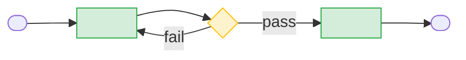

# <Value stream name>

## Summary

<Three to five sentences: trigger, outcome, the main sub-processes in order, and the decision points that matter.>

## SIPOC

| Suppliers | Inputs | High-level steps | Outputs | Customers |
|---|---|---|---|---|
| <who supplies> | <what goes in> | <four to seven steps> | <what comes out> | <who uses it> |

## Flow

## Sub-processes

| Sub-process | Entry | Exit | Page |
|---|---|---|---|
| <name> | <entry criteria> | <exit criteria> | [<id>](<path>) |

## Controls

| Control | Source | Enforcement class | Surface | Applies to |
|---|---|---|---|---|
| <rule, in one line> | `<path>` | <enforcement class, per the pack> | <surface, per the pack> | <sub-process id> |

## Evidence

| Lens | Source | Observation | Label |
|---|---|---|---|
| designed | `<path>` | <what the spec says> | [SOURCE] |
| built | `<path>` | <what code enforces> | [SOURCE] |
| executed | measure `<measure-id>` — [<script>](/core/deploy/tools/process-catalog-measures/<script>) (population: <the rule, in words>) | <what the measure reports and how to read it; no figure> | [SOURCE] |

## Navigation

<!-- nav:begin -->
Up: [<L0 id>](<path>) · Next: [<sibling id>](<path>) · Down: <sub-process links>
<!-- nav:end -->

## Sources

- `<path>` — <what it contributes>
