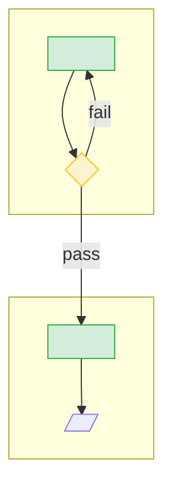

# <Sub-process name>

## Summary

<Three to five sentences: what enters, what happens, what leaves, and the gate at each end.>

## Entry and exit

| Side | Criteria | Source |
|---|---|---|
| Entry | <what must be true to start> | `<path>` |
| Exit | <what must be true to finish> | `<path>` |

## Flow

## Activities

| Activity | Primary actor | Purpose | Page |
|---|---|---|---|
| <name> | <actor> | <one line> | [<id>](<path>) |

## Controls

| Control | Source | Enforcement class | Surface | Applies to |
|---|---|---|---|---|
| <rule> | `<path>` | <class> | <surface> | <activity id> |

## Evidence

| Lens | Source | Observation | Label |
|---|---|---|---|
| designed | `<path>` | <observation> | [SOURCE] |
| built | `<path>` | <observation> | [SOURCE] |
| executed | measure `<measure-id>` — [<script>](/core/deploy/tools/process-catalog-measures/<script>) (population: <the rule, in words>) | <what the measure reports and how to read it; no figure> | [SOURCE] |

## Navigation

<!-- nav:begin -->
Up: [<L1 id>](<path>) · Previous: [<id>](<path>) · Next: [<id>](<path>) · Down: <activity links>
<!-- nav:end -->

## Sources

- `<path>` — <what it contributes>
