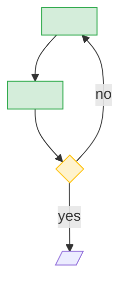

# <Activity name>

## Summary

<Two to four sentences: who does it, on what, producing what.>

## ICOM

| Inputs | Controls | Outputs | Mechanisms |
|---|---|---|---|
| <what it consumes> | <rules that govern it> | <what it produces> | <skills, tools, hooks, models that perform it> |

## Flow

## Steps

| Step | Action | Actor | Inputs → outputs (shape) | Controls | Mechanism | Harness | Model need | Source |
|---|---|---|---|---|---|---|---|---|
| <step-slug> | <verb + object> | <actor> | <input shape> → <output shape> | <rule: class> | <skill / tool> | <feature relied on> | <model need, per the pack> | `<path>` |

## Step profile

| Field | Value |
|---|---|
| Deterministic steps | <count of steps a script could do> |
| Judgment steps | <count needing model judgment> |
| Harness features relied on | <list> |
| Context read | <token estimate of what the actor must read> |

## Evidence

| Lens | Source | Observation | Label |
|---|---|---|---|
| designed | `<path>` | <observation> | [SOURCE] |
| built | `<path>` | <observation> | [SOURCE] |
| executed | measure `<measure-id>` — [<script>](/core/deploy/tools/process-catalog-measures/<script>) (population: <the rule, in words>) · [<file>](/.github/workflows/<file>) | <what the measure reports and how to read it; no figure> covers: `<step-key>`, `<step-key>` | [SOURCE] |

## Navigation

<!-- nav:begin -->
Up: [<L2 id>](<path>) · Previous: [<id>](<path>) · Next: [<id>](<path>)
<!-- nav:end -->

## Sources

- `<path>` — <what it contributes>
