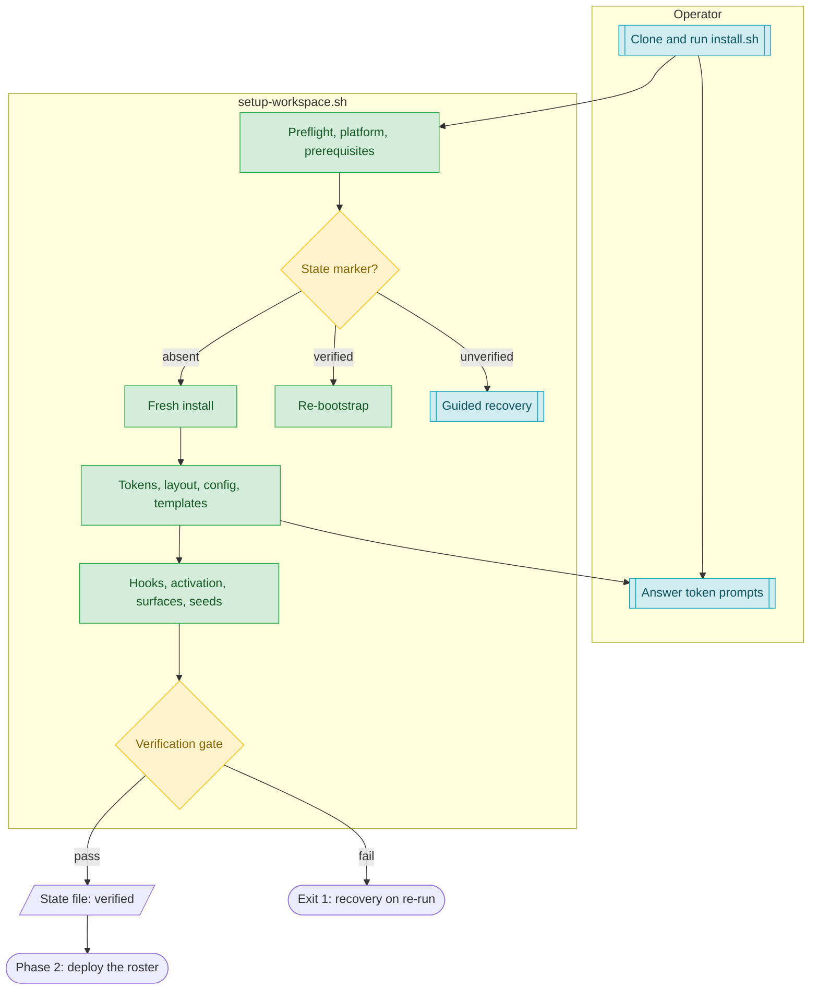

# Bootstrap the workspace (install.sh Phase 1)

## Summary

The operator clones the repository and runs `./install.sh` from its root. The entry script preflights the clone and
hands off to `setup-workspace.sh`, which checks the platform and prerequisites, routes on the install-state marker,
derives the token set from the templates and the manifest, resolves the operator's identity tokens (prompting, or
from declared defaults unattended), writes `operator.toml`, composes `CLAUDE.md` and `settings.json`, installs the
hook bundle with checksums and the post-merge git hook, asks about workflow-hook activation, installs the 21
composition surfaces install-if-missing, scaffolds the operator-instance seeds, and runs a verification gate before
writing the state file. Phase 2 then enters the deploy sub-process with no arguments, which bootstraps the full roster.
Its [ICOM](/core/process-catalog/definitions/pack.json) table follows.

## ICOM

| Inputs | Controls | Outputs | Mechanisms |
|---|---|---|---|
| A clone with `.version`, the manifest, `setup-workspace.sh` and `orchestrate.sh`; the two templates; the token vocabulary; the operator's answers or `--non-interactive` defaults; an existing state file, if any | Darwin-only by default (exit 78); prerequisites (exit 69); clone validity (exit 66); rollback of this run's writes on interruption; install-if-missing on every seed; the verification gate | `operator.toml` (0600), `CLAUDE.md`, `.claude/settings.json`, an empty `settings.local.json`, `.claude/hooks/*`, the post-merge symlink, 21 fenced surfaces, the needle, roster and operations-tier seeds, `.workspace-setup.state` | `install.sh`; `setup-workspace.sh` (bash 3.2); [`compose.py`](/core/deploy/compose.py) through [`lib-composition.sh`](/core/deploy/lib-composition.sh); Python `str.replace` substitution; `shasum`; `jq` |

## Flow

## Steps

| Step | Action | Actor | Inputs → outputs (shape) | Controls | Mechanism | Harness | Model need | Source |
|---|---|---|---|---|---|---|---|---|
| run-install-entry | Clone the repository and run the install entry from its root | operator | a machine with the prerequisites → `./install.sh [--dry-run] [--non-interactive] [--workspace-root] [--config-root]` | macOS only at this release; the Windows entry runs `-DryRun` alone and exits 3 otherwise | shell | none | human | [INSTALL.md](/docs/INSTALL.md#L11)<!-- source-anchor: line=11; fp=0e2101f4400c0f83 -->; [install.ps1](/install.ps1#L102)<!-- source-anchor: line=102; fp=3392cfdcc9ab2908 --> |
| preflight-clone | Confirm the four marker files and `python3` | script:install.sh | repo root from the script's own location → continue, or exit 65 (missing file) / 69 (no `python3`) | the clone's root is the anchor, never the cwd | file tests | file-and-shell-tools | XS/none/read/scriptable/batch | [install.sh](/install.sh#L76)<!-- source-anchor: line=76; fp=6212afec21124365 --> |
| check-platform-and-prerequisites | Refuse non-Darwin (by default), missing tools, an invalid source repo | script:setup-workspace.sh | `uname`, `python3`/`shasum`/`git`/`jq`, the two templates → continue, or exit 78 / 69 (with a `brew install` line) / 66 | fail before any state mutation | `check_platform`, `check_prereqs`, `check_source_repo` | file-and-shell-tools | XS/none/read/scriptable/batch | [setup](/docs/scripts/setup-workspace.sh#L474)<!-- source-anchor: line=474; fp=7af34357e69cdf2a -->, [setup-workspace.sh](/docs/scripts/setup-workspace.sh#L567)<!-- source-anchor: line=567; fp=37e832cdc9ebcbdb -->, [setup-workspace.sh](/docs/scripts/setup-workspace.sh#L591)<!-- source-anchor: line=591; fp=6fce8858d763f3cf --> |
| route-by-state-marker | Pick fresh install, re-bootstrap or guided recovery | script:setup-workspace.sh | `.workspace-setup.state` absent → fresh; schema version and `verification_passed: true` → re-bootstrap; else → recovery (an unattended run exits 66 there) | a state file claiming completion without verification routes to recovery | `detect_state_and_route` | file-and-shell-tools | XS/none/read/scriptable/batch | [setup](/docs/scripts/setup-workspace.sh#L687)<!-- source-anchor: line=687; fp=43693229fb2aa516 --> |
| prepare-layout-and-token-set | Create the directory layout and derive the active tokens | script:setup-workspace.sh | three sources grepped for `[OPERATOR_*]`/`[CLAUDE_*]`/`[COWORK_*]` → `ACTIVE_TOKENS`; the layout's directories under the workspace root, the operator-instance and ambient ones included | the token set is derived, never a hardcoded list | `compute_active_tokens`, `create_dir_layout` | file-and-shell-tools | XS/none/write/scriptable/batch | [setup](/docs/scripts/setup-workspace.sh#L669)<!-- source-anchor: line=669; fp=0c95f0cababb11b5 -->, [setup-workspace.sh](/docs/scripts/setup-workspace.sh#L1329)<!-- source-anchor: line=1329; fp=020ced64d9b26b99 --> |
| answer-token-prompts | Supply name, role, organization and the other identity values | operator | prompts (git config defaults offered) → values; under `--non-interactive` the declared defaults answer and a required token with none exits non-zero naming it | no value is silently substituted | interactive stdin | none | human | [setup](/docs/scripts/setup-workspace.sh#L1147)<!-- source-anchor: line=1147; fp=05da8b358877c176 -->; [INSTALL.md](/docs/INSTALL.md#L113)<!-- source-anchor: line=113; fp=1e8fa6d171cbccb2 --> |
| write-operator-config | Persist the resolved tokens to the canonical config | script:setup-workspace.sh | values → `<config-root>/operator.toml` (mode 0600), keys derived from the declared schema; an existing file is round-tripped losslessly | C-190 (Check 70) later asserts declaration/template parity: code-enforce (parity arms) / code-warn (schema arm) | `write_operator_toml` | file-and-shell-tools | XS/none/write/scriptable/batch | [setup](/docs/scripts/setup-workspace.sh#L817)<!-- source-anchor: line=817; fp=3c94c6510173d32e --> |
| compose-context-and-settings | Render `CLAUDE.md` and `settings.json`, scaffold the overlay | script:setup-workspace.sh | templates + tokens → the workspace `CLAUDE.md` (composition writer, markdown fence) and `.claude/settings.json` (whole-file substitution, `_comment` stripped); `settings.local.json` = `{}` once | Python `str.replace`, never `sed`; the overlay is never regenerated | `substitute_templates`, `scaffold_settings_local` | file-and-shell-tools | XS/none/write/scriptable/batch | [setup](/docs/scripts/setup-workspace.sh#L1439)<!-- source-anchor: line=1439; fp=68f9987c4a4435a0 -->, [setup-workspace.sh](/docs/scripts/setup-workspace.sh#L1494)<!-- source-anchor: line=1494; fp=5cdde1ad6641df57 --> |
| install-hook-bundle | Copy every `core/hooks/*.sh` with checksums, plus the co-shipped libraries and mode defaults | script:setup-workspace.sh | each hook file → `.claude/hooks/` (`cp`, `chmod +x`, SHA recorded); unchanged copies synced, edited copies prompt a drift decision; [`lib/dep-resolve.sh`](/core/hooks/lib/dep-resolve.sh), the path-leak and instance-path primitives, the warn-mode templates install-if-missing | hooks fail closed without `dep-resolve.sh`; the verifier's mode file is deliberately not laid down | `install_hooks`, `install_hook_with_checksum`, `install_mode_template_if_missing` | file-and-shell-tools | XS/none/write/scriptable/batch | [setup](/docs/scripts/setup-workspace.sh#L2537)<!-- source-anchor: line=2537; fp=2bb0d22e2b66ceac -->, [setup-workspace.sh](/docs/scripts/setup-workspace.sh#L2300)<!-- source-anchor: line=2300; fp=3906984a66939fcd -->, [setup-workspace.sh](/docs/scripts/setup-workspace.sh#L2516)<!-- source-anchor: line=2516; fp=e9be10a7e5da1efd --> |
| install-post-merge-git-hook | Symlink the post-merge deploy hook into the source repo's hooks dir | script:setup-workspace.sh | [`core/hooks/git-post-merge-deploy.sh`](/core/hooks/git-post-merge-deploy.sh) → `<hooks-dir>/post-merge` when the repo sits inside the workspace root (or `PMO_INSTALL_GIT_HOOKS=1`); else a printed one-liner | scoped so test sandboxes never write a live hook into the real checkout | `ln -sf` after `git rev-parse --git-path hooks` | git-and-gh-cli | XS/none/write/scriptable/batch | [setup](/docs/scripts/setup-workspace.sh#L2617)<!-- source-anchor: line=2617; fp=737430e699ef0206 --> |
| choose-hook-activation | Decide whether the workflow-class hooks are active | operator | the prompt (default N) → `[security_hooks].master_enabled` in the XDG `platform-config.toml`; preserved when already set; `false` unattended | the security/floor hooks are unaffected; the switch governs only the workflow class | `configure_hook_activation` | none | human | [setup](/docs/scripts/setup-workspace.sh#L2891)<!-- source-anchor: line=2891; fp=e14745266f22fa43 --> |
| install-composition-surfaces | Write the 21 manifest rows as fenced files, install-if-missing | script:setup-workspace.sh | each manifest row → its tier target with a MANAGED SECTION and an empty OPERATOR ADDITIONS fence; the workspace charter and the operations context anchor included; an existing target is never clobbered; a manifest-sourcing failure exits 73 | C-367: prose-only | `install_composition_surface_files` via `compose.py` | file-and-shell-tools | XS/none/write/scriptable/batch | [setup](/docs/scripts/setup-workspace.sh#L2982)<!-- source-anchor: line=2982; fp=36e0801cb10f1a5e -->; [manifest](/core/deploy/composition-surface-manifest.sh#L74)<!-- source-anchor: line=74; fp=44316e17323f502e --> |
| scaffold-instance-seeds | Create-once the needle file, the people roster and the operations-tier cards | script:setup-workspace.sh | tracked examples and templates → operator-instance copies only when absent; `install.sh` repeats the needle and roster guards after Phase 1 | a filled roster is never clobbered (operator PII) | `scaffold_localized_needles`, `scaffold_localized_roster`, `scaffold_operations_tiers` | file-and-shell-tools | XS/none/write/scriptable/batch | [setup](/docs/scripts/setup-workspace.sh#L3085)<!-- source-anchor: line=3085; fp=f332e8a199d871b0 -->, [setup-workspace.sh](/docs/scripts/setup-workspace.sh#L3183)<!-- source-anchor: line=3183; fp=87b8e691fee4cb5a -->; [install.sh](/install.sh#L134)<!-- source-anchor: line=134; fp=c90843c1eb89a358 --> |
| verify-and-record-state | Run the verification gate and write the state file | script:setup-workspace.sh | no unresolved token in `CLAUDE.md` or `settings.json`, valid JSON, every hook present and executable, a benign hook invocation exits 0 → `.workspace-setup.state` with `verification_passed`, the recorded source root and hook checksums; a failure writes `false` and exits 1 | the state file is written after the gate, never before | `run_verification_gate`, `verify_hooks_invokable`, `write_state_file` | file-and-shell-tools | XS/none/write/scriptable/batch | [setup](/docs/scripts/setup-workspace.sh#L3254)<!-- source-anchor: line=3254; fp=4a2e2ed9eb86ed6c -->, [setup-workspace.sh](/docs/scripts/setup-workspace.sh#L3310)<!-- source-anchor: line=3310; fp=87b29e7568f40990 --> |
| enter-skill-deploy | Bridge the deploy root and run the no-argument deploy | script:install.sh | `--workspace-root` (when given) → `PMO_PLATFORM_DEPLOY_ROOT`; `phase_deploy_skills` runs [`deploy.sh`](/core/deploy/deploy.sh) `--deploy` from the repo root in a subshell; its exit propagates; skipped under `--dry-run`; then the completion banner | the empty user-local mirror makes the deploy select the full roster | `orchestrate.sh` `phase_deploy_skills` | file-and-shell-tools | XS/none/write/scriptable/batch | [install.sh](/install.sh#L207)<!-- source-anchor: line=207; fp=06ec74c8ea2a52a1 -->; [orchestrate](/core/deploy/orchestrate.sh#L45)<!-- source-anchor: line=45; fp=36b5311025f3f9c0 --> |

## Step profile

| Field | Value |
|---|---|
| Deterministic steps | 12 of 15 (determinism `scriptable`, counted from the Steps table) |
| Judgment steps | 0 |
| Operator steps | 3 (`human`): the entry command, the token answers, the activation choice |
| Harness features relied on | file-and-shell-tools, git-and-gh-cli (portable) — plain scripts; no agent runtime is involved until the first session |
| Context read | M (8k–32k tokens) for a reader following the installer: the two templates, the manifest, the usage banner |

## Evidence

| Lens | Source | Observation | Label |
|---|---|---|---|
| designed | [`docs/INSTALL.md`](/docs/INSTALL.md), "Run the install" | the two phases and the bootstrap's twelve numbered steps, the settings split, the sandbox flags, re-run safety | [SOURCE] |
| designed | [`docs/ONBOARDING_JOURNEY.md`](/docs/ONBOARDING_JOURNEY.md), the journey table | stages J1–J3 (acquire, prerequisites, bootstrap) and J5 (deploy) of the seven-stage journey | [SOURCE] |
| built | [`install.sh`](/install.sh); [`docs/scripts/setup-workspace.sh`](/docs/scripts/setup-workspace.sh), `fresh_install` and `main`; [`core/deploy/composition-surface-manifest.sh`](/core/deploy/composition-surface-manifest.sh) | the entry script preflights, delegates Phase 1 and runs Phase 2; `fresh_install` calls the functions the Steps table names, in that order, and writes the state file after the gate; the manifest array holds the surface rows and its own comment counts 21 installs | [SOURCE] |
| designed vs built | [INSTALL.md](/docs/INSTALL.md#L97)<!-- source-anchor: line=97; fp=652440a0be678df3 -->; [setup-workspace.sh](/docs/scripts/setup-workspace.sh#L3656)<!-- source-anchor: line=3656; fp=762f673f625c372a --> | the document's numbered list for the bootstrap has twelve steps; the built `fresh_install` also calls `configure_hook_activation`, the needle and roster scaffolds and `scaffold_operations_tiers`, which the list does not name | [SOURCE] |
| designed vs built | [setup-workspace.sh](/docs/scripts/setup-workspace.sh#L87)<!-- source-anchor: line=87; fp=c29055a83ed71ced -->, [setup-workspace.sh](/docs/scripts/setup-workspace.sh#L90)<!-- source-anchor: line=90; fp=6e8cff1a1c749528 -->; [manifest](/core/deploy/composition-surface-manifest.sh#L70)<!-- source-anchor: line=70; fp=2d6c28d463f8ab72 --> | the installer's own design notes give a current expected hook count of 10 and "14 files at present" for the composition surfaces; the manifest's comment counts 21 installs, and the hook loop copies every `core/hooks/*.sh`, which is more files than the note expects | [SOURCE] |
| executed | measure `workflow-runs-install-security` — [workflow-run-history.py](/core/deploy/tools/process-catalog-measures/workflow-run-history.py) (population: every run of each named workflow created in the trailing window, split by trigger event, read in slices and verified against the host's total for each slice) · [`install-tests.yml`](/.github/workflows/install-tests.yml) | The measure reports the runs of the install-test workflow by trigger event and conclusion. Its jobs install into a sandbox, so a successful run shows the entry script and the bootstrap completing there, and shows nothing of an operator's own install | [SOURCE] |
| executed | no measure — what would show an operator's own install is that install's state file. | No measure in the measures register reads an operator's own install. The sandboxed installs of the workflow row above are the reproducible evidence for this page | [SOURCE] |

## Navigation

<!-- nav:begin -->
Up: [install-platform](install-platform.md) · Next: [validate-install](validate-install.md)
<!-- nav:end -->

## Sources

- [`install.sh`](/install.sh) — preflight, Phase 1 delegation, the scaffold guards, the deploy-root bridge, Phase 2
- [`docs/scripts/setup-workspace.sh`](/docs/scripts/setup-workspace.sh) — the fresh-install sequence and every function it calls
- [`core/deploy/composition-surface-manifest.sh`](/core/deploy/composition-surface-manifest.sh) — the surface rows and the token vocabulary
- [`docs/INSTALL.md`](/docs/INSTALL.md), [`docs/ONBOARDING_JOURNEY.md`](/docs/ONBOARDING_JOURNEY.md) — the documented procedure and journey
- [`core/deploy/orchestrate.sh`](/core/deploy/orchestrate.sh), [`core/deploy/deploy.sh`](/core/deploy/deploy.sh) — Phase 2's entry and the deploy it runs
- [`.github/workflows/install-tests.yml`](/.github/workflows/install-tests.yml) — the workflow whose run history the executed row reads
- [`core/process-catalog/definitions/controls-register.tsv`](/core/process-catalog/definitions/controls-register.tsv) — C-190, C-367
