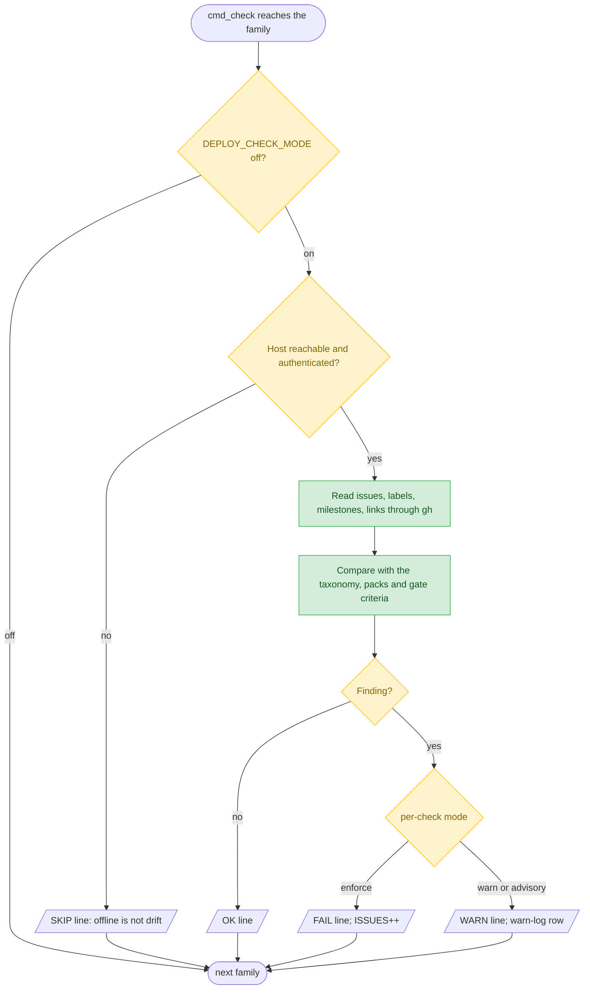

# Check backlog and tracker hygiene on the host (Checks 16, 17, 21, 22, 51, 52, 53, 55, 56, 72)

## Summary

Ten checks read out-of-tree state through the host CLI and compare it with what the corpus says the backlog should
look like: one status label per intake issue, proposed issues inside their age bands, body-stated dependencies
mirrored as native links, every bundled issue past gate G1, labels and milestone positions matching the taxonomy,
the approved queue within depth, the three work-hierarchy legs in agreement, milestone populations complete, and
issue-body anchors that still resolve. None of them can block a merge: their subject is mutable host state, so the
gate-efficacy standard's flip-decision table ratifies five of them permanently advisory and defers Check 22's mode
flip until both of its ending conditions hold and its authority decision record reads Accepted; the script writes
Check 72 as advisory only. Checks 51, 52, 53, 55, 56 and 72 print SKIP when the host cannot be read, and Checks 21
and 22 warn once and stop when the client lacks its scope. Its [ICOM](/core/process-catalog/definitions/pack.json) table (inputs,
controls, outputs, mechanisms) follows.

## ICOM

| Inputs | Controls | Outputs | Mechanisms |
|---|---|---|---|
| The host's issues, labels, milestones and native sub-issue links read live; the label taxonomy, the bundle-issues parser, the work-item type packs and the hierarchy reader; the G1 gate criteria and the operator exemption list | Per-check modes resolved through `resolve_check_mode` with the shared warn fallback; the dedicated `g1-enforcement` mode for Check 22; the flip-decision table's RATIFIED ADVISORY and SPLIT DISPOSITION rows; the offline-skip idiom | `OK` / `FAIL` / `WARN` / `SKIP` / `EXEMPT` / `DENOM` / `TEST` / `ERROR` lines; `ISSUES` increments only in enforce mode; warn-log rows under the aging, status-label, native-dep, G1, label, milestone and hierarchy key families | `gh issue`, `gh api` and `gh auth` reads; the label-parity, queue-depth, work-hierarchy, milestone-membership and issue-body-anchor primitives; the milestone-position computer |

## Flow

## Steps

| Step | Action | Actor | Inputs → outputs (shape) | Controls | Mechanism | Harness | Model need | Source |
|---|---|---|---|---|---|---|---|---|
| verify-status-label-invariants | Check 16 — Status-label invariant | script:deploy.sh | every intake issue on the host, for invariants I1 to I4 → verdict lines FAIL/WARN/EXEMPT/OK; ISSUES++ at 2 site(s); warn keys `status-label-I1-mutex`, `status-label-I2-presence`, `status-label-I3-contradiction-A`, `status-label-I4-contradiction-B`; mode resolved per check (`status-label-invariant`) | C-136: code-warn | inline bash in `cmd_check` (the `_c16_*` body `--report` shares) over `gh issue` | file-and-shell-tools, git-and-gh-cli | XS/none/read/scriptable/batch | [deploy.sh](/core/deploy/deploy.sh#L9991)<!-- source-anchor: line=9991; fp=2ded3aea6762bf1a --> |
| signal-proposed-aging | Check 17 — Aging signal (status proposed) | script:deploy.sh | open proposed issues on the host, by age band → verdict lines TEST/ERROR/OK; warn keys `aging-critical-<days>d`, `aging-escalate-<days>d`, `aging-warn-<days>d` | C-137: code-warn | host read via `gh issue` | file-and-shell-tools, git-and-gh-cli | XS/none/read/scriptable/batch | [deploy.sh](/core/deploy/deploy.sh#L10131)<!-- source-anchor: line=10131; fp=23aa85b57776c159 --> |
| detect-native-dep-drift | Check 21 — Native-dependency body-to-native drift (with sub-arm 21a token scope) | script:deploy.sh | issue-body dependency statements against native sub-issue links on the host → verdict lines OK; warn keys `native-dep-drift`, `native-dep-drift-to-add`, `native-dep-drift-orphan`; 21a's token-scope check is non-fatal | C-141: code-warn | host read via `gh auth`, `gh issue`, `gh api` | file-and-shell-tools, git-and-gh-cli | XS/none/read/scriptable/batch | [deploy.sh](/core/deploy/deploy.sh#L10420)<!-- source-anchor: line=10420; fp=7f730b2bab2b676c --> |
| enforce-g1-on-bundled-issues | Check 22 — G1 enforcement on bundled issues | script:deploy.sh | every issue bundled into a milestone, against gate G1 (the pack kinds read through the work-hierarchy reader) → verdict lines DENOM/OK; structural findings through `flag_g1_enforcement`, judgment-tier ones through a RECOMMEND emitter; mode resolved per check (`g1-enforcement`) | C-142: code-warn | [bundle-issues-parser.py](/release/tools/bundle-issues-parser.py); [check-work-hierarchy.py](/core/deploy/tools/check-work-hierarchy.py); host read via `gh api`, `gh auth`, `gh issue` | file-and-shell-tools, git-and-gh-cli | XS/none/read/scriptable/batch | [deploy.sh](/core/deploy/deploy.sh#L10546)<!-- source-anchor: line=10546; fp=c466d8f70f777e7f --> |
| verify-label-parity | Check 51 — Label-taxonomy to host label-set parity | script:deploy.sh | the host's label set against the label taxonomy → verdict lines SKIP/OK/FAIL; ISSUES++ at 1 site(s); warn keys `label-parity`; mode resolved per check (`label-parity`) | C-171: code-warn | [check-label-parity.py](/core/deploy/tools/check-label-parity.py) | file-and-shell-tools, git-and-gh-cli | XS/none/read/scriptable/batch | [deploy.sh](/core/deploy/deploy.sh#L14891)<!-- source-anchor: line=14891; fp=88461681196d219a --> |
| detect-milestone-position-drift | Check 52 — Milestone-position drift | script:deploy.sh | milestone positions on the host against the corpus → verdict lines SKIP/OK/FAIL; ISSUES++ at 1 site(s); warn keys `milestone-position`; mode resolved per check (`milestone-position`) | C-172: code-warn | [compute-milestone-positions.py](/release/tools/compute-milestone-positions.py) | file-and-shell-tools, git-and-gh-cli | XS/none/read/scriptable/batch | [deploy.sh](/core/deploy/deploy.sh#L15077)<!-- source-anchor: line=15077; fp=3669ef4184011524 --> |
| monitor-approved-queue-depth | Check 53 — Approved-queue-depth monitor | script:deploy.sh | the approved-but-unbundled queue on the host → verdict lines SKIP/OK/FAIL; ISSUES++ at 1 site(s); warn keys `approved-queue-depth`; mode resolved per check (`approved-queue-depth`) | C-173: code-warn | [check-approved-queue-depth.py](/core/deploy/tools/check-approved-queue-depth.py) | file-and-shell-tools, git-and-gh-cli | XS/none/read/scriptable/batch | [deploy.sh](/core/deploy/deploy.sh#L15144)<!-- source-anchor: line=15144; fp=5848c00f2b99fdac --> |
| detect-work-hierarchy-drift | Check 55 — Work-hierarchy drift | script:deploy.sh | the doc, backlog and coextension hierarchy legs → verdict lines SKIP/OK/FAIL; ISSUES++ at 2 site(s); warn keys `work-hierarchy-drift`, `work-hierarchy-coextension`; mode resolved per check (`work-hierarchy-drift`) | C-174: code-warn | [check-work-hierarchy.py](/core/deploy/tools/check-work-hierarchy.py) | file-and-shell-tools, git-and-gh-cli | XS/none/read/scriptable/batch | [deploy.sh](/core/deploy/deploy.sh#L15293)<!-- source-anchor: line=15293; fp=8f57d54cdf52cd15 --> |
| verify-milestone-population | Check 56 — Milestone-to-issue population invariants | script:deploy.sh | milestone membership, descriptions, scaffold completeness and sub-task orphans on the host → verdict lines SKIP/OK/FAIL/WARN; ISSUES++ at 2 site(s); warn keys `milestone-epic-membership`, `milestone-description-reconciliation`, `milestone-scaffold-completeness`, `milestone-subtask-orphan`; mode resolved per check (`milestone-epic-membership`, `milestone-subtask-orphan`) | C-175: code-warn | [check-milestone-epic-membership.py](/core/deploy/tools/check-milestone-epic-membership.py) | file-and-shell-tools, git-and-gh-cli | XS/none/read/scriptable/batch | [deploy.sh](/core/deploy/deploy.sh#L15450)<!-- source-anchor: line=15450; fp=54cbc878533a1892 --> |
| detect-issue-body-anchor-drift | Check 72 — Issue-body section-anchor drift (advisory) | script:deploy.sh | numeric section anchors in open issue bodies against their targets → verdict lines SKIP/DENOM/OK; warn key `issue-body-anchor-drift` (advisory emitter) | C-192: code-warn | [check-issue-body-anchors.sh](/core/deploy/tools/check-issue-body-anchors.sh) | file-and-shell-tools, git-and-gh-cli | XS/none/read/scriptable/batch | [deploy.sh](/core/deploy/deploy.sh#L17266)<!-- source-anchor: line=17266; fp=4ce5602c5036a255 --> |

## Step profile

| Field | Value |
|---|---|
| Deterministic steps | 10 of 10 (determinism `scriptable`, counted from the Steps table) |
| Judgment steps | 0 — Check 22's judgment-tier G1 criteria are recommend-only emits by the same script, never a model call |
| Harness features relied on | file-and-shell-tools, git-and-gh-cli |
| Context read | XS (under 2k tokens) |

## Evidence

| Lens | Source | Observation | Label |
|---|---|---|---|
| designed | [`core/deploy/deploy.sh`](/core/deploy/deploy.sh), the ten check blocks in `cmd_check`; [`core/standards/gate-efficacy-standard.md`](/core/standards/gate-efficacy-standard.md) § Flip-decision status (Checks 51, 52, 53, 55, 56 RATIFIED ADVISORY; Check 22 SPLIT DISPOSITION) | the flip-decision table declines five flips because a verdict over mutable host state is non-deterministic for a fixed tree — it records two `--check` runs six minutes apart returning different verdicts for ten host-reading checks; Check 22's mode flip is due only when both of its ending conditions hold and its authority ADR reads Accepted | [SOURCE] |
| built | [the controls register](/core/process-catalog/definitions/controls-register.tsv), C-136, C-137, C-141, C-142, C-171 to C-175, C-192, C-214; [`install-tests.yml`](/.github/workflows/install-tests.yml); [`release-tooling-smoke.yml`](/.github/workflows/release-tooling-smoke.yml) | the register classes each of the ten member checks `code-warn` and the shell-suite job C-214 `code-enforce`; Check 22's structural findings use the dedicated `flag_g1_enforcement` emitter, its judgment-tier ones a RECOMMEND emitter that never increments `ISSUES` in any mode; the two workflows run fixture suites for parts of this family's logic — the status-label invariants of Check 16, the bundle parser, and the Check 22 resolver suites of C-214 — which test that logic on fixtures, not on the live tracker | [SOURCE] |
| executed | no measure — what would show which members fire is the deploy-check warn log, where each warning arm appends its row. | No measure in the measures register reads the warn log, so the page reads `unobserved` | [SOURCE] |

## Navigation

<!-- nav:begin -->
Up: [run-check-suite](run-check-suite.md) · Previous: [check-public-surface-hygiene](check-public-surface-hygiene.md) · Next: [check-release-corpus-integrity](check-release-corpus-integrity.md)
<!-- nav:end -->

## Sources

- [`core/deploy/deploy.sh`](/core/deploy/deploy.sh) — the ten check blocks, the `flag_g1_enforcement` and RECOMMEND emitters, the offline-skip idiom
- [`check-label-parity.py`](/core/deploy/tools/check-label-parity.py), [`check-approved-queue-depth.py`](/core/deploy/tools/check-approved-queue-depth.py), [`check-work-hierarchy.py`](/core/deploy/tools/check-work-hierarchy.py), [`check-milestone-epic-membership.py`](/core/deploy/tools/check-milestone-epic-membership.py), [`check-issue-body-anchors.sh`](/core/deploy/tools/check-issue-body-anchors.sh); [`compute-milestone-positions.py`](/release/tools/compute-milestone-positions.py), [`bundle-issues-parser.py`](/release/tools/bundle-issues-parser.py) — the primitives
- [`core/standards/gate-efficacy-standard.md`](/core/standards/gate-efficacy-standard.md) — the ratified-advisory and split-disposition rows
- [`core/process-catalog/definitions/controls-register.tsv`](/core/process-catalog/definitions/controls-register.tsv) — C-136, C-137, C-141, C-142, C-171 to C-175, C-192, C-214
- [`.github/workflows/install-tests.yml`](/.github/workflows/install-tests.yml), [`.github/workflows/release-tooling-smoke.yml`](/.github/workflows/release-tooling-smoke.yml) — the fixture suites the built row names
