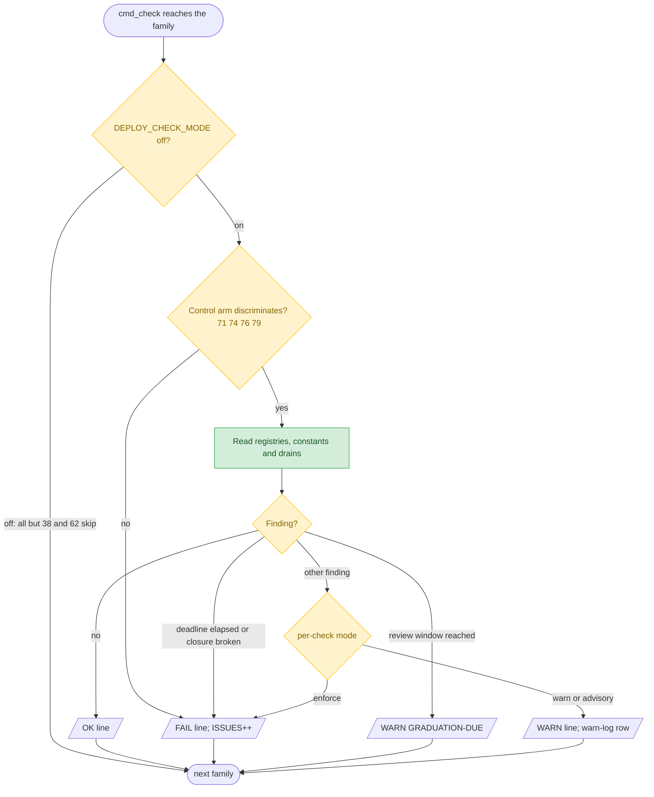

# Check the control layer's own registries, rollouts and gate meta-checks (Checks 37, 38, 57, 58, 60, 62, 71, 73, 74, 76, 79)

## Summary

The last family turns the suite on itself and on the hooks. Three checks keep the hook registries honest — ownership
completeness, a regenerate-and-diff of the committed index, and the master-enable class of every block hook — and one
checks the hook-tier publish map. Three are meta-checks over the control layer's records: the check-roster extraction
contract inside `deploy.sh`, the gate-coverage register's runner pointers, and admission of every automation to the
registry. Two force rollout decisions on committed deadlines — the destructive hook's three phased arms and the
bundle-metrics gate's integrity limb — and one proves that gate's evaluators still discriminate. Check 58 is the
founding member of the advisory-only class. Its [ICOM](/core/process-catalog/definitions/pack.json)
table (inputs, controls, outputs, mechanisms) follows.

## ICOM

| Inputs | Controls | Outputs | Mechanisms |
|---|---|---|---|
| The block hooks, their per-hook sources, the generated registry index and the publish map; `deploy.sh`'s own def-blocks and emitters; the gate-coverage register; proposed ADRs; the automation registry and its schema; the rollout constants in `deploy.sh` and the destructive hook; the bundle-metrics fixtures and sink declarations; the hook drains read through the segment set | Always-enforce for 38, 76 and the deadline and closure arms of 71, 74, 79; the shared `deploy-check.mode` for 37, 60, 73; per-check modes for 57, 62; the advisory-only emitter for 58; the progressive-rollout ladder | `OK` / `FAIL` / `WARN` / `SKIP` / `CTRL` / `DENOM` lines; `ISSUES` increments; warn-log rows under each check's own key; the GRADUATION-DUE and GRADUATION-OVERDUE verdicts | The extraction-contract, ADR-flip and automation primitives; the hook-registry builder's regeneration; `_c38_compute_verdict` and `_c73_compute_verdict` (shared with the pre-merge runner); date arithmetic over committed constants |

## Flow

## Steps

| Step | Action | Actor | Inputs → outputs (shape) | Controls | Mechanism | Harness | Model need | Source |
|---|---|---|---|---|---|---|---|---|
| verify-hook-registry-completeness | Check 37 — Hook-registry completeness | script:deploy.sh | every block hook script against its owning doc and registry row → verdict lines SKIP/OK; warn keys `hook-registry-completeness` | C-159: code-warn | inline bash in `cmd_check` | file-and-shell-tools | XS/none/read/scriptable/batch | [deploy.sh](/core/deploy/deploy.sh#L13839)<!-- source-anchor: line=13839; fp=6061707068882e78 --> |
| verify-hook-registry-freshness | Check 38 — Hook-registry index freshness | script:deploy.sh | the committed hook registry against a regeneration from its sources → verdict lines OK/FAIL; ISSUES++ at 2 site(s) | C-160: code-enforce | `_c38_compute_verdict` over the registry builder | file-and-shell-tools | XS/none/read/scriptable/batch | [deploy.sh](/core/deploy/deploy.sh#L13970)<!-- source-anchor: line=13970; fp=0329d15b481e758c --> |
| verify-extraction-contract | Check 57 — Check-roster extraction contract | script:deploy.sh | every check def-block and emitter in deploy.sh itself → verdict lines OK/FAIL; ISSUES++ at 3 site(s); warn keys `extraction-contract`; mode resolved per check (`extraction-contract`) | C-177: code-warn | [check-extraction-contract.py](/core/deploy/tools/check-extraction-contract.py) | file-and-shell-tools | XS/none/read/scriptable/batch | [deploy.sh](/core/deploy/deploy.sh#L15833)<!-- source-anchor: line=15833; fp=c176f0138bb5b9c4 --> |
| surface-adr-flip-promises | Check 58 — ADR ratification-flip backstop (advisory only) | script:deploy.sh | proposed ADRs carrying a flip promise → verdict lines OK; warn key `adr-flip-verify` (advisory emitter) | C-178: code-warn | [check-adr-flip.py](/core/deploy/tools/check-adr-flip.py) | file-and-shell-tools | XS/none/read/scriptable/batch | [deploy.sh](/core/deploy/deploy.sh#L15894)<!-- source-anchor: line=15894; fp=19d7dbfa16adb781 --> |
| reconcile-master-enable-classes | Check 60 — Master-enable hook-class reconcile | script:deploy.sh | each block hook's declared master-enable class against the security registry → verdict lines SKIP/OK; warn keys `master-enable-class` | C-180: code-warn | inline bash in `cmd_check` | file-and-shell-tools | XS/none/read/scriptable/batch | [deploy.sh](/core/deploy/deploy.sh#L16002)<!-- source-anchor: line=16002; fp=dd71ae3dec597f12 --> |
| verify-register-runner-resolution | Check 62 — Register runner-resolution | script:deploy.sh | each gate-coverage register runner pointer against the runner it names → verdict lines OK/FAIL/WARN; ISSUES++ at 1 site(s); warn keys `register-runner-resolution`; mode resolved per check (`register-runner-resolution`) | C-182: code-warn | `_rr_compute_verdict`, inline in `cmd_check` | file-and-shell-tools | XS/none/read/scriptable/batch | [deploy.sh](/core/deploy/deploy.sh#L16121)<!-- source-anchor: line=16121; fp=5ba5fc1f8fc6f2a7 --> |
| grade-destructive-022-rollout | Check 71 — BLOCK-DESTRUCTIVE-022 rollout graduation | script:deploy.sh | each phased arm's committed rollout constants and today's date (deadline arm); the destructive drain row count per arm (evidence arm) → verdict lines FAIL/CTRL/DENOM/OK/WARN; ISSUES++ at 6 site(s) | C-191: code-enforce (deadline arm) / code-warn (evidence arm) | constants read from [block-destructive.sh](/core/hooks/block-destructive.sh); date arithmetic inline | file-and-shell-tools | XS/none/read/scriptable/batch | [deploy.sh](/core/deploy/deploy.sh#L17089)<!-- source-anchor: line=17089; fp=b8d8e96ae03f912f --> |
| verify-bundle-metrics-gate-integrity | Check 73 — Bundle-metrics gate integrity | script:deploy.sh | the G3-14 and G3-15 evaluators (the two bundle-metrics stage gates at the Stage 3 → 4 boundary: the combined-clean parse-rate floor and the per-milestone size bound) against committed fixtures, their sink declarations and config → verdict lines OK; warn keys `bundle-metrics-gate-integrity` | C-193: code-warn | `_c73_compute_verdict`, inline in `cmd_check` | file-and-shell-tools | XS/none/read/scriptable/batch | [deploy.sh](/core/deploy/deploy.sh#L17341)<!-- source-anchor: line=17341; fp=81071d96ee36a728 --> |
| grade-gate-rollout | Check 74 — Gate-rollout graduation | script:deploy.sh | the committed GATE_ROLLOUT constants and today's date (deadline arm); Check 73's drain rows through the segment set (evidence arm) → verdict lines CTRL/FAIL/DENOM/OK/WARN; ISSUES++ at 5 site(s) | C-194: code-enforce (deadline arm) / code-warn (evidence arm) | inline bash in `cmd_check`; `warn_log_segment_set` | file-and-shell-tools | XS/none/read/scriptable/batch | [deploy.sh](/core/deploy/deploy.sh#L17384)<!-- source-anchor: line=17384; fp=60a9e9d03eef358c --> |
| admit-automation-registry | Check 76 — Automation-registry admission | script:deploy.sh | every declared automation against the registry rows and the schema's field set → verdict lines FAIL/CTRL/OK; ISSUES++ at 8 site(s) | C-196: code-enforce | [check-automation-registry.sh](/core/deploy/tools/check-automation-registry.sh); [check-automation-coverage.sh](/core/deploy/tools/check-automation-coverage.sh) | file-and-shell-tools | XS/none/read/scriptable/batch | [deploy.sh](/core/deploy/deploy.sh#L17617)<!-- source-anchor: line=17617; fp=fc54b0e6f45173c7 --> |
| verify-hook-tier-publish-parity | Check 79 — Hook-tier publish parity | script:deploy.sh | the hook-tier publish map (closure arm) and the deployed byte parity (advisory arm) → verdict lines CTRL/FAIL/OK/DENOM; ISSUES++ at 5 site(s); warn keys `hook-parity`, `hook-parity-bytes` | C-199: code-enforce (map-closure arm) / code-warn (byte-parity arm) | inline bash in `cmd_check` | file-and-shell-tools | XS/none/read/scriptable/batch | [deploy.sh](/core/deploy/deploy.sh#L17822)<!-- source-anchor: line=17822; fp=875e8da87763372e --> |

## Step profile

| Field | Value |
|---|---|
| Deterministic steps | 11 of 11 (determinism `scriptable`, counted from the Steps table) |
| Judgment steps | 0 — the graduation verdicts name the decision the operator owes; the script never takes it |
| Harness features relied on | file-and-shell-tools |
| Context read | XS (under 2k tokens) |

## Evidence

| Lens | Source | Observation | Label |
|---|---|---|---|
| designed | [`core/deploy/deploy.sh`](/core/deploy/deploy.sh), the eleven check blocks in `cmd_check`; [`core/standards/gate-efficacy-standard.md`](/core/standards/gate-efficacy-standard.md) § Flip-decision status (G3-14 / G3-15 and Check 57, 62 rows); [`core/rules/bypass-mode-readiness.md`](/core/rules/bypass-mode-readiness.md) § Warn-mode shakedown | Checks 71 and 74 share one shape: a repo-derivable deadline arm that fails the run past escalation and an operator-local evidence arm that never touches `ISSUES`; once a phase constant reads `enforce` its deadline arm is discharged and the check reports that rollout graduated; the shakedown procedure tells the operator to read the destructive drain per arm and says the shared mode file moves none of the three arms | [SOURCE] |
| built | [the controls register](/core/process-catalog/definitions/controls-register.tsv), C-159, C-160, C-177, C-178, C-180, C-182, C-191, C-193, C-194, C-196, C-199; [`deploy-check-ci.yml`](/.github/workflows/deploy-check-ci.yml), [`automation-registry-check.yml`](/.github/workflows/automation-registry-check.yml) | Checks 38 and 73 are members of the pre-merge `--check-required-subset` roster the first workflow runs (C-209) and Check 76 has its own pull-request leg in the second (C-202); `warn_log_segment_set` is defined at the script's top level, so Check 74's evidence arm reads the whole segment family | [SOURCE] |
| described vs built | [the header comment](/core/deploy/deploy.sh#L17434)<!-- source-anchor: line=17434; fp=1c9927fed5a8aba8 -->; [the function](/core/deploy/deploy.sh#L355)<!-- source-anchor: line=355; fp=ebe93ada83668cc2 -->; [the arm's body](/core/deploy/deploy.sh#L17478)<!-- source-anchor: line=17478; fp=53df2474c948f32f --> | Check 74's header comment says the segment-set function "does not exist yet" and that the arm "SKIPs until it lands", while the function is defined at the script's top level and the arm's own body reads it and explains a defect found once it became reachable — a stale comment inside the check | [SOURCE] |
| executed | measure `gate-rollout-deadlines` — [gate-rollout-deadlines.py](/core/deploy/tools/process-catalog-measures/gate-rollout-deadlines.py) (population: the rollout constants of the deploy script and the destructive-operations hook and the committed enforce sentinels, classified as the deadline checks classify them on the day of the run) | The measure reports, for each rollout family that Check 71 and Check 74 grade, its phase and its standing on the day of the run — graduated, within its window, review due or escalation overdue — and then the committed enforce sentinels by token. It reads tracked constants only; the evidence arms' drains are outside it | [SOURCE] |
| executed | no measure — what would show which members fire, and what the evidence arms count, is the deploy-check warn log and the destructive hook's warn log. | No measure in the measures register reads either log | [SOURCE] |

## Navigation

<!-- nav:begin -->
Up: [run-check-suite](run-check-suite.md) · Previous: [check-orchestration-surfaces](check-orchestration-surfaces.md)
<!-- nav:end -->

## Sources

- [`core/deploy/deploy.sh`](/core/deploy/deploy.sh) — the eleven check blocks, `_c38_compute_verdict`, `_c73_compute_verdict`, `_rr_compute_verdict`, the GATE_ROLLOUT constants and `warn_log_segment_set`
- [`check-extraction-contract.py`](/core/deploy/tools/check-extraction-contract.py), [`check-adr-flip.py`](/core/deploy/tools/check-adr-flip.py), [`check-automation-registry.sh`](/core/deploy/tools/check-automation-registry.sh), [`check-automation-coverage.sh`](/core/deploy/tools/check-automation-coverage.sh) — the primitives
- [`core/hooks/block-destructive.sh`](/core/hooks/block-destructive.sh) — the DESTRUCTIVE_022 rollout constants Check 71 reads
- [`core/standards/gate-efficacy-standard.md`](/core/standards/gate-efficacy-standard.md); [`core/rules/bypass-mode-readiness.md`](/core/rules/bypass-mode-readiness.md) — the rollout dispositions and the shakedown procedure
- [`core/process-catalog/definitions/controls-register.tsv`](/core/process-catalog/definitions/controls-register.tsv) — C-159, C-160, C-177, C-178, C-180, C-182, C-191, C-193, C-194, C-196, C-199, C-202, C-209
- [`.github/workflows/deploy-check-ci.yml`](/.github/workflows/deploy-check-ci.yml), [`.github/workflows/automation-registry-check.yml`](/.github/workflows/automation-registry-check.yml) — the two pre-merge legs the built row names
