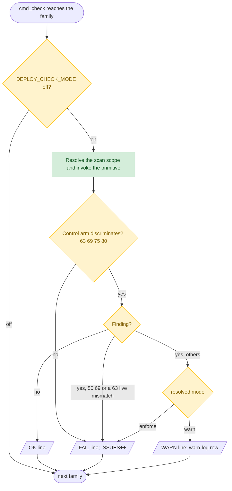

# Check documentation and schema conventions (Checks 14, 18, 25, 31, 34, 45, 49, 50, 63, 69, 75, 80)

## Summary

Twelve checks police how the corpus is written rather than what it deploys. Most are warn-mode scans through a
primitive under `core/deploy/tools/`: the doc-link scan over the shared scope list, the framework version anchors,
the universal-versus-localized needles, the reference-durability snapshot, template-to-schema and pack-to-schema
conformance, the design-principle register, the convention linter and the count-versus-structure lint. Three
enforce: Check 50 carries a committed enforce default for platform-doc frontmatter, Check 69 always fails the run
on a second spelling of the degraded-state token, and Check 63 always fails on a live count mismatch (its baseline
arm stays warn-mode). Several of these checks carry a control arm that must discriminate
before the verdict counts. Check 14 is mirrored at pull-request time by the link-check workflow, which runs the same
primitive over the same scope and allowlist, and the repository-integrity workflow runs Check 69's script. Its
[ICOM](/core/process-catalog/definitions/pack.json) table (inputs, controls, outputs, mechanisms)
follows.

## ICOM

| Inputs | Controls | Outputs | Mechanisms |
|---|---|---|---|
| The governance, reference, rules and SKILL.md scan scope and the tracked base allowlist; the framework catalog; universal corpus surfaces; the durable corpus and its override markers; schema-bearing templates and their schemas; the design-principle register; every platform doc under the core tree; stated cardinalities and their fixture harness; the work-item type packs | The shared `deploy-check.mode` for the warn-mode members; Check 50's committed enforce default; Check 69 always-enforce; Check 63's live mismatch always-enforce with a per-check baseline arm; the doc-link rule's scan-scope and allowlist discipline | `OK` / `FAIL` / `WARN` / `CTRL` / `DENOM` / `NOTE` / `SKIP` lines; `ISSUES` increments; warn-log rows under eleven keys | The primitives named per row; inline bash for Checks 25, 34, 45 |

## Flow

## Steps

| Step | Action | Actor | Inputs → outputs (shape) | Controls | Mechanism | Harness | Model need | Source |
|---|---|---|---|---|---|---|---|---|
| verify-doc-links | Check 14 — Doc-link maintenance | script:deploy.sh | every link in the shared scan scope, with the tracked base allowlist → verdict lines OK; warn keys `doc-link-maintenance` | C-134: code-warn | [check-doc-links.py](/core/deploy/tools/check-doc-links.py) | file-and-shell-tools | XS/none/read/scriptable/batch | [deploy.sh](/core/deploy/deploy.sh#L10005)<!-- source-anchor: line=10005; fp=470593a8cb6cb2b3 --> |
| detect-version-anchor-drift | Check 18 — Framework-corpus version-anchor drift | script:deploy.sh | the framework catalog's version anchors against the framework docs → verdict lines OK; warn keys `framework-anchor-drift` | C-138: code-warn | [check-version-anchors.py](/core/deploy/tools/check-version-anchors.py) | file-and-shell-tools | XS/none/read/scriptable/batch | [deploy.sh](/core/deploy/deploy.sh#L10362)<!-- source-anchor: line=10362; fp=ad32e8ba7cd18ffa --> |
| guard-universal-vs-localized | Check 25 — Universal-vs-localized-context guardrail | script:deploy.sh | universal corpus surfaces, scanned for localized-context needles → verdict lines WARN/OK/FAIL; ISSUES++ at 1 site(s); warn keys `universal-vs-localized-context` | C-145: code-warn | inline bash in `cmd_check` | file-and-shell-tools | XS/none/read/scriptable/batch | [deploy.sh](/core/deploy/deploy.sh#L12017)<!-- source-anchor: line=12017; fp=151d727a19b321d8 --> |
| measure-reference-durability | Check 31 — Reference-durability saturation | script:deploy.sh | the durable corpus's fragile-reference snapshot and override markers → verdict lines FAIL/OK; ISSUES++ at 1 site(s); warn keys `reference-durability` | C-151: code-warn | [run-fragile-ref-fixtures.sh](/core/hooks/run-fragile-ref-fixtures.sh) | file-and-shell-tools | XS/none/read/scriptable/batch | [deploy.sh](/core/deploy/deploy.sh#L12756)<!-- source-anchor: line=12756; fp=1dc9eb770a0cfd2f --> |
| verify-template-schema-conformance | Check 34 — Template-to-schema conformance | script:deploy.sh | each schema-bearing template's fields against its governing schema → verdict lines SKIP/OK; warn keys `template-schema-conformance` | C-156: code-warn | inline bash in `cmd_check` | file-and-shell-tools | XS/none/read/scriptable/batch | [deploy.sh](/core/deploy/deploy.sh#L13450)<!-- source-anchor: line=13450; fp=0df5a72b97bb3e5b --> |
| verify-design-principle-register | Check 45 — Design-principle conformance integrity | script:deploy.sh | each design-principle register row's governing-doc path and line → verdict lines OK; warn keys `design-principle-conformance` | C-167: code-warn | inline bash in `cmd_check` | file-and-shell-tools | XS/none/read/scriptable/batch | [deploy.sh](/core/deploy/deploy.sh#L14625)<!-- source-anchor: line=14625; fp=16bf71f19ab93260 --> |
| lint-platform-conventions | Check 49 — Platform-convention linter | script:deploy.sh | naming, layer-2, evidence-label, placeholder and event-log-key conventions corpus-wide → verdict lines FAIL/WARN/OK; ISSUES++ at 2 site(s); warn keys `check-convention`; mode resolved per check (`check-convention`) | C-169: code-warn | [check-convention.sh](/core/deploy/tools/check-convention.sh) | file-and-shell-tools | XS/none/read/scriptable/batch | [deploy.sh](/core/deploy/deploy.sh#L14841)<!-- source-anchor: line=14841; fp=c146a6e1f409da60 --> |
| verify-doc-frontmatter | Check 50 — Platform-doc frontmatter standard | script:deploy.sh | every platform doc under the core tree, for the required frontmatter → verdict lines OK/FAIL; ISSUES++ at 1 site(s); warn keys `doc-frontmatter` | C-170: code-enforce | [check-doc-frontmatter.py](/core/deploy/tools/check-doc-frontmatter.py) | file-and-shell-tools | XS/none/read/scriptable/batch | [deploy.sh](/core/deploy/deploy.sh#L14929)<!-- source-anchor: line=14929; fp=89a30c7ed5f130c3 --> |
| lint-count-vs-structure | Check 63 — Count-vs-structure lint | script:deploy.sh | stated cardinalities against the structure beneath them, with a fixture harness → verdict lines FAIL/DENOM/CTRL/OK/WARN; ISSUES++ at 7 site(s); mode resolved per check (`count-structure-baseline`); warn key `count-structure` (baseline arm) | C-183: code-enforce | [check-count-structure.py](/core/deploy/tools/check-count-structure.py); [run-count-structure-fixtures.sh](/core/deploy/tools/run-count-structure-fixtures.sh) | file-and-shell-tools | XS/none/read/scriptable/batch | [deploy.sh](/core/deploy/deploy.sh#L16308)<!-- source-anchor: line=16308; fp=01a8f5f5e2d252f0 --> |
| verify-pv7-spelling | Check 69 — PV-7a Register B spelling conformance | script:deploy.sh | the degraded-state terminal token, one sanctioned spelling corpus-wide → verdict lines FAIL/CTRL/DENOM/OK; ISSUES++ at 4 site(s) | C-189: code-enforce | [check-pv7-vocabulary.sh](/core/deploy/tools/check-pv7-vocabulary.sh) | file-and-shell-tools | XS/none/read/scriptable/batch | [deploy.sh](/core/deploy/deploy.sh#L17120)<!-- source-anchor: line=17120; fp=55aae6bfdf603884 --> |
| verify-pack-grammar | Check 75 — Pack-grammar conformance | script:deploy.sh | each work-item type pack against the meta-schema → verdict lines CTRL/FAIL/OK/NOTE; ISSUES++ at 2 site(s); warn keys `pack-conformance`; mode resolved per check (`pack-conformance`) | C-195: code-warn | [check-work-hierarchy.py](/core/deploy/tools/check-work-hierarchy.py) | file-and-shell-tools | XS/none/read/scriptable/batch | [deploy.sh](/core/deploy/deploy.sh#L17768)<!-- source-anchor: line=17768; fp=d143189826719b57 --> |
| verify-pack-content-completeness | Check 80 — Pack content-completeness | script:deploy.sh | each pack's declared kinds: a position on every surface and a source per position → verdict lines CTRL/FAIL/OK; ISSUES++ at 2 site(s); warn keys `pack-content-completeness`; mode resolved per check (`pack-content-completeness`) | C-200: code-warn | [check-work-hierarchy.py](/core/deploy/tools/check-work-hierarchy.py) | file-and-shell-tools | XS/none/read/scriptable/batch | [deploy.sh](/core/deploy/deploy.sh#L18180)<!-- source-anchor: line=18180; fp=f46a6addb712d875 --> |

## Step profile

| Field | Value |
|---|---|
| Deterministic steps | 12 of 12 (determinism `scriptable`, counted from the Steps table) |
| Judgment steps | 0 |
| Harness features relied on | file-and-shell-tools |
| Context read | XS (under 2k tokens) |

## Evidence

| Lens | Source | Observation | Label |
|---|---|---|---|
| designed | [`core/deploy/deploy.sh`](/core/deploy/deploy.sh), the twelve check blocks in `cmd_check`; [`core/rules/doc-link-maintenance.md`](/core/rules/doc-link-maintenance.md) § Enforcement Surfaces, § When Scans Run; [`core/standards/gate-efficacy-standard.md`](/core/standards/gate-efficacy-standard.md) § Flip-decision status (Check 45(b), Check 80 rows) | Check 14 and `link-check.yml` call one primitive over one scope list and one tracked allowlist; Check 45(b) is deferred precondition-blocked with its evidence met; Check 80's shakedown ends on a repo-derivable pack count, not a date or a drain | [SOURCE] |
| built | [the controls register](/core/process-catalog/definitions/controls-register.tsv), C-134, C-138, C-145, C-151, C-156, C-167, C-169, C-170, C-183, C-189, C-195, C-200, C-218; [`link-check.yml`](/.github/workflows/link-check.yml); [`repo-integrity.yml`](/.github/workflows/repo-integrity.yml) | Check 50's mode is a hardcoded committed `enforce` (a different shape from the per-check `resolve_check_mode` default the flip mechanism names, live at Check 47); Check 63 increments `ISSUES` on a live mismatch outside the mode gate while its baseline arm resolves its own warn mode; the link-check workflow (C-218) declares `posture=required(warn-mode-initial)` and runs its scan with `WARN_MODE` true; the repository-integrity workflow's PV-7 vocabulary job, declared advisory, runs Check 69's script after that script's self-test | [SOURCE] |
| executed | no measure — what would show which members fire at deploy time is the deploy-check warn log, where each warning arm appends its row. | No measure in the measures register reads the warn log | [SOURCE] |
| executed | measure `workflow-runs-deploy-probes` — [workflow-run-history.py](/core/deploy/tools/process-catalog-measures/workflow-run-history.py) (population: every run of each named workflow created in the trailing window, read in slices and verified against the host's total for each slice) · [`link-check.yml`](/.github/workflows/link-check.yml) · [`repo-integrity.yml`](/.github/workflows/repo-integrity.yml) | The measure reports, per named workflow, its run total and its runs by conclusion. The link-check workflow runs the Check 14 primitive over the same scope list and tracked allowlist, and the repository-integrity workflow's vocabulary job runs the Check 69 script with its self-test; the measure counts runs of a workflow, not of one job in it. No workflow named on this page runs the other steps, so the page reads `unobserved`. covers: `verify-doc-links`, `verify-pv7-spelling` | [SOURCE] |

## Navigation

<!-- nav:begin -->
Up: [run-check-suite](run-check-suite.md) · Previous: [check-workspace-config-surfaces](check-workspace-config-surfaces.md) · Next: [check-public-surface-hygiene](check-public-surface-hygiene.md)
<!-- nav:end -->

## Sources

- [`core/deploy/deploy.sh`](/core/deploy/deploy.sh) — the twelve check blocks and their emitters inside `cmd_check`
- [`check-doc-links.py`](/core/deploy/tools/check-doc-links.py), [`check-version-anchors.py`](/core/deploy/tools/check-version-anchors.py), [`check-convention.sh`](/core/deploy/tools/check-convention.sh), [`check-doc-frontmatter.py`](/core/deploy/tools/check-doc-frontmatter.py), [`check-count-structure.py`](/core/deploy/tools/check-count-structure.py), [`run-count-structure-fixtures.sh`](/core/deploy/tools/run-count-structure-fixtures.sh), [`check-pv7-vocabulary.sh`](/core/deploy/tools/check-pv7-vocabulary.sh), [`check-work-hierarchy.py`](/core/deploy/tools/check-work-hierarchy.py); [`run-fragile-ref-fixtures.sh`](/core/hooks/run-fragile-ref-fixtures.sh) — the primitives
- [`core/rules/doc-link-maintenance.md`](/core/rules/doc-link-maintenance.md) — the scan scope, allowlist and enforcement surfaces behind Check 14
- [`core/standards/gate-efficacy-standard.md`](/core/standards/gate-efficacy-standard.md) — the flip-decision rows for Check 45(b) and Check 80
- [`core/process-catalog/definitions/controls-register.tsv`](/core/process-catalog/definitions/controls-register.tsv) — C-134, C-138, C-145, C-151, C-156, C-167, C-169, C-170, C-183, C-189, C-195, C-200, C-218
- [`.github/workflows/link-check.yml`](/.github/workflows/link-check.yml), [`.github/workflows/repo-integrity.yml`](/.github/workflows/repo-integrity.yml) — the workflows whose run history the executed row reads
- `SKILL.md` on this page is every skill's definition file inside the doc-link scan scope, so it is not linked as one tracked file
