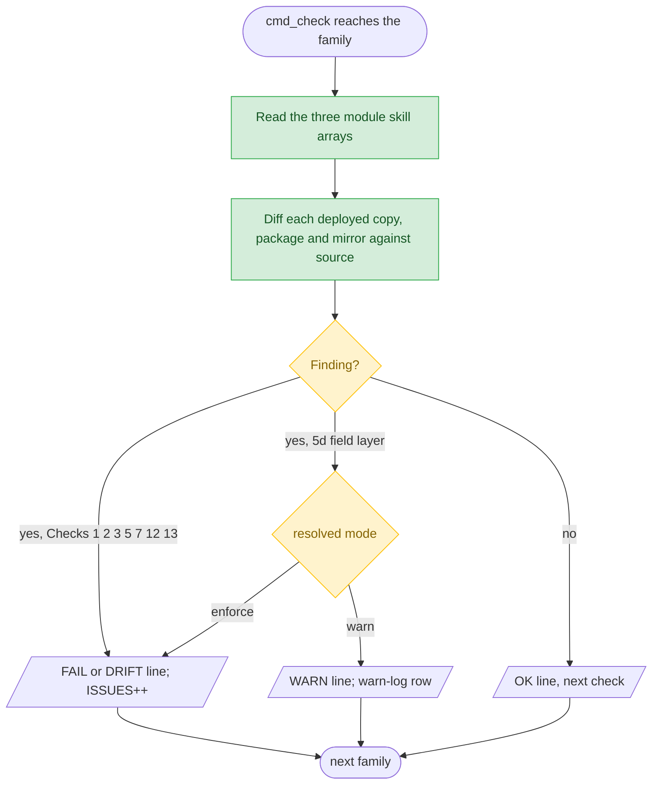

# Check deployed skill and package parity (Checks 1, 2, 3, 5, 7, 12, 13)

## Summary

The first family `cmd_check` runs asks one question seven ways: does the deployed tree still equal its source? The
script walks the three module skill arrays (the roster of record, which the count convention forbids restating as a
number), diffs each deployed SKILL.md and compiled package against source, rejects case-insensitive duplicate skill
names, checks the registry rows and the content hash behind every package, and repeats the diff for the user-scope
mirror and every injected reference file. Every check here but 5(d)'s field layer is always-enforce: a finding
increments `ISSUES` and fails `--check` whatever the mode file says. Check 7 has a pull-request mirror that calls the
same verdict function before merge, and two sub-checks of Check 5 have mirrors of their own. Its [ICOM](/core/process-catalog/definitions/pack.json) table (inputs,
controls, outputs, mechanisms) follows.

## ICOM

| Inputs | Controls | Outputs | Mechanisms |
|---|---|---|---|
| The module skill arrays in `deploy.sh`; the deployed skill tree at the install path; the packages root and each package's content manifest; the user-scope skills mirror; the registry rows; the template-sync map of injected references | The always-enforce rule (`ISSUES++`, no mode gate) for Checks 1, 2, 3, 5, 7, 12, 13; the roster count convention; the package-freshness content-hash contract | Per-check `OK` / `DRIFT` / `DUPLICATE` / `FAIL` / `WARN` / `NOT-EVAL` lines on the console; the `ISSUES` tally the summary gate reads; one warn-log row per 5(d) field finding | Inline bash in `cmd_check` (diff, awk), 5(d) included — the registry-currency script is its pull-request mirror twin, which this block does not call; for Check 7, deploy.sh's own `build_skill_to_dir` stages the rebuild — the in-process twin of the package builder |

## Flow

## Steps

| Step | Action | Actor | Inputs → outputs (shape) | Controls | Mechanism | Harness | Model need | Source |
|---|---|---|---|---|---|---|---|---|
| verify-skill-sync | Check 1 — Skill sync | script:deploy.sh | each rostered SKILL.md and its deployed copy → verdict lines DRIFT/OK; ISSUES++ at 7 site(s) | C-119: code-enforce | inline bash in `cmd_check` | file-and-shell-tools | XS/none/read/scriptable/batch | [deploy.sh](/core/deploy/deploy.sh#L8106)<!-- source-anchor: line=8106; fp=e8bf569b78b70bcf --> |
| verify-package-sync | Check 2 — Package sync | script:deploy.sh | each rostered skill's compiled package under the packages root → verdict lines DRIFT/OK; ISSUES++ at 2 site(s) | C-120: code-enforce | inline bash in `cmd_check` | file-and-shell-tools | XS/none/read/scriptable/batch | [deploy.sh](/core/deploy/deploy.sh#L8220)<!-- source-anchor: line=8220; fp=ea0f9949de20986a --> |
| detect-duplicate-skills | Check 3 — Duplicate detection | script:deploy.sh | the deployed skill names, compared case-insensitively → verdict lines DUPLICATE/OK; ISSUES++ at 4 site(s) | C-121: code-enforce | inline bash in `cmd_check` | file-and-shell-tools | XS/none/read/scriptable/batch | [deploy.sh](/core/deploy/deploy.sh#L8240)<!-- source-anchor: line=8240; fp=7c9e43a338863e1d --> |
| verify-skill-roster | Check 5 — Skill-roster drift (with sub-check 5(d) registry currency) | script:deploy.sh | the deploy.sh module arrays, the skill directories and the registry rows → verdict lines FAIL/WARN/OK; ISSUES++ at 8 site(s); the 5(d) field layer routes through `registry-field-currency` | C-123: code-enforce; C-124: code-enforce (row layer) / code-warn (field layer) | inline bash in `cmd_check`, 5(d) included ([deploy.sh](/core/deploy/deploy.sh#L8405)<!-- source-anchor: line=8405; fp=92dc69d0a60700bc -->); [check-registry-currency.sh](/core/deploy/tools/check-registry-currency.sh) is the pull-request mirror twin of the 5(d) row layer, and nothing in this block calls it | file-and-shell-tools | XS/none/read/scriptable/batch | [deploy.sh](/core/deploy/deploy.sh#L8311)<!-- source-anchor: line=8311; fp=50efde7ceb7278fc --> |
| verify-package-freshness | Check 7 — Package freshness (content-manifest hash) | script:deploy.sh | each rostered package's content hash against a staged rebuild of its source → verdict lines OK/FAIL/NOT-EVAL; ISSUES++ at 2 site(s); a rebuild that did not conclude is reported not evaluated and increments nothing | C-126: code-enforce | inline bash in `cmd_check`: `_c7_compute_verdict` stages the rebuild with deploy.sh's own `build_skill_to_dir` ([deploy.sh](/core/deploy/deploy.sh#L4366)<!-- source-anchor: line=4366; fp=145d38f7840eb6a5 -->, [deploy.sh](/core/deploy/deploy.sh#L4847)<!-- source-anchor: line=4847; fp=ce74396e6f61d23c -->), the in-process twin of [build-skill-packages.sh](/core/deploy/tools/build-skill-packages.sh); deploy.sh's own comment says their agreement is "enforced by nothing" ([deploy.sh](/core/deploy/deploy.sh#L656)<!-- source-anchor: line=656; fp=251a73ed0b8b5ea9 -->) | file-and-shell-tools | XS/none/read/scriptable/batch | [deploy.sh](/core/deploy/deploy.sh#L8804)<!-- source-anchor: line=8804; fp=6a86c196ffc966b1 --> |
| verify-user-local-mirror | Check 12 — User-local skills mirror sync | script:deploy.sh | the user-scope skills mirror against the deployed set → verdict lines FAIL/DRIFT/OK; ISSUES++ at 3 site(s) | C-131: code-enforce | inline bash in `cmd_check` | file-and-shell-tools | XS/none/read/scriptable/batch | [deploy.sh](/core/deploy/deploy.sh#L9641)<!-- source-anchor: line=9641; fp=41ce3420ccceb251 --> |
| detect-template-injection-drift | Check 13 — Template-injection drift | script:deploy.sh | each registered injected reference against its canonical source → verdict lines FAIL/DRIFT/OK; ISSUES++ at 5 site(s) | C-132: code-enforce | inline bash in `cmd_check` | file-and-shell-tools | XS/none/read/scriptable/batch | [deploy.sh](/core/deploy/deploy.sh#L9683)<!-- source-anchor: line=9683; fp=b516aeeafe93b059 --> |

## Step profile

| Field | Value |
|---|---|
| Deterministic steps | 7 of 7 (determinism `scriptable`, counted from the Steps table) |
| Judgment steps | 0 |
| Harness features relied on | file-and-shell-tools |
| Context read | XS (under 2k tokens): a script reads the trees; the operator reads only the verdict lines |

## Evidence

| Lens | Source | Observation | Label |
|---|---|---|---|
| designed | [`core/deploy/deploy.sh`](/core/deploy/deploy.sh), the seven check blocks in `cmd_check`; [`core/rules/skill-deployment.md`](/core/rules/skill-deployment.md) § Tracked Skills (the count convention), § Deployment Steps; [`core/standards/gate-efficacy-standard.md`](/core/standards/gate-efficacy-standard.md) § Gate-coverage register | seven check blocks, each with its own `OK` emitter; the roster is derived from the arrays and never hardcoded; the gate-coverage register names Check 7's content hash as the gate for package currency and gives its falsification | [SOURCE] |
| built | [the controls register](/core/process-catalog/definitions/controls-register.tsv), C-119 to C-121, C-123, C-124, C-126, C-131, C-132, C-251, C-253, C-254; [`skill-registry-currency-check.yml`](/.github/workflows/skill-registry-currency-check.yml), [`skill-count-imp-check.yml`](/.github/workflows/skill-count-imp-check.yml), [`skill-package-freshness.yml`](/.github/workflows/skill-package-freshness.yml) | every check increments `ISSUES` directly except 5(d)'s field layer; three pull-request workflows mirror parts of the family — 5(d)'s row layer through the registry-currency script (C-254; declared advisory, and a finding turns the job red), 5(c)'s count delta (C-251; declared required, with its warn switch off) and Check 7 through `--check-package-freshness` (C-253; declared required) | [SOURCE] |
| executed | no measure — what would show a deploy-time run of this family is the console output and exit code of that run, and for the registry field layer the deploy-check warn log. | No measure in the measures register reads either; an always-enforce verdict leaves a console line and an exit code and writes no log row | [SOURCE] |
| executed | measure `workflow-runs-deploy-probes` — [workflow-run-history.py](/core/deploy/tools/process-catalog-measures/workflow-run-history.py) (population: every run of each named workflow created in the trailing window, read in slices and verified against the host's total for each slice) · [`skill-package-freshness.yml`](/.github/workflows/skill-package-freshness.yml) | The measure reports, per named workflow, its run total and its runs by conclusion. The package-freshness workflow runs `--check-package-freshness`, which calls the verdict function Check 7 calls. The registry-currency and count workflows run sub-checks of Check 5 and not the whole check, and no workflow named on this page runs the remaining steps, so the page reads `unobserved`. covers: `verify-package-freshness` | [SOURCE] |

## Navigation

<!-- nav:begin -->
Up: [run-check-suite](run-check-suite.md) · Next: [check-skill-corpus-integrity](check-skill-corpus-integrity.md)
<!-- nav:end -->

## Sources

- [`core/deploy/deploy.sh`](/core/deploy/deploy.sh) — the seven check blocks and their emitters inside `cmd_check`
- [`core/deploy/tools/check-registry-currency.sh`](/core/deploy/tools/check-registry-currency.sh) — the pull-request mirror twin of 5(d)'s row layer (its header says so); the deploy-time check does not call it
- [`core/deploy/tools/build-skill-packages.sh`](/core/deploy/tools/build-skill-packages.sh) — the builder of the committed packages; Check 7's staged rebuild uses its in-process twin, deploy.sh's `build_skill_to_dir`
- [`core/rules/skill-deployment.md`](/core/rules/skill-deployment.md) — the roster-derivation and count conventions
- [`core/standards/gate-efficacy-standard.md`](/core/standards/gate-efficacy-standard.md) — the gate-coverage register's rows for Check 7 and its pull-request mirror
- [`core/process-catalog/definitions/controls-register.tsv`](/core/process-catalog/definitions/controls-register.tsv) — C-119 to C-121, C-123, C-124, C-126, C-131, C-132, C-251, C-253, C-254
- [`.github/workflows/skill-package-freshness.yml`](/.github/workflows/skill-package-freshness.yml), [`.github/workflows/skill-registry-currency-check.yml`](/.github/workflows/skill-registry-currency-check.yml), [`.github/workflows/skill-count-imp-check.yml`](/.github/workflows/skill-count-imp-check.yml) — the three pull-request mirrors
- `SKILL.md` on this page is each rostered skill's own definition file, so it is not linked as one tracked file
