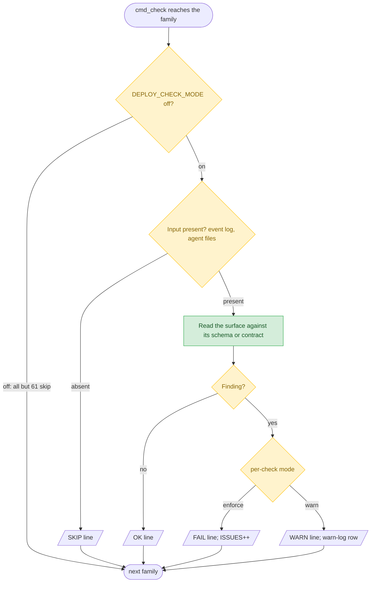

# Check hub, spoke and event-log surfaces (Checks 19, 27, 29, 46, 61, 68)

## Summary

Six checks look at the machinery the release pipeline runs on rather than at the pipeline's records. Three read the
hub-spawned agent definitions: the designated model, the return-value contract and the tools-list recursion
ratchet. Two read the pipeline event log — its schema invariants and, for every verified post-cutover release, the
presence of each asserted decision class. One reads the hub-state enums restated in templates and the playbook
against the standard that owns them. All six are warn-mode; Check 61 is additionally exposed as a single-check
probe whose live arm can only ever skip in CI, because the event log is operator-instance state. Its
[ICOM](/core/process-catalog/definitions/pack.json) table (inputs, controls, outputs, mechanisms)
follows.

## ICOM

| Inputs | Controls | Outputs | Mechanisms |
|---|---|---|---|
| The operator-instance pipeline event log; the hub-spawned agent files under the release module's agents directory; the spoke-runtime config and overrides allowlist; the asserted decision-class set; the hub-state owning standard and its restatements | The shared `deploy-check.mode`; per-check modes for 61 and 68; the event-log schema's locked write path; the flip-decision table's SPLIT DISPOSITION row for Check 61 | `OK` / `FAIL` / `WARN` / `SKIP` / `N/A` / `CTRL` / `DENOM` lines; `ISSUES` increments for 61 and 68; warn-log rows under six keys | Inline bash over the agent files and the event log; the enum-parity script; `_de_compute_verdict` for Check 61 |

## Flow

## Steps

| Step | Action | Actor | Inputs → outputs (shape) | Controls | Mechanism | Harness | Model need | Source |
|---|---|---|---|---|---|---|---|---|
| verify-event-log-integrity | Check 19 — Pipeline-event-log integrity | script:deploy.sh | the pipeline event log against its schema invariants → verdict lines SKIP/OK; warn keys `pipeline-event-log-integrity` | C-139: code-warn | inline bash in `cmd_check` | file-and-shell-tools | XS/none/read/scriptable/batch | [deploy.sh](/core/deploy/deploy.sh#L10413)<!-- source-anchor: line=10413; fp=7e0d50b3b36d92e0 --> |
| verify-designated-model-config | Check 27 — Designated-model config for spoke agents | script:deploy.sh | each hub-spawned agent file's model against the spoke-runtime config → verdict lines OK; warn keys `designated-model-config` | C-147: code-warn | inline bash in `cmd_check` | file-and-shell-tools | XS/none/read/scriptable/batch | [deploy.sh](/core/deploy/deploy.sh#L12396)<!-- source-anchor: line=12396; fp=0720998995243ad1 --> |
| verify-return-value-conformance | Check 29 — Return-value conformance for spoke agents | script:deploy.sh | each hub-spawned agent definition against the return-value contract → verdict lines OK; warn keys `return-value-conformance` | C-149: code-warn | inline bash in `cmd_check` | file-and-shell-tools | XS/none/read/scriptable/batch | [deploy.sh](/core/deploy/deploy.sh#L12629)<!-- source-anchor: line=12629; fp=0dcb4597c270a0b4 --> |
| verify-agent-tools-list | Check 46 — Agent tools-list conformance | script:deploy.sh | each hub-spawned agent file against the tools-list recursion ratchet → verdict lines OK; warn keys `agent-tools-list-conformance` | C-168: code-warn | inline bash in `cmd_check` | file-and-shell-tools | XS/none/read/scriptable/batch | [deploy.sh](/core/deploy/deploy.sh#L14755)<!-- source-anchor: line=14755; fp=6db7df96d3757bc3 --> |
| verify-decision-emission | Check 61 — Decision-emission minimum set | script:deploy.sh | every VERIFIED post-cutover release's event rows against the asserted MUST classes → verdict lines N/A/OK/FAIL/WARN; ISSUES++ at 1 site(s); warn keys `decision-emission`; mode resolved per check (`decision-emission`) | C-181: code-warn | `_de_compute_verdict`, inline in `cmd_check` | file-and-shell-tools | XS/none/read/scriptable/batch | [deploy.sh](/core/deploy/deploy.sh#L16191)<!-- source-anchor: line=16191; fp=cf06df1269e25bcb --> |
| verify-hub-state-enum-parity | Check 68 — Hub-state enum parity | script:deploy.sh | derived template and playbook restatements of the hub-state enums against the owning standard → verdict lines CTRL/FAIL/DENOM/OK; ISSUES++ at 2 site(s); warn keys `enum-parity`; mode resolved per check (`enum-parity`) | C-188: code-warn | [check-enum-parity.sh](/core/deploy/tools/check-enum-parity.sh) | file-and-shell-tools | XS/none/read/scriptable/batch | [deploy.sh](/core/deploy/deploy.sh#L17011)<!-- source-anchor: line=17011; fp=5373c252765ff484 --> |

## Step profile

| Field | Value |
|---|---|
| Deterministic steps | 6 of 6 (determinism `scriptable`, counted from the Steps table) |
| Judgment steps | 0 |
| Harness features relied on | file-and-shell-tools |
| Context read | XS (under 2k tokens) |

## Evidence

| Lens | Source | Observation | Label |
|---|---|---|---|
| designed | [`core/deploy/deploy.sh`](/core/deploy/deploy.sh), the six check blocks in `cmd_check`; [`core/standards/gate-efficacy-standard.md`](/core/standards/gate-efficacy-standard.md) § Flip-decision status (the Check 61 row); [`release/references/pipeline/stage-13-close.md`](/release/references/pipeline/stage-13-close.md) § Phase A8.2 | Check 61's machinery arm is CI-gated by the self-test and its live arm is a permanent advisory residual because its input is git-ignored; Stage 13 runs the live arm through the probe and records the verdict in the close-out report | [SOURCE] |
| built | [the controls register](/core/process-catalog/definitions/controls-register.tsv), C-139, C-147, C-149, C-168, C-181, C-188, C-207, C-208; [`decision-emission.yml`](/.github/workflows/decision-emission.yml) | the decision-emission workflow carries two jobs, both declared advisory — the gate-integrity job, which runs the script's self-test (C-207), and the report-only live-arm job (C-208), whose header says its verdict input is absent from every checkout; a comment in the script's dispatch says the check must not join the `--check-required-subset` roster | [SOURCE] |
| executed | no measure — what would show which members fire is the deploy-check warn log, where each warning arm appends its row. | No measure in the measures register reads the warn log | [SOURCE] |
| executed | measure `workflow-runs-deploy-probes` — [workflow-run-history.py](/core/deploy/tools/process-catalog-measures/workflow-run-history.py) (population: every run of each named workflow created in the trailing window, read in slices and verified against the host's total for each slice) · [`decision-emission.yml`](/.github/workflows/decision-emission.yml) | The measure reports, per named workflow, its run total and its runs by conclusion. A run of the decision-emission workflow shows that the script's self-test ran; its live-arm job reads an event log that a checkout does not hold, so a run carries nothing of a live verdict. Neither job runs a step of this page, so the row carries no coverage clause and the page reads `unobserved` | [SOURCE] |

## Navigation

<!-- nav:begin -->
Up: [run-check-suite](run-check-suite.md) · Previous: [check-release-corpus-integrity](check-release-corpus-integrity.md) · Next: [check-control-layer-registries](check-control-layer-registries.md)
<!-- nav:end -->

## Sources

- [`core/deploy/deploy.sh`](/core/deploy/deploy.sh) — the six check blocks and `_de_compute_verdict`
- [`core/deploy/tools/check-enum-parity.sh`](/core/deploy/tools/check-enum-parity.sh) — the Check 68 primitive
- [`release/references/standards/pipeline-event-log-schema.md`](/release/references/standards/pipeline-event-log-schema.md) — the invariants Check 19 asserts and the join key Check 61 resolves through
- [`core/standards/gate-efficacy-standard.md`](/core/standards/gate-efficacy-standard.md) — the Check 61 split disposition
- [`release/references/pipeline/stage-13-close.md`](/release/references/pipeline/stage-13-close.md) — the phase that runs the live arm through the probe
- [`core/process-catalog/definitions/controls-register.tsv`](/core/process-catalog/definitions/controls-register.tsv) — C-139, C-147, C-149, C-168, C-181, C-188, C-207, C-208
- [`.github/workflows/decision-emission.yml`](/.github/workflows/decision-emission.yml) — the workflow whose run history the executed row reads
