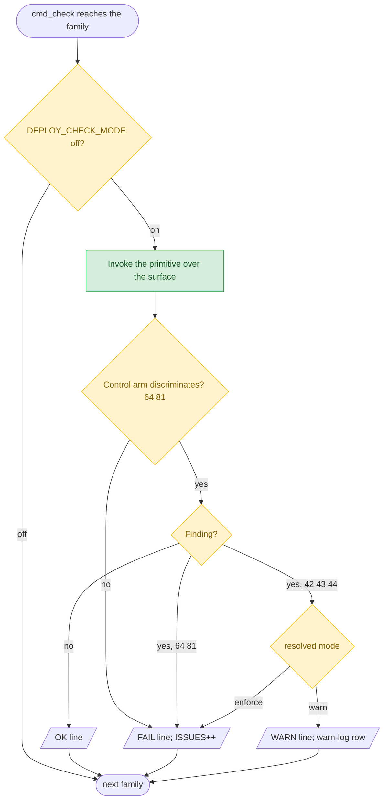

# Check public-surface portability and tool hygiene (Checks 42, 43, 44, 64, 81)

## Summary

The repository is public, so five checks guard what the tree may not carry: a host-specific mechanism prescribed in
the K1 corpus, an operator-local install path hardcoded in an executable, an unregistered depersonalization token,
a theme variable consumed but undeclared, and a tool with an interpreter line that is not tracked executable. The
three leak detectors are warn-mode scans through shared primitives — the path-leak patterns are sourced by two hooks as
well — while the theme-token and exec-mode checks always fail the run and each carries a control arm and a population
record. Its [ICOM](/core/process-catalog/definitions/pack.json) table (inputs, controls, outputs,
mechanisms) follows.

## ICOM

| Inputs | Controls | Outputs | Mechanisms |
|---|---|---|---|
| The K1-tier corpus; every executable surface; all tracked files and the registered token vocabulary; the theme blocks and their consumers with a fixture harness; the two tool trees and the exec-mode exemption list | The shared `deploy-check.mode` for Checks 42, 43, 44; always-enforce for 64 and 81; the depersonalization spec's token families | `OK` / `FAIL` / `CTRL` / `DENOM` lines; `ISSUES` increments for 64 and 81; warn-log rows under three keys | The host-binding, path-leak and tool-exec-mode primitives; the theme-token fixture hook; inline bash for Check 44 |

## Flow

## Steps

| Step | Action | Actor | Inputs → outputs (shape) | Controls | Mechanism | Harness | Model need | Source |
|---|---|---|---|---|---|---|---|---|
| detect-host-binding-leak | Check 42 — Host-binding leak detector | script:deploy.sh | the K1-tier corpus, for host-specific mechanism prescriptions → verdict lines OK; warn keys `host-binding-leak` | C-164: code-warn | [check-host-binding.py](/core/deploy/tools/check-host-binding.py) | file-and-shell-tools | XS/none/read/scriptable/batch | [deploy.sh](/core/deploy/deploy.sh#L14447)<!-- source-anchor: line=14447; fp=a57f6bbfab0748b8 --> |
| detect-path-portability-leak | Check 43 — Path-portability leak detector | script:deploy.sh | executable surfaces, for hardcoded operator-local install paths → verdict lines OK; warn keys `path-portability` | C-165: code-warn | [path-leak-patterns.sh](/core/deploy/tools/path-leak-patterns.sh), sourced not executed | file-and-shell-tools | XS/none/read/scriptable/batch | [deploy.sh](/core/deploy/deploy.sh#L14492)<!-- source-anchor: line=14492; fp=d14b6e6aa301dd42 --> |
| verify-depersonalization-tokens | Check 44 — Depersonalization-token conformance | script:deploy.sh | all tracked files, for the registered depersonalization tokens → verdict lines OK; warn keys `depersonalization-token` | C-166: code-warn | inline bash in `cmd_check` | file-and-shell-tools | XS/none/read/scriptable/batch | [deploy.sh](/core/deploy/deploy.sh#L14544)<!-- source-anchor: line=14544; fp=f04b7980e9787b7e --> |
| lint-theme-token-consumers | Check 64 — Theme-token undeclared-consumer lint | script:deploy.sh | every theme-variable consumer against the theme blocks, with a fixture harness → verdict lines FAIL/CTRL/OK/DENOM; ISSUES++ at 4 site(s) | C-184: code-enforce | [run-theme-token-fixtures.sh](/core/hooks/run-theme-token-fixtures.sh) | file-and-shell-tools | XS/none/read/scriptable/batch | [deploy.sh](/core/deploy/deploy.sh#L16635)<!-- source-anchor: line=16635; fp=d5c08657057a7f0f --> |
| verify-tool-exec-mode | Check 81 — Tool exec-mode conformance | script:deploy.sh | every interpreter-line file under the two tool trees, against the exemption list → verdict lines FAIL/CTRL/DENOM/OK; ISSUES++ at 8 site(s) | C-201: code-enforce | [check-tool-exec-mode.py](/core/deploy/tools/check-tool-exec-mode.py) | file-and-shell-tools | XS/none/read/scriptable/batch | [deploy.sh](/core/deploy/deploy.sh#L18309)<!-- source-anchor: line=18309; fp=3a73b5a396c2ea24 --> |

## Step profile

| Field | Value |
|---|---|
| Deterministic steps | 5 of 5 (determinism `scriptable`, counted from the Steps table) |
| Judgment steps | 0 |
| Harness features relied on | file-and-shell-tools |
| Context read | XS (under 2k tokens) |

## Evidence

| Lens | Source | Observation | Label |
|---|---|---|---|
| designed | [`core/deploy/deploy.sh`](/core/deploy/deploy.sh), the five check blocks in `cmd_check`; [`core/deploy/tools/README.md`](/core/deploy/tools/README.md) (the consumer table for `path-leak-patterns.sh` and `check-tool-exec-mode.py`) | the path-leak primitive has four behavioral consumers, among them this check (which sources it) and two hooks, so one predicate serves the tracked-file and the host-operation surfaces; Check 81's population is discovered from the index on every run, and every row of its exemption list is asserted to still describe the tree | [SOURCE] |
| built | [the controls register](/core/process-catalog/definitions/controls-register.tsv), C-164, C-165, C-166, C-184, C-201; [`repo-integrity.yml`](/.github/workflows/repo-integrity.yml) | Check 81 has a pull-request job in the repo-integrity workflow that invokes the same script, its self-test first; the register classes the three leak detectors `code-warn` on the deploy run | [SOURCE] |
| executed | no measure — what would show which leak detectors fire is the deploy-check warn log; Checks 64 and 81 write no log row, so what would show them at deploy time is that run's console output and exit code. | No measure in the measures register reads either | [SOURCE] |
| executed | measure `workflow-runs-deploy-probes` — [workflow-run-history.py](/core/deploy/tools/process-catalog-measures/workflow-run-history.py) (population: every run of each named workflow created in the trailing window, read in slices and verified against the host's total for each slice) · [`repo-integrity.yml`](/.github/workflows/repo-integrity.yml) | The measure reports, per named workflow, its run total and its runs by conclusion. The repo-integrity workflow's exec-mode job runs the Check 81 script with its self-test; the measure counts runs of the workflow, not of one job in it. No workflow named on this page runs the other steps, so the page reads `unobserved`. covers: `verify-tool-exec-mode` | [SOURCE] |

## Navigation

<!-- nav:begin -->
Up: [run-check-suite](run-check-suite.md) · Previous: [check-corpus-conventions](check-corpus-conventions.md) · Next: [check-backlog-hygiene](check-backlog-hygiene.md)
<!-- nav:end -->

## Sources

- [`core/deploy/deploy.sh`](/core/deploy/deploy.sh) — the five check blocks and their emitters inside `cmd_check`
- [`check-host-binding.py`](/core/deploy/tools/check-host-binding.py), [`path-leak-patterns.sh`](/core/deploy/tools/path-leak-patterns.sh), [`check-tool-exec-mode.py`](/core/deploy/tools/check-tool-exec-mode.py); [`run-theme-token-fixtures.sh`](/core/hooks/run-theme-token-fixtures.sh) — the primitives
- [`core/deploy/tools/README.md`](/core/deploy/tools/README.md) — the consumer table naming every caller of the shared primitives
- [`core/process-catalog/definitions/controls-register.tsv`](/core/process-catalog/definitions/controls-register.tsv) — C-164, C-165, C-166, C-184, C-201
- [`.github/workflows/repo-integrity.yml`](/.github/workflows/repo-integrity.yml) — the workflow whose run history the executed row reads
