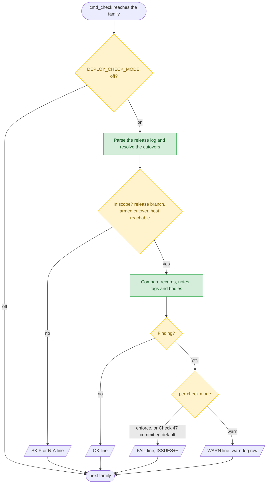

# Check release-corpus and release-identity integrity (Checks 20, 23, 26, 28, 32, 39, 41, 47, 48, 59, 65)

## Summary

Twelve checks read the release module's own records: the eleven the title lists, and Check 82. Seven assert the Stage 13 output set from the ledger outward —
note lint, log-to-index consistency, note presence, the documentation-impact surface on the pull-request template
and the work-item forms (with a deadline arm for three close gates), the corpus completeness that the gate-coverage
register calls the highest-frequency documented release failure, the scaffold-independent close-completeness
umbrella, and one close-out date across the digest, the changelog and the release note — and one bounds the hot
ledger's row count. Four concern release
identity and the published artifact: the repo-root version stamp against the latest published release, the
candidate version against the claimed set, the published body against the in-repo note (the one committed enforce
default in the family), and slug-primary identity before the Stage 12 claim. Three members have thin pull-request
callers that run the same verdict body through a single-check probe. Its
[ICOM](/core/process-catalog/definitions/pack.json) table (inputs, controls, outputs, mechanisms)
follows.

## ICOM

| Inputs | Controls | Outputs | Mechanisms |
|---|---|---|---|
| The release log, index, digest and notes under the releases root; the repo-root version stamp; the host's published releases and tags; the in-flight release plan and branch name; the pull-request template and the work-item forms; the close gates' arming constants and committed sentinels | The shared `deploy-check.mode` for most members; per-check modes for 41, 47, 48, 59, 82; Check 47's committed enforce default; the release-notes standard, the close-completeness cutovers and the defer-to-claim identity rule | `OK` / `FAIL` / `WARN` / `SKIP` / `N/A` / `CTRL` / `DENOM` lines; `ISSUES` increments; warn-log rows under twelve keys; the verdict bodies the single-check probes reuse | The note linter, index generator, body-drift script, identity-conformance primitive and corpus sweeper; the version-grammar library; `gh api` and `gh auth` reads; inline bash for 26, 28, 32, 41, 48 |

## Flow

## Steps

| Step | Action | Actor | Inputs → outputs (shape) | Controls | Mechanism | Harness | Model need | Source |
|---|---|---|---|---|---|---|---|---|
| lint-release-notes | Check 20 — Note-content lint | script:deploy.sh | every release note against the release-notes standard → verdict lines OK; warn keys `note-content-lint` | C-140: code-warn | [lint_release_corpus.py](/core/deploy/tools/lint_release_corpus.py) | file-and-shell-tools | XS/none/read/scriptable/batch | [deploy.sh](/core/deploy/deploy.sh#L10374)<!-- source-anchor: line=10374; fp=0879173de96edd59 --> |
| verify-log-index-consistency | Check 23 — RELEASE_LOG to RELEASE_INDEX consistency | script:deploy.sh | each release-log row against the regenerated index → verdict lines OK; warn keys `release-log-index-consistency` | C-143: code-warn | [generate_release_index.py](/core/deploy/tools/generate_release_index.py) | file-and-shell-tools | XS/none/read/scriptable/batch | [deploy.sh](/core/deploy/deploy.sh#L11795)<!-- source-anchor: line=11795; fp=28b73f7f78e29545 --> |
| verify-release-note-presence | Check 26 — Release-note presence | script:deploy.sh | each release's notes file → verdict lines DENOM/OK; warn keys `release-note-presence` | C-146: code-warn | inline bash in `cmd_check` | file-and-shell-tools | XS/none/read/scriptable/batch | [deploy.sh](/core/deploy/deploy.sh#L12155)<!-- source-anchor: line=12155; fp=6f432e12bcb33c59 --> |
| verify-doc-impact-resolution | Check 28 — Documentation close gates | script:deploy.sh | the pull-request template and every shipping work-item form, for the Documentation Impact surface (template arm); the three close gates' arming constants, their committed sentinels and today's date (deadline arm) → verdict lines OK/N/A/WARN/FAIL; ISSUES++ at 2 site(s); warn keys `doc-impact-resolution`; the release-context arms report N/A in this run and run at Stage 13 through `--check-doc-gates` | C-148: code-warn | inline bash in `cmd_check`; [check-doc-gates.py](/core/deploy/tools/check-doc-gates.py) is the engine of the release-context arms, which this run does not call | file-and-shell-tools | XS/none/read/scriptable/batch | [deploy.sh](/core/deploy/deploy.sh#L12372)<!-- source-anchor: line=12372; fp=75c01b83e2b542da --> |
| verify-release-corpus-completeness | Check 32 — Release-corpus completeness | script:deploy.sh | every release-log row at or after the cutover: index row, digest entry, notes file, tag and host release → verdict lines OK; warn keys `release-corpus-completeness` | C-152: code-warn | `_c32_compute_verdict`, inline in `cmd_check` | file-and-shell-tools | XS/none/read/scriptable/batch | [deploy.sh](/core/deploy/deploy.sh#L12775)<!-- source-anchor: line=12775; fp=9674b2088b9a2504 --> |
| detect-version-stamp-skew | Check 39 — Platform version drift vs latest published release | script:deploy.sh | the repo-root version stamp against the host's latest release → verdict lines N/A/OK; warn keys `version-stamp-skew` | C-161: code-warn | [version-grammar.sh](/release/tools/version-grammar.sh); host read via `gh auth`, `gh api` | file-and-shell-tools, git-and-gh-cli | XS/none/read/scriptable/batch | [deploy.sh](/core/deploy/deploy.sh#L14011)<!-- source-anchor: line=14011; fp=1f4021360cd71cf0 --> |
| verify-version-freeness | Check 41 — Pre-merge version-freeness | script:deploy.sh | the candidate version against the claimed set (release branches only) → verdict lines SKIP/N/A/OK; warn keys `version-freeness`; mode resolved per check (`version-freeness`) | C-163: code-warn | `_vf_compute_verdict`, inline in `cmd_check` | file-and-shell-tools | XS/none/read/scriptable/batch | [deploy.sh](/core/deploy/deploy.sh#L14185)<!-- source-anchor: line=14185; fp=6301cd8ec856021f --> |
| detect-release-body-drift | Check 47 — Release-body drift | script:deploy.sh | each published release body against the frontmatter-stripped in-repo note → verdict lines N/A; DENOM and OK through `_c47_report`; FAIL and WARN through the dedicated `flag_release_body_drift` emitter, whose enforce arm holds the one `ISSUES` increment; mode resolved per check (`release-body-drift`) | C-153: code-enforce | [check-release-body-drift.sh](/release/tools/check-release-body-drift.sh); host read via `gh auth` | file-and-shell-tools, git-and-gh-cli | XS/none/read/scriptable/batch | [deploy.sh](/core/deploy/deploy.sh#L12870)<!-- source-anchor: line=12870; fp=2b9674cf010e435f --> |
| verify-close-completeness | Check 48 — Close-completeness | script:deploy.sh | every VERIFIED release-log row, for the full Stage-13 output set on main → verdict lines N/A/OK/FAIL/WARN; ISSUES++ at 1 site(s); mode resolved per check (`close-completeness`) | C-154: code-warn | `_cc_compute_verdict`, inline in `cmd_check` | file-and-shell-tools | XS/none/read/scriptable/batch | [deploy.sh](/core/deploy/deploy.sh#L13138)<!-- source-anchor: line=13138; fp=92c50464a257a671 --> |
| verify-slug-primary-identity | Check 59 — Slug-primary release-identity conformance | script:deploy.sh | the branch name and plan basename before the Stage-12 claim (release branches only) → verdict lines OK/FAIL; ISSUES++ at 1 site(s); warn keys `identity-conformance`; mode resolved per check (`identity-conformance`) | C-179: code-warn | [check-identity-conformance.py](/core/deploy/tools/check-identity-conformance.py) | file-and-shell-tools | XS/none/read/scriptable/batch | [deploy.sh](/core/deploy/deploy.sh#L15951)<!-- source-anchor: line=15951; fp=4a4247dcc3f5c232 --> |
| verify-release-log-budget | Check 65 — RELEASE_LOG hot working-set budget | script:deploy.sh | the hot release log's row count against its budget → verdict lines DENOM/OK; warn keys `release-log-budget` | C-185: code-warn | [sweep-release-corpus.py](/release/tools/sweep-release-corpus.py) | file-and-shell-tools | XS/none/read/scriptable/batch | [deploy.sh](/core/deploy/deploy.sh#L16477)<!-- source-anchor: line=16477; fp=6e16f2b3f1da77e8 --> |
| verify-closeout-anchor-consistency | Check 82 — Close-out anchor consistency | script:deploy.sh | every VERIFIED release-log row at or after the anchor declaration: the digest heading's date, the changelog heading's date and the release note's frontmatter date → verdict lines CTRL/DENOM/OK/WARN/FAIL; ISSUES++ at 3 site(s) in the block; warn key `closeout-anchor-consistency`; mode resolved per check (`closeout-anchor-consistency`); a deadline arm reads the committed arming constant against today's date | code-warn | [generate_release_index.py](/core/deploy/tools/generate_release_index.py) `--verify-closeout-anchors`, after its `--self-test` as the control arm; `_c82_report` and `_c82_deadline` | file-and-shell-tools | XS/none/read/scriptable/batch | [deploy.sh](/core/deploy/deploy.sh#L18159)<!-- source-anchor: line=18159; fp=bdd69678eeea2ad8 --> |

## Step profile

| Field | Value |
|---|---|
| Deterministic steps | 12 of 12 (determinism `scriptable`, counted from the Steps table) |
| Judgment steps | 0 |
| Harness features relied on | file-and-shell-tools, git-and-gh-cli |
| Context read | XS (under 2k tokens) |

## Evidence

| Lens | Source | Observation | Label |
|---|---|---|---|
| designed | [`core/deploy/deploy.sh`](/core/deploy/deploy.sh), the twelve check blocks in `cmd_check`; [`release/references/pipeline/stage-13-close.md`](/release/references/pipeline/stage-13-close.md) § Phase A8 (Checks 32 and 48 as close evidence); [`core/standards/gate-efficacy-standard.md`](/core/standards/gate-efficacy-standard.md) § Flip-decision status (the `version-freeness`, close-gate and Check 82 rows) | Checks 32 and 48 are the close-completeness gates Stage 13 cites, the second scaffold-independent; the version-freeness flip is declined permanently because the version binds only at the Stage 12 claim; Check 47 is one of the live instances of the one-token committed enforce default; the three close gates Check 28 runs and Check 82 are each deferred with a deadline that a committed arming constant carries | [SOURCE] |
| built | [the controls register](/core/process-catalog/definitions/controls-register.tsv), C-140, C-143, C-146, C-148, C-152, C-153, C-154, C-161, C-163, C-179, C-185, C-204, C-224, C-255; [`version-freeness.yml`](/.github/workflows/version-freeness.yml), [`close-completeness.yml`](/.github/workflows/close-completeness.yml), [`release-corpus-completeness.yml`](/.github/workflows/release-corpus-completeness.yml) | Checks 32, 41 and 48 expose their shared verdict bodies to three thin pull-request callers through single-check probes (C-224, C-255, C-204), each declared path-filtered — the version-freeness caller advisory, the other two required, warn-mode-initial; Check 47's committed enforce default is lowered only by a per-check mode file or by the shared mode reading `off` | [SOURCE] |
| executed | no measure — what would show which members fire at deploy time is the deploy-check warn log, where each warning arm appends its row. | No measure in the measures register reads the warn log | [SOURCE] |
| executed | measure `workflow-runs-deploy-probes` — [workflow-run-history.py](/core/deploy/tools/process-catalog-measures/workflow-run-history.py) (population: every run of each named workflow created in the trailing window, read in slices and verified against the host's total for each slice) · [`release-corpus-completeness.yml`](/.github/workflows/release-corpus-completeness.yml) · [`version-freeness.yml`](/.github/workflows/version-freeness.yml) · [`close-completeness.yml`](/.github/workflows/close-completeness.yml) | The measure reports, per named workflow, its run total and its runs by conclusion. Each caller runs one single-check probe, which calls the verdict function its check calls; each is path-filtered, so it runs only on a change that touches its paths. No workflow named on this page runs the other steps, so the page reads `unobserved`. covers: `verify-release-corpus-completeness`, `verify-version-freeness`, `verify-close-completeness` | [SOURCE] |

## Navigation

<!-- nav:begin -->
Up: [run-check-suite](run-check-suite.md) · Previous: [check-backlog-hygiene](check-backlog-hygiene.md) · Next: [check-orchestration-surfaces](check-orchestration-surfaces.md)
<!-- nav:end -->

## Sources

- [`core/deploy/deploy.sh`](/core/deploy/deploy.sh) — the twelve check blocks and the shared verdict bodies `_c32_compute_verdict`, `_vf_compute_verdict`, `_cc_compute_verdict`
- [`lint_release_corpus.py`](/core/deploy/tools/lint_release_corpus.py), [`generate_release_index.py`](/core/deploy/tools/generate_release_index.py), [`check-doc-gates.py`](/core/deploy/tools/check-doc-gates.py), [`check-identity-conformance.py`](/core/deploy/tools/check-identity-conformance.py); [`check-release-body-drift.sh`](/release/tools/check-release-body-drift.sh), [`sweep-release-corpus.py`](/release/tools/sweep-release-corpus.py), [`version-grammar.sh`](/release/tools/version-grammar.sh) — the primitives
- [`release/references/pipeline/stage-13-close.md`](/release/references/pipeline/stage-13-close.md) — Phase A8, where Checks 32 and 48 become close evidence
- [`core/standards/gate-efficacy-standard.md`](/core/standards/gate-efficacy-standard.md) — the version-freeness disposition, the close-gate and Check 82 dispositions and the gate-coverage rows for close completeness
- [`core/process-catalog/definitions/controls-register.tsv`](/core/process-catalog/definitions/controls-register.tsv) — C-140, C-143, C-146, C-148, C-152, C-153, C-154, C-161, C-163, C-179, C-185, C-204, C-224, C-255
- [`.github/workflows/version-freeness.yml`](/.github/workflows/version-freeness.yml), [`.github/workflows/close-completeness.yml`](/.github/workflows/close-completeness.yml), [`.github/workflows/release-corpus-completeness.yml`](/.github/workflows/release-corpus-completeness.yml) — the three callers whose run history the executed row reads
