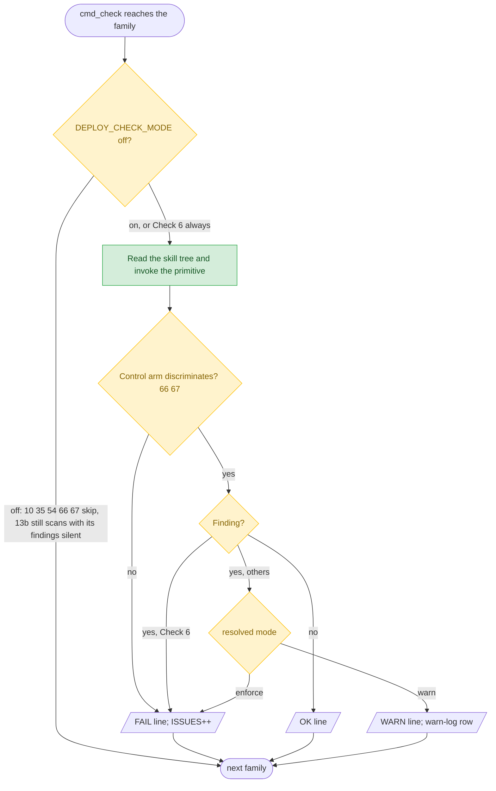

# Check skill-corpus integrity (Checks 6, 10, 13b, 35, 54, 66, 67)

## Summary

Where the previous family asks whether the deployed copy equals the source, this one asks whether the source is
well-formed. Check 6 enforces the canonical SKILL.md structure through its shared primitive; the other six are
warn-mode detectors over the skill tree: the editor audit trail on migrated skills, same-basename references split
between the corpus and a skill-local tree, mode enums a spoke can still recognize, output declarations with one
producer per entity, line-number citations that still resolve, and trigger phrases that collide. All six
warn-mode checks sit in the flip-decision table with their flips deferred: 10, 13b and 35 in the shared shakedown
cohort, and 54, 66 and 67 precondition-blocked. Check 6 has a pull-request mirror that runs the same script. Its
[ICOM](/core/process-catalog/definitions/pack.json) table (inputs, controls, outputs, mechanisms)
follows.

## ICOM

| Inputs | Controls | Outputs | Mechanisms |
|---|---|---|---|
| Every rostered SKILL.md and its `references/` tree; the complementary-pair registry allowlist; the skill registry's routing view; the editor audit-trail markers | Check 6 always-enforce; the shared `deploy-check.mode` for 10, 13b and 35 and the bare per-check resolution for 54, 66 and 67; the flip-decision table's deferrals | `OK` / `FAIL` / `WARN` / `SKIP` / `CTRL` / `DENOM` / `EXEMPT` lines; `ISSUES` increments for Check 6, for the control-arm failures of 66 and 67 under warn as under enforce, and for a finding of a warn-mode member once its mode resolves to `enforce` (in the blocks of 54, 66 and 67 themselves, through the shared emitter for 10, 13b and 35); warn-log rows under each warn-mode check's keys | The canonical-structure, ownership-collision and citation-anchor primitives; the skill-refiner's eval-audit script for trigger collision; inline bash for 10, 13b, 35 |

## Flow

## Steps

| Step | Action | Actor | Inputs → outputs (shape) | Controls | Mechanism | Harness | Model need | Source |
|---|---|---|---|---|---|---|---|---|
| verify-canonical-structure | Check 6 — Canonical-structure compliance | script:deploy.sh | each rostered SKILL.md's frontmatter, references threshold and failure-mode count → verdict lines OK/FAIL, the script's own lines passed through; ISSUES++ at 3 site(s) | C-125: code-enforce | [check-canonical-structure.sh](/core/deploy/tools/check-canonical-structure.sh) | file-and-shell-tools | XS/none/read/scriptable/batch | [deploy.sh](/core/deploy/deploy.sh#L8744)<!-- source-anchor: line=8744; fp=22009cb91c7543a6 --> |
| verify-editor-audit-trail | Check 10 — Editor audit-trail (migrated skills) | script:deploy.sh | each migrated skill's editor audit trail → verdict lines OK/SKIP; warn keys `editor-audit-trail` | C-129: code-warn | inline bash in `cmd_check` | file-and-shell-tools | XS/none/read/scriptable/batch | [deploy.sh](/core/deploy/deploy.sh#L9501)<!-- source-anchor: line=9501; fp=033a027b239f2f9e --> |
| detect-shared-reference-collision | Check 13b — Shared-reference collision (complementary pairs) | script:deploy.sh | same-basename reference files across the corpus and skill-local trees, with the complementary-pair registry → verdict lines OK; warn keys `shared-reference-collision`, `shared-reference-divergence`, `complementary-pair-registry-missing`, `complementary-pair-registry-malformed`, `complementary-pair-ownership-drift`, `complementary-pair-shared-section-divergence`, `unregistered-canonical-skill-local-pair`, `canonical-citation-unresolvable-in-package`, `complementary-pair-unknown-verdict` | C-133: code-warn | inline bash in `cmd_check` | file-and-shell-tools | XS/none/read/scriptable/batch | [deploy.sh](/core/deploy/deploy.sh#L9743)<!-- source-anchor: line=9743; fp=e29e59d6bab01346 --> |
| detect-mode-invocation-drift | Check 35 — Mode-invocation drift | script:deploy.sh | each multi-mode SKILL.md's mode enum against its triggers → verdict lines OK; warn keys `mode-invocation-drift` | C-157: code-warn | inline bash in `cmd_check` | file-and-shell-tools | XS/none/read/scriptable/batch | [deploy.sh](/core/deploy/deploy.sh#L13443)<!-- source-anchor: line=13443; fp=583e3bdd9b0d0457 --> |
| reconcile-ownership-collisions | Check 54 — Ownership-collision reconciliation | script:deploy.sh | skill output declarations, one producer per entity rendering → verdict lines OK/FAIL; ISSUES++ at 1 site(s); warn keys `ownership-collision`; mode resolved per check (`ownership-collision`) | C-176: code-warn | [check-ownership-collision.py](/core/deploy/tools/check-ownership-collision.py) | file-and-shell-tools | XS/none/read/scriptable/batch | [deploy.sh](/core/deploy/deploy.sh#L15225)<!-- source-anchor: line=15225; fp=dac80415787e6964 --> |
| verify-citation-anchors | Check 66 — Cross-skill citation-anchor drift | script:deploy.sh | line-number citation locators in the skill self-description tree → verdict lines CTRL/FAIL/DENOM/OK; ISSUES++ at 2 site(s); warn keys `citation-anchor`; mode resolved per check (`citation-anchor`) | C-186: code-warn | [check-citation-anchors.sh](/core/deploy/tools/check-citation-anchors.sh) | file-and-shell-tools | XS/none/read/scriptable/batch | [deploy.sh](/core/deploy/deploy.sh#L16520)<!-- source-anchor: line=16520; fp=d9d3d4af2af8ffc3 --> |
| detect-trigger-collision | Check 67 — Composition-aware trigger collision | script:deploy.sh | every pair of skill trigger phrases, registry-linked pairs exempt → verdict lines CTRL/FAIL/DENOM/EXEMPT/OK; ISSUES++ at 2 site(s); warn keys `trigger-collision`; mode resolved per check (`trigger-collision`) | C-187: code-warn | [run_eval_audit.py](/release/skills/pmo-skill-refiner/scripts/run_eval_audit.py) | file-and-shell-tools | XS/none/read/scriptable/batch | [deploy.sh](/core/deploy/deploy.sh#L16657)<!-- source-anchor: line=16657; fp=86678a5e396cd5a9 --> |

## Step profile

| Field | Value |
|---|---|
| Deterministic steps | 7 of 7 (determinism `scriptable`, counted from the Steps table) |
| Judgment steps | 0 |
| Harness features relied on | file-and-shell-tools |
| Context read | XS (under 2k tokens): the primitives read the tree; the operator reads the verdict lines |

## Evidence

| Lens | Source | Observation | Label |
|---|---|---|---|
| designed | [`core/deploy/deploy.sh`](/core/deploy/deploy.sh), the seven check blocks in `cmd_check`; [`core/standards/gate-efficacy-standard.md`](/core/standards/gate-efficacy-standard.md) § Flip-decision status | seven check blocks; 10, 13b and 35 belong to the shared warn-mode cohort, where the drain is what blocks the flip; 54, 66, 67 are deferred precondition-blocked with their evidence already met and repo-derivable | [SOURCE] |
| built | the primitives named in the Mechanism column; [the controls register](/core/process-catalog/definitions/controls-register.tsv), C-125, C-129, C-133, C-157, C-176, C-186, C-187, C-250; [`skill-canonical-structure-check.yml`](/.github/workflows/skill-canonical-structure-check.yml) | Check 6 is the one always-enforce member and has a pull-request mirror (C-250; declared advisory, warn-mode-initial) that runs the same script after that script's self-test; 66 and 67 fail the run on a control arm that stops discriminating, even in warn mode, and 54 has no control arm: its one increment is its finding arm under `enforce` | [SOURCE] |
| executed | no measure — what would show which of the warn-mode members fire is the deploy-check warn log; Check 6 writes no log row, so what would show it at deploy time is that run's console output and exit code. | No measure in the measures register reads either | [SOURCE] |
| executed | measure `workflow-runs-deploy-probes` — [workflow-run-history.py](/core/deploy/tools/process-catalog-measures/workflow-run-history.py) (population: every run of each named workflow created in the trailing window, read in slices and verified against the host's total for each slice) · [`skill-canonical-structure-check.yml`](/.github/workflows/skill-canonical-structure-check.yml) | The measure reports, per named workflow, its run total and its runs by conclusion. The canonical-structure workflow runs the Check 6 script with its self-test. No workflow named on this page runs the other steps, so the page reads `unobserved`. covers: `verify-canonical-structure` | [SOURCE] |

## Navigation

<!-- nav:begin -->
Up: [run-check-suite](run-check-suite.md) · Previous: [check-deployed-skill-parity](check-deployed-skill-parity.md) · Next: [check-workspace-config-surfaces](check-workspace-config-surfaces.md)
<!-- nav:end -->

## Sources

- [`core/deploy/deploy.sh`](/core/deploy/deploy.sh) — the seven check blocks and their emitters inside `cmd_check`
- [`check-canonical-structure.sh`](/core/deploy/tools/check-canonical-structure.sh), [`check-ownership-collision.py`](/core/deploy/tools/check-ownership-collision.py), [`check-citation-anchors.sh`](/core/deploy/tools/check-citation-anchors.sh); [`run_eval_audit.py`](/release/skills/pmo-skill-refiner/scripts/run_eval_audit.py) — the primitives
- [`core/standards/gate-efficacy-standard.md`](/core/standards/gate-efficacy-standard.md) — the flip-decision rows for the cohort and for Checks 54, 66, 67
- [`core/process-catalog/definitions/controls-register.tsv`](/core/process-catalog/definitions/controls-register.tsv) — C-125, C-129, C-133, C-157, C-176, C-186, C-187, C-250
- [`.github/workflows/skill-canonical-structure-check.yml`](/.github/workflows/skill-canonical-structure-check.yml) — the workflow whose run history the executed row reads
- `SKILL.md` on this page is each rostered skill's own definition file, so it is not linked as one tracked file
