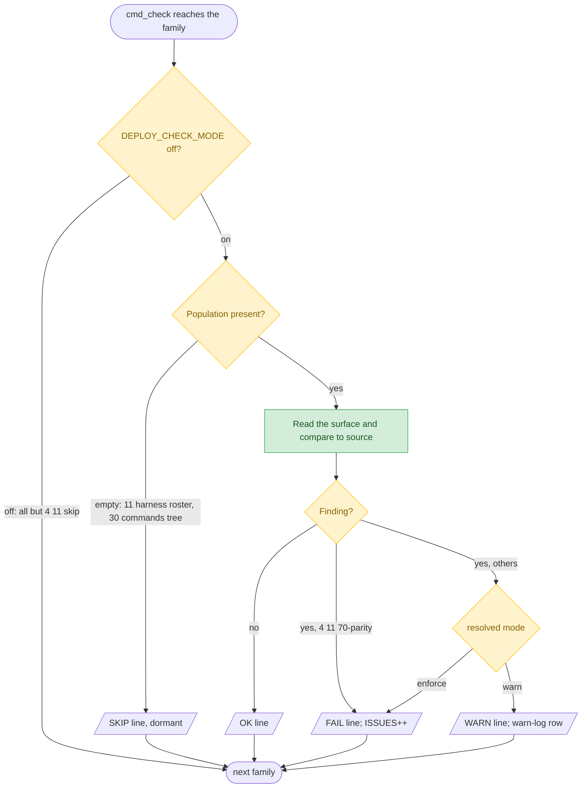

# Check workspace, config and operator-instance surfaces (Checks 4, 8, 9, 11, 30, 33, 36, 40, 70, 77, 78)

## Summary

This family reads what lives outside the tracked skill tree: the governance files at their canonical paths, the
deployed rules mirror and every holder of its path set, the canonical session-path artifacts, harness artifacts and
slash commands, the platform-config and operator-config surfaces, the auto-memory entries tied to corpus homes, the
touchpoint inventory, and the deployed rules set's byte budget. Two members are dormant — Check 11's harness roster
is empty and the harness tree Check 30 reads is absent, so each skips and asserts nothing — and the lifecycle index
records them as parked with their reactivation anchors. Checks 77 and 78 are the family's pre-merge members: the
workflow that runs `--check-required-subset` calls their verdict functions again on every pull request. Its
[ICOM](/core/process-catalog/definitions/pack.json) table (inputs, controls, outputs, mechanisms)
follows.

## ICOM

| Inputs | Controls | Outputs | Mechanisms |
|---|---|---|---|
| The deploy root's governance files and rules mirror; the mirror-pair set declaration and its holders; the install path's session-path artifacts; the harness and commands trees; the platform-config template and instance; the operator-config declaration, template and live instance; the auto-memory store and the host issues it cites; the touchpoint inventory instance; the admitted rules set | Always-enforce for Check 4, Check 11 (vacuous) and Check 70's parity arms; a per-check mode with a `warn` default for Check 70's schema arm; the shared `deploy-check.mode` for the rest; the lifecycle registry's dormant dispositions; the rules-corpus admission standard's byte ceiling | `OK` / `MISSING` / `DRIFT` / `FAIL` / `WARN` / `SKIP` / `N/A` / `NOT-EVAL` / `INFO` / `CTRL` / `DENOM` lines; `ISSUES` increments; warn-log rows under each warn-mode check's keys | Inline bash in `cmd_check` with diff; the operator-config schema script; the mirror-pair parity and rules-budget primitives (shared with the pre-merge runner); host reads for Check 36 |

## Flow

## Steps

| Step | Action | Actor | Inputs → outputs (shape) | Controls | Mechanism | Harness | Model need | Source |
|---|---|---|---|---|---|---|---|---|
| verify-governance-presence | Check 4 — Governance presence | script:deploy.sh | the governance files at their canonical paths → verdict lines OK/MISSING; ISSUES++ at 2 site(s) | C-122: code-enforce | inline bash in `cmd_check` | file-and-shell-tools | XS/none/read/scriptable/batch | [deploy.sh](/core/deploy/deploy.sh#L8426)<!-- source-anchor: line=8426; fp=eff7dc7d678fcd35 --> |
| verify-session-path-freshness | Check 8 — Canonical-session-path freshness | script:deploy.sh | the deployed canonical-session-path artifacts against source → verdict lines SKIP/OK; warn keys `canonical-session-path` | C-127: code-warn | inline bash in `cmd_check` | file-and-shell-tools | XS/none/read/scriptable/batch | [deploy.sh](/core/deploy/deploy.sh#L9407)<!-- source-anchor: line=9407; fp=a082f0850e283215 --> |
| verify-mirror-pair-sync | Check 9 — Mirror-pair sync (source to workspace) | script:deploy.sh | each declared mirror pair: byte identity and, on a deployed workspace, existence → verdict lines OK/NOT-EVAL/SKIP; warn keys `mirror-sync`, `mirror-undeclared-entry`, `operations-ssot` | C-128: code-warn | inline bash in `cmd_check` | file-and-shell-tools | XS/none/read/scriptable/batch | [deploy.sh](/core/deploy/deploy.sh#L9440)<!-- source-anchor: line=9440; fp=86a3d34b8fe3ad96 --> |
| verify-harness-sync | Check 11 — Harness sync (dormant: empty roster) | script:deploy.sh | each registered harness artifact's runtime copy (the roster array is empty) → verdict lines SKIP/FAIL/DRIFT/WARN/OK; ISSUES++ at 7 site(s) | C-130: code-enforce (vacuous) | inline bash in `cmd_check` | file-and-shell-tools | XS/none/read/scriptable/batch | [deploy.sh](/core/deploy/deploy.sh#L9702)<!-- source-anchor: line=9702; fp=1b3f7cdc38a794c1 --> |
| lint-slash-command-quoting | Check 30 — Slash-command quoting lint (dormant) | script:deploy.sh | pmo-authored slash commands under the harness commands tree (the harness tree is absent) → verdict lines SKIP/OK; warn keys `slash-command-quoting` | C-150: code-warn | inline bash in `cmd_check` | file-and-shell-tools | XS/none/read/scriptable/batch | [deploy.sh](/core/deploy/deploy.sh#L12718)<!-- source-anchor: line=12718; fp=b0124c15ce935988 --> |
| verify-platform-config-surface | Check 33 — Platform-config surface integrity | script:deploy.sh | the platform-config template and instance surfaces → verdict lines OK; warn keys `platform-config-surface` | C-155: code-warn | inline bash in `cmd_check` | file-and-shell-tools | XS/none/read/scriptable/batch | [deploy.sh](/core/deploy/deploy.sh#L13380)<!-- source-anchor: line=13380; fp=6aef9d72439cc35d --> |
| detect-memory-corpus-tie-drift | Check 36 — Memory-to-corpus tie-drift | script:deploy.sh | auto-memory entries tied to corpus homes, read against the host → verdict lines SKIP/N/A/INFO/OK; warn keys `memory-corpus-tie-drift` | C-158: code-warn | host read via `gh auth`, `gh issue` | file-and-shell-tools, git-and-gh-cli | XS/none/read/scriptable/batch | [deploy.sh](/core/deploy/deploy.sh#L13641)<!-- source-anchor: line=13641; fp=62e3c36b4fa76319 --> |
| validate-touchpoint-inventory | Check 40 — Touchpoint-inventory structural validation | script:deploy.sh | the touchpoint-inventory instance → verdict lines SKIP/OK; warn keys `touchpoint-schema` | C-162: code-warn | inline bash in `cmd_check` | file-and-shell-tools | XS/none/read/scriptable/batch | [deploy.sh](/core/deploy/deploy.sh#L14258)<!-- source-anchor: line=14258; fp=66d0315faa68020b --> |
| verify-operator-toml-schema | Check 70 — operator.toml declared-schema conformance | script:deploy.sh | the operator-config declaration, template and registry (parity arms) plus the live instance (schema arm) → verdict lines FAIL/CTRL/DENOM/WARN/OK; ISSUES++ at 5 site(s); mode resolved per check (`operator-toml-schema`) | C-190: code-enforce (parity arms) / code-warn (schema arm) | [check-operator-toml-schema.sh](/core/deploy/tools/check-operator-toml-schema.sh) | file-and-shell-tools | XS/none/read/scriptable/batch | [deploy.sh](/core/deploy/deploy.sh#L17242)<!-- source-anchor: line=17242; fp=3f4eb436668e54f6 --> |
| verify-mirror-pair-path-set-parity | Check 77 — Mirror-pair path-set parity | script:deploy.sh | every marker-registered holder of the mirror-pair source set → verdict lines OK; warn keys `mirror-pair-parity` | C-197: code-warn | `_c77_compute_verdict` over [check-mirror-pair-parity.py](/core/deploy/tools/check-mirror-pair-parity.py) | file-and-shell-tools | XS/none/read/scriptable/batch | [deploy.sh](/core/deploy/deploy.sh#L17998)<!-- source-anchor: line=17998; fp=94a7e232b4fd9688 --> |
| verify-rules-corpus-budget | Check 78 — Rules-corpus admission and byte budget | script:deploy.sh | the deployed rules set: byte ceiling and admission frontmatter → verdict lines OK; warn keys `rules-budget` | C-198: code-warn | `_c78_compute_verdict` over [check-rules-budget.py](/core/deploy/tools/check-rules-budget.py) | file-and-shell-tools | XS/none/read/scriptable/batch | [deploy.sh](/core/deploy/deploy.sh#L18048)<!-- source-anchor: line=18048; fp=2bc74874c168851f --> |

## Step profile

| Field | Value |
|---|---|
| Deterministic steps | 11 of 11 (determinism `scriptable`, counted from the Steps table) |
| Judgment steps | 0 |
| Harness features relied on | file-and-shell-tools, git-and-gh-cli (Check 36's host read) |
| Context read | XS (under 2k tokens) |

## Evidence

| Lens | Source | Observation | Label |
|---|---|---|---|
| designed | [`core/deploy/deploy.sh`](/core/deploy/deploy.sh), the eleven check blocks in `cmd_check` and the lifecycle index in `cmd_check_lifecycle`; [`core/rules/harness-deployment.md`](/core/rules/harness-deployment.md) § Drift Check Semantics | Check 11 is specified against the harness roster and Check 9 against the single mirror-pair declaration; the lifecycle index parks 11 and 30 as DORMANT with auto-reactivation on a non-empty roster or commands tree | [SOURCE] |
| built | [the controls register](/core/process-catalog/definitions/controls-register.tsv), C-122, C-127, C-128, C-130, C-150, C-155, C-158, C-162, C-190, C-197, C-198, C-209; [`deploy-check-ci.yml`](/.github/workflows/deploy-check-ci.yml); [`deploy-check-ci.enforce`](/.github/deploy-check-ci.enforce) | the register classes Check 11 `code-enforce (vacuous)` — enforcing code over an empty population; Checks 77 and 78 are two of the four members of the pre-merge `--check-required-subset` roster (C-209), which the workflow declares required and whose committed sentinel reads `enforce`; at deploy time the two stay on the shared warn dial, independent of that sentinel | [SOURCE] |
| executed | no measure — what would show which members fire at deploy time is the deploy-check warn log, where each warning arm appends its row. | No measure in the measures register reads the warn log | [SOURCE] |
| executed | measure `workflow-runs-deploy-probes` — [workflow-run-history.py](/core/deploy/tools/process-catalog-measures/workflow-run-history.py) (population: every run of each named workflow created in the trailing window, read in slices and verified against the host's total for each slice) · [`deploy-check-ci.yml`](/.github/workflows/deploy-check-ci.yml) | The measure reports, per named workflow, its run total and its runs by conclusion. The workflow runs `--check-required-subset` on every pull request, and that command calls the verdict functions of Check 77 and Check 78 among its members. No workflow named on this page runs the other steps, so the page reads `unobserved`. covers: `verify-mirror-pair-path-set-parity`, `verify-rules-corpus-budget` | [SOURCE] |

## Navigation

<!-- nav:begin -->
Up: [run-check-suite](run-check-suite.md) · Previous: [check-skill-corpus-integrity](check-skill-corpus-integrity.md) · Next: [check-corpus-conventions](check-corpus-conventions.md)
<!-- nav:end -->

## Sources

- [`core/deploy/deploy.sh`](/core/deploy/deploy.sh) — the eleven check blocks, the mode-file resolution block and the lifecycle index
- [`check-operator-toml-schema.sh`](/core/deploy/tools/check-operator-toml-schema.sh), [`check-mirror-pair-parity.py`](/core/deploy/tools/check-mirror-pair-parity.py), [`check-rules-budget.py`](/core/deploy/tools/check-rules-budget.py) — the primitives
- [`core/rules/harness-deployment.md`](/core/rules/harness-deployment.md) — the harness roster and the Check 9 / Check 11 drift semantics
- [`core/process-catalog/definitions/controls-register.tsv`](/core/process-catalog/definitions/controls-register.tsv) — C-122, C-127, C-128, C-130, C-150, C-155, C-158, C-162, C-190, C-197, C-198, C-209
- [`.github/workflows/deploy-check-ci.yml`](/.github/workflows/deploy-check-ci.yml), [`.github/deploy-check-ci.enforce`](/.github/deploy-check-ci.enforce) — the pre-merge subset's workflow, whose run history the executed row reads, and its sentinel
