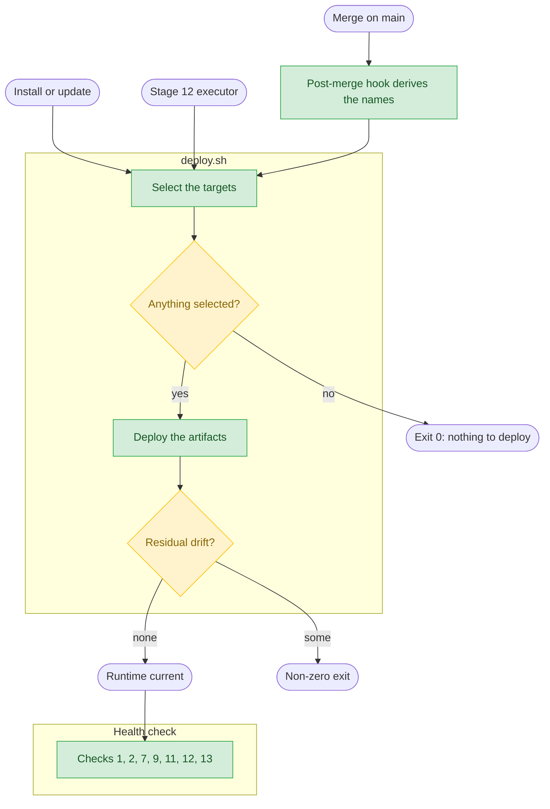

# Deploy merged changes to the runtime

## Summary

`deploy.sh --deploy` is the one carrier from the repository to the runtime: the desktop app's session skills path
(when a session resolves), the user-local skills mirror, the packages directory, the harness directories, and the
rules mirror. Four callers reach it — the post-merge git hook with the names a merge brought in, `install.sh` and
`update.sh` through the orchestrator with no names, and the Stage 12 executor with names and a release key — and the
script selects targets accordingly, copies and verifies each, asserts no residual drift, and exits non-zero only on
drift it could not repair. The release-stamped form is the only one that writes event-log rows; the deploy-time
check suite ([run-check-suite](run-check-suite.md)) polices the result afterwards.

## Entry and exit

| Side | Criteria | Source |
|---|---|---|
| Entry | The script runs from the repository root with one of: no arguments (bare), artifact names, `--all`, or `--release <slug>` with named targets or `--no-targets`; the post-merge hook supplies the names only on the primary checkout, on `main`, when not opted out | [deploy.sh](/core/deploy/deploy.sh#L4668)<!-- source-anchor: line=4668; fp=d40eaeba68e3dc13 -->, [deploy.sh](/core/deploy/deploy.sh#L6789)<!-- source-anchor: line=6789; fp=cc5a5674ddd6c2f3 -->; [hook](/core/hooks/git-post-merge-deploy.sh#L60)<!-- source-anchor: line=60; fp=bab5cd1b626b44dd --> |
| Exit | Every selected artifact is byte-identical at its targets (copy verified, residual assertion clean), the rules mirror is laid down, the summary line is printed, and the run exits 0; or `die` names the failures; an empty selection exits 0 with the verified denominator | [deploy.sh](/core/deploy/deploy.sh#L7333)<!-- source-anchor: line=7333; fp=63646d38dcb89566 -->, [deploy.sh](/core/deploy/deploy.sh#L7382)<!-- source-anchor: line=7382; fp=65f16033fae4b367 -->, [deploy.sh](/core/deploy/deploy.sh#L7037)<!-- source-anchor: line=7037; fp=d4b5c1b78adbc33d --> |

## Flow

## Activities

| Activity | Primary actor | Purpose | Page |
|---|---|---|---|
| Trigger a deploy from a merge on main | hook:git-post-merge-deploy | Derive the merge's own change set and call the named deploy, never failing the merge | [trigger-post-merge-deploy](trigger-post-merge-deploy.md) |
| Select the deploy targets | script:deploy.sh | Route the invocation form to the sets to write and lay down the rules mirror first | [select-deploy-targets](select-deploy-targets.md) |
| Deploy the selected artifacts and assert the result | script:deploy.sh | Copy, verify, inject templates, emit rows, assert no residual drift | [deploy-skill-artifacts](deploy-skill-artifacts.md) |

## Controls

| Control | Source | Enforcement class | Surface | Applies to |
|---|---|---|---|---|
| Every rostered skill's deployed copy is byte-identical to its source; every skill has its package; the user-local mirror matches | `core/deploy/deploy.sh` Checks 1, 2, 12 (C-119, C-120, C-131) | code-enforce | deploy-run | deploy-skill-artifacts |
| Every package's content hash reflects its source | `core/deploy/deploy.sh` Check 7 (C-126) | code-enforce | deploy-run | deploy-skill-artifacts |
| Every injected reference file is byte-identical to its canonical | `core/deploy/deploy.sh` Check 13 (C-132) | code-enforce | deploy-run | deploy-skill-artifacts |
| Every declared mirror pair is byte-identical and, on a deployed workspace, present | `core/deploy/deploy.sh` Check 9 (C-128) | code-warn | deploy-run | select-deploy-targets |
| Every holder of the mirror-pair set declares the same set; the deployed rules set stays within its byte ceiling | `core/deploy/deploy.sh` Checks 77, 78 through [`core/deploy/tools/check-mirror-pair-parity.py`](/core/deploy/tools/check-mirror-pair-parity.py) and [`check-rules-budget.py`](/core/deploy/tools/check-rules-budget.py) (C-197, C-198) | code-warn | deploy-run | select-deploy-targets |
| Every registered harness artifact matches its source, operator state excluded | `core/deploy/deploy.sh` Check 11 (C-130) | code-enforce (vacuous) | deploy-run | deploy-skill-artifacts |
| Editing a single-sourced canonical obliges a redeploy and a package rebuild in the same change | `core/rules/skill-deployment.md` (C-376) | code-enforce | — | deploy-skill-artifacts |
| Package freshness is asserted at deploy time and again pre-merge under its own sentinel | `core/rules/skill-deployment.md` (C-378) | code-enforce | — | deploy-skill-artifacts |
| The post-merge hook carries no release identity; a stamped deploy never auto-detects | `core/rules/skill-deployment.md` (C-379) | prose-only | — | trigger-post-merge-deploy, select-deploy-targets |
| A rules file is never copied into the mirror by hand; the carrier lays it down | `core/rules/harness-deployment.md` (C-373) | code-warn | — | select-deploy-targets |

## Evidence

| Lens | Source | Observation | Label |
|---|---|---|---|
| designed | [`core/rules/skill-deployment.md`](/core/rules/skill-deployment.md), "Deployment Steps (Post-Merge)" to "Initial bootstrap" | deployment steps 1–3, the automatic post-merge deploy and its three conditions, the auto-detect window, initial bootstrap, `--all`, the two package-freshness surfaces | [SOURCE] |
| designed | [`core/rules/harness-deployment.md`](/core/rules/harness-deployment.md), "Selected Deployment Mechanism", "Tracked Harness Artifacts" and "Drift Check Semantics" | the S-2 mechanism (direct file copy), the Check 11 drift semantics, the deploy-produced mirror and the parity marker | [SOURCE] |
| built | [`core/deploy/deploy.sh`](/core/deploy/deploy.sh), `cmd_deploy`; [`core/hooks/git-post-merge-deploy.sh`](/core/hooks/git-post-merge-deploy.sh) | the four callers converge on one `cmd_deploy`; the mirror carrier and the ground-truth scan run before the no-changes exit (deploy.sh's edge-case label E-02); event rows only when stamped | [SOURCE] |
| executed | measure `event-log-deploy-status` — [event-log-deploy-status.py](/core/deploy/tools/process-catalog-measures/event-log-deploy-status.py) (population: the deployment-status rows of the pipeline event log, among rows whose release key is a milestone title or a tag name on the host; a key another repository shares is counted, and a legacy row older than the host's tags is not) | The measure reports the deployment-status rows by release key, subtype and outcome. Only a release-stamped deploy writes them, so a deploy run by the post-merge hook, the installer or the updater leaves no row; one install's working state; supports no verdict on this page | [SOURCE] |
| executed | no measure — the mirror check (C-128) reports to the deploy-check warn log, which no measure in the measures register reads. | The page says nothing of how often the mirror check has reported | [SOURCE] |
| designed vs built | [`core/rules/skill-deployment.md`](/core/rules/skill-deployment.md), "Auto-detect window semantics"; [`core/deploy/deploy.sh`](/core/deploy/deploy.sh), `cmd_deploy`, the ground-truth selection block | the rule gives the tag diff as how a no-argument deploy determines what changed; the code also unions a ground-truth drift scan of the installed copies into the selection — the designed description lags the built mechanism | [SOURCE] |

## Navigation

<!-- nav:begin -->
Up: [install-or-update-workspace](install-or-update-workspace.md) · Previous: [update-platform](update-platform.md) · Next: [verify-session-setup](verify-session-setup.md) · Down: [trigger-post-merge-deploy](trigger-post-merge-deploy.md) · [select-deploy-targets](select-deploy-targets.md) · [deploy-skill-artifacts](deploy-skill-artifacts.md)
<!-- nav:end -->

## Sources

- [`core/deploy/deploy.sh`](/core/deploy/deploy.sh) — `cmd_deploy`, `deploy_rules_mirror`, `detect_changed_skills`, `skill_content_drift`, the dispatcher
- [`core/hooks/git-post-merge-deploy.sh`](/core/hooks/git-post-merge-deploy.sh) — the post-merge trigger
- [`core/rules/skill-deployment.md`](/core/rules/skill-deployment.md), [`core/rules/harness-deployment.md`](/core/rules/harness-deployment.md) — the deployment rules (mirror pairs themselves)
- [`install.sh`](/install.sh), [`update.sh`](/update.sh) — the two callers that reach the deploy through the orchestrator
- [`core/deploy/tools/check-mirror-pair-parity.py`](/core/deploy/tools/check-mirror-pair-parity.py), [`core/deploy/tools/check-rules-budget.py`](/core/deploy/tools/check-rules-budget.py) — the engines of Checks 77 and 78
- [`core/process-catalog/definitions/controls-register.tsv`](/core/process-catalog/definitions/controls-register.tsv) — C-119, C-120, C-126, C-128, C-130, C-131, C-132, C-197, C-198, C-373, C-376, C-378, C-379
