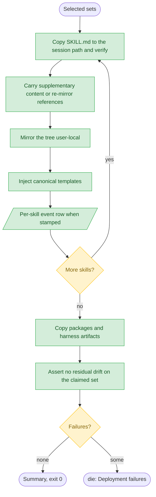

# Deploy the selected skills, packages and harness artifacts and assert the result

## Summary

For each selected skill the script copies `SKILL.md` to the desktop app's session path (when one resolved) with a
`diff` verification, carries supplementary content or re-mirrors `references/`, mirrors the whole tree to the
user-local skills directory unconditionally, injects the canonical templates the sync map names, and counts the skill
only if its deployed footprint changed. Packages copy beside the session path; harness artifacts have an empty
population. A residual drift assertion over the claimed set then turns any surviving drift into a failure, the
summary line is printed, and an unstamped deploy that addressed real targets is warned about. Its
[ICOM](/core/process-catalog/definitions/pack.json) table follows.

## ICOM

| Inputs | Controls | Outputs | Mechanisms |
|---|---|---|---|
| `CHANGED_SKILLS`, `CHANGED_PACKAGES`, `CHANGED_HARNESS`, `DELETED_SKILLS`; `INSTALL_PATH` or none; `TEMPLATE_SYNC_MAP`; `DEPLOY_RELEASE_SLUG` | Copy-then-verify; a bounded `rm -rf` guard on the references subtree; one writer for event rows; the residual assertion over the claimed set; Checks 1, 2, 7, 8, 12, 13 at `--check` time | Session-path and user-local copies; injected `references/` files; `deployment-status` rows; the `Deployed: N skills …` summary; exit 0 or a `die` naming the failures | `cp`, `diff`, `cp -R`, `remove_mirror_subtree`, `deploy_skill_user_local`, `sync_canonical_templates_to_runtime`, `skill_content_drift`, [`append-pipeline-event.sh`](/release/tools/append-pipeline-event.sh) |

## Flow

## Steps

| Step | Action | Actor | Inputs → outputs (shape) | Controls | Mechanism | Harness | Model need | Source |
|---|---|---|---|---|---|---|---|---|
| snapshot-deployed-footprint | Record the skill's deployed footprint before writing | script:deploy.sh | skill → `__before_fp` hash | idempotency accounting: a byte-identical re-copy must count as 0 | `deployed_skill_footprint` | file-and-shell-tools | XS/none/read/scriptable/batch | [deploy.sh](/core/deploy/deploy.sh#L7121)<!-- source-anchor: line=7121; fp=58e0f773cac79f92 -->, [deploy.sh](/core/deploy/deploy.sh#L6602)<!-- source-anchor: line=6602; fp=8a5c23ee4d7813f1 --> |
| copy-skill-to-session-path | Copy `SKILL.md` to the session install path and verify it | script:deploy.sh | source → `<session>/<skill>/SKILL.md`; `diff -q` → a `Deployed` line with an 8-char hash, or a `FAILED` line appended to `FAILURES`; skipped when no session resolved | S-2 direct copy; C-119 (Check 1) asserts byte identity afterwards: code-enforce | `cp` + `diff -q` | file-and-shell-tools | XS/none/write/scriptable/batch | [deploy.sh](/core/deploy/deploy.sh#L7141)<!-- source-anchor: line=7141; fp=567d9d4acb3a73dd --> |
| carry-supplementary-content | Copy a supplementary skill's extra directories | script:deploy.sh | each item but `SKILL.md` → copied; a failure sets `__degraded` with the cause and a chmod remediation, never `FAILURES` | the degraded signal reaches the event row, not the exit code | `cp -R` with captured stderr | file-and-shell-tools | XS/none/write/scriptable/batch | [deploy.sh](/core/deploy/deploy.sh#L7153)<!-- source-anchor: line=7153; fp=00cac11a91664157 --> |
| mirror-references-tree | Replace the session copy's `references/` from the source tree | script:deploy.sh | `<skill>/references/` → removed then `cp -R`; refused when the base is empty or the name carries `..` | bounded-target guard before any `rm -rf`; the package is never the source of references | `remove_mirror_subtree` + `cp -R` | file-and-shell-tools | XS/none/write/scriptable/batch | [deploy.sh](/core/deploy/deploy.sh#L7187)<!-- source-anchor: line=7187; fp=b92400674401fa76 -->, [deploy.sh](/core/deploy/deploy.sh#L4429)<!-- source-anchor: line=4429; fp=0b2b7d4a60e3e90e --> |
| mirror-skill-user-local | Expose the skill as a plain slash command | script:deploy.sh | full tree → `<deploy-root>/.claude/skills/<skill>/`; a failure appends `(user-local)` | unconditional, needs no session; C-131 (Check 12) asserts the mirror afterwards: code-enforce | `deploy_skill_user_local` | file-and-shell-tools | XS/none/write/scriptable/batch | [deploy.sh](/core/deploy/deploy.sh#L7220)<!-- source-anchor: line=7220; fp=3fa7c186d50bb0c7 -->, [deploy.sh](/core/deploy/deploy.sh#L5191)<!-- source-anchor: line=5191; fp=81170f8a18686457 --> |
| inject-canonical-templates | Inject the sync-map canonicals into both runtime `references/` trees | script:deploy.sh | `TEMPLATE_SYNC_MAP` entries for the skill → injected files at the session and user-local paths; a failure appends `(template-inject)` | single-source-of-truth: per-skill mirrors are runtime artifacts; C-132 (Check 13) asserts byte identity: code-enforce | `sync_canonical_templates_to_runtime` | file-and-shell-tools | XS/none/write/scriptable/batch | [deploy.sh](/core/deploy/deploy.sh#L7230)<!-- source-anchor: line=7230; fp=e0fa7a0d9263645b -->, [deploy.sh](/core/deploy/deploy.sh#L5097)<!-- source-anchor: line=5097; fp=f72ced81cd86940a --> |
| count-changed-footprint | Count the skill only if its footprint changed | script:deploy.sh | `__after_fp` vs `__before_fp` → `skills_changed` + 1 on change | the honest N the updater reads for its no-change exit | `deployed_skill_footprint` | file-and-shell-tools | XS/none/read/scriptable/batch | [deploy.sh](/core/deploy/deploy.sh#L7238)<!-- source-anchor: line=7238; fp=7b16eb6e5ac04676 --> |
| emit-skill-event-row | Write the per-target row inside the loop, when stamped | script:deploy.sh | outcome from the failure snapshot and the degraded flag → one `deployment-status` row (`deploy-skill`, stage 12, actor hub, payload with target, module, result, detail) through the pipeline-event writer; a no-op without `--release` | one writer, never a direct append (Check 19 parity); a writer failure is reported, never propagated | `_emit_deployment_status` | file-and-shell-tools | XS/none/write/scriptable/batch | [deploy.sh](/core/deploy/deploy.sh#L7248)<!-- source-anchor: line=7248; fp=2ac9b2b7b7f6d777 -->, [deploy.sh](/core/deploy/deploy.sh#L826)<!-- source-anchor: line=826; fp=60deb7de7279a78b --> |
| copy-packages | Install each selected `.skill` package beside the session path | script:deploy.sh | `packages/<pkg>.skill` → `<session>/../packages/<pkg>.skill`, verified; a `deploy-package` row each; skipped without a session | C-120 (Check 2) asserts presence, C-126 (Check 7) freshness: code-enforce | `cp` + `diff -q` | file-and-shell-tools | XS/none/write/scriptable/batch | [deploy.sh](/core/deploy/deploy.sh#L7256)<!-- source-anchor: line=7256; fp=cc3e12172a319c84 --> |
| deploy-harness-artifacts | Deploy each selected harness artifact under the operator-state policy | script:deploy.sh | `harness/<name>/` → `<deploy-root>/.claude/<name>/` and `commands/`; `config.toml` only if absent; state files never touched; a `deploy-harness` row each; the harness roster is empty | C-130 (Check 11): code-enforce (vacuous); C-372 operator-state policy: code-off | `deploy_harness_artifact` | file-and-shell-tools | XS/none/write/scriptable/batch | [deploy.sh](/core/deploy/deploy.sh#L7305)<!-- source-anchor: line=7305; fp=a4b77c69d8a52caf -->, [deploy.sh](/core/deploy/deploy.sh#L6502)<!-- source-anchor: line=6502; fp=6aa50ffd2c7e04be --> |
| warn-deleted-skills | Name installed copies the repository no longer has | script:deploy.sh | `DELETED_SKILLS` → one warning each; nothing is removed | manual cleanup is the operator's | `log` | none | XS/none/none/scriptable/batch | [deploy.sh](/core/deploy/deploy.sh#L7329)<!-- source-anchor: line=7329; fp=a507e505e017da79 --> |
| assert-residual-drift | Fail the run on drift the deploy did not heal | script:deploy.sh | `skill_content_drift` over the claimed set (named skills, or the roster) → a `FAILED` line per surviving row, `unwritable` carrying a chmod remedy | the non-zero exit is reserved for the unrepairable case | `skill_content_drift` | file-and-shell-tools | XS/none/read/scriptable/batch | [deploy.sh](/core/deploy/deploy.sh#L7333)<!-- source-anchor: line=7333; fp=63646d38dcb89566 --> |
| print-summary | Print the counts the callers parse | script:deploy.sh | `skills_changed`, package, harness and mirror counts → `Deployed: N skills, M packages, K harness artifacts, R rules-mirror files` | the skills field is what [`update.sh`](/update.sh) keys its exit code on | `log` | none | XS/none/none/scriptable/batch | [deploy.sh](/core/deploy/deploy.sh#L7376)<!-- source-anchor: line=7376; fp=7a8f46dfeb66b65c --> |
| warn-unstamped-deploy | Warn when real targets were addressed with no release key | script:deploy.sh | attempted count (skills + packages + harness + mirror) → a WARN block naming the Stage-12 form; expected on an install or ad-hoc redeploy | fires before the terminal `die` so it reaches a failed run too | `_ds_warn_unstamped` | none | XS/none/none/scriptable/batch | [deploy.sh](/core/deploy/deploy.sh#L7384)<!-- source-anchor: line=7384; fp=549dfc3f24e1ff43 -->, [deploy.sh](/core/deploy/deploy.sh#L870)<!-- source-anchor: line=870; fp=74c24b1b001f57b1 --> |
| fail-on-deployment-failures | Exit non-zero naming every failure | script:deploy.sh | `FAILURES` non-empty → `die "Deployment failures: …"`; else return 0 | every per-target row is already written by now | `die` | none | XS/none/none/scriptable/batch | [deploy.sh](/core/deploy/deploy.sh#L7439)<!-- source-anchor: line=7439; fp=df4508a7289ea2be --> |

## Step profile

| Field | Value |
|---|---|
| Deterministic steps | 15 of 15 (determinism `scriptable`, counted from the Steps table) |
| Judgment steps | 0 |
| Harness features relied on | file-and-shell-tools (portable); the desktop app's session path is an external target, not a harness feature |
| Context read | S (2k–8k tokens): the selected sets, the sync map entries, the per-skill log lines |

## Evidence

| Lens | Source | Observation | Label |
|---|---|---|---|
| designed | [`core/rules/skill-deployment.md`](/core/rules/skill-deployment.md), "Deployment Steps (Post-Merge)" and "References-only change propagation" | step 1 copies, mirrors `references/` from source, mirrors user-local and verifies by diff; a references-only change propagates by default; package rebuild is a separate obligation, owed before the merge and enforced by Check 7 | [SOURCE] |
| designed | [`core/rules/harness-deployment.md`](/core/rules/harness-deployment.md), "Operator-State Preservation Policy" | the operator-state preservation policy (`config.toml` only-if-missing; target-only files never touched) | [SOURCE] |
| built | [`core/deploy/deploy.sh`](/core/deploy/deploy.sh), `cmd_deploy` | the per-skill loop, the package and harness loops, the residual assertion and the summary match the rule; the event row is emitted inside the loop so a failed target's row survives the terminal `die` | [SOURCE] |
| built | [`controls-register.tsv`](/core/process-catalog/definitions/controls-register.tsv), C-119, C-120, C-126, C-130, C-131, C-132; [`core/deploy/deploy.sh`](/core/deploy/deploy.sh), `HARNESS_LIST` | the register classes each deploy-time check that polices this activity's result `code-enforce`; the harness roster that Check 11 reads is an empty array | [SOURCE] |
| executed | measure `event-log-deploy-status` — [event-log-deploy-status.py](/core/deploy/tools/process-catalog-measures/event-log-deploy-status.py) (population: the deployment-status rows of the pipeline event log, among rows whose release key is a milestone title or a tag name on the host; a key another repository shares is counted, and a legacy row older than the host's tags is not) | The measure reports the deployment-status rows a stamped deploy writes, by subtype, outcome, actor and stage. It reads a log that one install keeps, and no measure any reader can reproduce reads a deploy run, so the page reads `unobserved`; one install's working state; supports no verdict on this page | [SOURCE] |

## Navigation

<!-- nav:begin -->
Up: [deploy-merged-changes](deploy-merged-changes.md) · Previous: [select-deploy-targets](select-deploy-targets.md)
<!-- nav:end -->

## Sources

- [`core/deploy/deploy.sh`](/core/deploy/deploy.sh) — `cmd_deploy` and the helpers `deploy_skill_user_local`, `sync_canonical_templates_to_runtime`, `deploy_harness_artifact`, `skill_content_drift`, `_emit_deployment_status`
- [`core/rules/skill-deployment.md`](/core/rules/skill-deployment.md) — deployment steps, references-only propagation, package freshness
- [`core/rules/harness-deployment.md`](/core/rules/harness-deployment.md) — the operator-state policy and the empty roster
- [`release/tools/append-pipeline-event.sh`](/release/tools/append-pipeline-event.sh) — the one writer of event rows; [`update.sh`](/update.sh) — the caller that reads the summary line
- [`core/process-catalog/definitions/controls-register.tsv`](/core/process-catalog/definitions/controls-register.tsv) — C-119, C-120, C-126, C-130, C-131, C-132, C-372
- `SKILL.md` on this page is each selected skill's own definition file, so it is not linked as one tracked file
