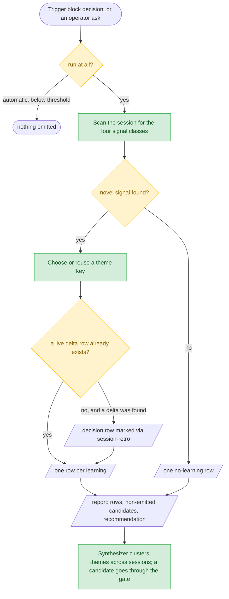

# Reflect over the session and emit learnings rows

## Summary

The skill is the session-grained learning sensor: it captures what the decision-moment and release grains cannot —
operator feedback with no recommendation on the table, and recurring in-session friction. Invoked by the trigger or
by an explicit ask, it decides whether to run at all, scans the session for four signal classes, chooses a theme key
that will cluster, checks the log so a delta captured live is not emitted twice, and appends one row per learning
through the event writer — never a direct file write. A session that taught nothing gets exactly one no-learning row.
The skill then reports and stops: it files no issue, edits no corpus file and never writes the operator memory store;
promotion is the synthesizer's cross-session pattern detection and the governance gate. Its
[ICOM](/core/process-catalog/definitions/pack.json) table (inputs, controls, outputs, mechanisms)
follows.

## ICOM

| Inputs | Controls | Outputs | Mechanisms |
|---|---|---|---|
| The ending session, read in context; the `[session_retro]` sampling keys; the existing `theme:` keys and the release's live delta rows in the event log; the active milestone slug or the `(none)` literal | The sampling contract; the novelty and abstraction disciplines; the schema's PII rule and payload limits; the locked write path; the closed `source:` and subtype sets; the Tier-2 scope — event-log rows and nothing else | `session-retro` rows with subtype `operator-feedback`, `learning` or `no-learning`; a hindsight `decision` row marked `via:session-retro` when the live path missed a delta; the output report with non-emitted candidates and a promotion recommendation | The skill body and its two references; the event writer; the query tool; the synthesizer's pattern-detect mode |

## Flow

## Steps

| Step | Action | Actor | Inputs → outputs (shape) | Controls | Mechanism | Harness | Model need | Source |
|---|---|---|---|---|---|---|---|---|
| decide-whether-to-run | Decide whether to run at all | skill:session-retro | the sampling keys and how the skill was invoked → run; or, on an automatic invocation below threshold, no row at all (an explicit ask always runs) | prose-only | the sampling reference | skill-auto-load | XS/low/read/scriptable/interactive | [SKILL.md](/core/skills/session-retro/SKILL.md#L44)<!-- source-anchor: line=44; fp=17fc06207fe43e0a --> |
| scan-session-signals | Scan the session for the four signal classes | skill:session-retro | the session in context → candidate signals classed operator-feedback, learning (friction or a missed delta) or nothing; non-novel restatements of codified rules dropped | prose-only | reflection over the session | none | L/high/read/judgment/interactive | [SKILL.md](/core/skills/session-retro/SKILL.md#L48)<!-- source-anchor: line=48; fp=cf6b80ef250904df --> |
| choose-theme-key | Choose or reuse a theme key | skill:session-retro | the existing `theme:` keys in the log + the pattern → a kebab-case key of at least four characters naming the pattern, reused when it genuinely matches | prose-only | `query-pipeline-event.sh --event-type session-retro` | file-and-shell-tools | S/medium/read/judgment/interactive | [emission-contract](/core/skills/session-retro/references/emission-contract.md#L42)<!-- source-anchor: line=42; fp=66158d395ca41195 --> |
| check-live-delta-capture | Check whether the live path already captured a delta | skill:session-retro | the release's `recommendation-choice-delta` rows, queried by milestone slug → emit a hindsight delta only when none exists, marked `via:session-retro` | prose-only | `query-pipeline-event.sh --release <slug> --event-subtype recommendation-choice-delta` | file-and-shell-tools | XS/low/read/scriptable/interactive | [SKILL.md](/core/skills/session-retro/SKILL.md#L148)<!-- source-anchor: line=148; fp=1dce1783e460161b --> |
| emit-learning-rows | Append one row per learning through the event writer | skill:session-retro | subtype, actor `skill:session-retro`, subject `session:<handle>`, the milestone slug or `(none)`, a payload of at most 300 characters with `source:`, `theme:`, `domain:`, `learning:` → one appended row each; a version-shaped value or an unknown subtype is rejected by the writer | code-enforce | [append-pipeline-event.sh](/release/tools/append-pipeline-event.sh) | file-and-shell-tools | S/medium/write/templated/interactive | [SKILL.md](/core/skills/session-retro/SKILL.md#L61)<!-- source-anchor: line=61; fp=b13e1627e0cf256d --> |
| emit-no-learning-row | Emit the explicit zero-state | skill:session-retro | a session with no novel signal → exactly one `no-learning` row carrying a `reason:` (a sampled skip emits nothing, not this row) | prose-only | the event writer | file-and-shell-tools | XS/none/write/templated/interactive | [emission-contract](/core/skills/session-retro/references/emission-contract.md#L51)<!-- source-anchor: line=51; fp=a25492849599b559 --> |
| report-and-hand-off | Report what was emitted and stop | skill:session-retro | the rows → the output contract: sampling verdict, each row's subtype, theme and learning with its exact invocation, non-emitted candidates, a promotion recommendation when warranted; no issue, edit or memory write | prose-only | the skill's output contract | none | S/low/write/templated/interactive | [SKILL.md](/core/skills/session-retro/SKILL.md#L67)<!-- source-anchor: line=67; fp=47beabb10c81d461 --> |
| synthesize-cross-session-patterns | Cluster themes across sessions and promote through the gate | script:synthesize-release-learnings.sh | the `session-retro` rows over a trailing window → clusters of at least three rows on one theme across at least two versions; `--apply` files an improvement candidate through the governance gate, never a direct change | code-warn | `synthesize-release-learnings.sh --mode pattern-detect --source session-retro` | file-and-shell-tools | XS/none/read/scriptable/batch | [synthesize-release-learnings.sh](/release/tools/synthesize-release-learnings.sh#L29)<!-- source-anchor: line=29; fp=8c2f359fdb19cd09 --> |

## Step profile

| Field | Value |
|---|---|
| Deterministic steps | 3 of 8 (determinism `scriptable`, counted from the Steps table): the run decision, the delta query, the synthesizer |
| Judgment steps | 2 (determinism `judgment`: the scan and the theme choice); the three emit and report rows are templated and sit in neither count |
| Harness features relied on | skill-auto-load, file-and-shell-tools |
| Context read | L (32k–128k tokens): the whole ending session, read in context |

## Evidence

| Lens | Source | Observation | Label |
|---|---|---|---|
| designed | [`core/skills/session-retro/SKILL.md`](/core/skills/session-retro/SKILL.md), § Role to § What This Skill Does NOT Do; [`emission-contract.md`](/core/skills/session-retro/references/emission-contract.md) §§ 1–7, with its line on the fixed columns ([emission-contract.md](/core/skills/session-retro/references/emission-contract.md#L36)<!-- source-anchor: line=36; fp=07e5a14ce6710a80 -->); the `session-retro` row of [`pipeline-event-log-schema.md`](/release/references/standards/pipeline-event-log-schema.md) ([pipeline-event-log-schema.md](/release/references/standards/pipeline-event-log-schema.md#L212)<!-- source-anchor: line=212; fp=f23fe9193b160778 -->) | three learning grains with the session grain closing a structural hole; a four-step procedure; a closed write scope; four domain failure modes, the first of them over-capture; the contract fixes the row's actor as the skill, and the schema describes the row as the skill's | [SOURCE] |
| built | [`release/tools/append-pipeline-event.sh`](/release/tools/append-pipeline-event.sh) (the only write path); [`release/tools/query-pipeline-event.sh`](/release/tools/query-pipeline-event.sh), its usage header; [`release/tools/synthesize-release-learnings.sh`](/release/tools/synthesize-release-learnings.sh), its usage header; [the controls register](/core/process-catalog/definitions/controls-register.tsv), C-227 | the writer and the query tool both carry the `session-retro` event type; the synthesizer accepts `--source session-retro`; the writer's rejection of unknown subtypes and version-shaped keys and the synthesizer's cluster filter are the code on this activity; both tools' self-tests run under C-227 | [SOURCE] |
| executed | measure `event-log-population` — [event-log-population.py](/core/deploy/tools/process-catalog-measures/event-log-population.py) (population: the rows of the pipeline event log whose release key is a milestone title or a tag name on the host; a key another repository shares is counted, and a legacy row older than the host's tags is not) | the measure reports the event log's row total, its rows under each key rule and its rows by event type, `session-retro` among the types; aggregates only; one install's working state; supports no verdict on this page | [SOURCE] |
| executed | held local — what would show how often the skill is invoked, and by which route, is the record of sessions across an install. | Nothing from that store is published, so the page reads `unobserved` | [SOURCE] |

## Navigation

<!-- nav:begin -->
Up: [run-session-retro](run-session-retro.md) · Previous: [trigger-session-retro](trigger-session-retro.md)
<!-- nav:end -->

## Sources

- [`core/skills/session-retro/SKILL.md`](/core/skills/session-retro/SKILL.md) — the role, the four-step procedure, the output contract and the failure modes
- [`core/skills/session-retro/references/emission-contract.md`](/core/skills/session-retro/references/emission-contract.md) — the subtype rule, the field contract and the abstraction ladder
- [`release/tools/append-pipeline-event.sh`](/release/tools/append-pipeline-event.sh), [`release/tools/query-pipeline-event.sh`](/release/tools/query-pipeline-event.sh), [`release/tools/synthesize-release-learnings.sh`](/release/tools/synthesize-release-learnings.sh) — the write, read and promotion mechanisms
- [`release/references/standards/pipeline-event-log-schema.md`](/release/references/standards/pipeline-event-log-schema.md) — the `session-retro` row; [`core/process-catalog/definitions/controls-register.tsv`](/core/process-catalog/definitions/controls-register.tsv) — C-227
