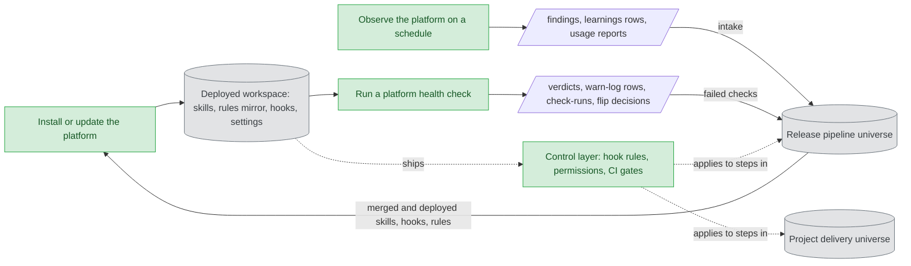

# Engineering harness

## Summary

This universe is everything that makes the platform run on a workspace rather than in a repository: the installer
and updater that lay the skills, rules mirror, hooks and settings down and keep them current; the deploy script's
check suite and its pull-request probes that say whether the deployed tree, the corpus and the host still agree with
the sources; and the scheduled routines, the session retro and the measurement skills that observe the platform and
route what they find to intake. It also ships the control layer — the hook rules, the settings permissions and the
CI gates — which is not a value stream of its own but acts on steps of the release pipeline and of project delivery.
It can be adopted, replaced or retired as a whole, and it is the layer a move to another runtime replaces.

## Landscape

## Value streams

| Value stream | Trigger | Outcome | Page |
|---|---|---|---|
| Install or update the platform (`install-or-update-workspace`) | a workspace install, a new published version, or a merge that changes deployed files | a configured workspace whose deployed copies match the sources | [install-or-update-workspace](install-or-update-workspace.md) |
| Run a platform health check (`run-platform-health-check`) | the operator runs the check suite, or a pull request runs a probe | a verdict per check with warn-log rows and check-run conclusions, and over time a gate's flip decision | [run-platform-health-check](run-platform-health-check.md) |
| Observe the platform on a schedule (`observe-platform`) | a scheduled routine fires, a session stops, or the operator asks a measurement question | findings, learnings rows and usage reports routed to intake or read by the operator | [observe-platform](observe-platform.md) |

## Navigation

<!-- nav:begin -->
Down: [install-or-update-workspace](install-or-update-workspace.md) · [run-platform-health-check](run-platform-health-check.md) · [observe-platform](observe-platform.md)
<!-- nav:end -->

## Sources

- [`core/deploy/deploy.sh`](/core/deploy/deploy.sh) — the deploy, check, probe and report commands
- [`docs/scripts/setup-workspace.sh`](/docs/scripts/setup-workspace.sh) — the installer that renders the settings template and lays down the hooks
- [`core/automations/registry.md`](/core/automations/registry.md) — the routine-spec rows the scheduled observations are admitted through
- [`core/rules/bypass-mode-readiness.md`](/core/rules/bypass-mode-readiness.md); [`core/settings.json.template`](/core/settings.json.template) — the hook layer and its loading surface, the control layer's home
