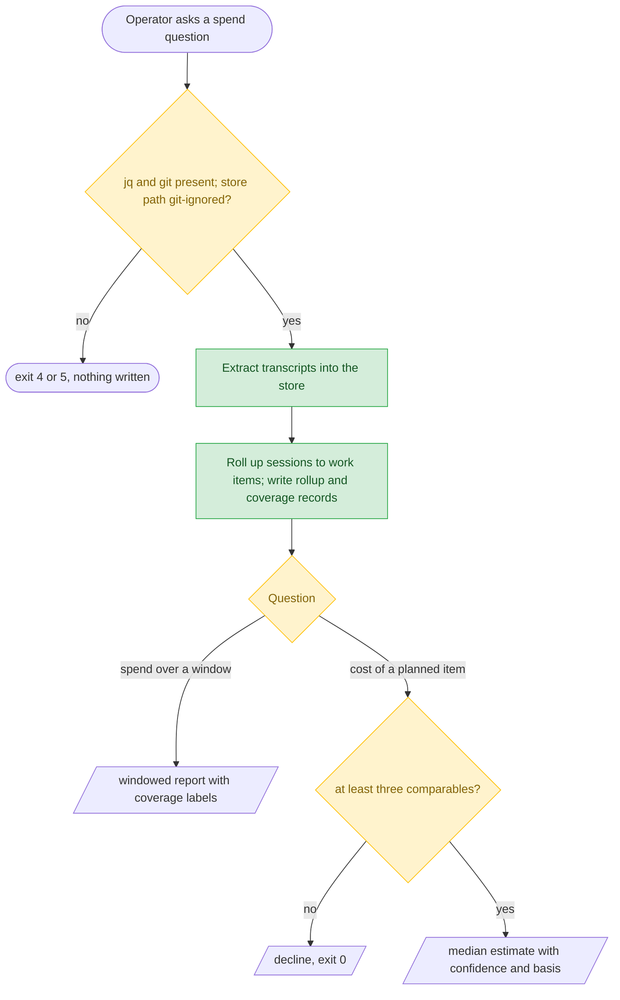

# Extract, attribute, report and estimate token spend

## Summary

Four phases over one source. Extraction parses every local session transcript into a versioned JSONL store —
exact usage counts first, the word-count heuristic as a flagged fallback — and never writes the transcripts.
Attribution resolves each session to its work item through an ordered local-only ladder and appends roll-up and
coverage records, with an opt-in network resolve that marks its rows non-reproducible. Reporting re-sums the sessions
inside a date window by work item, worktree, skill, connector and model, labelling every best-effort slice with its
coverage, and prints to stdout. Estimation finds at least three comparables for a planned item and reports a median
with a confidence that provenance can only lower, declining below the floor. The store lives at an operator-instance
path a fail-closed guard refuses to write unless it is git-ignored. Its
[ICOM](/core/process-catalog/definitions/pack.json) table (inputs, controls, outputs, mechanisms)
follows.

## ICOM

| Inputs | Controls | Outputs | Mechanisms |
|---|---|---|---|
| The local session transcripts; the store path from the operator config; the release ledger's velocity field for milestone-grain comparables; hub state and issue-event keys for attribution; the type-pack point scale | The store schema and its frozen kinds; the git-ignore guard; the summation invariant; the local-only default with opt-in network tiers; coverage labels structurally bound to figures; the three-comparable floor and the median; the read-only posture on sources | The usage store, one JSONL file (meta, session, subagent, rollup, coverage records); a windowed spend report and trend on stdout; an estimate with basis, confidence and comparables, or a decline | The four scripts and their self-tests; `jq` and `git`; the optional provider connector, off by default |

## Flow

## Steps

| Step | Action | Actor | Inputs → outputs (shape) | Controls | Mechanism | Harness | Model need | Source |
|---|---|---|---|---|---|---|---|---|
| route-spend-question | Route the ask to a phase | skill:finops-usage-extractor | a trigger phrase (extract, roll up, report, estimate) → the script and flags to run; the figures relayed with their provenance markers | prose-only | the skill's usage sections | skill-auto-load | S/low/read/templated/interactive | [SKILL.md](/core/skills/finops-usage-extractor/SKILL.md#L39)<!-- source-anchor: line=39; fp=6acd5424dab7b92c --> |
| preflight-store-guard | Check dependencies and the store path | script:extract-usage.sh | `jq`, `git`, the configured store path → exit 5 on a missing dependency; exit 4 when the resolved store sits inside a repository and is not git-ignored | code-enforce | `git check-ignore` and a dependency preflight | file-and-shell-tools | XS/none/read/scriptable/batch | [SKILL.md](/core/skills/finops-usage-extractor/SKILL.md#L164)<!-- source-anchor: line=164; fp=fe8ada601af3420a --> |
| extract-session-usage | Extract transcripts into the store | script:extract-usage.sh | every local session JSONL → `meta`, `session` and `subagent` records at the v2.0.0 shape (exact usage first, heuristic fallback flagged by `token_source`; the worktree basename, never the full path; five analysis sub-aggregates with a reserved unknown bucket), rewritten atomically or upserted incrementally | prose-only | `extract-usage.sh --rebuild` (default) or `--incremental` | file-and-shell-tools | XS/none/write/scriptable/batch | [extract-usage.sh](/core/skills/finops-usage-extractor/scripts/extract-usage.sh#L2)<!-- source-anchor: line=2; fp=42786045441adeb9 --> |
| roll-up-attribution | Roll sessions up to their work items | script:rollup-attribution.sh | the store → one `rollup` record per work item and a run-level `coverage` record, each session resolved through the local ladder (issue-event key, release or chore branch, hub-state lineage, else unattributed; a branch-switching session to its own bucket); a store predating v1.2.0 is refused with exit 3 | prose-only | `rollup-attribution.sh --emit`, `--resolve-prs` opt-in | file-and-shell-tools, git-and-gh-cli | XS/none/write/scriptable/batch | [rollup-attribution.sh](/core/skills/finops-usage-extractor/scripts/rollup-attribution.sh#L2)<!-- source-anchor: line=2; fp=cbfb8252d0cad66b --> |
| report-windowed-spend | Report spend over a window | script:report-usage.sh | the store and a window → a report sliced by work item, worktree, skill, connector and model, with a per-period trend; best-effort slices carry their coverage in the header, direction only on exact dimensions, an absent dimension gated rather than zeroed; stdout only, exit 3 on an aborted render | prose-only | `report-usage.sh --window N --by all --trend` | file-and-shell-tools | XS/none/read/scriptable/batch | [report-usage.sh](/core/skills/finops-usage-extractor/scripts/report-usage.sh#L2)<!-- source-anchor: line=2; fp=bde33771cbd3f04e --> |
| estimate-planned-item | Estimate a planned item from comparables | script:estimate-usage.sh | class and points (or size, or named comparables) → the ladder E1 explicit, E2 class and points, E3 pooled rate, opt-in labels, E4 decline; a median with MAD, a confidence capped by provenance, the basis rows; `--delta` re-derives a closed item leave-one-out | prose-only | `estimate-usage.sh --class C --points N` | file-and-shell-tools | XS/none/read/scriptable/batch | [estimate-usage.sh](/core/skills/finops-usage-extractor/scripts/estimate-usage.sh#L2)<!-- source-anchor: line=2; fp=0201678cdcb30120 --> |
| connect-provider-usage | Connect provider usage (optional, off by default) | script:provider-usage-connector.sh | a plan-gated connector with no live endpoint → a `provider` record, the only thing that lets a report print currency | prose-only | [provider-usage-connector.sh](/core/skills/finops-usage-extractor/scripts/provider-usage-connector.sh) | file-and-shell-tools | XS/none/read/scriptable/batch | [SKILL.md](/core/skills/finops-usage-extractor/SKILL.md#L49)<!-- source-anchor: line=49; fp=ff9a398ec2060139 --> |
| run-finops-self-tests | Run the self-tests of the six scripts in the job's loop on every pull request | ci:release-tooling-smoke | the synthetic fixtures → every assertion fails closed, each negative paired with a positive control; red on any failure | C-228: code-enforce | the `finops-selftest` job of [release-tooling-smoke.yml](/.github/workflows/release-tooling-smoke.yml), running each script's `--self-test` | file-and-shell-tools | XS/none/read/scriptable/batch | [SKILL.md](/core/skills/finops-usage-extractor/SKILL.md#L47)<!-- source-anchor: line=47; fp=a81d7e9403b0dc29 --> |

## Step profile

| Field | Value |
|---|---|
| Deterministic steps | 7 of 8 (determinism `scriptable`, counted from the Steps table) |
| Judgment steps | 0 — the routing row is templated and sits in neither count |
| Harness features relied on | skill-auto-load, file-and-shell-tools, git-and-gh-cli (the opt-in resolve only) |
| Context read | S (2k–8k tokens): the skill's usage sections and the printed report |

## Evidence

| Lens | Source | Observation | Label |
|---|---|---|---|
| designed | [`core/skills/finops-usage-extractor/SKILL.md`](/core/skills/finops-usage-extractor/SKILL.md), § Purpose to § Exit codes (version v5.09); [`core/schemas/finops-usage-store-schema.md`](/core/schemas/finops-usage-store-schema.md); [`core/standards/finops-attribution-convention.md`](/core/standards/finops-attribution-convention.md) | four phases at store schema v2.0.0; the session record persists the worktree basename and five analysis sub-aggregates; the roll-up refuses a store predating v1.2.0 with exit 3; the estimator declines below three comparables | [SOURCE] |
| built | the four phase scripts and the connector, each root-linked in the Steps table; [`.github/workflows/release-tooling-smoke.yml`](/.github/workflows/release-tooling-smoke.yml), the `finops-selftest` job (C-228) | every phase ships with a self-test, and the job runs the self-tests of the six scripts in its loop, and precision probes, on every pull request; the store guard and the writer's atomic rename are code | [SOURCE] |
| executed | held local — what would show which phases have run, and at which store shape, is the usage store itself: a git-ignored store of session records across an install. | Nothing from that store is published, so the page reads `unobserved` | [SOURCE] |
| executed | held local — what would show how often the skill is invoked is the record of sessions across an install. | Nothing from that store is published | [SOURCE] |

## Navigation

<!-- nav:begin -->
Up: [measure-platform-usage](measure-platform-usage.md) · Next: [measure-context-budget](measure-context-budget.md)
<!-- nav:end -->

## Sources

- [`core/skills/finops-usage-extractor/SKILL.md`](/core/skills/finops-usage-extractor/SKILL.md) — the four phases, the usage flags, the exit codes and the failure modes
- [`extract-usage.sh`](/core/skills/finops-usage-extractor/scripts/extract-usage.sh), [`rollup-attribution.sh`](/core/skills/finops-usage-extractor/scripts/rollup-attribution.sh), [`report-usage.sh`](/core/skills/finops-usage-extractor/scripts/report-usage.sh), [`estimate-usage.sh`](/core/skills/finops-usage-extractor/scripts/estimate-usage.sh), [`provider-usage-connector.sh`](/core/skills/finops-usage-extractor/scripts/provider-usage-connector.sh) — the four phase scripts and the optional connector
- [`core/schemas/finops-usage-store-schema.md`](/core/schemas/finops-usage-store-schema.md); [`core/standards/finops-attribution-convention.md`](/core/standards/finops-attribution-convention.md) — the record shapes and the resolver
- [`core/process-catalog/definitions/controls-register.tsv`](/core/process-catalog/definitions/controls-register.tsv) — C-228
- [`.github/workflows/release-tooling-smoke.yml`](/.github/workflows/release-tooling-smoke.yml) — the `finops-selftest` job
