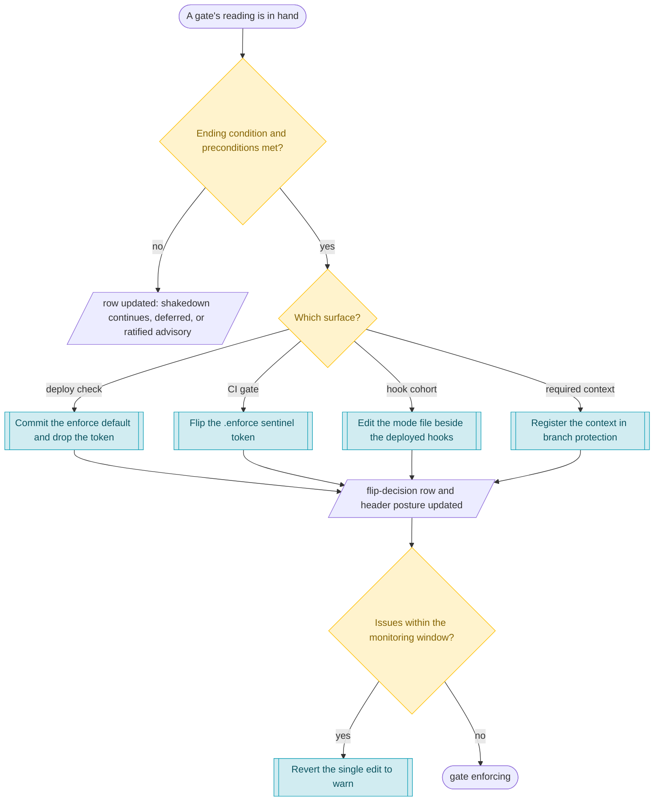

# Decide and record a gate's flip from warn to enforce

## Summary

A flip is one committed edit and one written decision. For a deploy check the edit is the committed default
`resolve_check_mode "<id>" "enforce"` with the graduation token dropped from its warn calls; for a CI gate it is the
`.enforce` sentinel token; for a hook cohort it is the shared or per-hook mode file beside the deployed hooks, which
is operator-instance state; and for a required context it is the branch-protection registration only the operator
can make. A runtime mode file can hold a check at warn or push one ahead, but it leaves no repository record and is
never the graduation. The decision itself goes into the gate's flip-decision row as one of six closed-set tokens,
and advance is never promoted by row count. Rollback is the same single edit reversed. Its
[ICOM](/core/process-catalog/definitions/pack.json) table (inputs, controls, outputs, mechanisms)
follows.

## ICOM

| Inputs | Controls | Outputs | Mechanisms |
|---|---|---|---|
| The drain reading and the rollout verdicts; the gate's flip-decision row and its ending condition; the Requirement (b′) CI-mirror precondition; for Check 22, the authority decision record's `status:`; the hook checklist's allowlist reviews | The one-token flip form; the never-a-mode-file rule for graduation; the closed decision-token set; the ≥3-day hook review and 48-hour monitoring; the host as the only surface that delivers a blocking posture | A committed default or sentinel token on a pull request; a mode-file edit on the instance; a registered context on the host; the updated flip-decision row and workflow header posture; a reverted edit on rollback | A pull request through the release pipeline; an edit beside the deployed hooks; the host's branch-protection settings; the standard's table |

## Flow

## Steps

| Step | Action | Actor | Inputs → outputs (shape) | Controls | Mechanism | Harness | Model need | Source |
|---|---|---|---|---|---|---|---|---|
| verify-flip-preconditions | Verify the gate's ending condition and preconditions | operator | the reading, the row's ending condition (a shakedown is terminable: its exit criterion is evaluable from committed state), the CI mirror that Requirement (b′) requires, the authority record's `status:` → proceed, or a non-flip token with its reason; a row count never promotes a gate | prose-only | reading the flip-decision row and its named sources | file-and-shell-tools | human | [gate-efficacy](/core/standards/gate-efficacy-standard.md#L533)<!-- source-anchor: line=533; fp=9ec9e0fefc47f376 -->; [gate-efficacy](/core/standards/gate-efficacy-standard.md#L144)<!-- source-anchor: line=144; fp=48037e3fe6251848 --> |
| choose-flip-surface | Choose the surface the flip lands on | operator | the gate's kind → a committed default (deploy check; the only form its graduation may take), a sentinel token (CI gate), a mode file (hook cohort) or a host registration (required context) | prose-only | the standard's flip mechanism paragraph | none | human | [deploy.sh](/core/deploy/deploy.sh#L9334)<!-- source-anchor: line=9334; fp=4f4ab862a7418d25 --> |
| commit-enforce-default | Commit the enforce default for a deploy check | operator | one dial call in `deploy.sh` → `resolve_check_mode "<id>" "enforce"` with the `committed-default` token dropped from the check's warn calls, on a pull request; the emitter-contract suite fails on a stale token | C-214: code-enforce | a pull request through the release pipeline | git-and-gh-cli | human | [deploy.sh](/core/deploy/deploy.sh#L9134)<!-- source-anchor: line=9134; fp=020aa2d26b75eabb --> |
| flip-enforce-sentinel | Flip a CI gate's committed sentinel | operator | `.github/<name>.enforce` → its first non-comment token set to `enforce` on a pull request; the probe reads it on its next run and maps findings to exit 1 | prose-only | a pull request | git-and-gh-cli | human | [deploy.sh](/core/deploy/deploy.sh#L22656)<!-- source-anchor: line=22656; fp=ed874b0c8b5aa2f4 --> |
| set-hook-mode-file | Flip a hook cohort's mode file after the shakedown checklist | operator | the shared `.mode` (seven hooks) or a per-hook file → `enforce`, after a review of at least 3 days and allowlisting; the destructive hook's three phased families graduate on their own constants, never on this file | C-381: prose-only | an edit beside the deployed hooks | file-and-shell-tools | human | [bypass-mode-readiness](/core/rules/bypass-mode-readiness.md#L889)<!-- source-anchor: line=889; fp=dc42b518c842cb87 --> |
| register-required-context | Register the context in branch protection | operator | the job's check-run name → a required status check on main, set operator-side in repository settings; in the standard's order the registration changes reality and the declaration follows it; the reconciliation gate then stops listing the context as held | host-config | the host's branch-protection settings | none | human | [gate-efficacy](/core/standards/gate-efficacy-standard.md#L134)<!-- source-anchor: line=134; fp=cf0e09f2444107bf --> |
| record-flip-decision | Record the decision in the flip-decision row | operator | the outcome → column 3 of the gate's row leads with a closed-set token (flipped, shakedown continues, DEFERRED — precondition-blocked, RATIFIED ADVISORY, DEFERRED WITH A DEADLINE, SPLIT DISPOSITION) and the workflow header's posture is updated | prose-only | an edit to the standard on the same pull request | git-and-gh-cli | human | [gate-efficacy](/core/standards/gate-efficacy-standard.md#L567)<!-- source-anchor: line=567; fp=4862c712998b4225 --> |
| revert-flip-on-issue | Roll back to warn when issues surface | operator | the block log over the 48-hour monitoring window → the mode file set back to `warn`, a single-file edit | C-381: prose-only | the same surface, reversed | file-and-shell-tools | human | [bypass-mode-readiness](/core/rules/bypass-mode-readiness.md#L890)<!-- source-anchor: line=890; fp=f4dee277132dc507 --> |

## Step profile

| Field | Value |
|---|---|
| Deterministic steps | 0 of 8 (determinism `scriptable`, counted from the Steps table) |
| Judgment steps | 0 by the notation — every step is the operator's and reads `human` |
| Operator steps | 8 |
| Harness features relied on | file-and-shell-tools, git-and-gh-cli |
| Context read | S (2k–8k tokens): the gate's row, its header and the reading |

## Evidence

| Lens | Source | Observation | Label |
|---|---|---|---|
| designed | [the gate-efficacy standard](/core/standards/gate-efficacy-standard.md) § Flip-decision status; [`core/deploy/deploy.sh`](/core/deploy/deploy.sh), the comment above `resolve_check_mode()` (the committed-default rule) and the emitter's token contract (the flip commit drops the token); [`bypass-mode-readiness.md`](/core/rules/bypass-mode-readiness.md) § Warn-mode shakedown — flip to enforce, § Shakedown → Enforce Transition Checklist | one flip form per surface; the mode file is a runtime override that leaves no repository record; the hook checklist flips seven hooks at once and excludes the five with their own file and the destructive hook's three phased families | [SOURCE] |
| built | [`core/deploy/deploy.sh`](/core/deploy/deploy.sh), Check 47, Check 50 and the gate-rollout constants; [`.github/skill-package-freshness.enforce`](/.github/skill-package-freshness.enforce); [`.github/deploy-check-ci.enforce`](/.github/deploy-check-ci.enforce); [the controls register](/core/process-catalog/definitions/controls-register.tsv), C-214, C-381 | Check 47 ships a committed enforce default and Check 50 a hardcoded enforce mode; the sentinels of the pre-merge subset and of the package-freshness probe read `enforce`, and the gate-rollout phase constant reads `enforce`; the other committed sentinels read `warn`; the standard's registration-disposition table records the subset's context as REGISTER | [SOURCE] |
| executed | measure `flip-decision-rows` — [flip-decision-rows.py](/core/deploy/tools/process-catalog-measures/flip-decision-rows.py) (population: the data rows of both tables under the gate-efficacy standard's flip-decision heading, in the checked-out tree) | The measure reports, per table of the flip-decision section, its row total and its rows by leading decision; a row that leads with `flipped` is counted under that token | [SOURCE] |
| executed | measure `gate-rollout-deadlines` — [gate-rollout-deadlines.py](/core/deploy/tools/process-catalog-measures/gate-rollout-deadlines.py) (population: the rollout constants of the deploy script and the destructive-operations hook and the committed enforce sentinels, classified as the deadline checks classify them on the day of the run) | The measure reports, per rollout family, its phase and its standing on the day of the run, and the committed enforce sentinels by token | [SOURCE] |
| designed vs built | [the gate-efficacy standard](/core/standards/gate-efficacy-standard.md) § Flip-decision status, its opening sentence ([gate-efficacy](/core/standards/gate-efficacy-standard.md#L531)<!-- source-anchor: line=531; fp=34d141acb1f53fe7 -->) and its lede ([gate-efficacy](/core/standards/gate-efficacy-standard.md#L537)<!-- source-anchor: line=537; fp=7c7e49a6508e153a -->); [`core/deploy/deploy.sh`](/core/deploy/deploy.sh), the phase constant ([deploy.sh](/core/deploy/deploy.sh#L207)<!-- source-anchor: line=207; fp=68f0cba8955ea2ba -->) and Check 47's default ([deploy.sh](/core/deploy/deploy.sh#L13165)<!-- source-anchor: line=13165; fp=af989d5ee8916f2b -->); [`.github/deploy-check-ci.enforce`](/.github/deploy-check-ci.enforce); [`.github/skill-package-freshness.enforce`](/.github/skill-package-freshness.enforce) | The section says each release that evaluates a warn-mode gate for graduation records its decision in the table, `flipped` among them, and the row form makes `flipped` a leading token of column 3; its lede closes by saying that no gate was flipped in the round of decisions it records and each remains advisory. Built: the committed sentinels of the pre-merge subset and of the package-freshness probe read `enforce`, the gate-rollout phase constant reads `enforce`, and Check 47 ships a committed enforce default. None of the table's rows leads with `flipped`: the subset's flip stands in the posture cell of a split-disposition row and in the registration-disposition table, and neither Check 47 nor Check 50 is the gate of any row | [SOURCE] |
| executed | no measure — what would show whether a hook cohort has been flipped is the mode files beside the deployed hooks, which are operator-instance state and are not committed. | No measure in the measures register reads a mode file | [SOURCE] |

## Navigation

<!-- nav:begin -->
Up: [graduate-gate-modes](graduate-gate-modes.md) · Previous: [reconcile-gate-posture](reconcile-gate-posture.md)
<!-- nav:end -->

## Sources

- [`core/standards/gate-efficacy-standard.md`](/core/standards/gate-efficacy-standard.md) — the flip mechanism, the row form, the closed decision-token set and the registration-disposition table
- [`core/deploy/deploy.sh`](/core/deploy/deploy.sh) — the committed-default rule, the token-dropping commit, the sentinel reads, the gate-rollout constants, Check 47 and Check 50
- [`core/rules/bypass-mode-readiness.md`](/core/rules/bypass-mode-readiness.md) — the hook shakedown checklist and rollback
- [`core/hooks/deploy-check.mode.template`](/core/hooks/deploy-check.mode.template) — the shipped `warn` an instance file inherits
- [`.github/deploy-check-ci.enforce`](/.github/deploy-check-ci.enforce), [`.github/skill-package-freshness.enforce`](/.github/skill-package-freshness.enforce) — the two committed sentinels that read `enforce`
- [`core/process-catalog/definitions/controls-register.tsv`](/core/process-catalog/definitions/controls-register.tsv) — C-214, C-381
