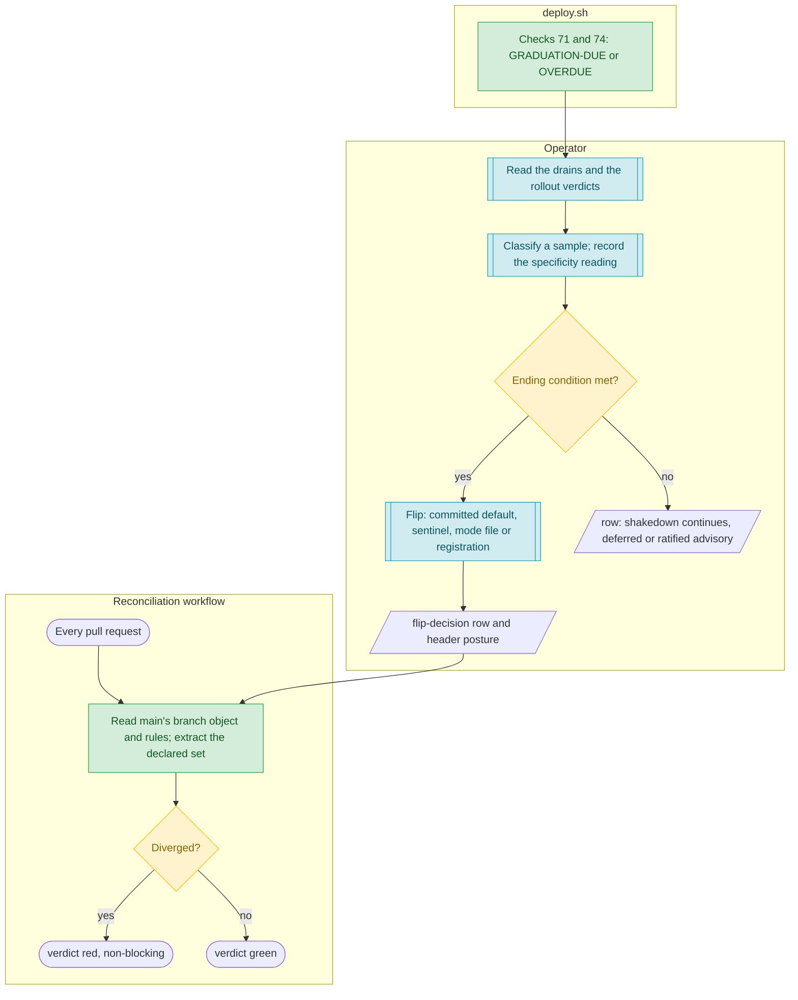

# Review warn logs and graduate gate modes

## Summary

A gate that ships in warn mode records findings instead of failing runs; this sub-process is how such a gate
leaves that state. The operator reads the drains — the deploy-check warn log per check id across its segments and
each hook's drain per rule — classifies a sample, and records the reading in the gate's flip-decision row; Check 71
and Check 74 put a rollout decision on a committed deadline, and HSR-1 makes the hook-layer reading a Stage 13
Close obligation. In parallel a workflow reconciles, on every pull request, the postures the headers declare
against main's live required contexts, read from its branch object and from the rules that apply to it. A flip is
one committed change on the right surface plus a decision token from a closed set; a decline or a deferral is
recorded the same way. None of the flip-decision table's rows leads with `flipped`, while two committed sentinels
and the gate-rollout phase constant read `enforce`.

## Entry and exit

| Side | Criteria | Source |
|---|---|---|
| Entry | A review window is reached — Check 71 or 74 prints GRADUATION-DUE, a gate's own `2–3 release` threshold elapses, or the hook checklist's three warn-mode days have passed; Stage 13 Close triggers HSR-1 and the Check 14 assessment; any pull request triggers the reconciliation, whose verdict job then runs only on a `RECONCILED` or `DIVERGED` measurement and is skipped otherwise | [deploy.sh](/core/deploy/deploy.sh#L17782)<!-- source-anchor: line=17782; fp=60a81147bb418d35 -->; [bypass-mode-readiness](/core/rules/bypass-mode-readiness.md#L1013)<!-- source-anchor: line=1013; fp=e2f9755e289b06d3 -->; [doc-link-maintenance](/core/rules/doc-link-maintenance.md#L131)<!-- source-anchor: line=131; fp=72e6afd233f209b3 -->; [gate-posture-reconciliation.yml](/.github/workflows/gate-posture-reconciliation.yml#L218)<!-- source-anchor: line=218; fp=32825e2398cb93f5 --> |
| Exit | The gate's flip-decision row carries a closed-set token with its rationale and, where a flip happened, the committed default, sentinel token, mode-file value or host registration is in place and the workflow header's posture updated; the reconciliation verdict check-run has concluded success, failure or skipped | [gate-efficacy](/core/standards/gate-efficacy-standard.md#L569)<!-- source-anchor: line=569; fp=4862c712998b4225 -->; [gate-posture-reconciliation.yml](/.github/workflows/gate-posture-reconciliation.yml#L41)<!-- source-anchor: line=41; fp=e39189882c036ef1 --> |

## Flow

## Activities

| Activity | Primary actor | Purpose | Page |
|---|---|---|---|
| Review the warn-log drains and rollout verdicts | operator | Read what the warn-mode gates recorded and classify it into a reading | [review-warn-log-drains](review-warn-log-drains.md) |
| Reconcile declared gate posture against live branch protection | ci:gate-posture-reconciliation | Measure the declared-required set against the live one on every pull request | [reconcile-gate-posture](reconcile-gate-posture.md) |
| Decide and record a gate's flip from warn to enforce | operator | Land the one committed change and the decision token, or record why not | [flip-gate-to-enforce](flip-gate-to-enforce.md) |

## Controls

| Control | Source | Enforcement class | Surface | Applies to |
|---|---|---|---|---|
| Every hook rule that wrote drain rows since the previous review receives a specificity reading at each Stage 13 Close | [`bypass-mode-readiness.md`](/core/rules/bypass-mode-readiness.md) § HSR-1 (C-380) | prose-only | — | review-warn-log-drains |
| A warn-mode hook flips to enforce only after a review of at least three days of warn-log activity and allowlisting of legitimate false positives | [`bypass-mode-readiness.md`](/core/rules/bypass-mode-readiness.md) § Shakedown → Enforce Transition Checklist (C-381) | prose-only | — | flip-gate-to-enforce |
| Stage 13 Close at the first release after merge carries a Check 14 flip-to-enforce assessment line; silent deferral is a process violation | [`doc-link-maintenance.md`](/core/rules/doc-link-maintenance.md) § Initial Mode + Flip-to-Enforce Timeline (C-359) | prose-only | — | review-warn-log-drains |
| Declared-required contexts and live required contexts do not diverge; a divergence turns the verdict check red and blocks nothing | [`gate-posture-reconciliation.yml`](/.github/workflows/gate-posture-reconciliation.yml), the verdict job (C-213) | code-enforce | ci-run | reconcile-gate-posture |
| The reconciler's self-test passes with the shared parser loaded before anything is measured | [`gate-posture-reconciliation.yml`](/.github/workflows/gate-posture-reconciliation.yml), the measurement job (C-212) | code-enforce | ci-run | reconcile-gate-posture |
| An undecided rollout past its escalation day fails `--check`: the destructive hook's three phased families and the bundle-metrics integrity limb each carry committed deadline constants | [`core/deploy/deploy.sh`](/core/deploy/deploy.sh), Checks 71 and 74 (C-191, C-194) | code-enforce (deadline arm) / code-warn (evidence arm) | deploy-run | review-warn-log-drains |
| A flip is never promoted by row count, graduates a deploy check only by a committed default, and is recorded in the flip-decision row with a closed-set token | [the gate-efficacy standard](/core/standards/gate-efficacy-standard.md) § Flip-decision status | prose-only | — | flip-gate-to-enforce |

## Evidence

| Lens | Source | Observation | Label |
|---|---|---|---|
| designed | [the gate-efficacy standard](/core/standards/gate-efficacy-standard.md) § Flip-decision status, § Written sink and terminable shakedown; [`bypass-mode-readiness.md`](/core/rules/bypass-mode-readiness.md) § Warn-Mode vs. Enforce-Mode, § Shakedown → Enforce Transition Checklist | a warn-mode declaration needs a written sink and a terminable shakedown; the drain history is the criterion for an out-of-tree subject; a hook is in a mode file's cohort exactly when its own mode-file setting names that file | [SOURCE] |
| built | [`core/deploy/deploy.sh`](/core/deploy/deploy.sh), Checks 71 and 74; [`reconcile-gate-posture.py`](/core/deploy/tools/reconcile-gate-posture.py); [the controls register](/core/process-catalog/definitions/controls-register.tsv), C-191, C-194, C-212, C-213, C-359, C-380, C-381 | the deadline arms of Checks 71 and 74 and the reconciliation workflow are code; the register classes the hook-layer reading, the hook flip and the Check 14 assessment `prose-only` | [SOURCE] |
| executed | measure `flip-decision-rows` — [flip-decision-rows.py](/core/deploy/tools/process-catalog-measures/flip-decision-rows.py) (population: the data rows of both tables under the gate-efficacy standard's flip-decision heading, in the checked-out tree) | The measure reports, per table of the flip-decision section, its row total and its rows by leading decision. A specificity reading is not a leading decision, so the measure does not show whether a row carries one | [SOURCE] |
| designed vs described | [`bypass-mode-readiness.md`](/core/rules/bypass-mode-readiness.md) § HSR-1, its declared observable ([bypass-mode-readiness](/core/rules/bypass-mode-readiness.md#L1016)<!-- source-anchor: line=1016; fp=ad7627fca59f99ee -->); [the gate-efficacy standard](/core/standards/gate-efficacy-standard.md) § Flip-decision status, the rows for the hook rules on the shared dial ([gate-efficacy](/core/standards/gate-efficacy-standard.md#L581)<!-- source-anchor: line=581; fp=46093d72a4144893 -->, [gate-efficacy](/core/standards/gate-efficacy-standard.md#L582)<!-- source-anchor: line=582; fp=d855d386e97f2e15 -->) | HSR-1 makes a specificity reading for every hook rule that wrote drain rows an obligation of each Stage 13 Close, and names its observable: a dated classification line in the rule's flip-decision row. The table's row for the fs-boundary rule says no sample has been classified, the row for the shell-injection rule says it is blocked on the same preconditions, and neither carries a line in the declared form | [SOURCE] |
| executed | measure `gate-rollout-deadlines` — [gate-rollout-deadlines.py](/core/deploy/tools/process-catalog-measures/gate-rollout-deadlines.py) (population: the rollout constants of the deploy script and the destructive-operations hook and the committed enforce sentinels, classified as the deadline checks classify them on the day of the run) | The measure reports, per rollout family, its phase and its standing on the day of the run, and the committed enforce sentinels by token | [SOURCE] |
| executed | measure `workflow-runs-deploy-probes` — [workflow-run-history.py](/core/deploy/tools/process-catalog-measures/workflow-run-history.py) (population: every run of each named workflow created in the trailing window, read in slices and verified against the host's total for each slice) · [`gate-posture-reconciliation.yml`](/.github/workflows/gate-posture-reconciliation.yml) | The measure reports, per named workflow, its run total and its runs by conclusion; the reconciliation workflow is one of them. A failed run is a measured divergence or a broken instrument, which a run-level read does not separate | [SOURCE] |
| executed | no measure — what would show whether a hook cohort has been flipped is the mode files beside the deployed hooks, which are operator-instance state and are not committed. | No measure in the measures register reads a mode file | [SOURCE] |

## Navigation

<!-- nav:begin -->
Up: [run-platform-health-check](run-platform-health-check.md) · Previous: [run-check-probes](run-check-probes.md) · Down: [review-warn-log-drains](review-warn-log-drains.md) · [reconcile-gate-posture](reconcile-gate-posture.md) · [flip-gate-to-enforce](flip-gate-to-enforce.md)
<!-- nav:end -->

## Sources

- [`core/standards/gate-efficacy-standard.md`](/core/standards/gate-efficacy-standard.md) — the warn-mode declaration axes, the flip mechanism and the flip-decision table
- [`core/rules/bypass-mode-readiness.md`](/core/rules/bypass-mode-readiness.md) — the hook shakedown, HSR-1 and HSR-2
- [`core/rules/doc-link-maintenance.md`](/core/rules/doc-link-maintenance.md) — the Check 14 flip timeline
- [`core/deploy/tools/reconcile-gate-posture.py`](/core/deploy/tools/reconcile-gate-posture.py); [`.github/workflows/gate-posture-reconciliation.yml`](/.github/workflows/gate-posture-reconciliation.yml) — the reconciliation
- [`core/deploy/deploy.sh`](/core/deploy/deploy.sh) — Checks 71 and 74 and the committed-default rule
- [`core/process-catalog/definitions/controls-register.tsv`](/core/process-catalog/definitions/controls-register.tsv) — C-191, C-194, C-212, C-213, C-359, C-380, C-381
