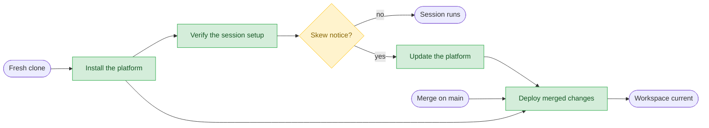

# Install or update the platform

## Summary

The stream starts outside the platform's own flow — an operator clones the repository onto a machine, or a session's
SessionStart hook reports that a newer release is published, or a merge lands on main in the primary checkout — and
ends with a workspace whose runtime copies match the version in the clone. Four sub-processes carry it: the install
(bootstrap, full-roster deploy, validation), the update (config reconcile, surface regeneration, redeploy, hook and
settings refresh), the deploy itself (the one carrier from repository to runtime, reached by the installer, the
updater, the post-merge hook and the release pipeline's Stage 12), and the session-start verification that hands
the operator the update prompt. The operator decides at four points: the identity answers, the workflow-hook
activation, whether to act on a skew notice, and a schema key with no default. Every run leaves the exit code as its
record; CI exercises the install and update flows in sandboxes on every pull request. The
[SIPOC](/core/process-catalog/definitions/pack.json) table follows.

## SIPOC

| Suppliers | Inputs | High-level steps | Outputs | Customers |
|---|---|---|---|---|
| The repository host (the clone, the published releases, the merged main); the operator; the desktop app (a session path, when present) | A clone at a version; the templates, manifest, hooks, skills and packages it carries; the operator's identity answers and host choices; the installed state and the operator's additions | Bootstrap → deploy the roster → validate → (each session) verify and notify → pull and update → redeploy and refresh → (each merge) redeploy the merge's skills | `operator.toml` and the composed context and settings files; the hook bundle and its registrations; 21 fenced surfaces; the rules mirror; the skills, references and packages at their targets; the state and update markers; an exit code | The operator's sessions (every hook, rule and skill they load); the operations workspace (its context anchor); the release pipeline (Stage 12 deploys through the same carrier); the health-check stream (Checks 1–13, 70, 77–79 police the result) |

## Flow

## Sub-processes

| Sub-process | Entry | Exit | Page |
|---|---|---|---|
| Install the platform on a workspace | a clone with its marker files on macOS with the prerequisites; `./install.sh` from the clone root | the state file records a passed verification gate; the full roster deployed; the validator reports PASS | [install-platform](install-platform.md) |
| Update an installed workspace to a newer version | a bootstrapped workspace, the clone pulled, `./update.sh` | exit 0 (applied), 64 (nothing to do) or 75 (a control left on superseded bytes); `.last-update` written; validation as the follow-up | [update-platform](update-platform.md) |
| Deploy merged changes to the runtime | `deploy.sh --deploy` from the repo root — bare, named, `--all` or release-stamped; the post-merge hook supplies names on the primary checkout | every selected artifact byte-identical at its targets, the rules mirror laid down, the summary printed; non-zero only on unrepaired drift | [deploy-merged-changes](deploy-merged-changes.md) |
| Verify the session setup at session start | a session resolves the workspace settings surface | the session runs; at most a skew notice and a posture finding on stderr | [verify-session-setup](verify-session-setup.md) |

## Controls

| Control | Source | Enforcement class | Surface | Applies to |
|---|---|---|---|---|
| The shell, hook, install/onboarding/update regression and cross-platform suites pass on every pull request | [`.github/workflows/install-tests.yml`](/.github/workflows/install-tests.yml) (C-214 to C-217) | code-enforce | merge-gate | install-platform, update-platform |
| Deployed skills, packages, the user-local mirror and the injected references match their sources | `core/deploy/deploy.sh` Checks 1, 2, 12, 13 (C-119, C-120, C-131, C-132) | code-enforce | deploy-run | deploy-merged-changes |
| Every package's content hash reflects its source, at deploy time | `core/deploy/deploy.sh` Check 7 (C-126) | code-enforce | deploy-run | deploy-merged-changes |
| The rules mirror is byte-identical and present; its holders agree; the admitted set stays within budget | `core/deploy/deploy.sh` Checks 9, 77, 78 (C-128, C-197, C-198) | code-warn | deploy-run | deploy-merged-changes |
| The operator config matches its declared schema and template | `core/deploy/deploy.sh` Check 70 (C-190) | code-enforce (parity arms) / code-warn (schema arm) | deploy-run | install-platform, update-platform |
| A session behind the latest release is notified, never updated | [`core/hooks/notify-version-skew.sh`](/core/hooks/notify-version-skew.sh) (C-079) | code-warn | hook | verify-session-setup |
| Runtime model and effort drift are reported at launch | [`core/hooks/verify-session-config.sh`](/core/hooks/verify-session-config.sh) (C-074 to C-076) | code-off | hook | verify-session-setup |
| The installer and the update path seed managed Layer-2 files install-if-missing and never write operator content | [`core/rules/operations-bridge.md`](/core/rules/operations-bridge.md) (C-367) | prose-only | — | install-platform, update-platform |
| The post-merge hook carries no release identity; a stamped deploy never auto-detects | [`core/rules/skill-deployment.md`](/core/rules/skill-deployment.md) (C-379) | prose-only | — | deploy-merged-changes |

## Evidence

| Lens | Source | Observation | Label |
|---|---|---|---|
| designed | [`docs/INSTALL.md`](/docs/INSTALL.md), [`docs/UPDATE.md`](/docs/UPDATE.md), [`docs/ONBOARDING_JOURNEY.md`](/docs/ONBOARDING_JOURNEY.md) | four install commands and two phases; pull then update with a five-step summary and a full effect list; a seven-stage journey whose host choices ship with working defaults | [SOURCE] |
| designed | `core/rules/skill-deployment.md`, [`core/rules/harness-deployment.md`](/core/rules/harness-deployment.md), `core/rules/operations-bridge.md`, "Cross-Domain Read Access" | the deploy steps and the automatic post-merge deploy; the deploy-produced rules mirror; the installer as the sanctioned Layer-2 seed-writer | [SOURCE] |
| built | `install.sh`, `update.sh`, [`core/deploy/orchestrate.sh`](/core/deploy/orchestrate.sh), `core/deploy/deploy.sh` `cmd_deploy`, `core/settings.json.template`, the SessionStart block | both entry points converge on one skill-deploy phase and one carrier; three SessionStart hooks on the workspace surface only; the Windows entry points preview and exit 3 otherwise | [SOURCE] |
| executed | measure `workflow-runs-install-security` — [workflow-run-history.py](/core/deploy/tools/process-catalog-measures/workflow-run-history.py) (population: every run of each named workflow created in the trailing window, split by trigger event, read in slices and verified against the host's total for each slice) · [`install-tests.yml`](/.github/workflows/install-tests.yml) | The measure reports the install-test workflow's runs by trigger event and conclusion; its jobs install and update in sandboxes | [SOURCE] |
| executed | no measure — the session-start verifier's findings go to the warn log, which no measure in the measures register reads. | The page says nothing of what the verifier reports or how often | [SOURCE] |
| executed | measure `event-log-deploy-status` — [event-log-deploy-status.py](/core/deploy/tools/process-catalog-measures/event-log-deploy-status.py) (population: the deployment-status rows of the pipeline event log, among rows whose release key is a milestone title or a tag name on the host; a key another repository shares is counted, and a legacy row older than the host's tags is not) | The measure reports release-stamped deploy rows by release key and outcome; install, update and post-merge deploys write none by design; one install's working state; supports no verdict on this page | [SOURCE] |
| executed | measure `event-log-deploy-replay` — [event-log-deploy-replay.py](/core/deploy/tools/process-catalog-measures/event-log-deploy-replay.py) (population: the stamped-deploy cases of the pipeline event log, among rows whose release key is a milestone title or a tag name on the host; a key another repository shares is counted, and a legacy row older than the host's tags is not) | The measure replays each stamped-deploy case against the documented order (mirror, skills, packages, harness) and reports the fit; one install's working state; supports no verdict on this page | [SOURCE] |
| executed | no measure — what would show an operator's own install or update is that install's state file and update marker. | No measure in the measures register reads an operator's own install or update | [SOURCE] |

## Navigation

<!-- nav:begin -->
Up: [engineering-harness](engineering-harness.md) · Next: [run-platform-health-check](run-platform-health-check.md) · Down: [install-platform](install-platform.md) · [update-platform](update-platform.md) · [deploy-merged-changes](deploy-merged-changes.md) · [verify-session-setup](verify-session-setup.md)
<!-- nav:end -->

## Sources

- [`install.sh`](/install.sh), [`install.ps1`](/install.ps1), [`update.sh`](/update.sh), [`update.ps1`](/update.ps1) — the entry points
- [`docs/scripts/setup-workspace.sh`](/docs/scripts/setup-workspace.sh), [`docs/scripts/validate-install.sh`](/docs/scripts/validate-install.sh), [`doctor.sh`](/doctor.sh), [`qa.sh`](/qa.sh) — bootstrap, validation, diagnosis
- [`core/deploy/orchestrate.sh`](/core/deploy/orchestrate.sh), [`core/deploy/deploy.sh`](/core/deploy/deploy.sh), [`core/deploy/compose.py`](/core/deploy/compose.py), [`core/deploy/composition-surface-manifest.sh`](/core/deploy/composition-surface-manifest.sh) — the carrier and the composition surface
- [`core/hooks/notify-version-skew.sh`](/core/hooks/notify-version-skew.sh), [`core/hooks/verify-session-config.sh`](/core/hooks/verify-session-config.sh), [`core/hooks/git-post-merge-deploy.sh`](/core/hooks/git-post-merge-deploy.sh), [`core/settings.json.template`](/core/settings.json.template) — the hooks and their registrations
- [`core/rules/skill-deployment.md`](/core/rules/skill-deployment.md), [`core/rules/harness-deployment.md`](/core/rules/harness-deployment.md), [`core/rules/operations-bridge.md`](/core/rules/operations-bridge.md) — the governing rules
- [`docs/INSTALL.md`](/docs/INSTALL.md), [`docs/UPDATE.md`](/docs/UPDATE.md), [`docs/ONBOARDING_JOURNEY.md`](/docs/ONBOARDING_JOURNEY.md) — the documented procedures
- [`.github/workflows/install-tests.yml`](/.github/workflows/install-tests.yml) — the CI workflow
- [`core/process-catalog/definitions/controls-register.tsv`](/core/process-catalog/definitions/controls-register.tsv) — C-074 to C-076, C-079, C-119, C-120, C-126, C-128, C-131, C-132, C-190, C-197, C-198, C-214 to C-217, C-367, C-379
