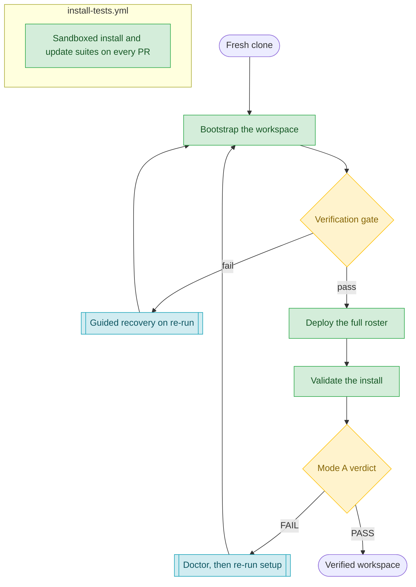

# Install the platform on a workspace

## Summary

An install starts with a clone and `./install.sh` and ends with a workspace whose state file records a passed
verification gate, whose user-local skills mirror carries the whole roster, and whose validator reports PASS. Three
activities carry it: the bootstrap (Phase 1, `setup-workspace.sh`), the full-roster deploy (Phase 2, `deploy.sh
--deploy` with no arguments — the deploy sub-process entered on its empty-mirror branch), and the validation the
operator runs afterwards. The decision points are the operator's: the identity prompts, the workflow-hook activation
choice, and whether to proceed from a failed gate into guided recovery. The Windows entry point only previews.
When an install looks broken the operator runs the read-only two-layer diagnosis, `doctor.sh`, which reuses the
QA-as-code registry through `qa.sh`.

## Entry and exit

| Side | Criteria | Source |
|---|---|---|
| Entry | A clone with its marker files, on macOS with `python3`, `shasum`, `git` and `jq` (exit 78 / 69 / 66 otherwise); `./install.sh` run from the clone root; on Windows only `install.ps1 -DryRun` runs, through the shared [`core/deploy/lib-dryrun-proxy.ps1`](/core/deploy/lib-dryrun-proxy.ps1) proof primitives (exit 3 otherwise) | [install.sh](/install.sh#L76)<!-- source-anchor: line=76; fp=6212afec21124365 -->; [setup](/docs/scripts/setup-workspace.sh#L474)<!-- source-anchor: line=474; fp=7af34357e69cdf2a -->; [install.ps1](/install.ps1#L102)<!-- source-anchor: line=102; fp=3392cfdcc9ab2908 --> |
| Exit | `.workspace-setup.state` carries `verification_passed: true`; `deploy.sh` reported the full roster deployed; `validate-install.sh` Mode A is PASS (the documented fourth command); the next step is the first-task walkthrough | [setup](/docs/scripts/setup-workspace.sh#L3467)<!-- source-anchor: line=3467; fp=87b29e7568f40990 -->; [install.sh](/install.sh#L238)<!-- source-anchor: line=238; fp=b5fb67a4cfd2796f -->; [INSTALL.md](/docs/INSTALL.md#L149)<!-- source-anchor: line=149; fp=b565fa398edd1369 --> |

## Flow

## Activities

| Activity | Primary actor | Purpose | Page |
|---|---|---|---|
| Bootstrap the workspace (Phase 1) | script:setup-workspace.sh | Lay down layout, config, composed files, hooks and seeds; verify and record the state | [bootstrap-workspace](bootstrap-workspace.md) |
| Deploy the full skill roster (Phase 2) | script:deploy.sh | The deploy sub-process entered with no arguments on an empty mirror — shared with `deploy-merged-changes` | [select-deploy-targets](select-deploy-targets.md) · [deploy-skill-artifacts](deploy-skill-artifacts.md) |
| Validate the install and the first task | script:validate-install.sh | Assert the sixteen install facts and hand the operator the demo-skill proof | [validate-install](validate-install.md) |

## Controls

| Control | Source | Enforcement class | Surface | Applies to |
|---|---|---|---|---|
| The shell, hook, install/onboarding/update regression and cross-platform suites pass on every pull request | [`.github/workflows/install-tests.yml`](/.github/workflows/install-tests.yml) (C-214 to C-217) | code-enforce | merge-gate | bootstrap-workspace, validate-install |
| The installer seeds managed Layer-2 files install-if-missing and never writes operator content | [`core/rules/operations-bridge.md`](/core/rules/operations-bridge.md) (C-367) | prose-only | — | bootstrap-workspace |
| The user-local skills mirror matches the deployed set | [`core/deploy/deploy.sh`](/core/deploy/deploy.sh) Check 12 (C-131) | code-enforce | deploy-run | select-deploy-targets |
| The operator config matches its declared schema and template | `core/deploy/deploy.sh` Check 70 (C-190) | code-enforce (parity arms) / code-warn (schema arm) | deploy-run | bootstrap-workspace |
| The platform-config surfaces are structurally sound | `core/deploy/deploy.sh` Check 33 (C-155) | code-warn | deploy-run | bootstrap-workspace |
| Deployed canonical-session-path artifacts are fresh against their source | `core/deploy/deploy.sh` Check 8 (C-127) | code-warn | deploy-run | select-deploy-targets |
| Darwin only by default: a non-Darwin platform exits 78 before any write | [`docs/scripts/setup-workspace.sh`](/docs/scripts/setup-workspace.sh), `check_platform` | code-enforce | — | bootstrap-workspace |

## Evidence

| Lens | Source | Observation | Label |
|---|---|---|---|
| designed | [`docs/INSTALL.md`](/docs/INSTALL.md), "TL;DR", "Run the install" and "Verify install" | four commands; two phases; twelve bootstrap steps; validate afterwards; macOS only at this release | [SOURCE] |
| designed | [`docs/ONBOARDING_JOURNEY.md`](/docs/ONBOARDING_JOURNEY.md), the journey table | the seven-stage journey; J4 (configure hosts) ships defaults so a fresh install runs end-to-end with no action | [SOURCE] |
| built | [`install.sh`](/install.sh), [`docs/scripts/setup-workspace.sh`](/docs/scripts/setup-workspace.sh) `fresh_install`, [`core/deploy/orchestrate.sh`](/core/deploy/orchestrate.sh), `core/deploy/deploy.sh` `should_full_roster` | the two phases as documented; the empty-mirror branch is what makes Phase 2 deploy everything unattended | [SOURCE] |
| executed | measure `workflow-runs-install-security` — [workflow-run-history.py](/core/deploy/tools/process-catalog-measures/workflow-run-history.py) (population: every run of each named workflow created in the trailing window, split by trigger event, read in slices and verified against the host's total for each slice) · [`install-tests.yml`](/.github/workflows/install-tests.yml) | The measure reports the runs of the install-test workflow by trigger event and conclusion. Its jobs run the install and update flows in sandboxes; a run shows nothing of an operator's own install | [SOURCE] |
| executed | no measure — what would show an operator's own install is that install's state file and the validator's run record. | No measure in the measures register reads an operator's own install | [SOURCE] |

## Navigation

<!-- nav:begin -->
Up: [install-or-update-workspace](install-or-update-workspace.md) · Next: [update-platform](update-platform.md) · Down: [bootstrap-workspace](bootstrap-workspace.md) · [validate-install](validate-install.md)
<!-- nav:end -->

## Sources

- [`install.sh`](/install.sh), [`install.ps1`](/install.ps1) — the two entry points
- [`docs/scripts/setup-workspace.sh`](/docs/scripts/setup-workspace.sh) — the bootstrap
- [`docs/scripts/validate-install.sh`](/docs/scripts/validate-install.sh), [`doctor.sh`](/doctor.sh), [`qa.sh`](/qa.sh) — validation, and the read-only diagnosis scripts this page depicts
- [`docs/INSTALL.md`](/docs/INSTALL.md), [`docs/ONBOARDING_JOURNEY.md`](/docs/ONBOARDING_JOURNEY.md) — the documented procedure
- [`core/deploy/orchestrate.sh`](/core/deploy/orchestrate.sh), [`core/deploy/deploy.sh`](/core/deploy/deploy.sh) — Phase 2's entry and the deploy it runs
- [`core/rules/operations-bridge.md`](/core/rules/operations-bridge.md) — the installer's writer invariant
- [`.github/workflows/install-tests.yml`](/.github/workflows/install-tests.yml) — the CI suites; [`controls-register.tsv`](/core/process-catalog/definitions/controls-register.tsv) — C-127, C-131, C-155, C-190, C-214 to C-217, C-367
