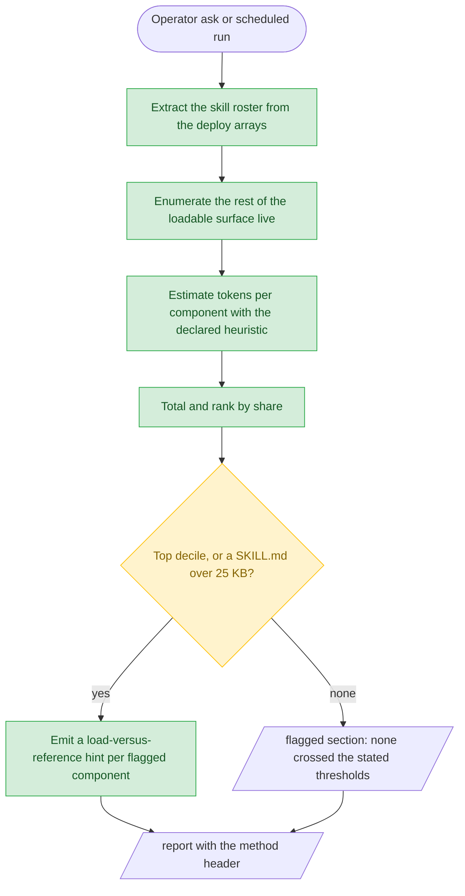

# Measure the per-session context budget

## Summary

The auditor measures the static corpus a session loads — the skill catalog rostered from the deploy arrays, the
rules, the standards, schemas, specs and disciplines, agent definitions, hooks, the context-file chain and any
connector schemas present — and estimates each component's tokens as `ceil(words / 0.75)`, declaring the method in
the report header so the figure reads as a trend signal, not an absolute. It totals, ranks, flags anything in the top
decile or over the 25 KB single-file ceiling the canonical-skill standard already sets, and hints for each flag
whether the component is load-justified or a candidate to move to reference. It writes only the report and is never
a check gate. Its [ICOM](/core/process-catalog/definitions/pack.json) table (inputs, controls,
outputs, mechanisms) follows.

## ICOM

| Inputs | Controls | Outputs | Mechanisms |
|---|---|---|---|
| The deploy module arrays; the rules, standards, schemas, specs and disciplines trees; agent files; the deployed hooks; the context-file chain; connector tool schemas when a session has them | The live-roster rule (never a hardcoded count); the declared heuristic and multiplier; the two stated thresholds; the read-only posture; the not-a-check-gate boundary | A report (in the generated-artifact folder of a project session, else stdout): method header, total, per-class table with share, flagged section with thresholds inline, a load-versus-reference hint per flag, roster provenance | The scan script; `wc -w` and `wc -c`; an optional tokenizer column |

## Flow

## Steps

| Step | Action | Actor | Inputs → outputs (shape) | Controls | Mechanism | Harness | Model need | Source |
|---|---|---|---|---|---|---|---|---|
| resolve-skill-roster | Resolve the skill roster from the deploy arrays | script:measure-context-budget.sh | the three module arrays in [deploy.sh](/core/deploy/deploy.sh) → the list of skill definition files, never a literal count | C-377: code-enforce (narrow) | an awk window over the arrays | file-and-shell-tools | XS/none/read/scriptable/batch | [SKILL.md](/core/skills/context-budget-auditor/SKILL.md#L54)<!-- source-anchor: line=54; fp=76aa96e9155f1038 --> |
| enumerate-loadable-surface | Enumerate the rest of the loadable surface | script:measure-context-budget.sh | the rules, standards, schemas, specs and disciplines trees, agent files, deployed hooks, the context-file chain, connector schemas if present → one component list; a missing surface reported as not present, never an error | prose-only | `find` and `ls` over the trees | file-and-shell-tools | XS/none/read/scriptable/batch | [SKILL.md](/core/skills/context-budget-auditor/SKILL.md#L64)<!-- source-anchor: line=64; fp=5ed55ce763e646d0 --> |
| estimate-component-tokens | Estimate each component's tokens | script:measure-context-budget.sh | each file's word and byte counts → `ceil(words / 0.75)` tokens, labelled inferred; an optional tokenizer column for a named model, never the silent primary | prose-only | `wc -w`, `wc -c` | file-and-shell-tools | XS/none/read/scriptable/batch | [SKILL.md](/core/skills/context-budget-auditor/SKILL.md#L55)<!-- source-anchor: line=55; fp=e6b21d5dd4fa9fe7 --> |
| total-and-rank | Total and rank the components | script:measure-context-budget.sh | per-component estimates → the total loaded figure and each component's share | prose-only | arithmetic in the script | file-and-shell-tools | XS/none/read/scriptable/batch | [SKILL.md](/core/skills/context-budget-auditor/SKILL.md#L56)<!-- source-anchor: line=56; fp=2d6eaa619240480d --> |
| flag-bloat-candidates | Flag components against the two stated thresholds | script:measure-context-budget.sh | shares and byte counts → each component in the top decile of share, or any SKILL.md over 25,600 bytes, flagged with the crossing value; an empty result stated explicitly | prose-only | the script's threshold pass | file-and-shell-tools | XS/none/read/scriptable/batch | [SKILL.md](/core/skills/context-budget-auditor/SKILL.md#L57)<!-- source-anchor: line=57; fp=bca0c36e1ebd1e8e --> |
| emit-load-vs-reference-hint | Hint load-justified or move-to-reference per flag | skill:context-budget-auditor | each flagged component against the knowledge-architecture load-versus-reference boundary → a recommendation labelled as such | prose-only | reading the flagged rows against the discipline | none | S/medium/read/judgment/interactive | [SKILL.md](/core/skills/context-budget-auditor/SKILL.md#L58)<!-- source-anchor: line=58; fp=814eede73334588b --> |
| write-budget-report | Write the report | skill:context-budget-auditor | the table, flags and hints → a report with the method header, survey date and commit, roster provenance; to the generated-artifact folder in a project session, else stdout; no component modified | prose-only | the report template | file-and-shell-tools | S/low/write/templated/interactive | [SKILL.md](/core/skills/context-budget-auditor/SKILL.md#L81)<!-- source-anchor: line=81; fp=8df20f77b3db36d4 --> |

## Step profile

| Field | Value |
|---|---|
| Deterministic steps | 5 of 7 (determinism `scriptable`, counted from the Steps table) |
| Judgment steps | 1 (determinism `judgment`: the load-versus-reference hint); the report write is templated and sits in neither count |
| Harness features relied on | file-and-shell-tools |
| Context read | S (2k–8k tokens): the per-component table and the flagged rows |

## Evidence

| Lens | Source | Observation | Label |
|---|---|---|---|
| designed | [`core/skills/context-budget-auditor/SKILL.md`](/core/skills/context-budget-auditor/SKILL.md), § Role to § Principal Standard (version v3.41) | a single Measure mode at Tier 0; the roster is parameterized on the deploy arrays; the skill is explicitly not coupled to `deploy.sh --check` and must not be wired into it | [SOURCE] |
| built | [`core/skills/context-budget-auditor/scripts/measure-context-budget.sh`](/core/skills/context-budget-auditor/scripts/measure-context-budget.sh); [`core/rules/skill-deployment.md`](/core/rules/skill-deployment.md) § Count convention (C-377) | a pure-bash scan with no dependency beyond the core utilities; its roster read applies the count convention | [SOURCE] |
| executed | held local — what would show how often the skill is invoked is the record of sessions across an install. | Nothing from that store is published | [SOURCE] |
| designed vs built | the Triggers table of the skill definition, its scheduled-run row ([SKILL.md](/core/skills/context-budget-auditor/SKILL.md#L40)<!-- source-anchor: line=40; fp=6950feb09783edce -->), against [`core/automations/registry.md`](/core/automations/registry.md) § Routines | the skill names a scheduled run registered against the schedule seam as a trigger, and this page's own `triggered_by` carries it; the registry states that an automation is admitted only if it has a row there, and none of its Routines rows names this skill; the parent sub-process page records the same disagreement | [SOURCE] |

## Navigation

<!-- nav:begin -->
Up: [measure-platform-usage](measure-platform-usage.md) · Previous: [extract-token-spend](extract-token-spend.md) · Next: [measure-skill-compliance](measure-skill-compliance.md)
<!-- nav:end -->

## Sources

- [`core/skills/context-budget-auditor/SKILL.md`](/core/skills/context-budget-auditor/SKILL.md) — the Measure mode, the scanned surface, the output contract and the failure modes
- [`core/skills/context-budget-auditor/scripts/measure-context-budget.sh`](/core/skills/context-budget-auditor/scripts/measure-context-budget.sh) — the scan
- [`core/rules/skill-deployment.md`](/core/rules/skill-deployment.md) — the count convention the roster read reuses; [`core/deploy/deploy.sh`](/core/deploy/deploy.sh) — the three module arrays
- [`core/automations/registry.md`](/core/automations/registry.md) — the routine rows, none of which names this skill
- [`core/process-catalog/definitions/controls-register.tsv`](/core/process-catalog/definitions/controls-register.tsv) — C-377
