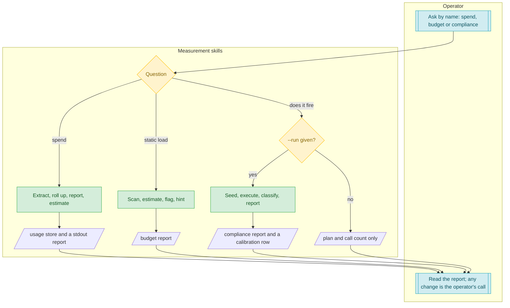

# Measure platform usage and context cost

## Summary

Three measurement skills, each invoked by name and each read-only on what it measures. The usage extractor turns
local session transcripts into a git-ignored store and rolls spend up to work items, reports it over a window and
estimates a planned item from comparables. The context-budget auditor estimates the static corpus a session loads and
flags bloat against two stated thresholds. The compliance auditor measures whether the right skill fires, under a
cost governor that never spends without an explicit run. Four release read-models also measure the platform, over the
event log: [the DORA tool](/release/tools/compute-dora-metrics.sh), the
[front](/release/tools/compute-front-cluster-telemetry.sh) and
[middle](/release/tools/compute-middle-cluster-telemetry.sh) phase-cluster telemetry tools and the event-log query. They
report delivery metrics rather than usage or cost, and are not an activity of this sub-process.

## Entry and exit

| Side | Criteria | Source |
|---|---|---|
| Entry | The operator asks a spend, budget or compliance question by name, or, for the two auditors, a scheduled run on the schedule seam (none of the registry's Routines rows names either); the compliance auditor additionally requires `--run` to spend | [finops SKILL.md](/core/skills/finops-usage-extractor/SKILL.md#L39)<!-- source-anchor: line=39; fp=6acd5424dab7b92c -->; [context-budget SKILL.md](/core/skills/context-budget-auditor/SKILL.md#L35)<!-- source-anchor: line=35; fp=c41205b8a2a1b500 -->; [compliance SKILL.md](/core/skills/skill-compliance-auditor/SKILL.md#L85)<!-- source-anchor: line=85; fp=55abed1498ce0b28 --> |
| Exit | A report printed to stdout or written to the project's generated-artifact folder with its method and provenance; for the extractor, the store rewritten or upserted and the roll-up records appended; for the compliance auditor, one `trigger-rate` row appended to the calibration surface; no skill, component or corpus file changed | [finops SKILL.md](/core/skills/finops-usage-extractor/SKILL.md#L168)<!-- source-anchor: line=168; fp=793dcc5ad3084507 -->; [context-budget SKILL.md](/core/skills/context-budget-auditor/SKILL.md#L79)<!-- source-anchor: line=79; fp=025d05083c5a5446 -->; [compliance SKILL.md](/core/skills/skill-compliance-auditor/SKILL.md#L91)<!-- source-anchor: line=91; fp=025d05083c5a5446 --> |

## Flow

## Activities

| Activity | Primary actor | Purpose | Page |
|---|---|---|---|
| Extract, attribute, report and estimate token spend | skill:finops-usage-extractor | Runtime spend from the transcripts into a store, up to work items, over windows and ahead of a planned item | [extract-token-spend](extract-token-spend.md) |
| Measure the per-session context budget | skill:context-budget-auditor | The static corpus cost per component, flagged and hinted | [measure-context-budget](measure-context-budget.md) |
| Measure skill trigger-compliance | skill:skill-compliance-auditor | Whether the right skill fires, at three strictness levels, under a cost governor | [measure-skill-compliance](measure-skill-compliance.md) |

## Controls

| Control | Source | Enforcement class | Surface | Applies to |
|---|---|---|---|---|
| The self-tests of the six extractor scripts in the job's loop pass on every pull request | [`.github/workflows/release-tooling-smoke.yml`](/.github/workflows/release-tooling-smoke.yml) finops-selftest job (C-228) | code-enforce | ci-run | extract-token-spend |
| The usage store is written only to a path that is git-ignored inside any repository it sits in | [`core/skills/finops-usage-extractor/SKILL.md`](/core/skills/finops-usage-extractor/SKILL.md) § Read-only posture and § Exit codes (exit 4) | code-enforce | — | extract-token-spend |
| Each skill measures and reports and never edits, trims, moves or removes a component, a skill description or a store record other than its own additive rows | the usage extractor's § Read-only posture; the two auditors' § Autonomy Tier and § What This Skill Does NOT Do | prose-only | — | every activity |
| The compliance auditor never runs its scenario matrix from a bare trigger: operator-gated, capped at a stated default, dry-run first | [`core/skills/skill-compliance-auditor/SKILL.md`](/core/skills/skill-compliance-auditor/SKILL.md) § Cost Governor | prose-only | — | measure-skill-compliance |
| Skill counts and rosters are derived from the deploy arrays, never hardcoded | [`core/rules/skill-deployment.md`](/core/rules/skill-deployment.md) § Count convention (C-377) | code-enforce (narrow) | — | measure-context-budget, measure-skill-compliance |
| The context-budget auditor is not a gate of the deploy script's check suite and must not be wired into one | [`core/skills/context-budget-auditor/SKILL.md`](/core/skills/context-budget-auditor/SKILL.md) § Dependency Graph Node | prose-only | — | measure-context-budget |

## Evidence

| Lens | Source | Observation | Label |
|---|---|---|---|
| designed | the three skill definitions, root-linked above; [`core/automations/registry.md`](/core/automations/registry.md) § Routines | three measurement skills, each invoked by name and read-only on what it measures; the two auditors operate at Autonomy Tier 0, and each names a scheduled run on the schedule seam as a trigger, yet none of the registry's Routines rows names either | [SOURCE] |
| built | [`.github/workflows/release-tooling-smoke.yml`](/.github/workflows/release-tooling-smoke.yml), the `finops-selftest` job (C-228); [`selftest-coverage-exclusions.txt`](/core/deploy/allowlists/selftest-coverage-exclusions.txt) | the workflow's job runs the self-tests of the six extractor scripts in its loop; the exclusion list of the self-test discovery gate records the two auditors' scripts, and the extractor's connector, as skill-owned scripts with no CI executor | [SOURCE] |
| executed | held local — what would show which phases of the usage lane have run is the usage store itself: a git-ignored store of session records across an install. | Nothing from that store is published | [SOURCE] |
| executed | held local — what would show how often each of these skills is invoked is the record of sessions across an install. | Nothing from that store is published | [SOURCE] |
| designed vs built | the scheduled-run rows of the two auditors' Triggers tables ([context-budget SKILL.md](/core/skills/context-budget-auditor/SKILL.md#L40)<!-- source-anchor: line=40; fp=6950feb09783edce -->, [compliance SKILL.md](/core/skills/skill-compliance-auditor/SKILL.md#L43)<!-- source-anchor: line=43; fp=8ec89c7e3c025533 -->) against [`core/automations/registry.md`](/core/automations/registry.md) § Routines | each auditor's definition names a scheduled run registered against the schedule seam; the registry states that an automation is admitted only if it has a row there, and none of its Routines rows names either skill | [SOURCE] |

## Navigation

<!-- nav:begin -->
Up: [observe-platform](observe-platform.md) · Previous: [run-session-retro](run-session-retro.md) · Down: [extract-token-spend](extract-token-spend.md) · [measure-context-budget](measure-context-budget.md) · [measure-skill-compliance](measure-skill-compliance.md)
<!-- nav:end -->

## Sources

- [`core/skills/finops-usage-extractor/SKILL.md`](/core/skills/finops-usage-extractor/SKILL.md), [`core/skills/context-budget-auditor/SKILL.md`](/core/skills/context-budget-auditor/SKILL.md), [`core/skills/skill-compliance-auditor/SKILL.md`](/core/skills/skill-compliance-auditor/SKILL.md) — the three skills
- [`release/tools/query-pipeline-event.sh`](/release/tools/query-pipeline-event.sh), [`release/tools/compute-dora-metrics.sh`](/release/tools/compute-dora-metrics.sh), [`release/tools/compute-front-cluster-telemetry.sh`](/release/tools/compute-front-cluster-telemetry.sh), [`release/tools/compute-middle-cluster-telemetry.sh`](/release/tools/compute-middle-cluster-telemetry.sh) — the release read-models the Summary names
- [`core/automations/registry.md`](/core/automations/registry.md) — the routine rows, none naming a measurement skill
- [`core/process-catalog/definitions/controls-register.tsv`](/core/process-catalog/definitions/controls-register.tsv) — C-228, C-377
- [`.github/workflows/release-tooling-smoke.yml`](/.github/workflows/release-tooling-smoke.yml), [`core/deploy/allowlists/selftest-coverage-exclusions.txt`](/core/deploy/allowlists/selftest-coverage-exclusions.txt), [`core/rules/skill-deployment.md`](/core/rules/skill-deployment.md) — the self-test job, the discovery gate's exclusion list and the count convention
