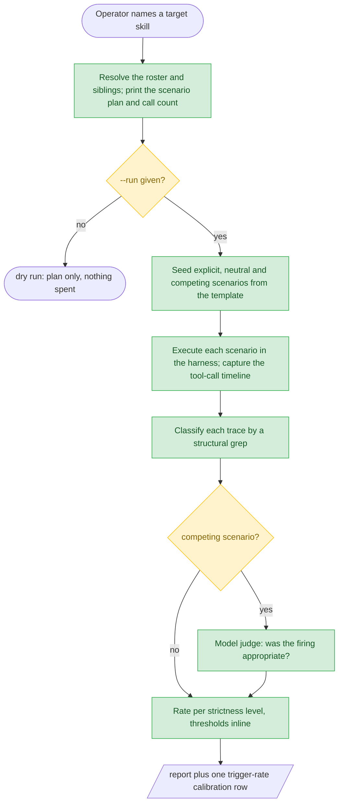

# Measure skill trigger-compliance

## Summary

Three surfaces measure a skill's output, its structure and its gate decisions; nothing measured whether it fires.
This auditor closes that gap upstream of all three. Named by the operator with a target skill or a bounded subset,
it resolves the roster from the deploy arrays and each target's siblings from the registry's routing view, seeds
three scenarios per target from a fixed template — explicit, neutral, competing — with a model filling only the
prose, runs each through a measurement harness capturing the tool-call timeline, classifies each trace by a
structural grep for the target's Skill-tool call and reserves a model judge for the competing case alone, then
reports a rate per strictness level and appends a `trigger-rate` row to the shared calibration surface. Every
scenario is an agent invocation, so a bare invocation only prints the plan and its call count; nothing spends
without `--run`. Its [ICOM](/core/process-catalog/definitions/pack.json) table (inputs, controls,
outputs, mechanisms) follows.

## ICOM

| Inputs | Controls | Outputs | Mechanisms |
|---|---|---|---|
| The target skill or subset; the deploy module arrays; the skill registry's routing view; the three-slot scenario template; prior stored runs for a re-render | The cost governor (operator-gated, a documented cap of 30 scenarios, dry-run by default); template-first generation; deterministic-first classification; the reserved `trigger-rate` namespace; the read-only posture on every skill | The scenario plan with its estimated call count; per-scenario trace classifications (`fired`, `not-fired`, `sibling-captured`, and on competing `appropriate` or `inappropriate`); a compliance rate per level with thresholds inline; one appended calibration row; a re-rendered view of a prior run | The script for the plan and the structural classifier; the measurement harness for execution; a model judge on competing traces; the calibration-data surface at the operator-instance evals path |

## Flow

## Steps

| Step | Action | Actor | Inputs → outputs (shape) | Controls | Mechanism | Harness | Model need | Source |
|---|---|---|---|---|---|---|---|---|
| gate-on-explicit-run | Gate the run on an explicit operator invocation | skill:skill-compliance-auditor | a named target → a dry-run plan (targets, slots, scenario count, estimated calls) unless `--run` is passed; the cap of 30 scenarios stated, exceeding it an explicit override | prose-only | the script's plan output | file-and-shell-tools | XS/none/read/scriptable/interactive | [SKILL.md](/core/skills/skill-compliance-auditor/SKILL.md#L85)<!-- source-anchor: line=85; fp=55abed1498ce0b28 --> |
| resolve-targets-and-siblings | Resolve the target roster and each target's siblings | script:measure-skill-compliance.sh | the deploy arrays and the registry's routing view → the target list and, per target, the skills whose trigger surface overlaps | prose-only | an awk window over the arrays; a read of the registry | file-and-shell-tools | XS/none/read/scriptable/batch | [SKILL.md](/core/skills/skill-compliance-auditor/SKILL.md#L58)<!-- source-anchor: line=58; fp=780f43ef4c977772 --> |
| seed-scenarios | Seed three scenarios per target from the template | skill:skill-compliance-auditor | the fixed slots (explicit names the trigger phrases; neutral describes the domain task; competing names a sibling) → one prompt per slot, the structure fixed and the domain prose model-filled | prose-only | the scenario template | none | M/medium/read/templated/interactive | [SKILL.md](/core/skills/skill-compliance-auditor/SKILL.md#L59)<!-- source-anchor: line=59; fp=e88cf15862ad64f7 --> |
| execute-scenarios | Execute each scenario and capture the timeline | sub-agent:measurement-harness | each prompt → the ordered tool-call timeline of the run; a failed capture reported as `capture-failed`, never scored | prose-only | the measurement harness | sub-agent-spawn | M/medium/orchestrate/templated/batch | [SKILL.md](/core/skills/skill-compliance-auditor/SKILL.md#L60)<!-- source-anchor: line=60; fp=a3279a8db2327341 --> |
| classify-traces | Classify each trace deterministic-first | script:measure-skill-compliance.sh | a timeline → `fired` (the target's Skill-tool call at the right point), `not-fired`, or `sibling-captured`, by structural grep | prose-only | the script's trace classifier | file-and-shell-tools | XS/none/read/scriptable/batch | [SKILL.md](/core/skills/skill-compliance-auditor/SKILL.md#L61)<!-- source-anchor: line=61; fp=e2980a615148c3c9 --> |
| judge-competing-traces | Judge appropriateness on competing scenarios only | skill:skill-compliance-auditor | a competing trace where both skills plausibly apply → `appropriate` or `inappropriate`; a bounded set of judge calls; structural-only when the judge is unavailable | prose-only | a model judge | none | S/medium/read/judgment/interactive | [SKILL.md](/core/skills/skill-compliance-auditor/SKILL.md#L61)<!-- source-anchor: line=61; fp=e2980a615148c3c9 --> |
| aggregate-and-report | Aggregate rates and flag drift | skill:skill-compliance-auditor | classifications → a rate per strictness level, the per-scenario table, drift candidates with the threshold and diagnostic named (description drift on neutral, sibling capture on competing); an empty finding stated | prose-only | the report template | file-and-shell-tools | S/low/write/templated/interactive | [SKILL.md](/core/skills/skill-compliance-auditor/SKILL.md#L62)<!-- source-anchor: line=62; fp=aeb0d188eda67598 --> |
| append-calibration-row | Append the trigger-rate row | skill:skill-compliance-auditor | the run's rate → one row under the reserved `trigger-rate` class on the shared calibration surface at the operator-instance evals path; no other row touched | prose-only | an append to the calibration file | file-and-shell-tools | XS/none/write/templated/batch | [SKILL.md](/core/skills/skill-compliance-auditor/SKILL.md#L99)<!-- source-anchor: line=99; fp=86948a7e4a372e33 --> |
| re-render-prior-run | Re-render a prior run without spending | skill:skill-compliance-auditor | stored results for a target → a different view or a trend against an earlier run; with no prior run, says so and points at a Measure run | prose-only | the stored results | file-and-shell-tools | S/low/read/templated/interactive | [SKILL.md](/core/skills/skill-compliance-auditor/SKILL.md#L64)<!-- source-anchor: line=64; fp=f05112d3bde36f8a --> |

## Step profile

| Field | Value |
|---|---|
| Deterministic steps | 3 of 9 (determinism `scriptable`, counted from the Steps table) |
| Judgment steps | 1 (determinism `judgment`: the competing-scenario judge); five steps are templated and sit in neither count |
| Harness features relied on | file-and-shell-tools, sub-agent-spawn (the harness executions) |
| Context read | M (8k–32k tokens): the target's description, its siblings and the captured timelines |

## Evidence

| Lens | Source | Observation | Label |
|---|---|---|---|
| designed | [`core/skills/skill-compliance-auditor/SKILL.md`](/core/skills/skill-compliance-auditor/SKILL.md), § Role to § Principal Standard Target (version v3.41); [`scenario-and-calibration-schema.md`](/core/skills/skill-compliance-auditor/references/scenario-and-calibration-schema.md) | a four-stage pipeline with the cost governor a required design element; the skill-refiner invokes it as a post-creation calibration pass | [SOURCE] |
| built | [`core/skills/skill-compliance-auditor/scripts/measure-skill-compliance.sh`](/core/skills/skill-compliance-auditor/scripts/measure-skill-compliance.sh) | the script drives the deterministic parts — the plan and the structural classifier | [SOURCE] |
| executed | held local — what would show how often the skill is invoked is the record of sessions across an install. | Nothing from that store is published | [SOURCE] |
| executed | no measure — what would show a completed run is a `trigger-rate` row on the calibration surface, a file at the operator-instance evals path. | No measure in the measures register reads that surface | [SOURCE] |
| designed vs built | the Triggers table of the skill definition, its scheduled-run row ([SKILL.md](/core/skills/skill-compliance-auditor/SKILL.md#L43)<!-- source-anchor: line=43; fp=8ec89c7e3c025533 -->), against [`core/automations/registry.md`](/core/automations/registry.md) § Routines | the skill names a scheduled run registered against the schedule seam as a trigger, and this page's own `triggered_by` carries it; the registry states that an automation is admitted only if it has a row there, and none of its Routines rows names this skill; the parent sub-process page records the same disagreement | [SOURCE] |

## Navigation

<!-- nav:begin -->
Up: [measure-platform-usage](measure-platform-usage.md) · Previous: [measure-context-budget](measure-context-budget.md)
<!-- nav:end -->

## Sources

- [`core/skills/skill-compliance-auditor/SKILL.md`](/core/skills/skill-compliance-auditor/SKILL.md) — the pipeline, the cost governor, the output contract and the failure modes
- [`core/skills/skill-compliance-auditor/references/scenario-and-calibration-schema.md`](/core/skills/skill-compliance-auditor/references/scenario-and-calibration-schema.md) — the scenario template and the calibration-row schema
- [`core/skills/skill-compliance-auditor/scripts/measure-skill-compliance.sh`](/core/skills/skill-compliance-auditor/scripts/measure-skill-compliance.sh) — the plan and the classifier
- [`core/automations/registry.md`](/core/automations/registry.md) — the routine rows, none of which names this skill
