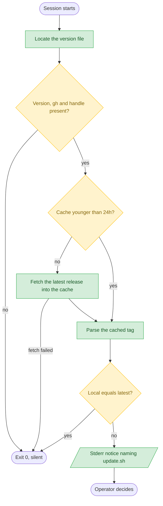

# Notify the operator of version skew at launch

## Summary

The first SessionStart hook locates the deployed `.version` snapshot, resolves the repository identity from the
operator config, reads a 24-hour cache of the latest published release (refreshing it through the repository host's
API when stale), and prints a single stderr line when the two version strings differ. Every guard exits 0 silently;
the hook never applies an update — the operator decides when to run [`update.sh`](/update.sh), which makes this hook the trigger
into the update sub-process. Its [ICOM](/core/process-catalog/definitions/pack.json) table follows.

## ICOM

| Inputs | Controls | Outputs | Mechanisms |
|---|---|---|---|
| The deployed `.version` snapshot (or the clone's root `.version`); `operator.toml` keys `operator_github` and `pmo_platform_repo_name`; the cache file under the user cache dir; the host's latest-release record | Fail-silent on any error; no mode file and no master gate; the 24-hour cache TTL; string inequality as the notice test | One stderr notice line, or nothing; a refreshed cache file | The hook script; `gh api`; the settings template's SessionStart registration |

## Flow

## Steps

| Step | Action | Actor | Inputs → outputs (shape) | Controls | Mechanism | Harness | Model need | Source |
|---|---|---|---|---|---|---|---|---|
| locate-version-file | Pick the first readable `.version` of two layouts | hook:notify-version-skew | deployed `<workspace>/.claude/.version`, else the clone's root `.version` → `VERSION_FILE` | the deployed snapshot is preferred (the artifact `update.sh` refreshes) | path probe | tool-event-hooks | XS/none/read/scriptable/batch | [hook](/core/hooks/notify-version-skew.sh#L41)<!-- source-anchor: line=41; fp=1b4ed4a248a15e3f --> |
| check-prerequisites | Exit silently unless the version, `gh` and a non-empty local version exist | hook:notify-version-skew | file readability, `command -v gh`, first line → continue or exit 0 | C-079: code-warn | guards | tool-event-hooks | XS/none/read/scriptable/batch | [hook](/core/hooks/notify-version-skew.sh#L56)<!-- source-anchor: line=56; fp=9dc3715f23793d35 --> |
| resolve-repo-identity | Read the handle and repository name from the operator config | hook:notify-version-skew | `operator.toml` → `operator_github`, `repo_name` (default name when unset); an empty handle exits 0 | the handle key is optional at install, so an install without it never sees a notice | `grep` + `awk` | file-and-shell-tools | XS/none/read/scriptable/batch | [hook](/core/hooks/notify-version-skew.sh#L63)<!-- source-anchor: line=63; fp=151723abfb4fb429 --> |
| check-cache-age | Decide whether the cached release record is stale | hook:notify-version-skew | cache mtime vs `CACHE_TTL_SECONDS` → `fetch_latest` 0 or 1 (absent cache → 1) | 24-hour TTL | `stat` | file-and-shell-tools | XS/none/read/scriptable/batch | [hook](/core/hooks/notify-version-skew.sh#L73)<!-- source-anchor: line=73; fp=9f15b592b5850dac --> |
| fetch-latest-release | Refresh the cache from the host's latest-release endpoint | hook:notify-version-skew | `gh api repos/<handle>/<repo>/releases/latest` → cache JSON (`tag_name`, `name`, `published_at`); a failed call exits 0 | read-only host query; failure is silent | `gh api --jq` | git-and-gh-cli | XS/none/write/scriptable/batch | [hook](/core/hooks/notify-version-skew.sh#L90)<!-- source-anchor: line=90; fp=dcab6212fb65e5a6 --> |
| parse-latest-tag | Extract the tag from the cache | hook:notify-version-skew | cache JSON → `latest_version` (empty → exit 0) | — | `grep` + `sed` | file-and-shell-tools | XS/none/read/scriptable/batch | [hook](/core/hooks/notify-version-skew.sh#L102)<!-- source-anchor: line=102; fp=3e1aab4f24443dcf --> |
| compare-and-notify | Print the notice when the strings differ | hook:notify-version-skew | `local_version` ≠ `latest_version` → one stderr line naming both versions and `./update.sh`; equal → nothing; exit 0 | inequality, not ordering: a local version ahead of the latest release also notifies (documented in UPDATE.md, "Version-skew notification") | `printf` to stderr | tool-event-hooks | XS/none/none/scriptable/batch | [hook](/core/hooks/notify-version-skew.sh#L106)<!-- source-anchor: line=106; fp=93b8de1c25bf264b --> |

## Step profile

| Field | Value |
|---|---|
| Deterministic steps | 7 of 7 (determinism `scriptable`, counted from the Steps table) |
| Judgment steps | 0 |
| Harness features relied on | tool-event-hooks (rebuild), file-and-shell-tools, git-and-gh-cli (portable) |
| Context read | XS (under 2k tokens): one version line, two config keys, one cached record |

## Evidence

| Lens | Source | Observation | Label |
|---|---|---|---|
| designed | [`core/hooks/notify-version-skew.sh`](/core/hooks/notify-version-skew.sh), the header comment | passive notice; five-step behaviour (read, cache, query, compare, never block); the header says "if local < latest" | [SOURCE] |
| designed | [`docs/UPDATE.md`](/docs/UPDATE.md), "Version-skew notification" | the notice is an exact-match check (a version ahead of the latest release also notifies); `.version` is release-cut-owned and `update.sh` only propagates it to the deployed snapshot | [SOURCE] |
| built | [`core/hooks/notify-version-skew.sh`](/core/hooks/notify-version-skew.sh), the compare block; [`core/settings.json.template`](/core/settings.json.template), the SessionStart block | the test is string inequality, matching UPDATE.md and not the header's "<"; registered first of the three SessionStart hooks | [SOURCE] |
| built | [`controls-register.tsv`](/core/process-catalog/definitions/controls-register.tsv), C-079, C-108; [`core/hooks/notify-version-skew.sh`](/core/hooks/notify-version-skew.sh) | the register classes both `code-warn`; the hook reads no mode file and no master switch, runs on every session start and fails silently | [SOURCE] |
| executed | held local — the notice is one stderr line inside a session, so what would show a firing is the store of sessions on an install. | The hook writes its notice to stderr and to no log; the page says nothing of how often it fires | [SOURCE] |
| designed vs built | [hook](/core/hooks/notify-version-skew.sh#L20)<!-- source-anchor: line=20; fp=e358e6b85d867b08 -->; [hook](/core/hooks/notify-version-skew.sh#L108)<!-- source-anchor: line=108; fp=07f65c4aa41bdd2b --> | the header describes an ordering test, the code an inequality test; UPDATE.md documents the code's behaviour — the header is the stale side | [SOURCE] |

## Navigation

<!-- nav:begin -->
Up: [verify-session-setup](verify-session-setup.md) · Next: [verify-session-config](verify-session-config.md)
<!-- nav:end -->

## Sources

- [`core/hooks/notify-version-skew.sh`](/core/hooks/notify-version-skew.sh) — the hook
- [`core/settings.json.template`](/core/settings.json.template) — the SessionStart registration
- [`docs/UPDATE.md`](/docs/UPDATE.md), "Version-skew notification" and the troubleshooting entry on a missing notice — the documented behaviour and the silent-failure causes
- [`update.sh`](/update.sh) — the updater the notice points to
- [`core/process-catalog/definitions/controls-register.tsv`](/core/process-catalog/definitions/controls-register.tsv) — C-079, C-108
