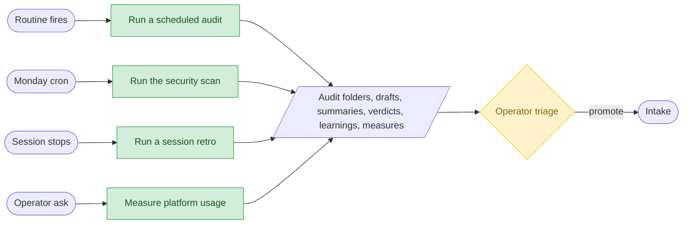

# Observe the platform on a schedule

## Summary

The stream starts on a clock or a boundary the platform does not control — a registered routine fires on the
operator's scheduler or the repository host's cron, a session stops, or the operator asks — and ends with findings
in a form the operator can triage: observation drafts in a dated audit folder, verdicts on a scheduled run,
learnings rows from a retro, usage and token-load measures. Four sub-processes carry it: the scheduled audits
(platform health and the four staleness sentinels, through the auditor's observe-only modes), the weekly security
scan (the one self-firing routine), the session retro at a Stop boundary (its hook ships disabled), and the usage
and cost measurements the operator invokes. Nothing in the stream writes the registry, the backlog or a tracked
governance file; the decision point is the operator's triage — promote, defer or close — which hands a promoted
finding to the work-item intake. The [SIPOC](/core/process-catalog/definitions/pack.json) table
below reads suppliers, inputs, process steps, outputs and customers left to right.

## SIPOC

| Suppliers | Inputs | High-level steps | Outputs | Customers |
|---|---|---|---|---|
| The registry (nine routine rows); the operator's scheduler registrations; the repository host's cron; the session runtime's Stop boundary; the operator | The corpus and the external skill catalog; the release record and the event log; the default branch; a stopping session's transcript; the operator's config dial | Admit and bind the routine → fire → run the audit mode, scan or retro → write the dated folder or run verdicts → echo → triage → intake | Audit folders with observation drafts; two committed summary surfaces; seven scan verdicts per week; learnings rows; usage roll-ups and token-load reports | The operator (triage); the work-item intake; the health-check stream (summary surfaces it reads); the release pipeline (learnings it synthesizes) |

## Flow

## Sub-processes

| Sub-process | Entry | Exit | Page |
|---|---|---|---|
| Run a scheduled platform audit | a registered routine's task fires on the operator's scheduler, a drift signal, or an operator ask | a dated audit folder or due-signal draft with observation drafts; the operator has triaged them; Modes I and J overwrote their committed summary | [run-scheduled-audit](run-scheduled-audit.md) |
| Run the scheduled security scan | Monday 06:00 UTC on the default branch, fired by the repository host | seven job conclusions on the run; the operator has read them | [run-security-scan](run-security-scan.md) |
| Run a session retro at session stop | the Stop hook fires on a sampled, substantive session — the hook ships `enabled=false` in the operator config | learnings rows emitted by the retro skill | [run-session-retro](run-session-retro.md) |
| Measure platform usage and context cost | an operator ask by name, or, for the two auditors, a scheduled run on the schedule seam | per-session usage in the operator-local store; token-load and skill-compliance reports | [measure-platform-usage](measure-platform-usage.md) |

## Controls

| Control | Source | Enforcement class | Surface | Applies to |
|---|---|---|---|---|
| Every declared automation has a conforming registry row and every scheduled workflow is registered | [`core/deploy/deploy.sh`](/core/deploy/deploy.sh) Check 76 (C-196); [`.github/workflows/automation-registry-check.yml`](/.github/workflows/automation-registry-check.yml) (C-202) | code-enforce | deploy-run, ci-run | run-scheduled-audit, run-security-scan |
| The seven security jobs pass on every pull request and push to main | [`.github/workflows/security.yml`](/.github/workflows/security.yml) (C-241 to C-247) | code-enforce | merge-gate or ci-run, by job, as the register records | run-security-scan |
| The Stop hook triggers a retro on a sampled session | [`core/hooks/session-retro-trigger.sh`](/core/hooks/session-retro-trigger.sh) (C-078) and its Stop registration (C-111) | code-off | hook | run-session-retro |
| The usage-extractor self-tests pass on every pull request | [`.github/workflows/release-tooling-smoke.yml`](/.github/workflows/release-tooling-smoke.yml) (C-228) | code-enforce | ci-run | measure-platform-usage |
| Audit modes observe and never mutate the registry or the backlog; drift findings are observations until the operator triages them | [`core/governance/OPERATIONS.md`](/core/governance/OPERATIONS.md) § Platform Health Audit Protocol, Rule 3; [`core/skills/pmo-qa-auditor/SKILL.md`](/core/skills/pmo-qa-auditor/SKILL.md), the mutation-posture paragraph of each audit mode | prose-only | — | run-scheduled-audit |
| A routine's cadence is a declared default; the instance resolves the effective schedule, and the firing backend is cited, never stored | [`core/schemas/automation-registry-schema.md`](/core/schemas/automation-registry-schema.md) § 3.1 and § 7 | prose-only | — | run-scheduled-audit, run-security-scan |

## Evidence

| Lens | Source | Observation | Label |
|---|---|---|---|
| designed | [`core/automations/registry.md`](/core/automations/registry.md) § Routines | nine routines: seven observe the platform (the security scan, four sentinels, two platform-health rows) and two drive the operations daily cycle | [SOURCE] |
| designed | [`core/governance/OPERATIONS.md`](/core/governance/OPERATIONS.md) § Platform Health Audit Protocol; § 6 of the four cadence protocols ([process fitness](/release/references/protocols/process-fitness-cadence.md), [structural audit](/release/references/protocols/structural-audit-cadence.md), [architecture conformance](/release/references/protocols/architecture-conformance-cadence.md), [decision audit](/release/references/protocols/decision-audit-cadence.md)) | quarterly plus reactive for platform health; hybrid manual-plus-sentinel for the four axes; triage by the operator; registration as a Stage 12 item | [SOURCE] |
| built | [`core/automations/registry.md`](/core/automations/registry.md) § Routines; [`.github/workflows/security.yml`](/.github/workflows/security.yml), its `on:` block; [`core/settings.json.template`](/core/settings.json.template), the Stop entry | one routine's entrypoint is a workflow, which carries its own `schedule:` block; every other row's entrypoint is a tracked spec; the Stop registration is present in the settings template | [SOURCE] |
| executed | measure `scheduled-audit-folders` — [scheduled-audit-folders.py](/core/deploy/tools/process-catalog-measures/scheduled-audit-folders.py) (population: every dated folder directly inside the analysis home, by audit family; folder names and the frontmatter of each summary file only) | the measure reports the dated folders inside the analysis home by audit family, read from folder names and each summary file's frontmatter; one install's working state; supports no verdict on this page | [SOURCE] |
| executed | measure `workflow-runs-install-security` — [workflow-run-history.py](/core/deploy/tools/process-catalog-measures/workflow-run-history.py) (population: every run of each named workflow created in the trailing window, split by trigger event, read in slices and verified against the host's total for each slice); [`security.yml`](/.github/workflows/security.yml) | the measure reports the run history of the security workflow, split by trigger event | [SOURCE] |
| executed | measure `event-log-population` — [event-log-population.py](/core/deploy/tools/process-catalog-measures/event-log-population.py) (population: the rows of the pipeline event log whose release key is a milestone title or a tag name on the host; a key another repository shares is counted, and a legacy row older than the host's tags is not) | the measure reports the event log's row total, its rows under each key rule and its rows by event type, `session-retro` among the types; aggregates only; one install's working state; supports no verdict on this page | [SOURCE] |
| executed | held local — what would show how often each skill of the stream is invoked is the record of sessions across an install. | Nothing from that store is published | [SOURCE] |

## Navigation

<!-- nav:begin -->
Up: [engineering-harness](engineering-harness.md) · Previous: [run-platform-health-check](run-platform-health-check.md) · Down: [run-scheduled-audit](run-scheduled-audit.md) · [run-security-scan](run-security-scan.md) · [run-session-retro](run-session-retro.md) · [measure-platform-usage](measure-platform-usage.md)
<!-- nav:end -->

## Sources

- [`core/automations/registry.md`](/core/automations/registry.md), [`core/schemas/automation-registry-schema.md`](/core/schemas/automation-registry-schema.md) — the routines and their contract
- [`core/deploy/tools/resolve-automation-binding.sh`](/core/deploy/tools/resolve-automation-binding.sh) — the scheduler adapter
- [`core/skills/pmo-qa-auditor/SKILL.md`](/core/skills/pmo-qa-auditor/SKILL.md) — Modes E, F, I, J
- [The audit framework](/release/references/protocols/platform-health-audit-framework.md) and the four cadence protocols, root-linked in the Evidence table
- [`core/governance/OPERATIONS.md`](/core/governance/OPERATIONS.md) § Platform Health Audit Protocol
- [`.github/workflows/security.yml`](/.github/workflows/security.yml) — the self-firing routine
- [`core/hooks/session-retro-trigger.sh`](/core/hooks/session-retro-trigger.sh), [`core/settings.json.template`](/core/settings.json.template) — the Stop trigger (the [run-session-retro](run-session-retro.md) sub-process)
- [`core/process-catalog/definitions/controls-register.tsv`](/core/process-catalog/definitions/controls-register.tsv) — C-078, C-111, C-196, C-202, C-228, C-241 to C-247
