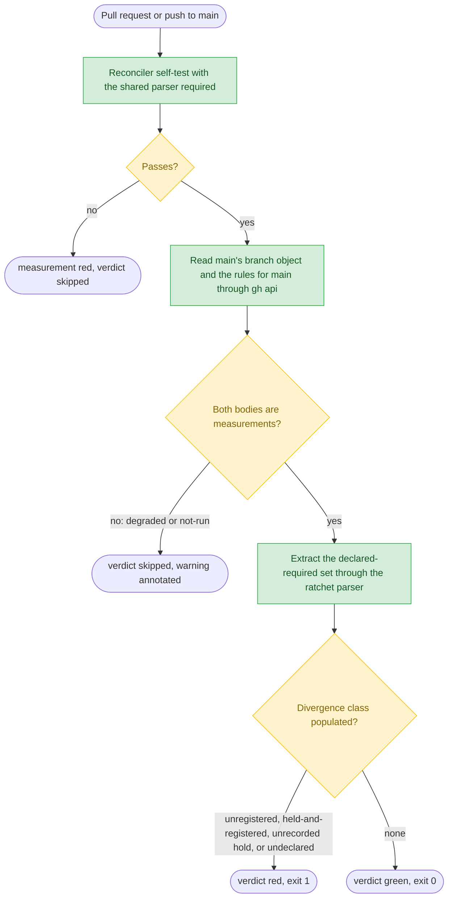

# Reconcile declared gate posture against live branch protection

## Summary

The gate-efficacy standard lets a workflow header declare its posture but forbids any gate from editing branch
protection, so the two can drift. This activity is the audit the standard names: a workflow with two jobs runs on
every pull request and push to main without a path filter. The measurement job hard-fails on the reconciler's own
self-test, reads the host twice with no admin scope — main's public branch object and the rules that apply to
main — extracts the declared-required set through the conformance ratchet's own header parser, reads the
standard's disposition table, and compares. Four classes are a divergence: a context that claims delivery and is
absent from the live set; a context that discloses a hold and is present in it; a context that discloses a hold,
is absent, and has no hold row in that table; and a live context no declaration names. A read that did not return is a
non-measurement and skips the verdict job rather than greening or reddening it: the verdict job `needs` the measurement
job and runs only when its `verdict` output is `RECONCILED` or `DIVERGED` ([gate-posture-reconciliation.yml](/.github/workflows/gate-posture-reconciliation.yml#L209)<!-- source-anchor: line=209; fp=32825e2398cb93f5 -->). The verdict is advisory permanently,
because part of its input is out-of-tree state. Its
[ICOM](/core/process-catalog/definitions/pack.json) table (inputs, controls, outputs, mechanisms)
follows.

## ICOM

| Inputs | Controls | Outputs | Mechanisms |
|---|---|---|---|
| Every workflow file's `gate-efficacy:` headers; main's branch object and the rules that apply to main, both from the host; the standard's registration-disposition table; the ratchet's header parser and its required-posture grammar | The four divergence classes; the held definition (`warn-mode-initial` exactly, with a hold row in the disposition table); the three-valued live status (fetched, degraded, not-run); the permanent-advisory posture and the never-join-the-subset rule | A report with the class table; two check-runs — measurement and verdict — concluding success, failure or skipped; a warning annotation on a non-measurement | `reconcile-gate-posture.py` with `--self-test --require-parser`, then with the two saved bodies; `gh api` for the two reads; the workflow's two jobs |

## Flow

## Steps

| Step | Action | Actor | Inputs → outputs (shape) | Controls | Mechanism | Harness | Model need | Source |
|---|---|---|---|---|---|---|---|---|
| trigger-reconciliation | Trigger on every pull request and push, no path filter | ci:gate-posture-reconciliation | a pull request opened, synchronized, reopened or ready, or a push to main → a checkout with the shared parser's dependency installed | C-212: code-enforce | the workflow's `on:` block and the dependency step | git-and-gh-cli | XS/none/read/scriptable/batch | [gate-posture-reconciliation.yml](/.github/workflows/gate-posture-reconciliation.yml#L102)<!-- source-anchor: line=102; fp=8bdae5c8727e93f6 --> |
| run-reconciler-self-test | Run the reconciler's self-test as a hard step | script:reconcile-gate-posture.py | the committed fixtures and the shared parser → exit 0, or exit 2 when a parser-backed arm cannot load, which fails the job before anything is measured | C-212: code-enforce | `reconcile-gate-posture.py --self-test --require-parser` | file-and-shell-tools | XS/none/read/scriptable/batch | [gate-posture-reconciliation.yml](/.github/workflows/gate-posture-reconciliation.yml#L130)<!-- source-anchor: line=130; fp=90cea000b7e4fff1 --> |
| read-branch-object | Read main's branch object | ci:gate-posture-reconciliation | the public branches endpoint → a JSON body saved whole, or no file when the request did not return (an un-gated step; the reconciler decides what the body is) | C-212: code-enforce | `gh api repos/<owner>/<repo>/branches/main` | git-and-gh-cli | XS/none/read/scriptable/batch | [gate-posture-reconciliation.yml](/.github/workflows/gate-posture-reconciliation.yml#L137)<!-- source-anchor: line=137; fp=03d0b8294c4578f8 --> |
| read-main-rules | Read the rules that apply to main | ci:gate-posture-reconciliation | the rules endpoint for the branch, one page → a JSON body saved whole, or no file when the request did not return (un-gated, like the branch read) | C-212: code-enforce | `gh api repos/<owner>/<repo>/rules/branches/main?per_page=100` | git-and-gh-cli | XS/none/read/scriptable/batch | [gate-posture-reconciliation.yml](/.github/workflows/gate-posture-reconciliation.yml#L157)<!-- source-anchor: line=157; fp=065cffb0f599a3ca --> |
| extract-declared-set | Extract the declared-required contexts | script:reconcile-gate-posture.py | every workflow's `gate-efficacy:` header → the declared set on the registration track, each context marked as claiming delivery or as disclosing a hold (every declaration naming it carries `warn-mode-initial` exactly) | C-212: code-enforce | `declared_required()` importing `parse_headers` from the ratchet | file-and-shell-tools | XS/none/read/scriptable/batch | [reconcile-gate-posture.py](/core/deploy/tools/reconcile-gate-posture.py#L318)<!-- source-anchor: line=318; fp=9da7c1fe932ddf2f --> |
| classify-live-status | Classify the live reads | script:reconcile-gate-posture.py | the two saved bodies → each `fetched` when it carries a usable context list, `degraded` when a read was supplied but unusable, `not-run` when none was; the live status is `fetched` only when both are; an empty body is degraded, never an empty set | C-212: code-enforce | the body tests inside the tool, `read_live_branch_json()` and `read_live_rules_json()` | file-and-shell-tools | XS/none/read/scriptable/batch | [reconcile-gate-posture.py](/core/deploy/tools/reconcile-gate-posture.py#L39)<!-- source-anchor: line=39; fp=0dc14145f89e0562 --> |
| compare-declared-and-live | Compare the declared and live sets | script:reconcile-gate-posture.py | the two sets and the standard's disposition rows, under a fetched status → members per class: unregistered, held-and-registered, unrecorded hold, undeclared; a context that discloses a hold, is absent from the live set and has its hold row is listed as held, never a divergence | C-213: code-enforce | `classify()` inside the tool, with `read_disposition_rows()` | file-and-shell-tools | XS/none/read/scriptable/batch | [reconcile-gate-posture.py](/core/deploy/tools/reconcile-gate-posture.py#L487)<!-- source-anchor: line=487; fp=1d9b37d0c6da19d4 --> |
| publish-measurement | Publish the report and the measurement check-run | ci:gate-posture-reconciliation | the report and status → a measurement check-run that is red only when the instrument is broken, green with a warning annotation on a non-measurement | C-212: code-enforce | the measurement job's summary step | git-and-gh-cli | XS/none/read/scriptable/batch | [gate-posture-reconciliation.yml](/.github/workflows/gate-posture-reconciliation.yml#L112)<!-- source-anchor: line=112; fp=36990d2be1d6d58d --> |
| publish-verdict | Publish the verdict check-run | ci:gate-posture-reconciliation | the measured comparison → a second check-run, run only when the measurement job's `verdict` output is `RECONCILED` or `DIVERGED`: success when reconciled, failure when diverged, skipped on any other output (a read of the host did not return); its header declares it never a required context | C-213: code-enforce | the verdict job | git-and-gh-cli | XS/none/read/scriptable/batch | [gate-posture-reconciliation.yml](/.github/workflows/gate-posture-reconciliation.yml#L3)<!-- source-anchor: line=3; fp=c844f856aba6aff0 -->; [gate-posture-reconciliation.yml](/.github/workflows/gate-posture-reconciliation.yml#L209)<!-- source-anchor: line=209; fp=32825e2398cb93f5 --> |

## Step profile

| Field | Value |
|---|---|
| Deterministic steps | 9 of 9 (determinism `scriptable`, counted from the Steps table) |
| Judgment steps | 0 |
| Harness features relied on | file-and-shell-tools, git-and-gh-cli |
| Context read | XS (under 2k tokens) |

## Evidence

| Lens | Source | Observation | Label |
|---|---|---|---|
| designed | [`reconcile-gate-posture.py`](/core/deploy/tools/reconcile-gate-posture.py), the module docstring; [the gate-efficacy standard](/core/standards/gate-efficacy-standard.md) § Requirement (b), § Declared-required contexts — registration disposition | the standard names the audit and assigns it to Requirement (c), and defines when the declared and live sets diverge; the tool's docstring records that before it existed every occurrence of the branch-protection API in an executable surface was a comment | [SOURCE] |
| built | [`gate-posture-reconciliation.yml`](/.github/workflows/gate-posture-reconciliation.yml), its header comment and both jobs; [the controls register](/core/process-catalog/definitions/controls-register.tsv), C-212, C-213 | two jobs so that a non-measurement is visible at the check-run level; the header gives the reason the first read is of the public branch object — the admin endpoint refuses the workflow token — and states the limit of the second: a rule of a type the tool cannot name the checks of reads degraded, and the run is not evaluated | [SOURCE] |
| executed | measure `workflow-runs-deploy-probes` — [workflow-run-history.py](/core/deploy/tools/process-catalog-measures/workflow-run-history.py) (population: every run of each named workflow created in the trailing window, read in slices and verified against the host's total for each slice) · [`gate-posture-reconciliation.yml`](/.github/workflows/gate-posture-reconciliation.yml) | The measure reports, per named workflow, its run total and its runs by conclusion. A failed run of this workflow is a measured divergence or a broken instrument, which a run-level read does not separate. The measurement job runs the reconciler's self-test as the step is written and then the tool itself, over the tracked headers and the host's reads. covers: `trigger-reconciliation`, `run-reconciler-self-test`, `read-branch-object`, `read-main-rules`, `extract-declared-set`, `classify-live-status`, `compare-declared-and-live`, `publish-measurement`, `publish-verdict` | [SOURCE] |

## Navigation

<!-- nav:begin -->
Up: [graduate-gate-modes](graduate-gate-modes.md) · Previous: [review-warn-log-drains](review-warn-log-drains.md) · Next: [flip-gate-to-enforce](flip-gate-to-enforce.md)
<!-- nav:end -->

## Sources

- [`core/deploy/tools/reconcile-gate-posture.py`](/core/deploy/tools/reconcile-gate-posture.py) — the reconciler, its three-valued status, its four divergence classes and its exit contract
- [`.github/workflows/gate-posture-reconciliation.yml`](/.github/workflows/gate-posture-reconciliation.yml) — the measurement and verdict jobs; its run history is what the executed row's measure reads
- [`core/standards/gate-efficacy-standard.md`](/core/standards/gate-efficacy-standard.md) — Requirement (b), the registration track, the disposition table and the coverage audit it names
- [`core/process-catalog/definitions/controls-register.tsv`](/core/process-catalog/definitions/controls-register.tsv) — C-212, C-213
