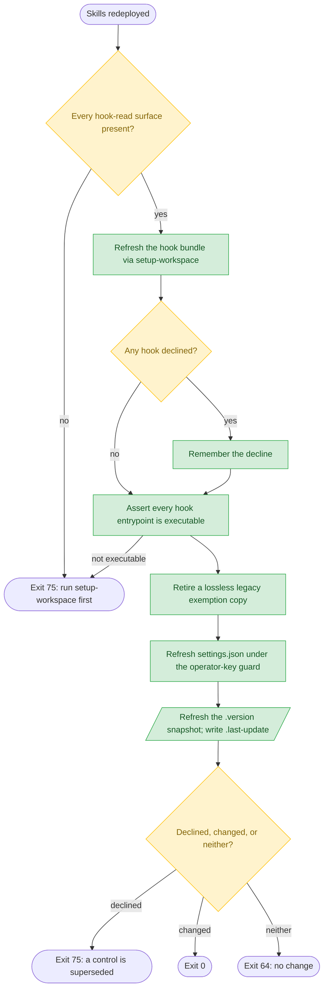

# Refresh the hook bundle and settings, then finalize the update (update.sh Phases 5b0–5d, 5b, 4)

## Summary

Once Phase 5 has redeployed the skills (the deploy sub-process, entered bare), the updater asserts that every
composition surface a security hook reads is present — refusing the hook refresh with exit 75 otherwise, under
`--dry-run` too — then delegates to the installer's `--refresh-hooks` flow, which snapshots the bundle, reinstalls
unchanged and platform-edited hooks, preserves operator-edited ones, and declines any it cannot update. The updater
asserts every deployed hook entrypoint is executable, retires a lossless legacy copy of the exemption list, re-renders
`settings.json` under the operator-key guard (hook scripts first, registrations second), refreshes the `.version`
snapshot the skew hook reads, writes `.last-update`, and exits 0, 64 or 75. Its
[ICOM](/core/process-catalog/definitions/pack.json) table follows.

## ICOM

| Inputs | Controls | Outputs | Mechanisms |
|---|---|---|---|
| The absent-surface list from Phase 3; the deployed hooks and their recorded checksums; `core/hooks/*.sh` and the co-shipped libraries; the settings template and the live `settings.json`; the clone's `.version` | The install-completeness gate (exit 75, dry-run included); checksum-aware drift handling; the executability assertion; the hooks-before-registrations order; the operator-key guard with migration to the overlay; the decline-is-terminal rule | A refreshed hook bundle with a durable snapshot; a refreshed `settings.json` with any operator keys migrated to `settings.local.json`; the `.version` snapshot; `.last-update`; exit 0 / 64 / 75 | `update.sh`; `setup-workspace.sh --refresh-hooks` and `--refresh-settings`; `shasum`; `jq` |

## Flow

## Steps

| Step | Action | Actor | Inputs → outputs (shape) | Controls | Mechanism | Harness | Model need | Source |
|---|---|---|---|---|---|---|---|---|
| assert-install-complete | Refuse the hook refresh while an escape surface is absent | script:update.sh | `MISSING_HOOK_ESCAPE_SURFACES` (hook-tier rows and the instance files a hook reads, found absent in Phase 3) → non-empty: name them and exit 75; fires under `--dry-run` too | installing enforcement with no escape hatch leaves the workspace more restrictive than intended | `assert_install_complete` | file-and-shell-tools | XS/none/none/scriptable/batch | [update.sh](/update.sh#L877)<!-- source-anchor: line=877; fp=72bf81bd5a09e38f --> |
| refresh-hook-bundle | Delegate to the installer's refresh flow | script:setup-workspace.sh | `--refresh-hooks --workspace-root --config-root --source-repo [--dry-run]` → a durable snapshot, then every `core/hooks/*.sh` reinstalled or synced with the checksum history, co-shipped libraries recopied, the library closure and whole-bundle currency asserted; exit 75 when ≥ 1 hook was declined | an operator-edited hook is preserved; a declined hook keeps enforcing superseded bytes and is named | `refresh_hooks_flow` → `install_hooks` | file-and-shell-tools | XS/none/write/scriptable/batch | [update.sh](/update.sh#L973)<!-- source-anchor: line=973; fp=ecb5d8902ba0eb70 -->; [setup](/docs/scripts/setup-workspace.sh#L3873)<!-- source-anchor: line=3873; fp=bc6cfe36ff7badbe --> |
| classify-refresh-outcome | Flip the change flag on a real refresh; remember a decline; warn on any other failure | script:update.sh | the captured output and exit code → `PHASE5_DEPLOYED=1` on `REFRESHED`, `MODE-REPAIRED` or `RECONCILED`; `HOOK_REFRESH_DECLINED=1` on exit 75 (the run continues); another non-zero warns and continues | the flag reads a line class, never the primitives' always-printed `INSTALLED` lines | `grep -qE` | file-and-shell-tools | XS/none/read/scriptable/batch | [update.sh](/update.sh#L1016)<!-- source-anchor: line=1016; fp=a12d7cd882998c3f --> |
| assert-hooks-executable | Fail when a deployed hook entrypoint lost its executable bit after the refresh | script:update.sh | `<workspace>/.claude/hooks/*.sh` minus the sourced libraries (`lib-*.sh`, `*-patterns.sh`) → any non-executable: exit 75 (a dry run warns instead) | a hook without `+x` is silently disabled; the refresh restores the bit, so reaching this means the repair failed | `assert_hooks_executable` | file-and-shell-tools | XS/none/read/scriptable/batch | [update.sh](/update.sh#L932)<!-- source-anchor: line=932; fp=ecda75a5c379a29c --> |
| retire-legacy-exemption-copy | Retire the hook-tier copy of the skill-editor exemption list once nothing reads it | script:update.sh | the legacy copy, the instance-tier list, the deployed Gate 2 hook's byte identity with source → lossless and reader switched: moved to the backup dir and counted as a change; extra entries: kept, each named with the governed writer command | the phase never writes policy itself; transitional, retires once no install carries a copy | `reconcile_legacy_exemption_list` | file-and-shell-tools | XS/none/write/scriptable/batch | [update.sh](/update.sh#L1084)<!-- source-anchor: line=1084; fp=3a4fd6bceb19a38d --> |
| refresh-settings | Re-render the managed `settings.json` after the hook scripts, under the operator-key guard | script:setup-workspace.sh | `--refresh-settings [--force-regen]` → the live file classified (S-0 unchanged, S-1 platform copy, S-2..S-5 structural): an untouched copy regenerated; operator keys migrated to `settings.local.json` with a backup; a conflicting key aborts the refresh for this run; a byte delta flips the change flag | a registration must never reach a workspace ahead of the script it names; a settings failure never takes the update down | `refresh_settings_flow`, `settings_guard_and_regen` | file-and-shell-tools | XS/none/write/scriptable/batch | [update.sh](/update.sh#L1172)<!-- source-anchor: line=1172; fp=8c1cb3fc966aa109 -->; [setup](/docs/scripts/setup-workspace.sh#L1782)<!-- source-anchor: line=1782; fp=c726ae4858635d71 --> |
| refresh-version-snapshot | Copy the clone's `.version` to the deployed snapshot the skew hook reads | script:update.sh | `<clone>/.version` → `<workspace>/.claude/.version`; a missing source warns | `update.sh` propagates the value; the Stage 13 close-out authors it | `cp` | file-and-shell-tools | XS/none/write/scriptable/batch | [update.sh](/update.sh#L1232)<!-- source-anchor: line=1232; fp=1bddaa9e5ab7ee36 --> |
| write-last-update | Record the run's timestamp and script version | script:update.sh | → `<config-root>/.last-update` (`last_update=`, `script_version=`); skipped by `--surfaces-only` so the marker proves the whole sequence ran | the last member of the full sequence, deliberately | `write_last_update` | file-and-shell-tools | XS/none/write/scriptable/batch | [update.sh](/update.sh#L730)<!-- source-anchor: line=730; fp=9823ac64bf7a97de --> |
| select-exit-code | Report incomplete, applied, or no change | script:update.sh | `HOOK_REFRESH_DECLINED` → 75 (tested first, after every phase); else `REGENERATED_COUNT`, `PHASE5_DEPLOYED`, `LEGACY_EXEMPTION_RETIRED` all zero → 64; else 0 | a decline is a finding whether or not anything was deployed | `exit` | none | XS/none/none/scriptable/batch | [update.sh](/update.sh#L1344)<!-- source-anchor: line=1344; fp=3c5bdc08997df139 --> |

## Step profile

| Field | Value |
|---|---|
| Deterministic steps | 9 of 9 (determinism `scriptable`, counted from the Steps table) |
| Judgment steps | 0 |
| Harness features relied on | file-and-shell-tools (portable) |
| Context read | S (2k–8k tokens): the refresh log, the settings classification lines |

## Evidence

| Lens | Source | Observation | Label |
|---|---|---|---|
| designed | [`docs/UPDATE.md`](/docs/UPDATE.md), "What gets updated", "Verify", "Blast radius of a full update" and the exit-75 troubleshooting entry | `settings.json` is refreshed whole-file under the guard; the full effect list; the two exit-75 conditions and their remedies; the re-home is a separate operator act | [SOURCE] |
| designed | [`core/settings.json.template`](/core/settings.json.template), the `_comment` key | the resolved file is platform-managed and re-rendered; operator additions belong in `settings.local.json` | [SOURCE] |
| built | [`update.sh`](/update.sh), Phases 5b0 to 5b and `main` | the order is not reorderable: assert → refresh hooks → assert executable → reconcile legacy → refresh settings → snapshot → state; exit 75 is tested before the no-change reduction | [SOURCE] |
| built | [`docs/scripts/setup-workspace.sh`](/docs/scripts/setup-workspace.sh), `refresh_hooks_flow` and the `--refresh-hooks` dispatch | the refresh flow snapshots, reinstalls through the same `install_hooks` the fresh install uses (so the post-merge git hook is re-laid too), asserts closure and currency, and returns 75 on a decline | [SOURCE] |
| executed | measure `workflow-runs-install-security` — [workflow-run-history.py](/core/deploy/tools/process-catalog-measures/workflow-run-history.py) (population: every run of each named workflow created in the trailing window, split by trigger event, read in slices and verified against the host's total for each slice) · [`install-tests.yml`](/.github/workflows/install-tests.yml) | The measure reports the runs of the install-test workflow by trigger event and conclusion. Its jobs run the refresh-hooks regression and the install, onboarding and update suite in sandboxes; a run shows nothing of an operator's own update | [SOURCE] |
| executed | no measure — what would show an operator's own update is the `.last-update` marker and the hook snapshot that update leaves on its own install. | No measure in the measures register reads an operator's own update | [SOURCE] |
| designed vs built | [UPDATE.md](/docs/UPDATE.md#L25)<!-- source-anchor: line=25; fp=b1aa2fa0a5d1922c -->; [update.sh](/update.sh#L964)<!-- source-anchor: line=964; fp=e1880cb678df0caa --> | the category table says hook scripts are "refreshed by `git pull`; no separate action", yet the deployed bundle is refreshed only by Phase 5c (or a full installer run) — the table row describes the source, not the deployed copy, and the same document's section on the blast radius of a full update says so | [SOURCE] |

## Navigation

<!-- nav:begin -->
Up: [update-platform](update-platform.md) · Previous: [regenerate-composition-surfaces](regenerate-composition-surfaces.md)
<!-- nav:end -->

## Sources

- [`update.sh`](/update.sh) — Phases 5b0, 5c, 5c0, 5c1, 5d, 5b, 4 and the exit-code decision
- [`docs/scripts/setup-workspace.sh`](/docs/scripts/setup-workspace.sh) — `refresh_hooks_flow`, `refresh_settings_flow`, `settings_guard_and_regen`, `install_hook_with_checksum`
- [`docs/UPDATE.md`](/docs/UPDATE.md) — what gets updated, the blast radius of a full update, the exit-75 entry
- [`core/settings.json.template`](/core/settings.json.template) — the managed-file contract
- [`.github/workflows/install-tests.yml`](/.github/workflows/install-tests.yml) — the workflow whose run history the executed row reads
