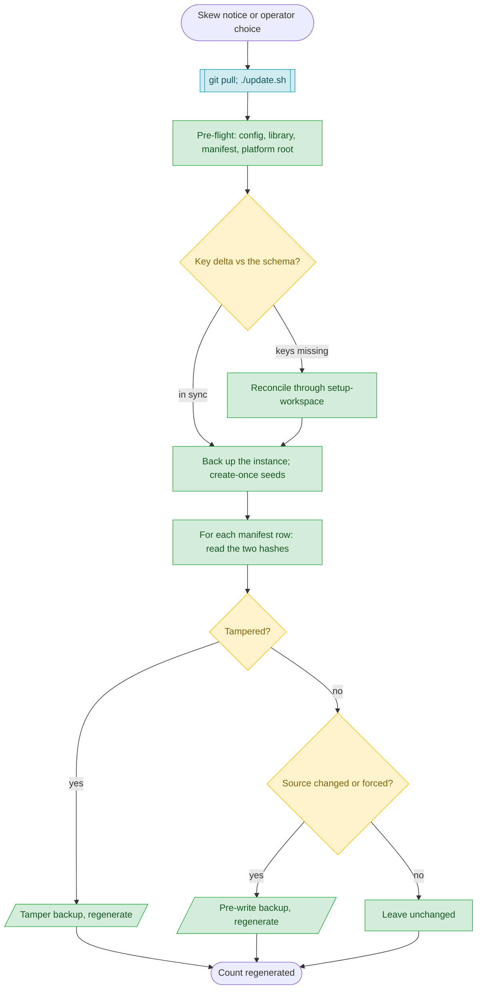

# Reconcile the operator config and regenerate composition surfaces (update.sh Phases 1–3)

## Summary

The operator, prompted by a skew notice or by choice, pulls the newer version and runs `./update.sh`. Pre-flight
requires `operator.toml`, the composition library and the manifest, and resolves the canonical platform root once.
Phase 2 diffs the config's key set against the declared schema and converges it through the installer's reconcile
flow. Phase 2.5 backs up the operator-instance directory and creates-once the seeds an existing workspace may lack.
Phase 3 walks all 21 manifest rows: a tampered managed body is backed up and regenerated; a changed source template
is backed up and regenerated; everything else is left alone, with the OPERATOR ADDITIONS fence preserved verbatim.
`--surfaces-only` runs the pre-flight, the config reconcile, the instance backup and the regeneration, and none
of the create-once seeds. Its
[ICOM](/core/process-catalog/definitions/pack.json) table follows.

## ICOM

| Inputs | Controls | Outputs | Mechanisms |
|---|---|---|---|
| The pulled clone (templates, manifest, library); `operator.toml` and the optional `operator.local.toml`; the install record; the installed surfaces' `managed_sha` and `installed_sha` markers; the flags `--dry-run`, `--force-regen`, `--surfaces-only` | Exit 65 on a missing config, library or root; exit 66 on an unanswerable schema key; exit 73 on a failed regeneration with restore; the two-hash model (source hash triggers, installed hash detects tamper); create-once guards on operator data | A converged `operator.toml`; an instance backup directory; regenerated managed sections with pre-write backups; `REGENERATED_COUNT` for the exit code | `update.sh`; `lib-composition.sh` wrapping `compose.py` (`regen`, `installed-sha`, `resolve-root`); [`check-operator-toml-schema.sh`](/core/deploy/tools/check-operator-toml-schema.sh) `--emit-delta`; `setup-workspace.sh --reconcile-config` |

## Flow

## Steps

| Step | Action | Actor | Inputs → outputs (shape) | Controls | Mechanism | Harness | Model need | Source |
|---|---|---|---|---|---|---|---|---|
| pull-and-run-update | Pull the newer version and run the updater from the clone root | operator | a skew notice or a decision → `git pull`, `./update.sh [--dry-run] [--force-regen] [--surfaces-only]`; a clean tree is advised, not required | the hook never applies an update; the operator does | shell | none | human | [UPDATE.md](/docs/UPDATE.md#L55)<!-- source-anchor: line=55; fp=876884030e8fc12c -->; [update.sh](/update.sh#L174)<!-- source-anchor: line=174; fp=3fca52a0b6857f1d --> |
| preflight-update | Require the config, the library and a loaded manifest | script:update.sh | `operator.toml`, `lib-composition.sh`, `lib_compose_source_manifest` and its caller-scope assert → continue, or exit 65 naming the missing piece | an incomplete clone is a defect, never "nothing to do" | `preflight` | file-and-shell-tools | XS/none/read/scriptable/batch | [update.sh](/update.sh#L203)<!-- source-anchor: line=203; fp=6212afec21124365 --> |
| resolve-platform-root | Resolve the canonical root every composed surface will carry | script:update.sh | the install record, else the repository's main working tree → an absolute `CANONICAL_PLATFORM_ROOT` and its tier, logged once; unresolvable → exit 65 | a worktree's own path is never baked into allowlists | `lib_compose_resolve_root` → `compose.py resolve-root` | file-and-shell-tools | XS/none/read/scriptable/batch | [update.sh](/update.sh#L245)<!-- source-anchor: line=245; fp=9fffc8b51944a456 --> |
| compute-config-key-delta | Diff the config's keys against the declared schema | script:update.sh | `check-operator-toml-schema.sh --emit-delta` → exit 0 (in sync), 1 (keys missing), 3 (probe could not run: warn loudly, never "reconciled") | the detector is the key-set diff, not the version integer | the schema primitive | file-and-shell-tools | XS/none/read/scriptable/batch | [update.sh](/update.sh#L306)<!-- source-anchor: line=306; fp=d8c419cb2dfa4b80 --> |
| reconcile-config | Backfill declared defaults, preserving operator-set values | script:setup-workspace.sh | the delta → `setup-workspace.sh --reconcile-config`; a key with no default and no answer leaves the key absent and exits 66; no key is ever removed; a dry run only names the command | C-190 (Check 70) polices parity afterwards: code-enforce (parity arms) / code-warn (schema arm) | `reconcile_config_flow` | file-and-shell-tools | XS/none/write/scriptable/batch | [update.sh](/update.sh#L360)<!-- source-anchor: line=360; fp=518c049096d982ba -->; [setup](/docs/scripts/setup-workspace.sh#L4437)<!-- source-anchor: line=4437; fp=30dd5b8b4859805a --> |
| back-up-operator-instance | Snapshot the operator-instance directory before any regeneration | script:update.sh | the instance dir → `<workspace>/.backup-pre-update-instance-<ts>/`; best-effort, a hiccup warns | operator data (needles, keys, mode files, hub state) is recoverable if a later phase misbehaves | `cp -R` | file-and-shell-tools | XS/none/write/scriptable/batch | [update.sh](/update.sh#L556)<!-- source-anchor: line=556; fp=62c6b9588b94a4d6 --> |
| scaffold-create-once-seeds | Create the needle file, the roster, the ambient directories and the settings overlay only when absent | script:update.sh | tracked examples and templates → instance copies; an existing file or directory is PRESERVED and never regenerated; the overlay is exactly `{}` | operator content is never touched; delivering the capability to existing workspaces is the point of doing it in this phase | `scaffold_needles`, `scaffold_roster`, `scaffold_ambient_dirs`, `scaffold_settings_local` | file-and-shell-tools | XS/none/write/scriptable/batch | [update.sh](/update.sh#L581)<!-- source-anchor: line=581; fp=c90843c1eb89a358 -->, [update.sh](/update.sh#L664)<!-- source-anchor: line=664; fp=616da21299e48252 -->, [update.sh](/update.sh#L710)<!-- source-anchor: line=710; fp=5cdde1ad6641df57 --> |
| resolve-surface-target | Resolve each manifest row to its runtime target and backup key | script:update.sh | row `<src>\|<tier>\|<tokens>[\|<dialect>]` → target path by tier (workspace-root and operations-root strip `.template`); backups keyed on tier plus basename; an absent target is logged for the installer and, for a hook-read surface, remembered for the completeness gate | a basename repeats across tiers, so the backup key carries the tier | `lib_compose_parse_entry`, `lib_compose_resolve_target` (the instance tiers through [`core/deploy/lib-instance-path.sh`](/core/deploy/lib-instance-path.sh)) | file-and-shell-tools | XS/none/read/scriptable/batch | [update.sh](/update.sh#L394)<!-- source-anchor: line=394; fp=4079369cb83558a5 --> |
| read-surface-hashes | Read the source hash, the stored hashes and the live managed body hash | script:update.sh | template file, the target's dialect-aware `managed_sha` and `installed_sha` markers, `compose.py installed-sha` → four hashes | two hashes by design: the source hash triggers regeneration, the installed-body hash detects tamper | `lib_compose_sha_compute`, `lib_compose_installed_body_sha` | file-and-shell-tools | XS/none/read/scriptable/batch | [update.sh](/update.sh#L439)<!-- source-anchor: line=439; fp=36aad029f6e015e6 --> |
| regenerate-on-tamper | Back up and regenerate a hand-edited managed body | script:update.sh | live body hash ≠ stored `installed_sha` → copy to `<workspace>/.backup-tampered-<ts>/<tier>-<basename>`, regenerate; a failed regeneration restores the backup and exits 73 | fires regardless of the source-hash skip; a missing anchor means "unknown, not tampered" | `lib_compose_regen` → `compose.py regen` | file-and-shell-tools | XS/none/write/scriptable/batch | [update.sh](/update.sh#L463)<!-- source-anchor: line=463; fp=71b4518d12a31237 --> |
| regenerate-on-source-change | Back up and regenerate when the template changed or `--force-regen` was given | script:update.sh | source hash ≠ stored `managed_sha` (or forced) → pre-write backup under `<workspace>/.backup-pre-update-<ts>/`, regeneration from the template plus `operator.toml` plus the resolved root; OPERATOR ADDITIONS carried verbatim; out-of-fence content discarded with a notice on the two root tiers; failure restores and exits 73 | §3.3 of the spec: content outside either fence is not carried forward | `lib_compose_regen` | file-and-shell-tools | XS/none/write/scriptable/batch | [update.sh](/update.sh#L484)<!-- source-anchor: line=484; fp=15ab222ab94aa1b5 -->; [spec](/core/standards/composition-surface-spec.md#L76)<!-- source-anchor: line=76; fp=448d4cb7e152ddc3 --> |
| count-regenerations | Report the survey and surface the count to the exit-code decision | script:update.sh | surveyed, regenerated, unchanged → one INFO line; `REGENERATED_COUNT` | a tamper regeneration counts as a change | `log` | none | XS/none/none/scriptable/batch | [update.sh](/update.sh#L530)<!-- source-anchor: line=530; fp=9d96fc50e09d3ea5 --> |

## Step profile

| Field | Value |
|---|---|
| Deterministic steps | 11 of 12 (determinism `scriptable`, counted from the Steps table) |
| Judgment steps | 0 |
| Operator steps | 1 (`human`): the pull and the invocation |
| Harness features relied on | file-and-shell-tools (portable); `update.sh` carries no JSON parser of its own and reads TOML with `grep` and `awk` |
| Context read | S (2k–8k tokens): the manifest rows, the per-file log lines, the usage banner |

## Evidence

| Lens | Source | Observation | Label |
|---|---|---|---|
| designed | [`docs/UPDATE.md`](/docs/UPDATE.md), "What gets updated", "Run update.sh" and "Blast radius of a full update" | the four file categories and their update behaviour; the five-step procedural summary; the full effect list; `--surfaces-only`; [`deploy.sh`](/core/deploy/deploy.sh) `--deploy` cannot refresh a surface | [SOURCE] |
| designed | [`core/standards/composition-surface-spec.md`](/core/standards/composition-surface-spec.md), "The four file categories" and "Marker syntax convention" | the per-category contract, the two fence dialects, the two-hash markers | [SOURCE] |
| built | [`update.sh`](/update.sh), `preflight` to `write_last_update`, and `surfaces_only_flow`; [`core/deploy/composition-surface-manifest.sh`](/core/deploy/composition-surface-manifest.sh) | the manifest array is the Phase 3 population; the phases run in the order pre-flight → reconcile → backup → scaffolds → regenerate; the surfaces-only flow is a named member list, so a later phase cannot join it by default | [SOURCE] |
| executed | measure `workflow-runs-install-security` — [workflow-run-history.py](/core/deploy/tools/process-catalog-measures/workflow-run-history.py) (population: every run of each named workflow created in the trailing window, split by trigger event, read in slices and verified against the host's total for each slice) · [`install-tests.yml`](/.github/workflows/install-tests.yml) | The measure reports the runs of the install-test workflow by trigger event and conclusion. Its regression suite runs the real updater against a sandboxed install whose source templates were changed, and runs the installer's reconcile flow. The operator's own step is run by no workflow and the tamper branch is not listed, so the page reads `unobserved`. covers: `preflight-update`, `resolve-platform-root`, `compute-config-key-delta`, `reconcile-config`, `back-up-operator-instance`, `scaffold-create-once-seeds`, `resolve-surface-target`, `read-surface-hashes`, `regenerate-on-source-change`, `count-regenerations` | [SOURCE] |
| executed | no measure — what would show an operator's own update is the `.last-update` marker and the backup directories that update leaves on its own install. | No measure in the measures register reads an operator's own update | [SOURCE] |

## Navigation

<!-- nav:begin -->
Up: [update-platform](update-platform.md) · Next: [refresh-hook-bundle](refresh-hook-bundle.md)
<!-- nav:end -->

## Sources

- [`update.sh`](/update.sh) — Phases 1, 1b, 2, 2.5a–e, 3 and the surfaces-only flow
- [`core/deploy/lib-composition.sh`](/core/deploy/lib-composition.sh), [`core/deploy/compose.py`](/core/deploy/compose.py) — the marker-fenced write and the two-hash contract
- [`core/deploy/composition-surface-manifest.sh`](/core/deploy/composition-surface-manifest.sh) — the 21 rows
- [`core/standards/composition-surface-spec.md`](/core/standards/composition-surface-spec.md), [`docs/UPDATE.md`](/docs/UPDATE.md) — the contract and the procedure
- [`docs/scripts/setup-workspace.sh`](/docs/scripts/setup-workspace.sh), [`core/deploy/tools/check-operator-toml-schema.sh`](/core/deploy/tools/check-operator-toml-schema.sh) — the reconcile flow and the key-delta probe
- [`.github/workflows/install-tests.yml`](/.github/workflows/install-tests.yml) — the workflow whose run history the executed row reads
- [`core/process-catalog/definitions/controls-register.tsv`](/core/process-catalog/definitions/controls-register.tsv) — C-190
