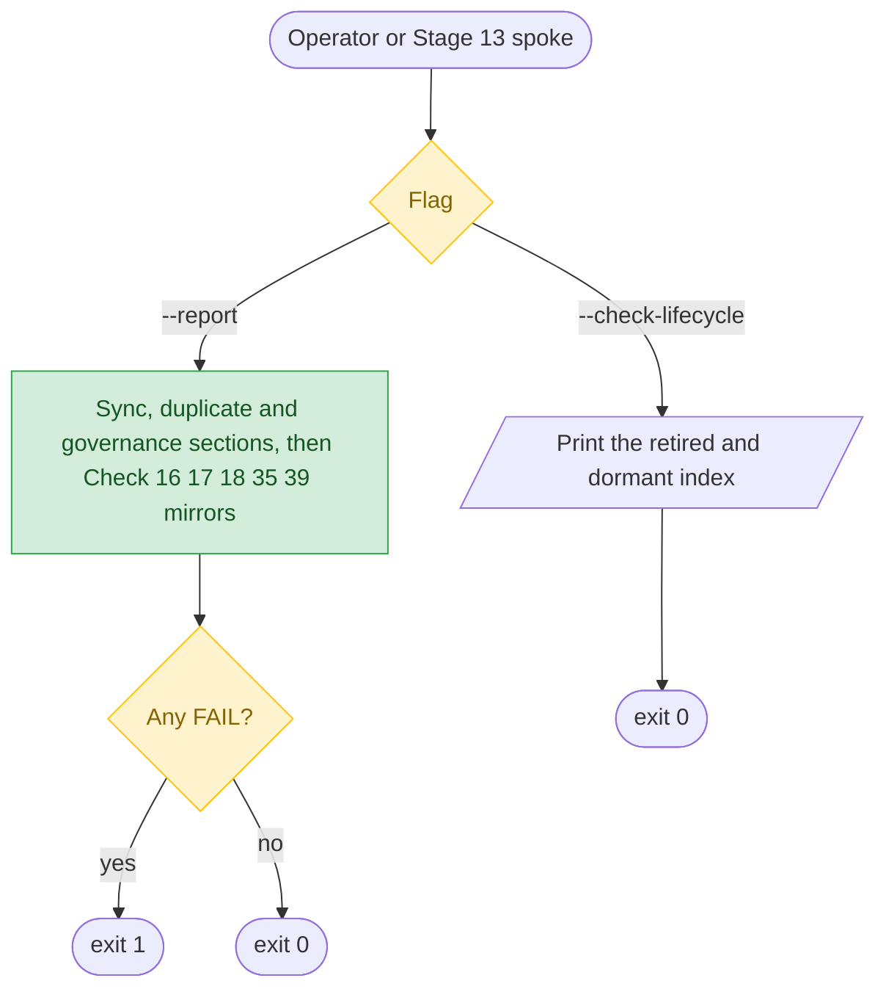

# Report platform health and list the check lifecycle

## Summary

Two dispatcher flags read the platform's state without running the full suite. `--report` prints a plain-text report
— git commit and tag, per-skill sync with references and supplementary content, package sync, duplicate detection
and governance presence, then PASS or FAIL mirrors of Checks 16, 17, 18, 35 and 39 in enforce-mode semantics
regardless of the warn mode — and exits 1 on any FAIL; the deployment rule names it as Stage 13 evidence, so the
Stage 13 spoke or the operator runs it. `--check-lifecycle` prints the index of retired and dormant checks with
their reactivation anchors, for the operator. (The hermetic `--self-test`, Check 61's machinery arm, belongs to the single-check probe
activity, where its pull-request caller is.) Its
[ICOM](/core/process-catalog/definitions/pack.json) table (inputs, controls, outputs, mechanisms)
follows.

## ICOM

| Inputs | Controls | Outputs | Mechanisms |
|---|---|---|---|
| The module arrays and the install path; the packages root; the host's issues and latest release; the inline RETIRED and DORMANT blocks the lifecycle index summarizes | The report's enforce-mode semantics; the lifecycle index's maintenance rule (a row per retirement or parking) | The report text with a `Summary: N checks, P passed, F failed` line and exit code; the lifecycle registry text | `cmd_report`, `cmd_check_lifecycle`; the shared `_c16_*` and `_c35_compute_verdict` bodies; `gh` reads for the host-backed mirrors |

## Flow

## Steps

| Step | Action | Actor | Inputs → outputs (shape) | Controls | Mechanism | Harness | Model need | Source |
|---|---|---|---|---|---|---|---|---|
| request-health-report | Request the report as close evidence | spoke | Stage 13's evidence need → `./deploy.sh --report` invoked from the workspace | prose-only | shell invocation | file-and-shell-tools | XS/none/read/scriptable/batch | [skill-deployment](/core/rules/skill-deployment.md#L391)<!-- source-anchor: line=391; fp=abb8fcfaa487f8a4 --> |
| report-skill-sync | Report per-skill sync, references and supplementary content | script:deploy.sh | the module arrays and install path → one `[PASS]` or `[FAIL]` line per skill, per references tree and per supplementary item, with a read-only annotation on an unwritable target; then the package-sync, duplicate-detection and governance-presence sections in the same form | prose-only | inline bash in `cmd_report` | file-and-shell-tools | XS/none/read/scriptable/batch | [deploy.sh](/core/deploy/deploy.sh#L22956)<!-- source-anchor: line=22956; fp=4808cef3dba6583c --> |
| report-check-mirrors | Report Checks 16, 17, 18, 35 and 39 in enforce-mode form | script:deploy.sh | the host's intake issues, the framework catalog, the multi-mode skills and the version stamp → `[PASS]` or `[FAIL]` per invariant, the unvarnished verdict regardless of the suite's warn mode | prose-only | `_c16_population`, `_c16_violators`, `_c35_compute_verdict`, the version-grammar library, `gh issue` and `gh api` | file-and-shell-tools, git-and-gh-cli | XS/none/read/scriptable/batch | [deploy.sh](/core/deploy/deploy.sh#L23141)<!-- source-anchor: line=23141; fp=cadbc132a95991e8 --> |
| summarize-report | Print the summary and exit | script:deploy.sh | the PASS and FAIL counts → `=== Summary: N checks, P passed, F failed ===`; exit 1 when any failed | prose-only | the summary block | file-and-shell-tools | XS/none/read/scriptable/batch | [deploy.sh](/core/deploy/deploy.sh#L23354)<!-- source-anchor: line=23354; fp=ffcc5846afc95722 --> |
| list-check-lifecycle | Print the check lifecycle index | script:deploy.sh | the inline RETIRED and DORMANT blocks → a fixed table: Checks 15 and 24 retired with their authorities, 11 and 30 dormant with their reactivation anchors; exit 0 | prose-only | `cmd_check_lifecycle`'s heredoc | file-and-shell-tools | XS/none/read/scriptable/batch | [deploy.sh](/core/deploy/deploy.sh#L7478)<!-- source-anchor: line=7478; fp=ac119e3c81e6f003 --> |

## Step profile

| Field | Value |
|---|---|
| Deterministic steps | 5 of 5 (determinism `scriptable`, counted from the Steps table) |
| Judgment steps | 0 |
| Harness features relied on | file-and-shell-tools, git-and-gh-cli |
| Context read | XS (under 2k tokens) |

## Evidence

| Lens | Source | Observation | Label |
|---|---|---|---|
| designed | [`core/deploy/deploy.sh`](/core/deploy/deploy.sh), `cmd_report` and `cmd_check_lifecycle`; [`core/rules/skill-deployment.md`](/core/rules/skill-deployment.md), the Stage 13 evidence line | the report's own comment calls it the same checks as `--check` in a different format; its sections are skill sync, package sync, duplicate detection, governance presence and the mirrors of Checks 16, 17, 18, 35 and 39; the lifecycle index is a fixed heredoc with a stated maintenance rule | [SOURCE] |
| described vs built | [the lifecycle index](/core/deploy/deploy.sh#L7488)<!-- source-anchor: line=7488; fp=5c428831c7526dcb -->; [its next-number line](/core/deploy/deploy.sh#L7489)<!-- source-anchor: line=7489; fp=2d683f7cf8ebc39f -->; [the last check block](/core/deploy/deploy.sh#L18427)<!-- source-anchor: line=18427; fp=bdd69678eeea2ad8 --> | the lifecycle index — which its own comment calls the SSOT for the lifecycle roster — states the live sequence as 1–14, 16–23, 25–53 with 54 the next number, while the suite's check blocks run to Check 82 | [SOURCE] |
| described vs built | [the usage line](/core/deploy/deploy.sh#L23488)<!-- source-anchor: line=23488; fp=cb9e0a27bc7a10ef -->; [a Modes line it omits](/core/deploy/deploy.sh#L23509)<!-- source-anchor: line=23509; fp=67cb1e790cff80f0 --> | the dispatcher's one-line usage omits the release-corpus, decision-emission and package-freshness flags that its Modes list and its `case` arms carry | [SOURCE] |
| built | [`core/deploy/deploy.sh`](/core/deploy/deploy.sh), `cmd_report` and the dispatcher | the report computes the Check 16 and Check 35 mirrors through the bodies the suite uses, reads the host through `gh` for Check 17 and Check 39 and the framework catalog for Check 18, sums the PASS and FAIL counts and exits 1 when any failed; the dispatcher routes `--report` and `--check-lifecycle` to their functions | [SOURCE] |
| executed | held local — what would show how often either flag is invoked is the record of sessions across an install. | Nothing from that store is published | [SOURCE] |

## Navigation

<!-- nav:begin -->
Up: [run-check-probes](run-check-probes.md) · Previous: [run-required-subset](run-required-subset.md)
<!-- nav:end -->

## Sources

- [`core/deploy/deploy.sh`](/core/deploy/deploy.sh) — `cmd_report`, `cmd_check_lifecycle` and the dispatcher's usage text
- [`core/rules/skill-deployment.md`](/core/rules/skill-deployment.md) — the line naming `--report` as Stage 13 evidence
