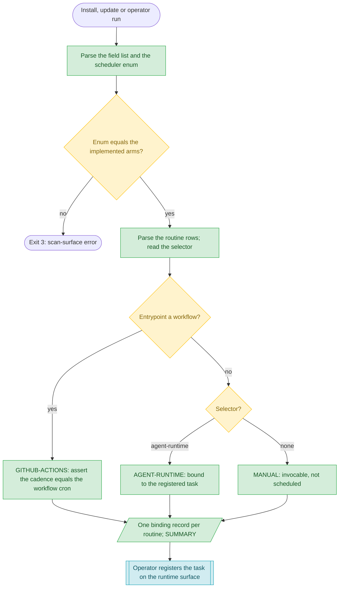

# Resolve a registered routine to its firing binding

## Summary

The registry declares what runs; the scheduler adapter resolves how it fires on a given install. It parses the field list from the
schema's machine-parse contract and the scheduler value space from the operator-config declaration, asserts those
match the arms it implements, reads every registry row, reads the operator's `[adapters].scheduler` selector, derives
the backend class from each entrypoint (a workflow path fires on the host; anything else needs an agent session), and
emits one binding record per routine whose first field is a state token — never a bare OK. On a default install the
selector is `none`, so every session-fired routine resolves to `MANUAL`: the registration itself is the operator's
step, on a surface no script can reach. Its
[ICOM](/core/process-catalog/definitions/pack.json) table follows.

## ICOM

| Inputs | Controls | Outputs | Mechanisms |
|---|---|---|---|
| The registry's `## Routines` table; the schema's field table; the `scheduler` enum in the operator-config declaration; `operator.toml` `[adapters].scheduler`; each entrypoint's `automation_id` marker; a workflow entrypoint's `schedule:` block | Resolution by registry id only; the AC-3 no-unused-arm set equality; cardinality guards on every parse; exit 3 on any scan-surface error regardless of posture | One binding record per routine (`AGENT-RUNTIME`, `GITHUB-ACTIONS` or `MANUAL` first), `FAIL:` lines, a `SUMMARY` line; exit 0 / 1 / 2 / 3 | The adapter script (bash 3.2); the registry and coverage predicates as siblings; the operator's registration on the agent-runtime scheduled-task surface |

## Flow

## Steps

| Step | Action | Actor | Inputs → outputs (shape) | Controls | Mechanism | Harness | Model need | Source |
|---|---|---|---|---|---|---|---|---|
| parse-schema-fields | Read the field list and column order from the schema's own contract | script:resolve-automation-binding.sh | the schema's numbered field table → the ordered field names; `id`, `cadence`, `entrypoint` located by name; 0 fields → exit 3 | code-enforce | `parse_schema_fields` | file-and-shell-tools | XS/none/read/scriptable/batch | [resolver](/core/deploy/tools/resolve-automation-binding.sh#L211)<!-- source-anchor: line=211; fp=91bf159022feb293 --> |
| parse-scheduler-enum | Read the scheduler value space and assert it equals the implemented arms | script:resolve-automation-binding.sh | the `scheduler` key's enum in the operator-config declaration → the member set; empty, or unequal to `agent-runtime none` → exit 3 | code-enforce | `parse_scheduler_enum`, `sorted_set` | file-and-shell-tools | XS/none/read/scriptable/batch | [resolver](/core/deploy/tools/resolve-automation-binding.sh#L226)<!-- source-anchor: line=226; fp=fcad790f000cf800 -->, [resolve-automation-binding.sh](/core/deploy/tools/resolve-automation-binding.sh#L134)<!-- source-anchor: line=134; fp=25c81c75c7a0ee9b --> |
| parse-routine-rows | Read the registry table and check its header against the schema | script:resolve-automation-binding.sh | the `## Routines` table → one row per routine; a missing table, an unreadable header, or a header that differs from the parsed field list → exit 3; a duplicate id → exit 2 | code-enforce | `parse_routines_table` | file-and-shell-tools | XS/none/read/scriptable/batch | [resolver](/core/deploy/tools/resolve-automation-binding.sh#L252)<!-- source-anchor: line=252; fp=1d661147177cab77 --> |
| read-selector | Read the operator's scheduler choice | script:resolve-automation-binding.sh | `[adapters].scheduler` in `operator.toml` → `agent-runtime` or `none` (the shipped default); a value outside the parsed set → exit 2 | code-enforce | `read_selector` | file-and-shell-tools | XS/none/read/scriptable/batch | [resolver](/core/deploy/tools/resolve-automation-binding.sh#L354)<!-- source-anchor: line=354; fp=272286b7a8cbe123 -->; [operator.toml.template](/core/config/operator.toml.template#L293)<!-- source-anchor: line=293; fp=19dd7662bbd8e15e --> |
| verify-entrypoint-declaration | Assert the entrypoint declares the row's own id | script:resolve-automation-binding.sh | the entrypoint's frontmatter `automation_id` (list-valued) or a workflow's `# automation_id:` comment → the ids; an unresolvable path or a mismatched id → a `FAIL:` line, exit 1 | code-enforce | `entrypoint_declared_ids` | file-and-shell-tools | XS/none/read/scriptable/batch | [resolver](/core/deploy/tools/resolve-automation-binding.sh#L284)<!-- source-anchor: line=284; fp=ffe49ec51169e4a1 --> |
| derive-backend-class | Classify each routine by its entrypoint, never by a stored field | script:resolve-automation-binding.sh | a workflow path → `GITHUB-ACTIONS` (the row's cadence must equal the workflow's cron, else `FAIL:`); any other tracked spec → session-fired, bound by the selector | code-enforce | `run_resolve`, `workflow_cron` | file-and-shell-tools | XS/none/read/scriptable/batch | [resolver](/core/deploy/tools/resolve-automation-binding.sh#L378)<!-- source-anchor: line=378; fp=7914c7a0181bfa15 -->, [resolve-automation-binding.sh](/core/deploy/tools/resolve-automation-binding.sh#L330)<!-- source-anchor: line=330; fp=4533aaf26b9fc5ee --> |
| emit-binding-records | Print one record per routine with its state token first, then the summary | script:resolve-automation-binding.sh | per routine → `AGENT-RUNTIME`, `GITHUB-ACTIONS` or `MANUAL` record; `SUMMARY`; exit 0 when every routine bound, 1 on routine-level failures | code-enforce | `printf` | file-and-shell-tools | XS/none/none/scriptable/batch | [resolver](/core/deploy/tools/resolve-automation-binding.sh#L136)<!-- source-anchor: line=136; fp=ab12e4071650ccc5 -->, [resolve-automation-binding.sh](/core/deploy/tools/resolve-automation-binding.sh#L69)<!-- source-anchor: line=69; fp=2ed0bfea52620491 --> |
| register-routine-task | Register the session-fired routines on the agent-runtime scheduled-task surface with the thin-bootstrap prompt | operator | each `MANUAL` record and the entrypoint's registration prompt → a scheduled task (cadence, completion notification on) on the surface `[adapters].scheduler` names; for the two platform-health tasks the registration is recorded as a Stage 12 deploy-log line item and rollback is deregistration | prose-only | the agent runtime's scheduled-task surface | scheduled-routines | human | [INSTALL.md](/docs/INSTALL.md#L174)<!-- source-anchor: line=174; fp=28352bc786d2197b -->; [OPERATIONS.md](/core/governance/OPERATIONS.md#L776)<!-- source-anchor: line=776; fp=65055505db0a5707 --> |

## Step profile

| Field | Value |
|---|---|
| Deterministic steps | 7 of 8 (determinism `scriptable`, counted from the Steps table) |
| Judgment steps | 0 |
| Operator steps | 1 (`human`): the registration |
| Harness features relied on | file-and-shell-tools (portable); scheduled-routines (adapter) for the registration itself |
| Context read | XS (under 2k tokens): the registry rows, one enum, one selector |

## Evidence

| Lens | Source | Observation | Label |
|---|---|---|---|
| designed | [`core/schemas/automation-registry-schema.md`](/core/schemas/automation-registry-schema.md) § 1 and, in § 8, the paragraph on a self-firing entrypoint | the three-way decoupling (what runs: the registry; how it fires: the operator's selector; who governs: the dial); a self-firing entrypoint identified by its path | [SOURCE] |
| designed | [`docs/ONBOARDING_JOURNEY.md`](/docs/ONBOARDING_JOURNEY.md) § EP-SCHED; [`docs/INSTALL.md`](/docs/INSTALL.md) § 3a | the scheduler default is `none` deliberately; nothing runs until the operator registers the tasks; the adapter prints a `MANUAL` line per routine | [SOURCE] |
| built | [`core/deploy/tools/resolve-automation-binding.sh`](/core/deploy/tools/resolve-automation-binding.sh), its header comment and `run_resolve`; [`automation-registry-check.yml`](/.github/workflows/automation-registry-check.yml) (C-202's job) | the parse-never-copy arms, the AC-3 set equality, the three state tokens, the four exit codes; the registry-check workflow's job runs the adapter's self-test on every pull request | [SOURCE] |
| built | [`core/automations/registry.md`](/core/automations/registry.md) § Routines; [`core/config/operator.toml.template`](/core/config/operator.toml.template), `[adapters].scheduler` | one row's entrypoint is a workflow, so that routine is fired by the host; every other row's entrypoint is a tracked spec, so the routine is session-fired and bound by the selector; the shipped selector default is `none` | [SOURCE] |
| executed | measure `workflow-runs-install-security` — [workflow-run-history.py](/core/deploy/tools/process-catalog-measures/workflow-run-history.py) (population: every run of each named workflow created in the trailing window, split by trigger event, read in slices and verified against the host's total for each slice); [`automation-registry-check.yml`](/.github/workflows/automation-registry-check.yml) | the measure reports the run history of the registry-check workflow, split by trigger event; that workflow's job runs the adapter's self-test, so the history shows runs of the self-test and not a resolution on an install | [SOURCE] |
| executed | held local — what would show a registration and its firings is the agent runtime's scheduled-task surface, a record of work across an install. | The adapter prints its records to stdout and writes no log; nothing from that surface is published, so the page reads `unobserved` | [SOURCE] |

## Navigation

<!-- nav:begin -->
Up: [run-scheduled-audit](run-scheduled-audit.md) · Next: [run-platform-health-audit](run-platform-health-audit.md)
<!-- nav:end -->

## Sources

- [`core/deploy/tools/resolve-automation-binding.sh`](/core/deploy/tools/resolve-automation-binding.sh) — the adapter
- [`core/automations/registry.md`](/core/automations/registry.md), [`core/schemas/automation-registry-schema.md`](/core/schemas/automation-registry-schema.md) — the rows and the contract
- [`core/standards/scheduler-adapter-routine-firing.md`](/core/standards/scheduler-adapter-routine-firing.md) — the constraints SD-1 to SD-4 the adapter implements
- [`docs/INSTALL.md`](/docs/INSTALL.md) § 3a, [`docs/ONBOARDING_JOURNEY.md`](/docs/ONBOARDING_JOURNEY.md) § EP-SCHED, [`core/governance/OPERATIONS.md`](/core/governance/OPERATIONS.md) Rule 5 of the platform-health audit protocol — the registration step
- [`core/config/operator.toml.template`](/core/config/operator.toml.template) — the selector's declaration and default; [`.github/workflows/automation-registry-check.yml`](/.github/workflows/automation-registry-check.yml) — the job that runs the adapter's self-test; [`core/process-catalog/definitions/controls-register.tsv`](/core/process-catalog/definitions/controls-register.tsv) — C-202
