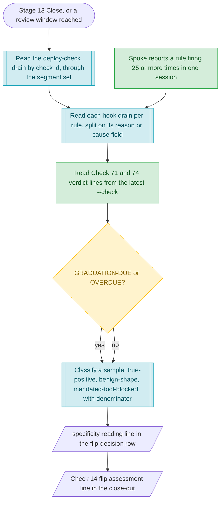

# Review the warn-log drains and rollout verdicts

## Summary

A warn-mode gate records instead of blocking, so the record has to be read. The operator reads the shared
deploy-check drain by check id across every segment — never the hot file alone, because a rotated log returns a
plausible wrong answer — and the hook drains per rule, split by the field each drain carries; classifies a sample of
firings as true-positive, benign-shape or mandated-tool-blocked with its denominator; and writes that reading into the
gate's flip-decision row. Deploy checks force the schedule: Check 71, once for each of the destructive rule's
three phase-gated families, and Check 74 print GRADUATION-DUE at the review window and fail the run at escalation,
so an undecided rollout cannot stay silent; Check 74's own phase constant reads `enforce`, so it reports that
rollout graduated. HSR-1 makes the hook-layer reading a Stage 13 Close obligation, and a session that sees one
rule fire 25 times reports it as a layer-level signal. Its [ICOM](/core/process-catalog/definitions/pack.json) table (inputs, controls, outputs,
mechanisms) follows.

## ICOM

| Inputs | Controls | Outputs | Mechanisms |
|---|---|---|---|
| The deploy-check warn-log segment family under the operator-instance path; the per-hook warn logs and the block log beside the deployed hooks; the latest `--check` output's Check 71 and 74 lines; the flip-decision table | The segment-set read rule; HSR-1's Stage 13 trigger and classification form; HSR-2's 25-firings threshold; the Check 14 flip-assessment line at Stage 13; the never-auto-promoted-by-count rule | A specificity reading per rule that wrote rows; a drain count per check id; a Check 14 assessment line in the close-out; a layer-level signal on a spoke's output | Shell reads over JSON lines; `deploy.sh --check` for the two verdict lines; the close-out report |

## Flow

## Steps

| Step | Action | Actor | Inputs → outputs (shape) | Controls | Mechanism | Harness | Model need | Source |
|---|---|---|---|---|---|---|---|---|
| read-deploy-check-drain | Read the deploy-check drain by check id through the segment set | operator | the warn-log segment family → rows per check id over the shakedown window, hot file and numbered segments together; after a rotation a hot-only read returns a plausible wrong count | prose-only | shell reads over the JSON lines | file-and-shell-tools | human | [deploy.sh](/core/deploy/deploy.sh#L333)<!-- source-anchor: line=333; fp=08843282a035e8b0 --> |
| read-hook-drains-per-rule | Read each hook drain per rule, split on its classification field | operator | the per-hook warn logs and the block log → rows per rule since the previous review, partitioned by the drain's `reason` or `cause` field (a drain without one yields no substrate, which is itself the finding) | C-380: prose-only | shell reads; the destructive drain is read per arm, never flipped by this review | file-and-shell-tools | human | [bypass-mode-readiness](/core/rules/bypass-mode-readiness.md#L947)<!-- source-anchor: line=947; fp=7ca0613b794a2a76 --> |
| read-rollout-verdicts | Read the rollout verdict lines | script:deploy.sh | the committed constants and today's date → Check 71's lines per family and Check 74's DENOM line with OK, WARN GRADUATION-DUE or FAIL GRADUATION-OVERDUE | C-191: code-enforce (deadline arm) / code-warn (evidence arm); C-194: code-enforce (deadline arm) / code-warn (evidence arm) | `deploy.sh --check`, Checks 71 and 74 | file-and-shell-tools | XS/none/read/scriptable/batch | [deploy.sh](/core/deploy/deploy.sh#L17246)<!-- source-anchor: line=17246; fp=0e7262ed949f4c5c --> |
| classify-firing-sample | Classify a sample of firings with its denominator | operator | sampled rows → each classed true-positive, benign-shape or mandated-tool-blocked; a zero drain read as instrumentation-suspect, never as no evidence | prose-only | reading the partitioned rows | file-and-shell-tools | human | [gate-efficacy](/core/standards/gate-efficacy-standard.md#L231)<!-- source-anchor: line=231; fp=38a1d7a292990ba8 --> |
| record-specificity-reading | Record the reading in the gate's flip-decision row | operator | the classification → one line `specificity reading YYYY-MM-DD: n sampled of N — TP n / benign n / mandated n` in the row; a skipped review shows as a stale date | C-380: prose-only | an edit to the standard through a pull request | file-and-shell-tools | human | [bypass-mode-readiness](/core/rules/bypass-mode-readiness.md#L954)<!-- source-anchor: line=954; fp=ad7627fca59f99ee --> |
| report-layer-level-signal | Report a rule firing 25 or more times in one session | spoke | the session's own block count per rule id → a line on the spoke's `Control firings:` output naming rule, count and shape; an input to the next reading, never an escalation | C-382: prose-only | the spoke's output | none | S/low/write/templated/batch | [bypass-mode-readiness](/core/rules/bypass-mode-readiness.md#L959)<!-- source-anchor: line=959; fp=ae6429e94ea50d1e --> |
| assess-check-14-flip-at-close | Record the Check 14 flip-to-enforce assessment at Stage 13 Close | operator | the doc-link drain and the backlog of broken refs → an explicit defer-with-rationale or a flip; silent deferral is a process violation | C-359: prose-only | a line item in the close-out | file-and-shell-tools | human | [doc-link-maintenance](/core/rules/doc-link-maintenance.md#L131)<!-- source-anchor: line=131; fp=72e6afd233f209b3 --> |

## Step profile

| Field | Value |
|---|---|
| Deterministic steps | 1 of 7 (determinism `scriptable`, counted from the Steps table): the verdict read |
| Judgment steps | 0 by the notation — five steps are the operator's and read `human`; the spoke's signal line is templated and sits in neither count |
| Operator steps | 5 |
| Harness features relied on | file-and-shell-tools |
| Context read | S (2k–8k tokens): the partitioned drain counts and the flip-decision rows under review |

## Evidence

| Lens | Source | Observation | Label |
|---|---|---|---|
| designed | [the gate-efficacy standard](/core/standards/gate-efficacy-standard.md) § Flip-decision status, § Over-firing; [`bypass-mode-readiness.md`](/core/rules/bypass-mode-readiness.md) § Shakedown → Enforce Transition Checklist, HSR-1, HSR-2; [`doc-link-maintenance.md`](/core/rules/doc-link-maintenance.md) § Initial Mode + Flip-to-Enforce Timeline | the drain history, not a green tree, is the shakedown criterion for an out-of-tree subject, and the flip-decision table's first row records the shared warn-mode cohort as still warning at scale ([gate-efficacy](/core/standards/gate-efficacy-standard.md#L534)<!-- source-anchor: line=534; fp=b92f21b245f620ec -->); HSR-1 is a class 3-O obligation with no runner; the shakedown checklist lists the hook drains to read and names the destructive drain as read-only for the shared flip, read per arm | [SOURCE] |
| built | [`core/deploy/deploy.sh`](/core/deploy/deploy.sh), Checks 71 and 74 and the segment-set function; [the controls register](/core/process-catalog/definitions/controls-register.tsv), C-191, C-194, C-359, C-380, C-382 | the deadline arms of Checks 71 and 74 force a rollout decision onto a schedule from committed constants and the run's date: Check 71 over the destructive rule's three families, Check 74 over one rollout whose phase constant reads `enforce`, which the check reports as graduated; each evidence arm counts drain rows and never raises the exit counter. The readings themselves have no runner: the register classes HSR-1, HSR-2 and the Check 14 assessment `prose-only`, and the standard's gate-coverage register lists HSR-1 as class 3-O | [SOURCE] |
| executed | no measure — what would show how many rows each check and each hook rule wrote is the deploy-check warn log and the per-hook warn logs. | No measure in the measures register reads a warn log | [SOURCE] |
| executed | measure `gate-rollout-deadlines` — [gate-rollout-deadlines.py](/core/deploy/tools/process-catalog-measures/gate-rollout-deadlines.py) (population: the rollout constants of the deploy script and the destructive-operations hook and the committed enforce sentinels, classified as the deadline checks classify them on the day of the run) | The measure reports, per rollout family, its phase and its standing on the day of the run — graduated, within its window, review due or escalation overdue — and the committed enforce sentinels by token. It reads the constants that Check 71 and Check 74 read and reads no drain | [SOURCE] |
| executed | measure `flip-decision-rows` — [flip-decision-rows.py](/core/deploy/tools/process-catalog-measures/flip-decision-rows.py) (population: the data rows of both tables under the gate-efficacy standard's flip-decision heading, in the checked-out tree) | The measure reports, per table of the flip-decision section, its row total and its rows by leading decision. A specificity reading is not a leading decision, so the measure does not show whether a row carries one | [SOURCE] |
| designed vs described | [`bypass-mode-readiness.md`](/core/rules/bypass-mode-readiness.md) § HSR-1, its declared observable ([bypass-mode-readiness](/core/rules/bypass-mode-readiness.md#L954)<!-- source-anchor: line=954; fp=ad7627fca59f99ee -->); [the gate-efficacy standard](/core/standards/gate-efficacy-standard.md) § Flip-decision status, the rows for the hook rules on the shared dial ([gate-efficacy](/core/standards/gate-efficacy-standard.md#L571)<!-- source-anchor: line=571; fp=46093d72a4144893 -->, [gate-efficacy](/core/standards/gate-efficacy-standard.md#L572)<!-- source-anchor: line=572; fp=d855d386e97f2e15 -->) | HSR-1 makes a specificity reading for every hook rule that wrote drain rows an obligation of each Stage 13 Close, and names its observable: a dated classification line in the rule's flip-decision row. The table's row for the fs-boundary rule describes a drain written continuously since the rule stopped blocking and says no sample has been classified; the row for the shell-injection rule says it is blocked on the same preconditions; neither row carries a line in the declared form. HSR-1's own text says of the same drains that neither has been reviewed | [SOURCE] |

## Navigation

<!-- nav:begin -->
Up: [graduate-gate-modes](graduate-gate-modes.md) · Next: [reconcile-gate-posture](reconcile-gate-posture.md)
<!-- nav:end -->

## Sources

- [`core/standards/gate-efficacy-standard.md`](/core/standards/gate-efficacy-standard.md) — § Flip-decision status and § Over-firing, the reading's form, the never-auto-promoted rule, and the gate-coverage register's row for HSR-1
- [`core/rules/bypass-mode-readiness.md`](/core/rules/bypass-mode-readiness.md) — § Warn-mode shakedown, § Shakedown → Enforce Transition Checklist, HSR-1 and HSR-2
- [`core/rules/doc-link-maintenance.md`](/core/rules/doc-link-maintenance.md) — § Initial Mode + Flip-to-Enforce Timeline
- [`core/deploy/deploy.sh`](/core/deploy/deploy.sh) — Checks 71 and 74, the deadline arms, and the segment-set function with its read rule
- [`core/process-catalog/definitions/controls-register.tsv`](/core/process-catalog/definitions/controls-register.tsv) — C-191, C-194, C-359, C-380, C-382
