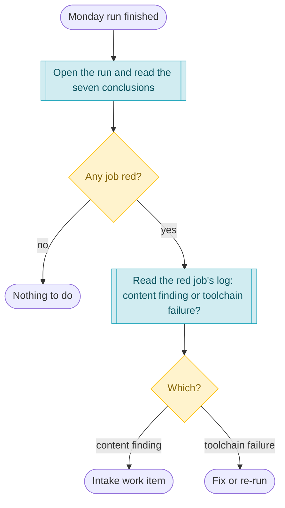

# Route the Monday scan verdicts

## Summary

The scheduled security run leaves seven conclusions and nothing else: the workflow has read-only contents
permission, opens no issue and sends no notification, and the registry's `bounded_auto` ceiling says it reports
unattended within its scope and acts on nothing. Reading that run and deciding what a red job means is therefore the
operator's activity. A finding in content — a secret the scan reported, a SAST hit on the
default branch — becomes a work item through the intake path the charter prescribes; a toolchain failure — a pin
that no longer downloads, a runner change — becomes a fix or a re-run; a green run needs nothing. Its
[ICOM](/core/process-catalog/definitions/pack.json) table follows.

## ICOM

| Inputs | Controls | Outputs | Mechanisms |
|---|---|---|---|
| The Monday run's seven job conclusions and logs on the repository host; the registry row's ceiling | The charter's auto-logging rule (a signal found during any processing is routed through the intake desk's ambient mode, at the operator's automation level); the work-item templates | A work item for a content finding; a fix pull request or a re-run for a toolchain failure; no artifact for a green run | The host's run view (`gh run list`, `gh run view`); the intake desk's ambient auto-log mode; the host's re-run control |

## Flow

## Steps

| Step | Action | Actor | Inputs → outputs (shape) | Controls | Mechanism | Harness | Model need | Source |
|---|---|---|---|---|---|---|---|---|
| open-scheduled-run | Find the week's scheduled run and read its conclusions | operator | the Security workflow's runs filtered to the `schedule` event → seven conclusions (success, failure, cancelled) | prose-only | `gh run list --workflow --event schedule`, `gh run view` | git-and-gh-cli | human | [security.yml](/.github/workflows/security.yml#L29)<!-- source-anchor: line=29; fp=0abbada7d8c639af -->; [registry](/core/automations/registry.md#L46)<!-- source-anchor: line=46; fp=fc85e1b8a5ddbd46 --> |
| classify-red-job | Decide whether a red job reports a content finding or a toolchain failure | operator | the job log → a content finding (a secret-scan, SAST or lint hit, a regression failure) or a toolchain failure (a tool download or pin, the runner image) | prose-only | log read | git-and-gh-cli | human | [security.yml](/.github/workflows/security.yml#L166)<!-- source-anchor: line=166; fp=3f978b1cba3a76df -->, [security.yml](/.github/workflows/security.yml#L186)<!-- source-anchor: line=186; fp=c465a0601f1e66e3 --> |
| route-the-result | Turn the classification into the next action | operator | a content finding → a work item through the intake desk's ambient auto-log, at the configured automation level; a toolchain failure → a fix pull request or a host re-run; green → nothing | prose-only | the intake desk (Mode C); the host's re-run control | git-and-gh-cli | human | [charter](/core/CLAUDE.md.template); [registry](/core/automations/registry.md#L46)<!-- source-anchor: line=46; fp=fc85e1b8a5ddbd46 --> |

## Step profile

| Field | Value |
|---|---|
| Deterministic steps | 0 of 3 (determinism `scriptable`, counted from the Steps table) |
| Judgment steps | 0 |
| Operator steps | 3 (`human`): the read, the classification and the routing |
| Harness features relied on | git-and-gh-cli (portable); the intake desk's ambient mode is explicit-skill-call (rebuild) when the operator hands the finding to it |
| Context read | XS (under 2k tokens): seven conclusions and one job log |

## Evidence

| Lens | Source | Observation | Label |
|---|---|---|---|
| designed | [`core/automations/registry.md`](/core/automations/registry.md) § Routines, the `security-scan` row, and the authoring note on it | `security-scan` runs at `bounded_auto`: it runs and reports unattended within its scope, opens no pull request and merges nothing — the routing of what it reports is left to the operator | [SOURCE] |
| designed | [`core/CLAUDE.md.template`](/core/CLAUDE.md.template) § Continuous Improvement | a signal identified during any processing is routed through the intake desk's ambient auto-log; the rule has no runner, so following it is conduct, not enforcement | [SOURCE] |
| built | [`.github/workflows/security.yml`](/.github/workflows/security.yml), its `permissions` block and its seven jobs | `permissions: contents: read`; no job creates an issue, posts a comment or sends a notification; the only outputs are the job conclusions | [SOURCE] |
| executed | measure `workflow-runs-install-security` — [workflow-run-history.py](/core/deploy/tools/process-catalog-measures/workflow-run-history.py) (population: every run of each named workflow created in the trailing window, split by trigger event, read in slices and verified against the host's total for each slice); [`security.yml`](/.github/workflows/security.yml) | the measure reports the run history of the security workflow, split by trigger event; a run's conclusions do not show whether the operator read or routed them, so the page reads `unobserved` | [SOURCE] |

## Navigation

<!-- nav:begin -->
Up: [run-security-scan](run-security-scan.md) · Previous: [run-security-jobs](run-security-jobs.md)
<!-- nav:end -->

## Sources

- [`.github/workflows/security.yml`](/.github/workflows/security.yml) — the permissions block and the jobs' outputs
- [`core/automations/registry.md`](/core/automations/registry.md) — the `security-scan` row and its ceiling
- [`core/CLAUDE.md.template`](/core/CLAUDE.md.template) § Continuous Improvement — the auto-logging rule and the intake desk's ambient mode
