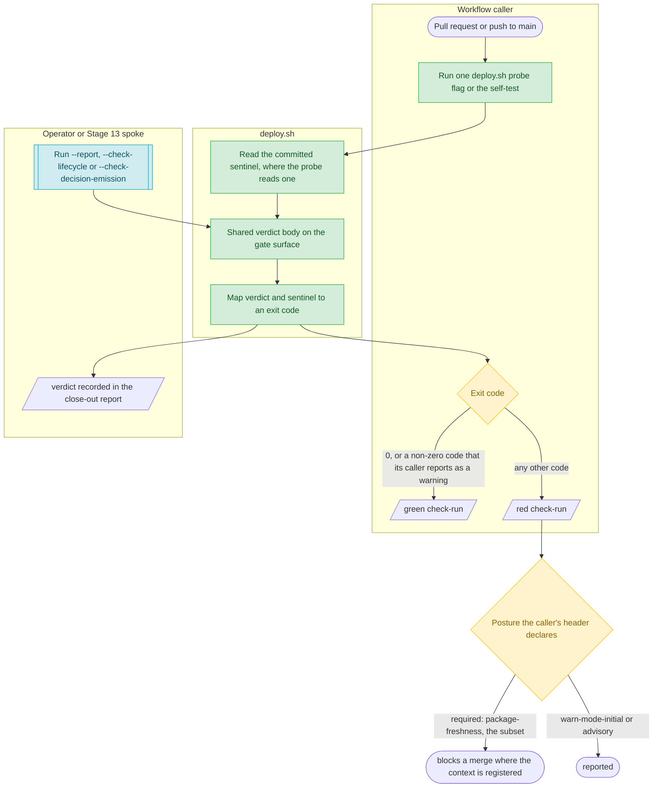

# Run a named check probe or the pre-merge subset

## Summary

The subset workflow's header records that the whole suite ran only at deploy time, on an operator machine
([deploy-check-ci.yml](/.github/workflows/deploy-check-ci.yml#L8)<!-- source-anchor: line=8; fp=4e812d105711aaf7 -->), so the dispatcher exposes further flags that run
a slice of it on demand. Nine belong to this sub-process: five single-check probes (version freeness, close
completeness, release-corpus completeness, package freshness, decision emission), the four-member required subset,
the structured report, the hermetic self-test and the lifecycle index. (A tenth, `--check-doc-gates`, runs the
Stage 13 close gates for one pull request and is the release pipeline's.) Seven of the nine — the five probes, the subset and the self-test — have a thin workflow caller,
on a pull request or a push to main (three probe workflows are path-filtered, so
they run only when a matching path changes). Each caller's gate decision reads the exit code, and the exit code alone
except in two: the close-completeness caller also matches a handshake line, and the version-freeness workflow tests,
in a step of its own, whether its enforce sentinel file exists and ends green with a warning on the probe's exit 1
while that file is absent. The report and the decision-emission probe are also run at Stage 13 close; the lifecycle index is
an operator read. Four of the five probes read their own committed sentinel and keep exit 0 for the clean verdict
alone, so a caller cannot read an unmeasured run of theirs as a pass; the version-freeness probe reads no sentinel
(none is committed) and also exits 0 on SKIP, where there is no version claim to assert.

## Entry and exit

| Side | Criteria | Source |
|---|---|---|
| Entry (CI) | A pull request opened, synchronized, reopened or marked ready, or a push to main, on a workflow whose trigger matches (three probe workflows are path-filtered; the subset, package-freshness and decision-emission workflows are not); the thin step runs `bash core/deploy/deploy.sh --check-<name>` | [deploy-check-ci.yml](/.github/workflows/deploy-check-ci.yml#L142)<!-- source-anchor: line=142; fp=bce827f8721d3849 -->; [skill-package-freshness.yml](/.github/workflows/skill-package-freshness.yml#L186)<!-- source-anchor: line=186; fp=b07fb81e61ad545e --> |
| Entry (pipeline or operator) | Stage 13 Phase A8.2 runs the decision-emission probe and the deployment rule names `--report` as Stage 13 evidence; the operator runs `--check-lifecycle` or `--self-test` by hand | [stage-13-close](/release/references/pipeline/stage-13-close.md#L174)<!-- source-anchor: line=174; fp=0d2e0fb84bc84843 -->; [skill-deployment](/core/rules/skill-deployment.md#L391)<!-- source-anchor: line=391; fp=abb8fcfaa487f8a4 --> |
| Exit | One exit code per the probe's contract table (0 clean; 2 advisory; 3 withheld; 4 asserted nothing; 1 blocking or unexpected), consumed by the caller's gate-decision step as green, green-with-warning or red; the subset exits 1 on a member failure under its `enforce` sentinel or on any unexpected token, and 0 on a failure only where the token is not `enforce`; the report exits 1 on any FAIL | [deploy.sh](/core/deploy/deploy.sh#L22717)<!-- source-anchor: line=22717; fp=e413bcdc73d9f8fb -->; [deploy.sh](/core/deploy/deploy.sh#L22689)<!-- source-anchor: line=22689; fp=7b1a169e310845db --> |

## Flow

## Activities

| Activity | Primary actor | Purpose | Page |
|---|---|---|---|
| Run a single-check CI probe and map its verdict to an exit code | script:deploy.sh | One check's verdict body on the gate surface, exit-coded for its thin caller; the hermetic self-test that is Check 61's machinery arm | [run-single-check-probe](run-single-check-probe.md) |
| Run the pre-merge required subset (Checks 38, 73, 77, 78) | script:deploy.sh | The load-bearing checks without a mirror, aggregated under the committed sentinel | [run-required-subset](run-required-subset.md) |
| Report platform health and list the check lifecycle | script:deploy.sh | The Stage 13 report and the retired-or-dormant index — reads of platform state without running the suite | [report-platform-health](report-platform-health.md) |

## Controls

| Control | Source | Enforcement class | Surface | Applies to |
|---|---|---|---|---|
| Every rostered package's content hash is current before merge — the one single-check probe whose sentinel reads `enforce` | [`skill-package-freshness.yml`](/.github/workflows/skill-package-freshness.yml) (C-253) | code-enforce | merge-gate | run-single-check-probe |
| Checks 38, 73, 77 and 78 pass pre-merge; under the committed `enforce` sentinel a member failure fails the job | [`deploy-check-ci.yml`](/.github/workflows/deploy-check-ci.yml) (C-209) | code-enforce | merge-gate | run-required-subset |
| The close-completeness, release-corpus and version-freeness verdicts are reported on every matching pull request; the first two read `warn` sentinels and no version-freeness sentinel is committed | [`close-completeness.yml`](/.github/workflows/close-completeness.yml), [`release-corpus-completeness.yml`](/.github/workflows/release-corpus-completeness.yml), [`version-freeness.yml`](/.github/workflows/version-freeness.yml) (C-204, C-224, C-255) | code-warn | ci-run | run-single-check-probe |
| The decision-emission verdict engine still discriminates — the self-test runs on every pull request with no sentinel | [`decision-emission.yml`](/.github/workflows/decision-emission.yml), the gate-integrity job (C-207) | code-enforce | ci-run | run-single-check-probe |
| The decision-emission live arm is reported and never gates; its header says the arm's input is absent from any checkout | [`decision-emission.yml`](/.github/workflows/decision-emission.yml), the live-arm job (C-208) | code-warn | ci-run | run-single-check-probe |
| In the four sentinel-reading single-check probes a sentinel may raise a verdict from advisory to blocking and never lower one onto exit 0; every caller is a thin caller of the one engine and re-encodes no check predicate; the version-freeness workflow's YAML adds its own warn-or-enforce switch, a test for its sentinel file | [`core/deploy/deploy.sh`](/core/deploy/deploy.sh), the contract tables; [the gate-efficacy standard](/core/standards/gate-efficacy-standard.md) § Requirement (b′) | prose-only | — | every activity |

## Evidence

| Lens | Source | Observation | Label |
|---|---|---|---|
| designed | [`core/deploy/deploy.sh`](/core/deploy/deploy.sh), the dispatcher, its usage text and the contract table above each probe; [the gate-efficacy standard](/core/standards/gate-efficacy-standard.md) § Requirement (b′), § Declared-required contexts — registration disposition | each probe's table names its exit members; each caller's header declares its posture, and the standard's registration-disposition table records what each declared-required context's disposition is | [SOURCE] |
| described vs built | [the usage line](/core/deploy/deploy.sh#L23465)<!-- source-anchor: line=23465; fp=cb9e0a27bc7a10ef -->; [a Modes line it omits](/core/deploy/deploy.sh#L23486)<!-- source-anchor: line=23486; fp=67cb1e790cff80f0 --> | the dispatcher's one-line usage omits the release-corpus, decision-emission and package-freshness flags that its Modes list and its `case` arms carry | [SOURCE] |
| built | [`deploy-check-ci.yml`](/.github/workflows/deploy-check-ci.yml), [`version-freeness.yml`](/.github/workflows/version-freeness.yml), [`close-completeness.yml`](/.github/workflows/close-completeness.yml), [`release-corpus-completeness.yml`](/.github/workflows/release-corpus-completeness.yml), [`skill-package-freshness.yml`](/.github/workflows/skill-package-freshness.yml), [`decision-emission.yml`](/.github/workflows/decision-emission.yml); the committed sentinels [`deploy-check-ci.enforce`](/.github/deploy-check-ci.enforce), [`skill-package-freshness.enforce`](/.github/skill-package-freshness.enforce), [`close-completeness.enforce`](/.github/close-completeness.enforce), [`release-corpus-completeness.enforce`](/.github/release-corpus-completeness.enforce), [`decision-emission.enforce`](/.github/decision-emission.enforce); [the controls register](/core/process-catalog/definitions/controls-register.tsv), C-204, C-207, C-208, C-209, C-224, C-253, C-255 | the subset and package-freshness sentinels read `enforce`, and those two callers' headers declare a required posture; the close-completeness, release-corpus and decision-emission sentinels read `warn`; no version-freeness sentinel is committed; the decision-emission gate-integrity job reads no sentinel | [SOURCE] |
| executed | measure `workflow-runs-deploy-probes` — [workflow-run-history.py](/core/deploy/tools/process-catalog-measures/workflow-run-history.py) (population: every run of each named workflow created in the trailing window, read in slices and verified against the host's total for each slice) · [`deploy-check-ci.yml`](/.github/workflows/deploy-check-ci.yml) · [`version-freeness.yml`](/.github/workflows/version-freeness.yml) · [`close-completeness.yml`](/.github/workflows/close-completeness.yml) · [`release-corpus-completeness.yml`](/.github/workflows/release-corpus-completeness.yml) · [`skill-package-freshness.yml`](/.github/workflows/skill-package-freshness.yml) · [`decision-emission.yml`](/.github/workflows/decision-emission.yml) | The measure reports, per named workflow, its run total and its runs by conclusion; each caller on this page is one of its named workflows. A run-level read counts runs of a workflow, not runs of one job in it | [SOURCE] |

## Navigation

<!-- nav:begin -->
Up: [run-platform-health-check](run-platform-health-check.md) · Previous: [run-check-suite](run-check-suite.md) · Next: [graduate-gate-modes](graduate-gate-modes.md) · Down: [run-single-check-probe](run-single-check-probe.md) · [run-required-subset](run-required-subset.md) · [report-platform-health](report-platform-health.md)
<!-- nav:end -->

## Sources

- [`core/deploy/deploy.sh`](/core/deploy/deploy.sh) — the dispatcher, the five probe bodies, the subset runner, the report, the self-test and the lifecycle index
- [`.github/workflows/deploy-check-ci.yml`](/.github/workflows/deploy-check-ci.yml), [`version-freeness.yml`](/.github/workflows/version-freeness.yml), [`close-completeness.yml`](/.github/workflows/close-completeness.yml), [`release-corpus-completeness.yml`](/.github/workflows/release-corpus-completeness.yml), [`skill-package-freshness.yml`](/.github/workflows/skill-package-freshness.yml), [`decision-emission.yml`](/.github/workflows/decision-emission.yml) — the thin callers; their run history is what the executed row's measure reads
- [`.github/deploy-check-ci.enforce`](/.github/deploy-check-ci.enforce), [`skill-package-freshness.enforce`](/.github/skill-package-freshness.enforce), [`close-completeness.enforce`](/.github/close-completeness.enforce), [`release-corpus-completeness.enforce`](/.github/release-corpus-completeness.enforce), [`decision-emission.enforce`](/.github/decision-emission.enforce) — the committed sentinels
- [`release/references/pipeline/stage-13-close.md`](/release/references/pipeline/stage-13-close.md); [`core/rules/skill-deployment.md`](/core/rules/skill-deployment.md) — the pipeline-side invocations
- [`core/standards/gate-efficacy-standard.md`](/core/standards/gate-efficacy-standard.md) — Requirement (b′) and the registration-disposition table
- [`core/process-catalog/definitions/controls-register.tsv`](/core/process-catalog/definitions/controls-register.tsv) — C-204, C-207, C-208, C-209, C-224, C-253, C-255
