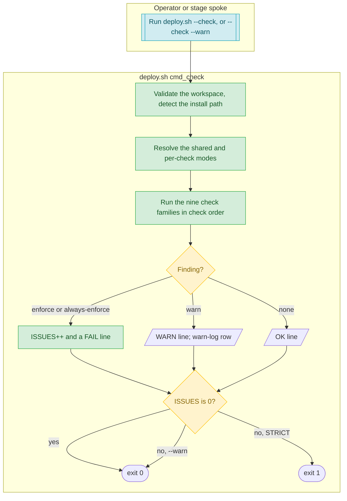

# Run the deploy-time check suite

## Summary

The operator — or a stage spoke at Stage 6 self-verification or Stage 13 close — runs `./deploy.sh --check` from
a workspace checkout. `cmd_check` validates the workspace, tolerates a missing install path, resolves the shared
`deploy-check.mode` (instance path first, then the legacy instance home and the hooks path; `warn` shipped), then runs
every live check in block order — numeric, except that Checks 47 and 48 run between 32 and 33: eighty-one check
blocks to Check 82, Check 13b among them and 21a as a sub-arm of 21, with 15 and 24 retired and their numbers
reserved. A finding either increments `ISSUES` (always-enforce checks, committed enforce defaults, and any
warn-mode check whose resolved mode is `enforce`) or, in warn mode, prints a `WARN` line and appends a JSON row to
the operator-instance warn log, which rotates into numbered segments. The summary gate exits 1 on any issue under
`--check` and 0 under `--check --warn`. The header of one mirror workflow says the suite itself is never invoked in
CI or on a push to main; its pull-request mirrors are the probes of the next sub-process. Its nine activities are
families of checks sharing one purpose.

## Entry and exit

| Side | Criteria | Source |
|---|---|---|
| Entry | The dispatcher receives `--check` (optionally `--warn`, which clears `STRICT`); `validate_workspace` passes; `detect_install_path` may return non-zero without aborting; errexit is disabled for the check body so a benign non-zero cannot abort the run before the gate | [dispatcher](/core/deploy/deploy.sh#L22950)<!-- source-anchor: line=22950; fp=0834b305494bb2d1 -->; [cmd_check](/core/deploy/deploy.sh#L8084)<!-- source-anchor: line=8084; fp=791486bb5bfaa051 --> |
| Entry (mode) | `DEPLOY_CHECK_MODE` resolved from the shared mode file, else `warn`; a per-check `<check-id>.mode` file outranks it in both directions; `off` skips every mode-gated check — including the code-enforce Checks 50, 63, 64, 69, 70, 71, 74, 76, 79 and 81, whose blocks sit inside `if [[ "$DEPLOY_CHECK_MODE" != "off" ]]` ([for example, the frontmatter check](/core/deploy/deploy.sh#L14825)<!-- source-anchor: line=14825; fp=7ba2e18713ea3711 -->) — and leaves the other always-enforce checks running | [mode block](/core/deploy/deploy.sh#L8888)<!-- source-anchor: line=8888; fp=cbba64a981d2033d -->; [resolve_check_mode](/core/deploy/deploy.sh#L9183)<!-- source-anchor: line=9183; fp=6e7a2d8a8b60e2c5 --> |
| Exit | `All checks passed.` and exit 0 when `ISSUES` is 0; otherwise `N issue(s) found.` and exit 1 under STRICT, exit 0 under `--warn`; every warn-mode finding has been appended to the hot warn log through `warn_log_path`, which rotates the file whole into the next segment past its byte budget | [summary](/core/deploy/deploy.sh#L18247)<!-- source-anchor: line=18247; fp=585101c5cf4e0621 -->; [warn_log_path](/core/deploy/deploy.sh#L411)<!-- source-anchor: line=411; fp=859037cdecd6c888 --> |

## Flow

## Activities

| Activity | Primary actor | Purpose | Page |
|---|---|---|---|
| Check deployed skill and package parity (Checks 1, 2, 3, 5, 7, 12, 13) | script:deploy.sh | The deployed tree, packages, mirror and injected references equal their sources | [check-deployed-skill-parity](check-deployed-skill-parity.md) |
| Check skill-corpus integrity (6, 10, 13b, 35, 54, 66, 67) | script:deploy.sh | The skill sources are well-formed, owned and recognizable | [check-skill-corpus-integrity](check-skill-corpus-integrity.md) |
| Check workspace, config and operator-instance surfaces (4, 8, 9, 11, 30, 33, 36, 40, 70, 77, 78) | script:deploy.sh | The surfaces laid down beside the repository are present, in sync and in budget | [check-workspace-config-surfaces](check-workspace-config-surfaces.md) |
| Check documentation and schema conventions (14, 18, 25, 31, 34, 45, 49, 50, 63, 69, 75, 80) | script:deploy.sh | The corpus keeps its authoring conventions | [check-corpus-conventions](check-corpus-conventions.md) |
| Check public-surface portability and tool hygiene (42, 43, 44, 64, 81) | script:deploy.sh | Nothing tracked binds the platform to one host, path or operator | [check-public-surface-hygiene](check-public-surface-hygiene.md) |
| Check backlog and tracker hygiene on the host (16, 17, 21, 22, 51, 52, 53, 55, 56, 72) | script:deploy.sh | The live tracker agrees with the intake and bundling rules | [check-backlog-hygiene](check-backlog-hygiene.md) |
| Check release-corpus and release-identity integrity (20, 23, 26, 28, 32, 39, 41, 47, 48, 59, 65, 82) | script:deploy.sh | Every recorded release carries its output set and binds its identity at the claim | [check-release-corpus-integrity](check-release-corpus-integrity.md) |
| Check hub, spoke and event-log surfaces (19, 27, 29, 46, 61, 68) | script:deploy.sh | The run's own machinery and records conform to their contracts | [check-orchestration-surfaces](check-orchestration-surfaces.md) |
| Check the control layer's own registries, rollouts and gate meta-checks (37, 38, 57, 58, 60, 62, 71, 73, 74, 76, 79) | script:deploy.sh | The controls are registered, regenerated, decided on schedule and discriminating | [check-control-layer-registries](check-control-layer-registries.md) |

## Controls

| Control | Source | Enforcement class | Surface | Applies to |
|---|---|---|---|---|
| An always-enforce check increments `ISSUES` and fails `--check` whatever the mode file says (for example C-119, C-125, C-160), except `off`, which skips the ones whose blocks sit inside the mode gate (for example C-196) | [`core/deploy/deploy.sh`](/core/deploy/deploy.sh), the check blocks with a direct `ISSUES++` | code-enforce | deploy-run | every activity |
| A warn-mode check reports and writes a warn-log row until its mode resolves to `enforce` (for example C-128, C-134, C-142, C-200) | [`core/deploy/deploy.sh`](/core/deploy/deploy.sh) `flag_warn_or_issue`; [`core/hooks/deploy-check.mode.template`](/core/hooks/deploy-check.mode.template) | code-warn | deploy-run | every activity |
| Retired numbers are reserved and never reused — Check 15 (release-corpus cross-link integrity) and Check 24 (initiative-roadmap staleness) are retired, their blocks tombstoned (C-135, C-144) | [`core/deploy/deploy.sh`](/core/deploy/deploy.sh), the two tombstone comments in `cmd_check` | not-a-control | deploy-run | run-check-suite |
| A check graduates only by a committed `resolve_check_mode "<id>" "enforce"` default, never by a runtime mode file, and the flip is an operator decision recorded in the flip-decision table | [`core/standards/gate-efficacy-standard.md`](/core/standards/gate-efficacy-standard.md) § Flip-decision status | prose-only | — | every activity |
| Spoke model and effort are changed only at the config surface and then verified with `deploy.sh --check` (Check 27) | [`core/CLAUDE.md.template`](/core/CLAUDE.md.template) § Universal Preferences (C-293) | code-warn | — | check-orchestration-surfaces |
| Skill counts are derived from the deploy arrays, never hardcoded; the canary is never added to a total (C-377) | [`core/rules/skill-deployment.md`](/core/rules/skill-deployment.md) § Tracked Skills, the count convention | code-enforce (narrow) | — | check-deployed-skill-parity |

## Evidence

| Lens | Source | Observation | Label |
|---|---|---|---|
| designed | [`core/deploy/deploy.sh`](/core/deploy/deploy.sh), `cmd_check`, the dispatcher in `main` and `cmd_check_lifecycle`; [`core/rules/skill-deployment.md`](/core/rules/skill-deployment.md) § Deployment Steps; [`stage-06-engineering.md`](/release/references/pipeline/stage-06-engineering.md), step C4; [`stage-13-close.md`](/release/references/pipeline/stage-13-close.md) § Phase A8 | the suite is specified as read-only, mode-gated and exit-coded; Stage 6's self-verification step (C4) and Stage 13 cite it as self-verification and close evidence | [SOURCE] |
| described vs built | [the lifecycle index](/core/deploy/deploy.sh#L7458)<!-- source-anchor: line=7458; fp=5c428831c7526dcb -->; [its next-number line](/core/deploy/deploy.sh#L7459)<!-- source-anchor: line=7459; fp=2d683f7cf8ebc39f -->; [the last check block](/core/deploy/deploy.sh#L18159)<!-- source-anchor: line=18159; fp=bdd69678eeea2ad8 --> | the lifecycle index — which its own comment calls the SSOT for the lifecycle roster — states the live sequence as 1–14, 16–23, 25–53 with 54 the next number, while the suite runs eighty-one check blocks to Check 82 | [SOURCE] |
| built | [the controls register](/core/process-catalog/definitions/controls-register.tsv), the deploy-check rows; [the mirror's header](/.github/workflows/skill-canonical-structure-check.yml#L15)<!-- source-anchor: line=15; fp=5b32506590233ec8 --> | the register classes each check `code-enforce` or `code-warn`, and the two retired numbers `not-a-control`; the canonical-structure mirror's header says `deploy.sh --check` is never invoked in CI or on a push to main, which is why the mirror exists | [SOURCE] |
| executed | no measure — what would show the result of a run of the suite is the deploy-check warn log and that run's console output and exit code. | No measure in the measures register reads either | [SOURCE] |
| executed | held local — what would show how often the suite is run is the record of sessions across an install. | Nothing from that store is published | [SOURCE] |

## Navigation

<!-- nav:begin -->
Up: [run-platform-health-check](run-platform-health-check.md) · Next: [run-check-probes](run-check-probes.md) · Down: [check-deployed-skill-parity](check-deployed-skill-parity.md) · [check-skill-corpus-integrity](check-skill-corpus-integrity.md) · [check-workspace-config-surfaces](check-workspace-config-surfaces.md) · [check-corpus-conventions](check-corpus-conventions.md) · [check-public-surface-hygiene](check-public-surface-hygiene.md) · [check-backlog-hygiene](check-backlog-hygiene.md) · [check-release-corpus-integrity](check-release-corpus-integrity.md) · [check-orchestration-surfaces](check-orchestration-surfaces.md) · [check-control-layer-registries](check-control-layer-registries.md)
<!-- nav:end -->

## Sources

- [`core/deploy/deploy.sh`](/core/deploy/deploy.sh) — `cmd_check`, the mode block, `flag_warn_or_issue`, `resolve_check_mode`, the warn-log family, the dispatcher and the lifecycle index
- [`core/hooks/deploy-check.mode.template`](/core/hooks/deploy-check.mode.template) — the shipped `warn` default
- [`core/rules/skill-deployment.md`](/core/rules/skill-deployment.md) — the deployment steps that run the suite and the count convention
- [`core/standards/gate-efficacy-standard.md`](/core/standards/gate-efficacy-standard.md) — the flip mechanism and the flip-decision table
- [`release/references/pipeline/stage-06-engineering.md`](/release/references/pipeline/stage-06-engineering.md), [`release/references/pipeline/stage-13-close.md`](/release/references/pipeline/stage-13-close.md) — the two stages that cite the suite
- [`core/CLAUDE.md.template`](/core/CLAUDE.md.template) — the preference behind the spoke-model control
- [`core/process-catalog/definitions/controls-register.tsv`](/core/process-catalog/definitions/controls-register.tsv) — the deploy-check rows, C-293, C-377
- [`.github/workflows/skill-canonical-structure-check.yml`](/.github/workflows/skill-canonical-structure-check.yml) — the mirror whose header the built row cites
