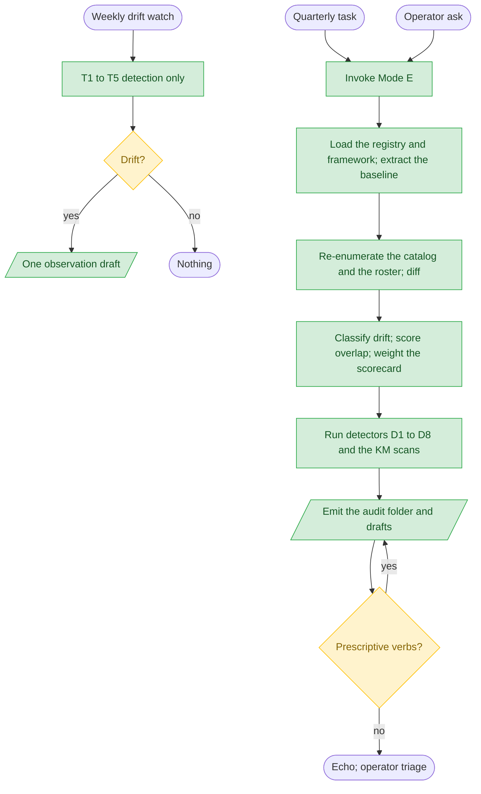

# Run the platform health audit (pmo-qa-auditor Mode E)

## Summary

Mode E is the one auditor mode whose input is the corpus itself: the base-vs-build registry instance and the framework
methodology. A spawned session (the quarterly task, 09:00 local on the first of January, April, July and October) or
an operator invokes it; the weekly drift-watch task runs only the T1–T5 detection and routes any drift to one
observation draft. The mode loads the baseline anchor, re-enumerates the external catalog from two sources and the
PMO roster from three skill trees, classifies drift to its update path, runs the eight-detector battery and the four
KM scans, writes a dated audit folder with at least three observation-format drafts, and rewrites any prescriptive
verb before emitting. It never mutates the registry. Its
[ICOM](/core/process-catalog/definitions/pack.json) table follows.

## ICOM

| Inputs | Controls | Outputs | Mechanisms |
|---|---|---|---|
| The registry instance (`audit_baseline_sha`, `audit_baseline_date`, the row set); the framework; the plugin cache and the available-skills namespace; the three skill trees; the detector and KM reference docs; the K1 corpus | OBSERVE-only (the registry row write is a separate human-gated change); INDETERMINATE over silent-clean; observational discipline; the audit-folder contract | `<OPERATOR_INSTANCE_ANALYSIS_PATH>/platform-health-<date>/` with `SUMMARY.md`, `findings-register.md`, `base-build-deltas.md`, two KM artifacts and ≥ 3 `issue-drafts/`; the in-chat echo | The skill mode in an agent session; `find`, `ls`; the scheduled task that spawns the session |

## Flow

## Steps

| Step | Action | Actor | Inputs → outputs (shape) | Controls | Mechanism | Harness | Model need | Source |
|---|---|---|---|---|---|---|---|---|
| invoke-mode-e | Enter the mode from the task-spawned session or an operator phrase | skill:pmo-qa-auditor | a spawn by the quarterly task, a drift-watch run, or a trigger phrase → Mode E selected (the drift watch runs the detection step only) | prose-only | skill mode selection | skill-auto-load | S/low/read/templated/batch | [SKILL.md](/core/skills/pmo-qa-auditor/SKILL.md#L429)<!-- source-anchor: line=429; fp=f18906dd0c81a930 -->; [OPERATIONS.md](/core/governance/OPERATIONS.md#L726)<!-- source-anchor: line=726; fp=6525bf2e3c2a23ec --> |
| load-registry-and-baseline | Read the instance and the methodology; extract the baseline anchor | skill:pmo-qa-auditor | the registry header → `audit_baseline_sha`, `audit_baseline_date`; the framework → the trigger table and update paths | prose-only | file reads | file-and-shell-tools | M/low/read/scriptable/batch | [SKILL.md](/core/skills/pmo-qa-auditor/SKILL.md#L450)<!-- source-anchor: line=450; fp=f7aff116287088ec --> |
| re-enumerate-catalog | Rebuild the external catalog from the plugin cache and the available-skills namespace | skill:pmo-qa-auditor | Source A (`find` over the plugin cache) ∪ Source B (the namespace in the session's skill list), deduped on name → the current catalog | prose-only | `find`; the session's own skill list | skill-auto-load | S/none/read/scriptable/batch | [SKILL.md](/core/skills/pmo-qa-auditor/SKILL.md#L452)<!-- source-anchor: line=452; fp=85c0495b3f2864d3 -->; [framework](/release/references/protocols/platform-health-audit-framework.md#L125)<!-- source-anchor: line=125; fp=7ecf31afb71127c8 --> |
| re-enumerate-roster-and-diff | List the PMO roster and diff both populations against the registry | skill:pmo-qa-auditor | `ls` over the three skill trees vs the row set (T5); the catalog vs the recorded baseline (T1–T4) → drift items | prose-only | `ls -1d` | file-and-shell-tools | S/none/read/scriptable/batch | [SKILL.md](/core/skills/pmo-qa-auditor/SKILL.md#L456)<!-- source-anchor: line=456; fp=8c8d5af05cb73d98 -->; [framework](/release/references/protocols/platform-health-audit-framework.md#L281)<!-- source-anchor: line=281; fp=ed0ce79b5b92b05e --> |
| classify-drift | Map each drift item to its update path; score overlap; weight the posture | skill:pmo-qa-auditor | drift items → T1–T5 class, § 3.3 (a/b/c) path, an overlap rubric score, the scorecard health posture | prose-only | judgment over the rubric | none | M/medium/none/judgment/batch | [SKILL.md](/core/skills/pmo-qa-auditor/SKILL.md#L459)<!-- source-anchor: line=459; fp=a005c47c1a6dd747 --> |
| run-detector-battery | Evaluate the eight named failure-mode detectors against their thresholds | skill:pmo-qa-auditor | the reviewed set and each detector's signature → eight rows with status and threshold; an unresolvable input reads INDETERMINATE, never clean | prose-only | `references/failure-mode-detectors.md` | none | L/medium/read/judgment/batch | [SKILL.md](/core/skills/pmo-qa-auditor/SKILL.md#L463)<!-- source-anchor: line=463; fp=e2806b4120a9692b --> |
| run-km-check-set | Run the four KM scans over the K1 corpus | skill:pmo-qa-auditor | durable docs → doc-debt register (P1–P3 bands), staleness report, lifecycle-state check, in-flight-capture subsection; unresolvable fields INDETERMINATE | prose-only | `references/km-scanning.md` | file-and-shell-tools | L/low/read/scriptable/batch | [SKILL.md](/core/skills/pmo-qa-auditor/SKILL.md#L472)<!-- source-anchor: line=472; fp=3c34b5d85c844980 --> |
| emit-audit-folder | Write the dated folder and the observation drafts | skill:pmo-qa-auditor | all of the above → `platform-health-<UTC date>/` with `SUMMARY.md`, `findings-register.md`, `base-build-deltas.md`, the two KM artifacts, ≥ 3 `issue-drafts/NNN-*.md` in the three-field observation form | prose-only | file writes | file-and-shell-tools | M/medium/write/templated/batch | [SKILL.md](/core/skills/pmo-qa-auditor/SKILL.md#L484)<!-- source-anchor: line=484; fp=54b2ed7139812711 -->, [SKILL.md](/core/skills/pmo-qa-auditor/SKILL.md#L1036)<!-- source-anchor: line=1036; fp=3f289b838ffe044b --> |
| self-check-observational-voice | Scan every output for prescriptive verbs and rewrite them | skill:pmo-qa-auditor | the folder's text → `recommend`, `migrate`, `consolidate`, `should` replaced by observational form | prose-only | grep and rewrite | file-and-shell-tools | S/low/write/scriptable/batch | [SKILL.md](/core/skills/pmo-qa-auditor/SKILL.md#L492)<!-- source-anchor: line=492; fp=2253fd48b217d1d3 --> |
| echo-summary | Report the baseline, counts, posture and the folder pointer in chat | skill:pmo-qa-auditor | → baseline SHA and date, drift count by trigger, posture, a detector line, a KM line, the folder path; no prescriptive verb | prose-only | chat output | none | S/low/none/templated/batch | [SKILL.md](/core/skills/pmo-qa-auditor/SKILL.md#L1048)<!-- source-anchor: line=1048; fp=225398f607271917 --> |

## Step profile

| Field | Value |
|---|---|
| Deterministic steps | 5 of 10 (determinism `scriptable`, counted from the Steps table) |
| Judgment steps | 2 (the drift classification and the detector battery); 3 are templated |
| Harness features relied on | skill-auto-load (rebuild), file-and-shell-tools (portable); the spawn by the scheduled task is scheduled-routines (adapter), on the L2 page |
| Context read | L (32k–128k tokens): the registry, the framework, the detector and KM references, the K1 corpus listing |

## Evidence

| Lens | Source | Observation | Label |
|---|---|---|---|
| designed | [`core/governance/OPERATIONS.md`](/core/governance/OPERATIONS.md) § Platform Health Audit Protocol | four triggers (quarterly, drift watch, reactive, operator); six audit steps; observe-then-triage; escalation after two missed quarters; the two registrations are non-git runtime state recorded at Stage 12 | [SOURCE] |
| designed | [`core/skills/pmo-qa-auditor/SKILL.md`](/core/skills/pmo-qa-auditor/SKILL.md), Mode E's process and its output contract | the process steps 1–7 (5.5 the KM set) and the folder contract | [SOURCE] |
| built | [`core/automations/registry.md`](/core/automations/registry.md) § Routines, the two `platform-health-*` rows, and the authoring note on them | two rows on one entrypoint: the quarterly cron verbatim in-corpus, the drift watch weekly; both session-fired | [SOURCE] |
| executed | measure `scheduled-audit-folders` — [scheduled-audit-folders.py](/core/deploy/tools/process-catalog-measures/scheduled-audit-folders.py) (population: every dated folder directly inside the analysis home, by audit family; folder names and the frontmatter of each summary file only) | the measure reports the dated folders inside the analysis home by audit family, read from folder names and each summary file's frontmatter; one install's working state; supports no verdict on this page | [SOURCE] |
| executed | held local — what would show how often the mode is invoked is the record of sessions across an install. | Nothing from that store is published | [SOURCE] |
| executed | held local — what would show the scheduled tasks' own firings is the agent runtime's scheduled-task surface, a record of work across an install. | Nothing from that surface is published, so the page reads `unobserved` | [SOURCE] |

## Navigation

<!-- nav:begin -->
Up: [run-scheduled-audit](run-scheduled-audit.md) · Previous: [resolve-routine-binding](resolve-routine-binding.md)
<!-- nav:end -->

## Sources

- [`core/skills/pmo-qa-auditor/SKILL.md`](/core/skills/pmo-qa-auditor/SKILL.md) — Mode E and its output contract
- [`release/references/protocols/platform-health-audit-framework.md`](/release/references/protocols/platform-health-audit-framework.md) — § 2 cadence, § 3.1 baseline, § 3.5 triggers, § 4 integration
- [`core/governance/OPERATIONS.md`](/core/governance/OPERATIONS.md) § Platform Health Audit Protocol — the operational cadence
- [`core/automations/registry.md`](/core/automations/registry.md) — the two `platform-health-*` rows
