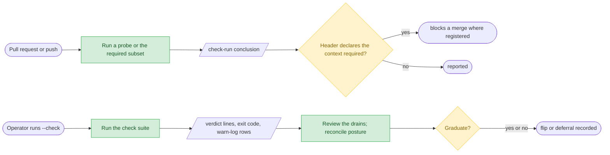

# Run a platform health check

## Summary

The stream starts when the operator runs `./deploy.sh --check` — or a pull request opens and a workflow runs one of
its probes — and ends with a verdict per check: a console line and an exit code on the operator's machine, a row in
the operator-instance warn log for every warn-mode finding, and a check-run conclusion on the host for every probe.
Eighty-one live check blocks run in the suite, numbered to Check 82; further flags run a slice of it pre-merge, as
Stage 13 evidence, or as the hermetic self-test. Because every new gate ships in warn mode, the stream has a third sub-process that closes the
loop: the drains are read, declared posture is reconciled against the host, and a gate graduates to enforce by one
committed change or has its deferral recorded. The release pipeline is both a supplier (the merges and deploys that
change what is checked) and a customer (Stage 6 self-verification, the merge gate, Stage 13 evidence). The
[SIPOC](/core/process-catalog/definitions/pack.json) table below reads suppliers, inputs, process
steps, outputs and customers left to right.

## SIPOC

| Suppliers | Inputs | High-level steps | Outputs | Customers |
|---|---|---|---|---|
| The operator; the release pipeline's merges and deploys; the host (branch state, labels, milestones, releases); the hook layer's drains | The checkout and the deployed tree; the mode files and committed sentinels; workflow events; the warn-log segment family; the rollout constants | Run the suite → read verdicts and the exit code → run the probes on each pull request → read the drains → reconcile posture → flip or record a deferral | Verdict lines and exit codes; warn-log rows; check-run conclusions; the Stage 13 report; flip-decision rows; a graduated gate | The operator; Stage 6 self-verification and Stage 13 close; the merge gate; the flip-decision table's readers; the next shakedown |

## Flow

## Sub-processes

| Sub-process | Entry | Exit | Page |
|---|---|---|---|
| Run the deploy-time check suite (`run-check-suite`) | `--check` or `--check --warn` from a workspace that validates; the shared and per-check modes resolved | `All checks passed.` and exit 0, or `N issue(s) found.` and exit 1 under STRICT (0 under `--warn`); warn-mode findings appended to the hot warn log | [run-check-suite](run-check-suite.md) |
| Run a named check probe or the pre-merge subset (`run-check-probes`) | A matching workflow event, Stage 13 Phase A8.2 or the report need, or an operator flag | One exit code per the probe's contract, consumed by the thin caller as green, green-with-warning or red; the report's summary line | [run-check-probes](run-check-probes.md) |
| Review warn logs and graduate gate modes (`graduate-gate-modes`) | A review window reached, Stage 13 Close, or any pull request for the reconciliation | A closed-set decision token in the gate's flip-decision row and, on a flip, the committed default, sentinel, mode-file value or host registration; the reconciliation verdict published | [graduate-gate-modes](graduate-gate-modes.md) |

## Controls

| Control | Source | Enforcement class | Surface | Applies to |
|---|---|---|---|---|
| Every rostered package's content hash is current before merge — the one single-check probe whose sentinel reads `enforce` | [`.github/workflows/skill-package-freshness.yml`](/.github/workflows/skill-package-freshness.yml) (C-253) | code-enforce | merge-gate | run-check-probes |
| Checks 38, 73, 77 and 78 pass pre-merge; under the committed `enforce` sentinel a member failure fails the job | [`.github/workflows/deploy-check-ci.yml`](/.github/workflows/deploy-check-ci.yml) (C-209) | code-enforce | merge-gate | run-check-probes |
| Declared-required contexts and main's live required contexts do not diverge | [`.github/workflows/gate-posture-reconciliation.yml`](/.github/workflows/gate-posture-reconciliation.yml) (C-213) | code-enforce | ci-run | graduate-gate-modes |
| The deploy, hook and install suites — including the check-fixture self-tests that keep the suite's predicates honest — pass on every pull request | [`.github/workflows/install-tests.yml`](/.github/workflows/install-tests.yml) (C-214, C-215, C-216, C-217) | code-enforce | merge-gate | run-check-suite |
| An always-enforce check fails `--check` whatever the mode file says (for example C-119, C-125, C-160), except `off`, which skips the ones whose blocks sit inside the mode gate (for example C-196) | [`core/deploy/deploy.sh`](/core/deploy/deploy.sh), the check blocks that raise the exit counter directly | code-enforce | deploy-run | run-check-suite |
| A warn-mode check reports and writes a warn-log row until its mode resolves to `enforce` (for example C-128, C-134, C-142, C-200) | `core/deploy/deploy.sh` `flag_warn_or_issue`; [`core/hooks/deploy-check.mode.template`](/core/hooks/deploy-check.mode.template) | code-warn | deploy-run | run-check-suite |
| A gate graduates only by a committed change, never a runtime mode file, and only by an operator decision recorded in the flip-decision row — never promoted by row count | [the gate-efficacy standard](/core/standards/gate-efficacy-standard.md) § Flip-decision status | prose-only | — | graduate-gate-modes |
| Every hook rule that wrote drain rows receives a specificity reading at each Stage 13 Close; the Check 14 flip assessment is a Stage 13 line item | [`bypass-mode-readiness.md`](/core/rules/bypass-mode-readiness.md) § HSR-1 (C-380); [`core/rules/doc-link-maintenance.md`](/core/rules/doc-link-maintenance.md) (C-359) | prose-only | — | graduate-gate-modes |

## Evidence

| Lens | Source | Observation | Label |
|---|---|---|---|
| designed | `core/deploy/deploy.sh` (the dispatcher and `cmd_check`); the gate-efficacy standard; `bypass-mode-readiness.md` | the operator runs the suite and gets a verdict per check, with a warn-log row for each warn-mode finding; the dispatcher's further flags run slices of it pre-merge; the standard and the hook-readiness rule specify the graduation loop | [SOURCE] |
| built | `core/deploy/deploy.sh`; [the controls register](/core/process-catalog/definitions/controls-register.tsv); the caller workflows | six workflows call the probes and one more reconciles posture; the subset workflow's header records that the whole suite ran only at deploy time, on an operator machine | [SOURCE] |
| executed | no measure — what would show which checks fire, and how often, is the deploy-check warn log. | No measure in the measures register reads the warn log | [SOURCE] |
| executed | measure `workflow-runs-deploy-probes` — [workflow-run-history.py](/core/deploy/tools/process-catalog-measures/workflow-run-history.py) (population: every run of each named workflow created in the trailing window, read in slices and verified against the host's total for each slice) | The measure reports, per named workflow, its run total and its runs by conclusion; the probe callers and the reconciliation workflow are among them | [SOURCE] |
| executed | measure `flip-decision-rows` — [flip-decision-rows.py](/core/deploy/tools/process-catalog-measures/flip-decision-rows.py) (population: the data rows of both tables under the gate-efficacy standard's flip-decision heading, in the checked-out tree) | The measure reports, per table of the flip-decision section, its row total and its rows by leading decision | [SOURCE] |
| executed | measure `gate-rollout-deadlines` — [gate-rollout-deadlines.py](/core/deploy/tools/process-catalog-measures/gate-rollout-deadlines.py) (population: the rollout constants of the deploy script and the destructive-operations hook and the committed enforce sentinels, classified as the deadline checks classify them on the day of the run) | The measure reports, per rollout family, its phase and its standing on the day of the run, and the committed enforce sentinels by token | [SOURCE] |

## Navigation

<!-- nav:begin -->
Up: [engineering-harness](engineering-harness.md) · Previous: [install-or-update-workspace](install-or-update-workspace.md) · Next: [observe-platform](observe-platform.md) · Down: [run-check-suite](run-check-suite.md) · [run-check-probes](run-check-probes.md) · [graduate-gate-modes](graduate-gate-modes.md)
<!-- nav:end -->

## Sources

- [`core/deploy/deploy.sh`](/core/deploy/deploy.sh) — the suite, the probes, the report, the self-test and the lifecycle index
- [`core/standards/gate-efficacy-standard.md`](/core/standards/gate-efficacy-standard.md) — the flip-decision table and the posture requirements
- [`core/rules/bypass-mode-readiness.md`](/core/rules/bypass-mode-readiness.md); [`core/rules/doc-link-maintenance.md`](/core/rules/doc-link-maintenance.md) — the shakedown and flip rules
- [`.github/workflows/deploy-check-ci.yml`](/.github/workflows/deploy-check-ci.yml), [`skill-package-freshness.yml`](/.github/workflows/skill-package-freshness.yml), [`gate-posture-reconciliation.yml`](/.github/workflows/gate-posture-reconciliation.yml), [`install-tests.yml`](/.github/workflows/install-tests.yml) — the subset, package-freshness, reconciliation and test workflows
- [`core/process-catalog/definitions/controls-register.tsv`](/core/process-catalog/definitions/controls-register.tsv) — the control IDs the Controls table cites
