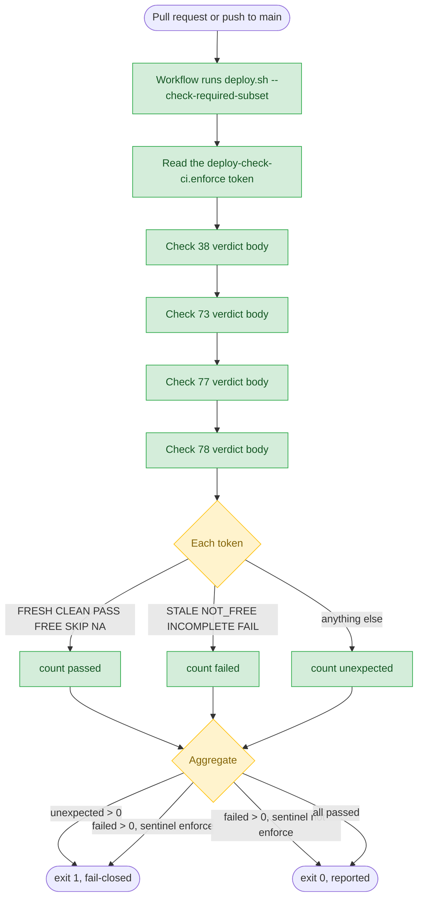

# Run the pre-merge required subset (Checks 38, 73, 77, 78)

## Summary

The deploy-check workflow runs on every pull request and push to main, with no path filter, and calls
`deploy.sh --check-required-subset`. The runner reads the committed `deploy-check-ci.enforce` token, then runs the
four members of an enumerated allowlist — hook-registry index freshness, bundle-metrics gate integrity, mirror-pair
path-set parity and the rules-corpus budget — each through the same `_cNN_compute_verdict "gate"` body the suite
uses. The predicate for membership is network-free, install-independent, posture required and no dedicated mirror;
checks with their own mirror are excluded so nothing is double-gated. A verdict outside the recognized token set
fails closed whatever the sentinel says, which is why host-reading checks can never join. The gate shipped
reporting only and has graduated: the committed token reads `enforce`, and the workflow header declares
`posture=required`. Its
[ICOM](/core/process-catalog/definitions/pack.json) table (inputs, controls, outputs, mechanisms)
follows.

## ICOM

| Inputs | Controls | Outputs | Mechanisms |
|---|---|---|---|
| The checkout: per-hook sources and the committed registry index; the bundle-metrics fixtures, sink declarations and config; every mirror-pair holder; the admitted rules set; the committed sentinel token | The membership predicate and the declared-once roster (the workflow header and the sentinel restate it and have drifted before); the recognized verdict token set; the sentinel as the warn-or-block dial; the workflow header's `posture=required` declaration | One exit code; a `required-subset:` line per member; a step summary; a check-run conclusion under the context the header names for branch protection | `cmd_check_required_subset`; `_c38_`, `_c73_`, `_c77_`, `_c78_compute_verdict`; the workflow's run and gate-decision steps |

## Flow

## Steps

| Step | Action | Actor | Inputs → outputs (shape) | Controls | Mechanism | Harness | Model need | Source |
|---|---|---|---|---|---|---|---|---|
| trigger-subset-run | Trigger the runner on every pull request and push | ci:deploy-check-ci | a pull request (opened, synchronized, reopened, ready for review) or a push to main → a checkout on the macOS runner with prerequisites verified | C-209: code-enforce | the workflow's `on:` block and the prerequisite step | git-and-gh-cli | XS/none/read/scriptable/batch | [deploy-check-ci.yml](/.github/workflows/deploy-check-ci.yml#L115)<!-- source-anchor: line=115; fp=7195728545baee92 --> |
| read-subset-sentinel | Read the committed enforce sentinel | script:deploy.sh | the first non-comment token of [`.github/deploy-check-ci.enforce`](/.github/deploy-check-ci.enforce) → `enforce` or `warn` (the committed token reads `enforce`; an absent file, or any other first token, reads as `warn`) | prose-only | grep over the one-token file | file-and-shell-tools | XS/none/read/scriptable/batch | [deploy.sh](/core/deploy/deploy.sh#L22231)<!-- source-anchor: line=22231; fp=3fb70554ddcbdf76 --> |
| verify-registry-freshness-pre-merge | Run Check 38's verdict body | script:deploy.sh | per-hook sources and the committed index → FRESH or STALE, or an ERROR token when the generator is missing, cannot be run or exits any other way | C-160: code-enforce | `_c38_compute_verdict "gate"` | file-and-shell-tools | XS/none/read/scriptable/batch | [deploy.sh](/core/deploy/deploy.sh#L22251)<!-- source-anchor: line=22251; fp=f0a44474ae4df5af --> |
| verify-bundle-metrics-pre-merge | Run Check 73's verdict body | script:deploy.sh | the committed fixtures, sink declarations and config → PASS or FAIL; no not-evaluated arm, because every input is a committed file | C-193: code-warn | `_c73_compute_verdict "gate"` | file-and-shell-tools | XS/none/read/scriptable/batch | [deploy.sh](/core/deploy/deploy.sh#L22252)<!-- source-anchor: line=22252; fp=f0c71ef7124b3730 --> |
| verify-mirror-pair-parity-pre-merge | Run Check 77's verdict body | script:deploy.sh | every marker-registered holder → PASS or FAIL; an unreadable holder is a checkout defect reported FAIL, never the outage token | C-197: code-warn | `_c77_compute_verdict "gate"` | file-and-shell-tools | XS/none/read/scriptable/batch | [deploy.sh](/core/deploy/deploy.sh#L22253)<!-- source-anchor: line=22253; fp=498f2dcbaa34f97c --> |
| verify-rules-budget-pre-merge | Run Check 78's verdict body | script:deploy.sh | the admitted rules set → PASS or FAIL against the published byte ceiling and admission frontmatter | C-198: code-warn | `_c78_compute_verdict "gate"` | file-and-shell-tools | XS/none/read/scriptable/batch | [deploy.sh](/core/deploy/deploy.sh#L22254)<!-- source-anchor: line=22254; fp=1d6be3b2f8c70b99 --> |
| classify-member-verdict | Classify each member's token | script:deploy.sh | a verdict token → passed (FRESH, CLEAN, PASS, FREE, SKIP, NA), failed (STALE, NOT_FREE, INCOMPLETE, FAIL) or unexpected | code-enforce | the `case` over the token | file-and-shell-tools | XS/none/read/scriptable/batch | [deploy.sh](/core/deploy/deploy.sh#L22263)<!-- source-anchor: line=22263; fp=0695d649637a2e14 --> |
| aggregate-subset-exit | Aggregate to one exit code | script:deploy.sh | the three counts and the sentinel → exit 1 on any unexpected verdict regardless of sentinel; exit 1 on a failure under `enforce`; exit 0 with a warn-mode notice on a failure under `warn`; exit 0 when all passed | code-enforce | the three `if` arms | file-and-shell-tools | XS/none/read/scriptable/batch | [deploy.sh](/core/deploy/deploy.sh#L22282)<!-- source-anchor: line=22282; fp=7b1a169e310845db --> |
| decide-subset-gate | Branch the workflow on the integer | ci:deploy-check-ci | the exit code → a green step on 0 (including a finding reported under a `warn` token), a red step with a summary on 1 | prose-only | the gate-decision step | git-and-gh-cli | XS/none/read/scriptable/batch | [deploy-check-ci.yml](/.github/workflows/deploy-check-ci.yml#L156)<!-- source-anchor: line=156; fp=9a8df85d2e020a72 --> |

## Step profile

| Field | Value |
|---|---|
| Deterministic steps | 9 of 9 (determinism `scriptable`, counted from the Steps table) |
| Judgment steps | 0 |
| Harness features relied on | file-and-shell-tools, git-and-gh-cli |
| Context read | XS (under 2k tokens) |

## Evidence

| Lens | Source | Observation | Label |
|---|---|---|---|
| designed | [`core/deploy/deploy.sh`](/core/deploy/deploy.sh), the header comment of `cmd_check_required_subset` and its roster; [`deploy-check-ci.yml`](/.github/workflows/deploy-check-ci.yml), its header comment; [the gate-efficacy standard](/core/standards/gate-efficacy-standard.md) § Flip-decision status (the G3-14 / G3-15 row — the bundle-metrics stage gates at the Stage 3 → 4 boundary) and § Declared-required contexts — registration disposition | the roster is declared once in `rs_checks` and restated in the workflow header and the sentinel; the header records that the restatements drifted when Check 78 joined; the flip was one sentinel token, moved in one commit with the gate-rollout phase constant; the sentinel's note gives the order for the context's registration: after the flip, never before it; the flip record is the subset's row of the registration-disposition table | [SOURCE] |
| built | [`.github/deploy-check-ci.enforce`](/.github/deploy-check-ci.enforce) (reads `enforce`); [the controls register](/core/process-catalog/definitions/controls-register.tsv), C-209, C-160, C-193, C-197, C-198 | under the `enforce` token a member failure exits 1 and the gate-decision step turns the job red; an unexpected token exits 1 whatever the sentinel; the header declares `posture=required` and names the context for branch protection; the sentinel's own note says the token and the phase constant move together and that nothing compares them | [SOURCE] |
| executed | measure `workflow-runs-deploy-probes` — [workflow-run-history.py](/core/deploy/tools/process-catalog-measures/workflow-run-history.py) (population: every run of each named workflow created in the trailing window, read in slices and verified against the host's total for each slice) · [`deploy-check-ci.yml`](/.github/workflows/deploy-check-ci.yml) | The measure reports, per named workflow, its run total and its runs by conclusion. The workflow's one job runs `deploy.sh --check-required-subset`, which reads the sentinel, calls the verdict function of each roster member in gate mode, classifies each token and aggregates; every input is a tracked file. A failed run is a member failure under the `enforce` token or a fail-closed exit, which a run-level read does not separate. covers: `trigger-subset-run`, `read-subset-sentinel`, `verify-registry-freshness-pre-merge`, `verify-bundle-metrics-pre-merge`, `verify-mirror-pair-parity-pre-merge`, `verify-rules-budget-pre-merge`, `classify-member-verdict`, `aggregate-subset-exit`, `decide-subset-gate` | [SOURCE] |
| executed | measure `gate-rollout-deadlines` — [gate-rollout-deadlines.py](/core/deploy/tools/process-catalog-measures/gate-rollout-deadlines.py) (population: the rollout constants of the deploy script and the destructive-operations hook and the committed enforce sentinels, classified as the deadline checks classify them on the day of the run) | The measure reports, per rollout family, its phase and its standing on the day of the run, and the committed enforce sentinels by token. The gate-rollout family is the one whose deadline armed this gate's flip decision | [SOURCE] |

## Navigation

<!-- nav:begin -->
Up: [run-check-probes](run-check-probes.md) · Previous: [run-single-check-probe](run-single-check-probe.md) · Next: [report-platform-health](report-platform-health.md)
<!-- nav:end -->

## Sources

- [`core/deploy/deploy.sh`](/core/deploy/deploy.sh) — `cmd_check_required_subset`, its header and the shared verdict bodies of its roster
- [`.github/workflows/deploy-check-ci.yml`](/.github/workflows/deploy-check-ci.yml) — the thin caller, its header and its gate decision; its run history is what the executed row's measure reads
- [`.github/deploy-check-ci.enforce`](/.github/deploy-check-ci.enforce) — the committed sentinel and its note on the graduation
- [`core/standards/gate-efficacy-standard.md`](/core/standards/gate-efficacy-standard.md) — the split-disposition row and the flip record in the registration-disposition table
- [`core/process-catalog/definitions/controls-register.tsv`](/core/process-catalog/definitions/controls-register.tsv) — C-160, C-193, C-197, C-198, C-209
