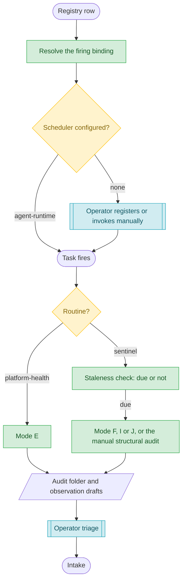

# Run a scheduled platform audit

## Summary

Seven of the nine registered routines observe the platform; six run through this sub-process: the quarterly
platform-health audit and its weekly drift watch, and four weekly staleness sentinels (process fitness, structure,
architecture conformance, decision health). The seventh, the weekly security scan, is
[run-security-scan](run-security-scan.md).
A routine is admitted by its registry row, resolved to a binding by the scheduler adapter, and registered by the
operator on the agent runtime's scheduled-task surface. When it fires, a session runs the matching auditor mode — E
for platform health, F, I and J for three sentinels; the structural sentinel has no mode and routes to the manual
audit framework — or, for a sentinel, emits a due-signal draft. Every mode is observe-only: findings land in a dated,
git-ignored folder as observation drafts, and the operator triages them (promote, defer, close). The decision point
is that triage; nothing here writes the registry or the backlog.

## Entry and exit

| Side | Criteria | Source |
|---|---|---|
| Entry | A registered routine's task fires on the operator's scheduler (the row declares the cadence; the instance resolves it), an out-of-band drift signal, or an operator ask; the row validates against the schema and the entrypoint declares the row's id | [registry](/core/automations/registry.md#L36)<!-- source-anchor: line=36; fp=310cae5d4d1f4807 -->; [OPERATIONS.md](/core/governance/OPERATIONS.md#L724)<!-- source-anchor: line=724; fp=6525bf2e3c2a23ec --> |
| Exit | A dated audit folder (or a due-signal draft) exists under the operator-instance analysis path with its observation drafts, and the operator has rendered PROMOTE / DEFER / CLOSE on each; Modes I and J also overwrite their committed summary surface | [OPERATIONS.md](/core/governance/OPERATIONS.md#L753)<!-- source-anchor: line=753; fp=697da34e707a6bc8 -->; [SKILL.md](/core/skills/pmo-qa-auditor/SKILL.md#L763)<!-- source-anchor: line=763; fp=11d84eecc788c55a -->, [SKILL.md](/core/skills/pmo-qa-auditor/SKILL.md#L839)<!-- source-anchor: line=839; fp=2c2efb718a0d33f3 --> |

## Flow

## Activities

| Activity | Primary actor | Purpose | Page |
|---|---|---|---|
| Resolve a registered routine to its firing binding | script:resolve-automation-binding.sh | Make how each routine fires on an install observable; the operator registers the task | [resolve-routine-binding](resolve-routine-binding.md) |
| Run the platform health audit (Mode E) | skill:pmo-qa-auditor | Catalog and roster drift, the detector battery, the KM scans, the audit folder | [run-platform-health-audit](run-platform-health-audit.md) |

## Controls

| Control | Source | Enforcement class | Surface | Applies to |
|---|---|---|---|---|
| Every declared automation has a conforming registry row and every row round-trips to its entrypoint | [`core/deploy/deploy.sh`](/core/deploy/deploy.sh) Check 76 (C-196) | code-enforce | deploy-run | resolve-routine-binding |
| The same admission predicates on every pull request and push to main | [`.github/workflows/automation-registry-check.yml`](/.github/workflows/automation-registry-check.yml) (C-202) | code-enforce | ci-run | resolve-routine-binding |
| A routine resolves by registry id alone; a row with no declaring entrypoint fails non-zero | [`core/deploy/tools/resolve-automation-binding.sh`](/core/deploy/tools/resolve-automation-binding.sh), its header comment | code-enforce | — | resolve-routine-binding |
| The audit modes observe and never mutate the registry or the backlog; the row write is a separate human-gated change | [`core/governance/OPERATIONS.md`](/core/governance/OPERATIONS.md) § Platform Health Audit Protocol, Rule 3; [`core/skills/pmo-qa-auditor/SKILL.md`](/core/skills/pmo-qa-auditor/SKILL.md), the mutation-posture paragraph of each audit mode | prose-only | — | every audit activity |
| Registration of the two platform-health tasks is non-git runtime state, recorded at Stage 12; rollback is deregistration | [`core/governance/OPERATIONS.md`](/core/governance/OPERATIONS.md) § Platform Health Audit Protocol, Rule 5 | prose-only | — | resolve-routine-binding |
| A quarterly audit missed for two consecutive quarters is run manually | [`core/governance/OPERATIONS.md`](/core/governance/OPERATIONS.md) § Platform Health Audit Protocol, Rule 4 | prose-only | — | run-platform-health-audit |

## Evidence

| Lens | Source | Observation | Label |
|---|---|---|---|
| designed | [`core/automations/registry.md`](/core/automations/registry.md) § Routines and its authoring notes | the four sentinels' weekly cadence is a recommended default, the quarterly cron verbatim; the trigger column marks the four sentinels and the quarterly audit `hybrid` and the drift watch `time-driven`; cadence is declared, the instance resolves | [SOURCE] |
| designed | § 6 of the four cadence protocols ([process fitness](/release/references/protocols/process-fitness-cadence.md), [structural audit](/release/references/protocols/structural-audit-cadence.md), [architecture conformance](/release/references/protocols/architecture-conformance-cadence.md), [decision audit](/release/references/protocols/decision-audit-cadence.md)) and § 2 of [the audit framework](/release/references/protocols/platform-health-audit-framework.md) | each axis is a hybrid of manual event triggers and a time-driven staleness sentinel whose registration the instance owns; the structural axis routes to the manual audit framework, not a skill mode | [SOURCE] |
| executed | measure `scheduled-audit-folders` — [scheduled-audit-folders.py](/core/deploy/tools/process-catalog-measures/scheduled-audit-folders.py) (population: every dated folder directly inside the analysis home, by audit family; folder names and the frontmatter of each summary file only) | the measure reports the dated folders inside the analysis home by audit family, read from folder names and each summary file's frontmatter; one install's working state; supports no verdict on this page | [SOURCE] |
| executed | held local — what would show how often the auditor skill is invoked, and in which mode, is the record of sessions across an install. | Nothing from that store is published | [SOURCE] |
| designed vs built | Rule 1's quarterly row in [OPERATIONS.md](/core/governance/OPERATIONS.md#L732)<!-- source-anchor: line=732; fp=11d11a5257eff303 --> against the scheduler selector's shipped default in [operator.toml.template](/core/config/operator.toml.template#L293)<!-- source-anchor: line=293; fp=19dd7662bbd8e15e --> and [the adapter](/core/deploy/tools/resolve-automation-binding.sh) | Rule 1 states the quarterly task spawns a session; the shipped selector is `none`, so no task exists until the operator registers it, and the adapter reports `MANUAL` — the rule describes a registered instance, not the shipped default | [SOURCE] |

## Navigation

<!-- nav:begin -->
Up: [observe-platform](observe-platform.md) · Next: [run-security-scan](run-security-scan.md) · Down: [resolve-routine-binding](resolve-routine-binding.md) · [run-platform-health-audit](run-platform-health-audit.md)
<!-- nav:end -->

## Sources

- [`core/automations/registry.md`](/core/automations/registry.md), [`core/schemas/automation-registry-schema.md`](/core/schemas/automation-registry-schema.md) — the routine rows and contract
- [`core/deploy/tools/resolve-automation-binding.sh`](/core/deploy/tools/resolve-automation-binding.sh), [`core/deploy/tools/check-automation-registry.sh`](/core/deploy/tools/check-automation-registry.sh), [`core/deploy/tools/check-automation-coverage.sh`](/core/deploy/tools/check-automation-coverage.sh) — the adapter and the admission predicates
- [`core/skills/pmo-qa-auditor/SKILL.md`](/core/skills/pmo-qa-auditor/SKILL.md) — Modes E, F, I, J
- The audit framework and the four cadence protocols, each root-linked in the Evidence table
- [`core/governance/OPERATIONS.md`](/core/governance/OPERATIONS.md) § Platform Health Audit Protocol — Rules 1–5; [`core/config/operator.toml.template`](/core/config/operator.toml.template) — the scheduler selector
- [`core/process-catalog/definitions/controls-register.tsv`](/core/process-catalog/definitions/controls-register.tsv) — C-196, C-202; [`core/deploy/deploy.sh`](/core/deploy/deploy.sh) Check 76 and [`.github/workflows/automation-registry-check.yml`](/.github/workflows/automation-registry-check.yml) — the two admission runs
