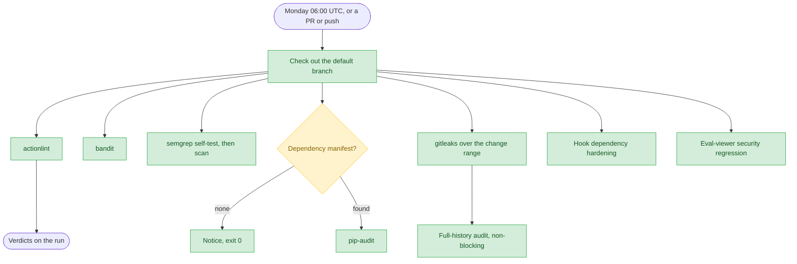

# Run the security workflow's jobs on the weekly schedule

## Summary

The repository host fires `security.yml` on its own cron (the registry row `security-scan` mirrors that cadence and
is self-firing, so the operator's scheduler must not register it). Seven jobs run in parallel on the default branch:
workflow lint, Python SAST, the custom semgrep ruleset with its positive-control self-test, a dependency audit that
skips when no manifest exists, a change-scoped secret scan plus a non-blocking full-history audit, the hook
dependency-hardening assertion and the eval-viewer security regression. A scheduled run gates no merge: the
verdicts sit on the run for the operator's read, the next activity. The same jobs on a pull request are the control layer,
under the posture the workflow's headers declare: its top header and the semgrep job's header declare
`required`, and the headers of the last two jobs declare `advisory`. Its
[ICOM](/core/process-catalog/definitions/pack.json) table follows.

## ICOM

| Inputs | Controls | Outputs | Mechanisms |
|---|---|---|---|
| The default branch at the firing moment (full history for gitleaks); pinned tool versions; the semgrep rules and fixtures; `.gitleaks.toml`; the hook test harness; the eval-viewer tests | The registry's admission of the routine (C-196, C-202); the host's cron; on pull requests the seven jobs as the control layer (C-241 to C-247), under the posture the workflow's header declares | Seven job conclusions on the run; no artifact, issue or notification is produced by the workflow itself | the repository host's workflow runner; actionlint 1.7.1; bandit 1.7.10; semgrep 1.136.0; pip-audit 2.7.3; gitleaks 8.21.2; [check-hook-dep-hardening.sh](/core/hooks/tests/check-hook-dep-hardening.sh); [test_generate_review.py](/release/skills/pmo-skill-refiner/eval-viewer/test_generate_review.py) |

## Flow

## Steps

| Step | Action | Actor | Inputs → outputs (shape) | Controls | Mechanism | Harness | Model need | Source |
|---|---|---|---|---|---|---|---|---|
| fire-workflow | Fire the workflow on the cron, a pull request or a push to main | external:repo-host | `schedule: cron '0 6 * * 1'`, `pull_request` and `push` on main → a run with seven jobs | C-196: code-enforce; C-202: code-enforce | the repository host's workflow triggers | none | XS/none/none/scriptable/batch | [security.yml](/.github/workflows/security.yml#L21)<!-- source-anchor: line=21; fp=8bdae5c8727e93f6 -->; [registry](/core/automations/registry.md#L23)<!-- source-anchor: line=23; fp=4c1e33b55de6ef70 --> |
| lint-workflows | Run actionlint over every workflow file | ci:security | the checkout → pass, or red on an injection pattern or shell issue (SC2016 suppressed by flag) | C-241: code-enforce | actionlint 1.7.1 | none | XS/none/read/scriptable/batch | [security.yml](/.github/workflows/security.yml#L42)<!-- source-anchor: line=42; fp=16004c3e32f92d5f --> |
| scan-python-sources | Run bandit over `core/` and `release/` at high severity, medium confidence | ci:security | Python sources → pass or red | C-242: code-enforce | bandit 1.7.10 | none | XS/none/read/scriptable/batch | [security.yml](/.github/workflows/security.yml#L63)<!-- source-anchor: line=63; fp=3a6a60734e64faac --> |
| self-test-and-run-semgrep | Prove the custom ruleset fires on its fixtures, then scan the HTML-emitting surface | ci:security | `semgrep --test` over the rules and fixtures → must go red on the vulnerable fixtures; then `semgrep scan --error --strict` over the two emitter trees → pass or red | C-243: code-enforce | semgrep 1.136.0 | none | XS/none/read/scriptable/batch | [security.yml](/.github/workflows/security.yml#L78)<!-- source-anchor: line=78; fp=e161cbbe8099f650 --> |
| audit-python-dependencies | Audit any dependency manifest, or skip with a notice | ci:security | `find` for `requirements*.txt` / `pyproject.toml` → `pip-audit --strict` per requirements file; none found → `::notice` and exit 0 | C-244: code-enforce | pip-audit 2.7.3 | none | XS/none/read/scriptable/batch | [security.yml](/.github/workflows/security.yml#L120)<!-- source-anchor: line=120; fp=64feca19298c7a19 --> |
| scan-change-for-secrets | Scan the commits between the merge base and HEAD for secrets | ci:security | `git merge-base origin/<base_ref or main> HEAD` → `gitleaks detect --log-opts=<base>..HEAD` with `.gitleaks.toml` (default rules plus one fixture path and one slug-literal allowlist) → pass or red | C-245: code-enforce | gitleaks 8.21.2 | none | XS/none/read/scriptable/batch | [security.yml](/.github/workflows/security.yml#L166)<!-- source-anchor: line=166; fp=3f978b1cba3a76df -->; [.gitleaks.toml](/.gitleaks.toml#L7)<!-- source-anchor: line=7; fp=a080dc456a41097c --> |
| audit-full-history-for-secrets | Scan the whole history and report only | ci:security | `gitleaks detect --source .` → findings reported; `continue-on-error: true` so the job stays green | code-warn | gitleaks 8.21.2 | none | XS/none/read/scriptable/batch | [security.yml](/.github/workflows/security.yml#L186)<!-- source-anchor: line=186; fp=c465a0601f1e66e3 --> |
| assert-hook-dependency-hardening | Assert no security hook hard-codes `jq` or carries a blanket fail-open | ci:security | the hook test harness → pass or red | C-246: code-enforce | `check-hook-dep-hardening.sh` | none | XS/none/read/scriptable/batch | [security.yml](/.github/workflows/security.yml#L192)<!-- source-anchor: line=192; fp=b13b6bfb37c92e00 --> |
| run-eval-viewer-regression | Run the symlink-read, redaction and CSRF regression | ci:security | `test_generate_review.py` → pass or red | C-247: code-enforce | `python3` | none | XS/none/read/scriptable/batch | [security.yml](/.github/workflows/security.yml#L215)<!-- source-anchor: line=215; fp=78f8376c2aa0d3b8 --> |

## Step profile

| Field | Value |
|---|---|
| Deterministic steps | 9 of 9 (determinism `scriptable`, counted from the Steps table) |
| Judgment steps | 0 |
| Harness features relied on | none — the jobs run on the repository host, outside the agent harness |
| Context read | XS (under 2k tokens): the jobs read the checkout; no model is involved |

## Evidence

| Lens | Source | Observation | Label |
|---|---|---|---|
| designed | [`.github/workflows/security.yml`](/.github/workflows/security.yml), its gate-efficacy header and its `automation_id` comment | the workflow's top header declares posture required and carries an invariant and a falsification recipe; the `automation_id` comment declares the routine self-firing | [SOURCE] |
| designed | [`core/automations/registry.md`](/core/automations/registry.md) § Routines, the `security-scan` row, and the authoring note on it | `security-scan`: `0 6 * * 1`, time-driven, `bounded_auto`, CHEAP; the cadence is a mirror of the workflow's own cron, asserted equal | [SOURCE] |
| built | [`.github/workflows/security.yml`](/.github/workflows/security.yml), its `on:` block and its job keys | seven jobs; a `schedule:` block with the cron `0 6 * * 1`, beside the pull-request and push triggers | [SOURCE] |
| built | [the controls register](/core/process-catalog/definitions/controls-register.tsv), C-241 to C-247 | the register classes all seven jobs `code-enforce` | [SOURCE] |
| executed | measure `workflow-runs-install-security` — [workflow-run-history.py](/core/deploy/tools/process-catalog-measures/workflow-run-history.py) (population: every run of each named workflow created in the trailing window, split by trigger event, read in slices and verified against the host's total for each slice); [`security.yml`](/.github/workflows/security.yml) | the measure reports the run history of the security workflow, split by trigger event; the trigger is the host's act and no workflow runs it, so the clause leaves it out; the dependency audit runs its tool only where a manifest exists, and the workflow's own comment says the repository declares none, so the clause leaves that step out too; covers: `lint-workflows`, `scan-python-sources`, `self-test-and-run-semgrep`, `scan-change-for-secrets`, `audit-full-history-for-secrets`, `assert-hook-dependency-hardening`, `run-eval-viewer-regression` | [SOURCE] |
| executed | measure `secret-scan-range` — [secret-scan-range.py](/core/deploy/tools/process-catalog-measures/secret-scan-range.py) (population: the most recent run of the security workflow for each named trigger event) | the measure reports, for the most recent run of the security workflow on each named trigger event, what the secret-scan step's log shows of the range it read and the verdict it printed; each line is one run, not a history | [SOURCE] |

## Navigation

<!-- nav:begin -->
Up: [run-security-scan](run-security-scan.md) · Next: [route-scan-verdicts](route-scan-verdicts.md)
<!-- nav:end -->

## Sources

- [`.github/workflows/security.yml`](/.github/workflows/security.yml) — the triggers and the seven jobs
- [`.gitleaks.toml`](/.gitleaks.toml) — the ruleset extension and its two allowlist entries
- [`core/automations/registry.md`](/core/automations/registry.md) — the `security-scan` row and its self-firing note
- [`core/process-catalog/definitions/controls-register.tsv`](/core/process-catalog/definitions/controls-register.tsv) — C-196, C-202, C-241 to C-247
- [`core/hooks/tests/check-hook-dep-hardening.sh`](/core/hooks/tests/check-hook-dep-hardening.sh), [`release/skills/pmo-skill-refiner/eval-viewer/test_generate_review.py`](/release/skills/pmo-skill-refiner/eval-viewer/test_generate_review.py) — the two regression scripts the last two jobs run
