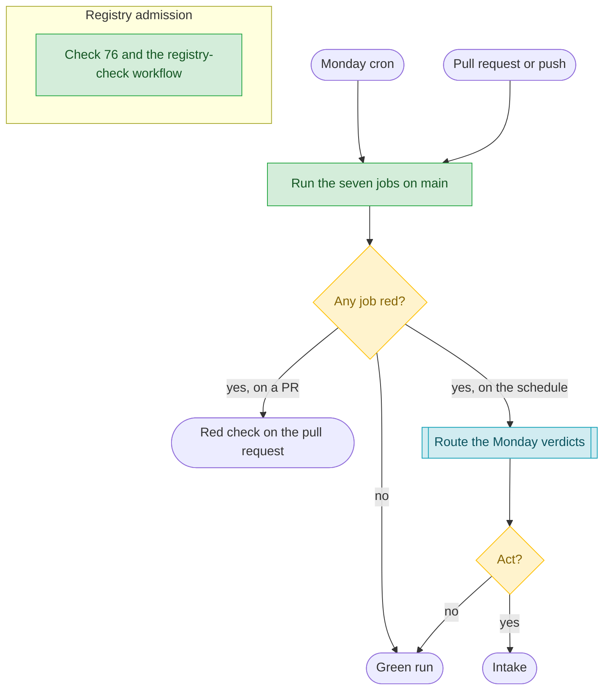

# Run the scheduled security scan

## Summary

Of the nine registered routines, `security-scan` is the one whose entrypoint is a workflow, so the repository host
fires it on the cron written in the workflow and the operator's scheduler stays out of it. Two activities carry
it: the seven jobs run over the default branch and leave their conclusions on the run, and the operator reads the
Monday run and routes a red result to intake. Entry is the Monday cron; exit is a run with seven verdicts the
operator has read; the workflow itself takes no further action. The same workflow on pull requests and pushes is the control layer for every change, which this
page names but does not describe: that limb belongs to the release pipeline's merge gate.

## Entry and exit

| Side | Criteria | Source |
|---|---|---|
| Entry | Monday 06:00 UTC on the default branch (`schedule: cron '0 6 * * 1'`); the routine is admitted by its registry row, whose cadence must equal the workflow's cron | [security.yml](/.github/workflows/security.yml#L26)<!-- source-anchor: line=26; fp=c1e028899d3c9866 -->; [registry](/core/automations/registry.md#L23)<!-- source-anchor: line=23; fp=4c1e33b55de6ef70 --> |
| Exit | Seven job conclusions recorded on the run; the operator has read them; the workflow created nothing else | [security.yml](/.github/workflows/security.yml#L41)<!-- source-anchor: line=41; fp=ad0c08162d013950 --> |

## Flow

## Activities

| Activity | Primary actor | Purpose | Page |
|---|---|---|---|
| Run the security workflow's jobs on the weekly schedule | ci:security | Lint, SAST, dependency audit, secret scanning and two regressions over the default branch | [run-security-jobs](run-security-jobs.md) |
| Route the Monday verdicts | operator | Read the scheduled run's seven conclusions; route a content finding to intake, a toolchain failure to a fix or re-run | [route-scan-verdicts](route-scan-verdicts.md) |

## Controls

| Control | Source | Enforcement class | Surface | Applies to |
|---|---|---|---|---|
| The seven security jobs pass on every pull request and push to main | [`.github/workflows/security.yml`](/.github/workflows/security.yml) (C-241 to C-247) | code-enforce | merge-gate or ci-run, by job, as the register records | run-security-jobs |
| Every declared automation has a conforming registry row and every scheduled workflow is registered | [`.github/workflows/automation-registry-check.yml`](/.github/workflows/automation-registry-check.yml) (C-202) | code-enforce | ci-run | run-security-jobs |
| The same admission predicate at deploy time | [`core/deploy/deploy.sh`](/core/deploy/deploy.sh) Check 76 (C-196) | code-enforce | deploy-run | run-security-jobs |
| The workflow's headers declare which of its checks are `required`, the posture under which a red verdict is to block a merge to main | [`.github/workflows/security.yml`](/.github/workflows/security.yml), its gate-efficacy headers | host-config | host | run-security-jobs |
| A self-firing entrypoint is derived from its path and never registered on the operator's scheduler | [`core/schemas/automation-registry-schema.md`](/core/schemas/automation-registry-schema.md) § 8, the paragraph on a self-firing entrypoint | prose-only | — | run-security-jobs |

## Evidence

| Lens | Source | Observation | Label |
|---|---|---|---|
| designed | [`core/automations/registry.md`](/core/automations/registry.md) § Routines and the authoring note on `security-scan` | `security-scan` is the one self-firing row, `bounded_auto`: it runs and reports unattended, opens no pull request and merges nothing | [SOURCE] |
| designed | [`core/schemas/automation-registry-schema.md`](/core/schemas/automation-registry-schema.md) § 8, the paragraph on a self-firing entrypoint | a workflow entrypoint identifies a self-firing routine by its path; no field stores the backend | [SOURCE] |
| built | [`.github/workflows/security.yml`](/.github/workflows/security.yml), its `on:` block and its job keys | seven jobs; a `schedule:` block beside the pull-request and push triggers | [SOURCE] |
| executed | measure `workflow-runs-install-security` — [workflow-run-history.py](/core/deploy/tools/process-catalog-measures/workflow-run-history.py) (population: every run of each named workflow created in the trailing window, split by trigger event, read in slices and verified against the host's total for each slice); [`security.yml`](/.github/workflows/security.yml); [`automation-registry-check.yml`](/.github/workflows/automation-registry-check.yml) | the measure reports the run history of the security workflow and of the registry-check workflow, split by trigger event; a run's conclusions do not show whether the operator read or routed them | [SOURCE] |
| executed | measure `secret-scan-range` — [secret-scan-range.py](/core/deploy/tools/process-catalog-measures/secret-scan-range.py) (population: the most recent run of the security workflow for each named trigger event) | the measure reports, for the most recent run of the security workflow on each named trigger event, what the secret-scan step's log shows of the range it read and the verdict it printed; each line is one run, not a history | [SOURCE] |

## Navigation

<!-- nav:begin -->
Up: [observe-platform](observe-platform.md) · Previous: [run-scheduled-audit](run-scheduled-audit.md) · Next: [run-session-retro](run-session-retro.md) · Down: [run-security-jobs](run-security-jobs.md) · [route-scan-verdicts](route-scan-verdicts.md)
<!-- nav:end -->

## Sources

- [`.github/workflows/security.yml`](/.github/workflows/security.yml) — the triggers and jobs
- [`core/automations/registry.md`](/core/automations/registry.md), [`core/schemas/automation-registry-schema.md`](/core/schemas/automation-registry-schema.md) — the admission row and the self-firing rule
- [`.github/workflows/automation-registry-check.yml`](/.github/workflows/automation-registry-check.yml) — the PR-time admission gate; [`core/deploy/deploy.sh`](/core/deploy/deploy.sh) Check 76 — the same predicate at deploy time
- [`core/process-catalog/definitions/controls-register.tsv`](/core/process-catalog/definitions/controls-register.tsv) — C-196, C-202, C-241 to C-247
