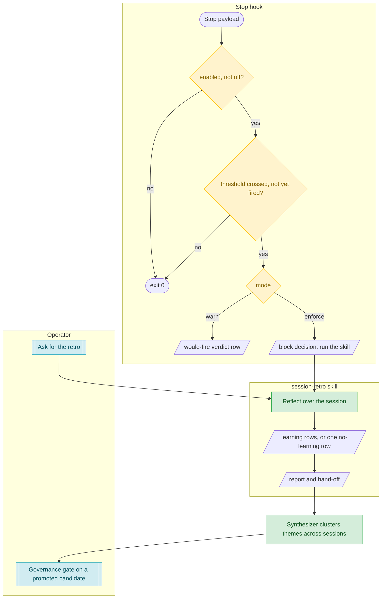

# Run a session retro at session stop

## Summary

Two halves, separable by design. The trigger is a Stop hook registered by the settings template and shipped inert:
only after the operator sets `enabled = true` does it evaluate, on every turn boundary, whether the session has crossed
the sampling threshold, and only in enforce mode — after a warn window — does it re-enter the agent. The skill is the
always-available floor: invoked by the hook or by an explicit ask, it reflects over the session, emits one event-log
row per learning or one explicit no-learning row through the locked write path, reports, and stops. Cross-session
promotion belongs to the synthesizer and the governance gate, never to one session.

## Entry and exit

| Side | Criteria | Source |
|---|---|---|
| Entry (automatic) | A Stop event in a session that loaded the workspace-scope settings, with `[session_retro] enabled = true` and `mode` not `off`; the session clears the sampling predicate for the first time | [session-retro-trigger.sh](/core/hooks/session-retro-trigger.sh#L467)<!-- source-anchor: line=467; fp=6a853c8764072b75 -->; [sampling-and-trigger](/core/skills/session-retro/references/sampling-and-trigger.md#L72)<!-- source-anchor: line=72; fp=0a4a81a98952e7f5 --> |
| Entry (manual) | The operator asks for the retro; the threshold never overrides a direct instruction | [SKILL.md](/core/skills/session-retro/SKILL.md#L33)<!-- source-anchor: line=33; fp=5d8fc0ad05186f9f --> |
| Exit | At least one `session-retro` row appended (a `no-learning` row when nothing was found) and the output report rendered; on a sampled skip, nothing at all; the hook has exited 0 on every path and, in warn mode, logged a would-fire verdict instead of interrupting | [SKILL.md](/core/skills/session-retro/SKILL.md#L71)<!-- source-anchor: line=71; fp=025d05083c5a5446 -->; [session-retro-trigger.sh](/core/hooks/session-retro-trigger.sh#L561)<!-- source-anchor: line=561; fp=2930fc86f47ea256 --> |

## Flow

## Activities

| Activity | Primary actor | Purpose | Page |
|---|---|---|---|
| Trigger the session retro at a Stop boundary | hook:session-retro-trigger | Decide once per session, at the threshold crossing, whether to re-enter the agent | [trigger-session-retro](trigger-session-retro.md) |
| Reflect over the session and emit learnings rows | skill:session-retro | Abstract the session into rows through the locked write path and hand off | [emit-session-learnings](emit-session-learnings.md) |

## Controls

| Control | Source | Enforcement class | Surface | Applies to |
|---|---|---|---|---|
| At a Stop boundary of a sampled, substantive session a retro is triggered before the session ends — shipped inert behind `enabled = false` | [`core/hooks/session-retro-trigger.sh`](/core/hooks/session-retro-trigger.sh) (C-078) | code-off | hook | trigger-session-retro |
| The Stop event runs the trigger script on the workspace-scope settings surface | [`core/settings.json.template`](/core/settings.json.template) (C-111) | code-off | hook | trigger-session-retro |
| The retro writes only `session-retro` rows through the event writer; no issue, corpus edit, skill change or memory write at any cluster size | [`core/skills/session-retro/SKILL.md`](/core/skills/session-retro/SKILL.md) § Autonomy Tier, § Guardrails | prose-only | — | emit-session-learnings |
| A payload carries no verbatim operator content, name, external path or customer data | [`release/references/standards/pipeline-event-log-schema.md`](/release/references/standards/pipeline-event-log-schema.md) § 4.2, § 4.3 | prose-only | — | emit-session-learnings |
| The writer rejects an unknown subtype, a version-shaped join key and a payload over 300 characters | [`release/tools/append-pipeline-event.sh`](/release/tools/append-pipeline-event.sh) | code-enforce | — | emit-session-learnings |
| A cluster qualifies for promotion at three rows or more on one theme across two versions | [`release/tools/synthesize-release-learnings.sh`](/release/tools/synthesize-release-learnings.sh) `--source session-retro` | code-warn | agent-run | emit-session-learnings |
| A promotion passes the governance gate | the charter's no-ungoverned-changes guardrail | prose-only | — | emit-session-learnings |

## Evidence

| Lens | Source | Observation | Label |
|---|---|---|---|
| designed | [`core/skills/session-retro/SKILL.md`](/core/skills/session-retro/SKILL.md); [`sampling-and-trigger.md`](/core/skills/session-retro/references/sampling-and-trigger.md) § 5 (the activation boundary); [`core/hooks/session-retro-trigger.sh`](/core/hooks/session-retro-trigger.sh), its header comment | the release ships the script and its registration but not its activation; three operator steps turn it on, the second of them an observation window | [SOURCE] |
| designed | the emission contract's line on the fixed columns ([emission-contract.md](/core/skills/session-retro/references/emission-contract.md#L36)<!-- source-anchor: line=36; fp=07e5a14ce6710a80 -->); the `session-retro` row of the event-log schema ([pipeline-event-log-schema.md](/release/references/standards/pipeline-event-log-schema.md#L212)<!-- source-anchor: line=212; fp=f23fe9193b160778 -->) | the contract fixes the row's actor as the skill, and the schema describes the row as the skill's | [SOURCE] |
| built | [the controls register](/core/process-catalog/definitions/controls-register.tsv), C-078 and C-111 (both `code-off`); [`core/settings.json.template`](/core/settings.json.template), its opening comment (the Stop object is not re-homed to user scope); [`release/tools/append-pipeline-event.sh`](/release/tools/append-pipeline-event.sh) | the trigger ships inert, and a session that resolves no settings surface declaring the wiring loads no Stop hook; the code on the skill's output is the writer's validation | [SOURCE] |
| executed | no measure — what would show an activation and a firing is the operator config's `[session_retro]` keys and the hook's state directory: its fire sentinels and its verdict log. | No measure in the measures register reads those surfaces, so the page reads `unobserved` | [SOURCE] |
| executed | measure `event-log-population` — [event-log-population.py](/core/deploy/tools/process-catalog-measures/event-log-population.py) (population: the rows of the pipeline event log whose release key is a milestone title or a tag name on the host; a key another repository shares is counted, and a legacy row older than the host's tags is not) | the measure reports the event log's row total, its rows under each key rule and its rows by event type, `session-retro` among the types; aggregates only; one install's working state; supports no verdict on this page | [SOURCE] |
| executed | held local — what would show how often the skill is invoked, and by which route, is the record of sessions across an install. | Nothing from that store is published | [SOURCE] |

## Navigation

<!-- nav:begin -->
Up: [observe-platform](observe-platform.md) · Previous: [run-security-scan](run-security-scan.md) · Next: [measure-platform-usage](measure-platform-usage.md) · Down: [trigger-session-retro](trigger-session-retro.md) · [emit-session-learnings](emit-session-learnings.md)
<!-- nav:end -->

## Sources

- [`core/hooks/session-retro-trigger.sh`](/core/hooks/session-retro-trigger.sh) — the trigger, its state layout and its fail-open contract
- [`core/settings.json.template`](/core/settings.json.template) — the Stop registration and its scope
- [`core/skills/session-retro/SKILL.md`](/core/skills/session-retro/SKILL.md), [`sampling-and-trigger.md`](/core/skills/session-retro/references/sampling-and-trigger.md), [`emission-contract.md`](/core/skills/session-retro/references/emission-contract.md) — the skill, the sampling contract and the emission contract
- [`release/tools/append-pipeline-event.sh`](/release/tools/append-pipeline-event.sh); [`release/tools/synthesize-release-learnings.sh`](/release/tools/synthesize-release-learnings.sh) — the write path and the promotion path; [`release/references/standards/pipeline-event-log-schema.md`](/release/references/standards/pipeline-event-log-schema.md) — the payload rules and the `session-retro` row
- [`core/process-catalog/definitions/controls-register.tsv`](/core/process-catalog/definitions/controls-register.tsv) — C-078, C-111
