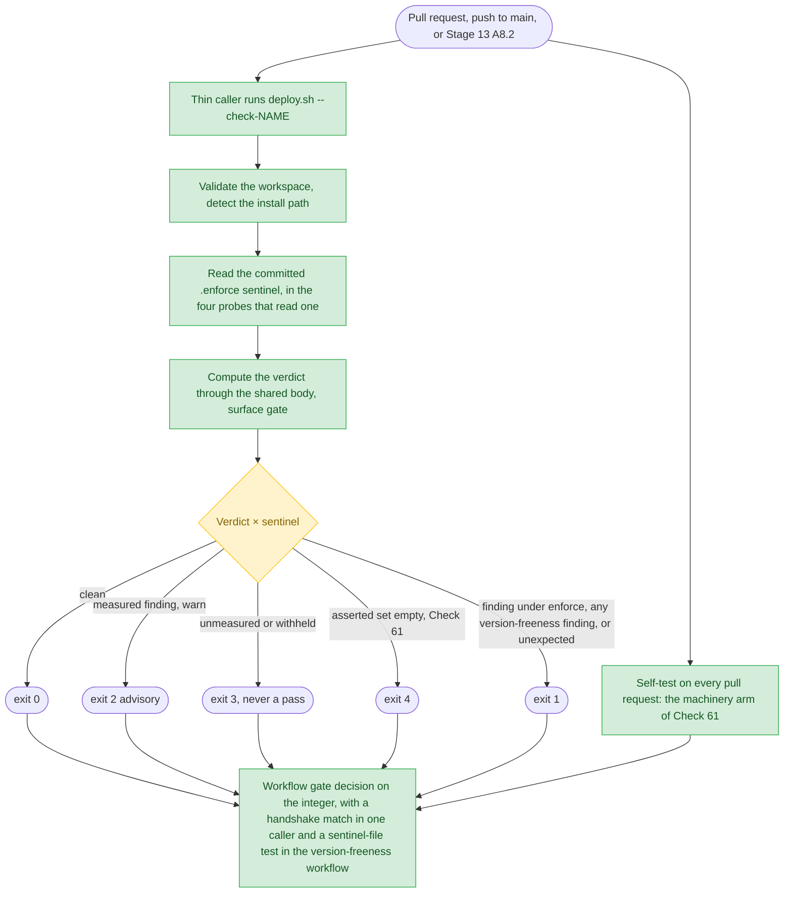

# Run a single-check CI probe and map its verdict to an exit code

## Summary

Five checks of the suite expose their verdict body a second time as a dispatcher flag: version freeness (Check 41),
close completeness (48), release-corpus completeness (32), package freshness (7) and the decision-emission minimum
set (61). A thin workflow step runs the flag on a pull request or a push to main, and a gate-decision step turns the
integer into the job's conclusion: the release-corpus, package-freshness and decision-emission callers branch on the
integer alone, the close-completeness caller also matches a handshake line before it honours 2 or 3, and the
version-freeness workflow first tests, in a step of its own, whether its enforce sentinel file exists and ends green
with a warning on the probe's exit 1 while that file is absent;
Stage 13 runs the decision-emission probe by hand and records its verdict, and the same workflow runs `--self-test` — the hermetic
regression that is Check 61's machinery arm — on every pull request. Each probe computes the verdict through the
same `_cNN_compute_verdict` body the suite uses and maps it to an exit code. Four of the five read their committed
`.enforce` sentinel themselves and keep one invariant: a degraded or unmeasured state never shares a member with the
clean state. The version-freeness probe reads no sentinel and also exits 0 on SKIP, where there is no version claim
to assert. The probes are the pre-merge mirrors that Requirement (b′) of
[the gate-efficacy standard](/core/standards/gate-efficacy-standard.md) asks of a required gate: a check that runs
only at deploy time cannot block a merge. The dispatcher also carries `--check-doc-gates`, which runs the Stage 13
close gates for one pull request; that command is the release pipeline's. Its
[ICOM](/core/process-catalog/definitions/pack.json) table (inputs, controls, outputs, mechanisms)
follows.

## ICOM

| Inputs | Controls | Outputs | Mechanisms |
|---|---|---|---|
| The checkout's release ledger, notes, packages and plan; the host's published releases and tags; the committed `.github/<name>.enforce` token; for Check 61 the event log, absent on every CI checkout | The verdict-to-exit contract tables (exit 0 only for CLEAN or FRESH or FREE or SKIP-with-nothing-to-assert; 2 advisory; 3 withheld; 4 asserted-nothing; 1 blocking or unexpected); in the four sentinel-reading probes, the sentinel as an escalation dial that can raise but never lower; the single-engine rule that no check predicate is re-encoded in YAML (the version-freeness workflow's YAML holds its warn-or-enforce switch, not a predicate) | One exit code per run; the verdict and remedy lines on stdout; a step summary and a check-run conclusion on the host; a Stage 13 close-out record for the decision-emission verdict | `cmd_check_version_freeness`, `cmd_check_close_completeness`, `cmd_check_release_corpus`, `cmd_check_package_freshness`, `cmd_check_decision_emission`, `cmd_self_test`; the workflow's run and gate-decision steps |

## Flow

## Steps

| Step | Action | Actor | Inputs → outputs (shape) | Controls | Mechanism | Harness | Model need | Source |
|---|---|---|---|---|---|---|---|---|
| dispatch-probe-flag | Route the probe flag to its command | script:deploy.sh | `--check-version-freeness`, `--check-close-completeness`, `--check-release-corpus`, `--check-package-freshness` or `--check-decision-emission` → the matching `cmd_check_*` function | prose-only | the `main` case statement | file-and-shell-tools | XS/none/read/scriptable/batch | [deploy.sh](/core/deploy/deploy.sh#L23367)<!-- source-anchor: line=23367; fp=73e47f0ff9db7eed --> |
| validate-probe-workspace | Validate the workspace | script:deploy.sh | the checkout → `validate_workspace` passes; `detect_install_path` tolerated non-fatally | prose-only | the two shared preflight functions | file-and-shell-tools | XS/none/read/scriptable/batch | [deploy.sh](/core/deploy/deploy.sh#L4675)<!-- source-anchor: line=4675; fp=d40eaeba68e3dc13 --> |
| read-enforce-sentinel | Read the committed enforce sentinel | script:deploy.sh | the first non-comment token of `.github/<name>.enforce` → `enforce` or `warn` (absent reads warn); the version-freeness probe reads none, and no version-freeness sentinel is committed | prose-only | grep over the one-token file | file-and-shell-tools | XS/none/read/scriptable/batch | [deploy.sh](/core/deploy/deploy.sh#L22768)<!-- source-anchor: line=22768; fp=1ad6a7f0ce3f134d --> |
| compute-probe-verdict | Compute the verdict on the gate surface | script:deploy.sh | ledger, notes, packages, plan, host anchor → one verdict token with its counts (CLEAN, INCOMPLETE, SKIP, NOT-EVALUATED, NOSET, FRESH, STALE, FREE, NOT_FREE, UNDECIDABLE); an unreachable anchor is a finding, not N/A | prose-only | `_vf_`, `_cc_`, `_c32_`, `_c7_`, `_de_compute_verdict "gate"` | file-and-shell-tools, git-and-gh-cli | XS/none/read/scriptable/batch | [deploy.sh](/core/deploy/deploy.sh#L22776)<!-- source-anchor: line=22776; fp=669a379ee328a173 --> |
| map-verdict-to-exit | Map verdict and sentinel to the exit code | script:deploy.sh | verdict token + sentinel → exit 0 for the clean token, and in the version-freeness probe for SKIP as well; 2 advisory finding; 3 withheld or unmeasured; 4 asserted nothing (61); 1 blocking under enforce, an unexpected token, or in the version-freeness probe NOT_FREE or UNDECIDABLE with no sentinel read | prose-only | `_c32_verdict_exit_code`, `_de_verdict_exit_code`, `_cc_exit_through_mapping` and the inline cases | file-and-shell-tools | XS/none/read/scriptable/batch | [deploy.sh](/core/deploy/deploy.sh#L22717)<!-- source-anchor: line=22717; fp=e413bcdc73d9f8fb --> |
| run-version-freeness-probe | Call the version-freeness probe on a version-claiming change | ci:version-freeness | a pull request touching the ledger, grammar, claim tool or engine, or a push to main touching the ledger or grammar → exit 0 FREE or SKIP, 1 NOT_FREE or UNDECIDABLE, reported as a check-run; a mode step of the workflow tests whether its enforce sentinel file exists, and its gate-decision step ends green with a warning on 1 while that file is absent and red when it is present | C-255: code-warn | `bash core/deploy/deploy.sh --check-version-freeness` in a run step | git-and-gh-cli | XS/none/read/scriptable/batch | [version-freeness.yml](/.github/workflows/version-freeness.yml#L173)<!-- source-anchor: line=173; fp=0f6e11be6743095b --> |
| run-close-completeness-probe | Call the close-completeness probe on a release-corpus change | ci:close-completeness | a pull request or push touching the releases tree, the engine or the sentinel → the integer plus a handshake line the caller matches before honoring 2 or 3 | C-204: code-warn | `bash core/deploy/deploy.sh --check-close-completeness` | git-and-gh-cli | XS/none/read/scriptable/batch | [close-completeness.yml](/.github/workflows/close-completeness.yml#L156)<!-- source-anchor: line=156; fp=4695814e77e46806 --> |
| run-release-corpus-probe | Call the release-corpus probe on a release-corpus change | ci:release-corpus-completeness | a pull request or push touching the releases tree, the engine or the sentinel → exit 0, 2 or 3 under the warn sentinel | C-224: code-warn | `bash core/deploy/deploy.sh --check-release-corpus` | git-and-gh-cli | XS/none/read/scriptable/batch | [release-corpus-completeness.yml](/.github/workflows/release-corpus-completeness.yml#L113)<!-- source-anchor: line=113; fp=fa7a35ec80b32556 --> |
| run-package-freshness-probe | Call the package-freshness probe on every pull request | ci:skill-package-freshness | every pull request and push (no path filter) → exit 0 FRESH, 1 STALE or NOT-EVALUATED under the committed `enforce` sentinel; the workflow header declares the context `required(enforce)` for branch protection | C-253: code-enforce | `bash core/deploy/deploy.sh --check-package-freshness` | git-and-gh-cli | XS/none/read/scriptable/batch | [skill-package-freshness.yml](/.github/workflows/skill-package-freshness.yml#L197)<!-- source-anchor: line=197; fp=b97aea8739032b81 --> |
| run-decision-emission-probe | Call the decision-emission probe (live arm) | ci:decision-emission | every pull request and push → exit 3 on every CI checkout, where the event log is absent, reported and never a gate; at Stage 13 Phase A8.2 the spoke runs the same flag on an operator instance and records the verdict in the close-out report | C-208: code-warn | `bash core/deploy/deploy.sh --check-decision-emission` | git-and-gh-cli | XS/none/read/scriptable/batch | [decision-emission.yml](/.github/workflows/decision-emission.yml#L153)<!-- source-anchor: line=153; fp=973e981b96afa3d7 -->; [stage-13-close](/release/references/pipeline/stage-13-close.md#L174)<!-- source-anchor: line=174; fp=0d2e0fb84bc84843 --> |
| run-self-test | Run the hermetic self-test | script:deploy.sh | a scaffolded sandbox corpus (ledger, index, digest, notes, stubbed lint and drift engines) → the fifteen numbered close-completeness assertions plus the sibling assertion groups — among them group DG, which runs the documentation close-gate engine [`check-doc-gates.py`](/core/deploy/tools/check-doc-gates.py) — exit 0 or 1 with the failing assertion named | C-207: code-enforce | `cmd_self_test` with `CC_*` overrides re-pointing every corpus path at the sandbox | file-and-shell-tools | XS/none/read/scriptable/batch | [deploy.sh](/core/deploy/deploy.sh#L18609)<!-- source-anchor: line=18609; fp=a15ce343814242aa --> |
| gate-self-test-in-ci | Run the self-test as the machinery arm on every pull request | ci:decision-emission | every pull request and push → a red check-run when any hermetic assertion fails; no sentinel, red-capable today | C-207: code-enforce | `bash core/deploy/deploy.sh --self-test` in the gate-integrity job | git-and-gh-cli | XS/none/read/scriptable/batch | [decision-emission.yml](/.github/workflows/decision-emission.yml#L119)<!-- source-anchor: line=119; fp=b93e03554ea23fe3 --> |
| decide-workflow-gate | Branch the workflow on the integer | ci:close-completeness | the exit code (and, in this caller, the handshake line) → a green step on 0, green-with-warning on 2 or 3 where a sentinel can later escalate, red on 1; this caller, the release-corpus caller and the package-freshness caller decide so and read no sentinel in YAML; the decision-emission live arm reads none either and ends green with a warning on 1, report-only by declaration; the version-freeness workflow's gate decision is on that probe's row | prose-only | the gate-decision step | git-and-gh-cli | XS/none/read/scriptable/batch | [close-completeness.yml](/.github/workflows/close-completeness.yml#L163)<!-- source-anchor: line=163; fp=08175e01e6f2692a --> |

## Step profile

| Field | Value |
|---|---|
| Deterministic steps | 13 of 13 (determinism `scriptable`, counted from the Steps table) |
| Judgment steps | 0 |
| Harness features relied on | file-and-shell-tools, git-and-gh-cli |
| Context read | XS (under 2k tokens) |

## Evidence

| Lens | Source | Observation | Label |
|---|---|---|---|
| designed | [`core/deploy/deploy.sh`](/core/deploy/deploy.sh), the contract table in the header comment of each probe command; [the gate-efficacy standard](/core/standards/gate-efficacy-standard.md) § Requirement (b′); the header comment of each caller | the tables of the four sentinel-reading probes name exit 0 as the clean token's alone and the sentinel as an escalation dial, and the version-freeness probe's table gives exit 0 to FREE and to SKIP; the callers' headers declare the package-freshness context `required(enforce)`, the close-completeness and release-corpus contexts `required(warn-mode-initial)`, and the version-freeness and decision-emission contexts advisory | [SOURCE] |
| built | [`version-freeness.yml`](/.github/workflows/version-freeness.yml), [`close-completeness.yml`](/.github/workflows/close-completeness.yml), [`release-corpus-completeness.yml`](/.github/workflows/release-corpus-completeness.yml), [`skill-package-freshness.yml`](/.github/workflows/skill-package-freshness.yml), [`decision-emission.yml`](/.github/workflows/decision-emission.yml); the committed sentinels [`close-completeness.enforce`](/.github/close-completeness.enforce), [`release-corpus-completeness.enforce`](/.github/release-corpus-completeness.enforce), [`decision-emission.enforce`](/.github/decision-emission.enforce), [`skill-package-freshness.enforce`](/.github/skill-package-freshness.enforce); [the controls register](/core/process-catalog/definitions/controls-register.tsv), C-204, C-207, C-208, C-224, C-253, C-255 | the close-completeness, release-corpus and decision-emission sentinels read `warn` and the package-freshness sentinel reads `enforce`; no version-freeness sentinel is committed, and the version-freeness workflow tests for that file in a step of its own, its gate decision ending green with a warning on the probe's exit 1 while the file is absent; three callers are path-filtered and the package-freshness and decision-emission workflows carry no path filter; the decision-emission workflow's gate-integrity job (C-207) runs the self-test with no sentinel and turns red on any failed assertion | [SOURCE] |
| executed | measure `workflow-runs-deploy-probes` — [workflow-run-history.py](/core/deploy/tools/process-catalog-measures/workflow-run-history.py) (population: every run of each named workflow created in the trailing window, read in slices and verified against the host's total for each slice) · [`version-freeness.yml`](/.github/workflows/version-freeness.yml) · [`close-completeness.yml`](/.github/workflows/close-completeness.yml) · [`release-corpus-completeness.yml`](/.github/workflows/release-corpus-completeness.yml) · [`skill-package-freshness.yml`](/.github/workflows/skill-package-freshness.yml) · [`decision-emission.yml`](/.github/workflows/decision-emission.yml) | The measure reports, per named workflow, its run total and its runs by conclusion. The version-freeness, close-completeness and release-corpus callers are path-filtered, so each runs only on a change that touches its paths. The decision-emission live-arm job can only report not-evaluated on a checkout, so its call is credited to no step; the verdict and mapping steps name that probe's functions among their mechanisms, so no workflow is stated to run them, and the page reads `unobserved`. covers: `dispatch-probe-flag`, `validate-probe-workspace`, `read-enforce-sentinel`, `run-version-freeness-probe`, `run-close-completeness-probe`, `run-release-corpus-probe`, `run-package-freshness-probe`, `run-self-test`, `gate-self-test-in-ci`, `decide-workflow-gate` | [SOURCE] |

## Navigation

<!-- nav:begin -->
Up: [run-check-probes](run-check-probes.md) · Next: [run-required-subset](run-required-subset.md)
<!-- nav:end -->

## Sources

- [`core/deploy/deploy.sh`](/core/deploy/deploy.sh) — the five `cmd_check_*` probe bodies, their contract tables, the dispatcher cases and `cmd_self_test`
- [`core/deploy/tools/check-doc-gates.py`](/core/deploy/tools/check-doc-gates.py) — the close-gate engine that the self-test's group DG runs
- [`.github/workflows/version-freeness.yml`](/.github/workflows/version-freeness.yml), [`close-completeness.yml`](/.github/workflows/close-completeness.yml), [`release-corpus-completeness.yml`](/.github/workflows/release-corpus-completeness.yml), [`skill-package-freshness.yml`](/.github/workflows/skill-package-freshness.yml), [`decision-emission.yml`](/.github/workflows/decision-emission.yml) — the thin callers and their gate decisions; their run history is what the executed row's measure reads
- [`.github/close-completeness.enforce`](/.github/close-completeness.enforce), [`release-corpus-completeness.enforce`](/.github/release-corpus-completeness.enforce), [`decision-emission.enforce`](/.github/decision-emission.enforce), [`skill-package-freshness.enforce`](/.github/skill-package-freshness.enforce) — the committed sentinels the probes read
- [`release/references/pipeline/stage-13-close.md`](/release/references/pipeline/stage-13-close.md) — Phase A8.2, the Stage 13 call of the decision-emission probe
- [`core/standards/gate-efficacy-standard.md`](/core/standards/gate-efficacy-standard.md) — Requirement (b′) and the split disposition of Check 61
- [`core/process-catalog/definitions/controls-register.tsv`](/core/process-catalog/definitions/controls-register.tsv) — C-204, C-207, C-208, C-224, C-253, C-255
