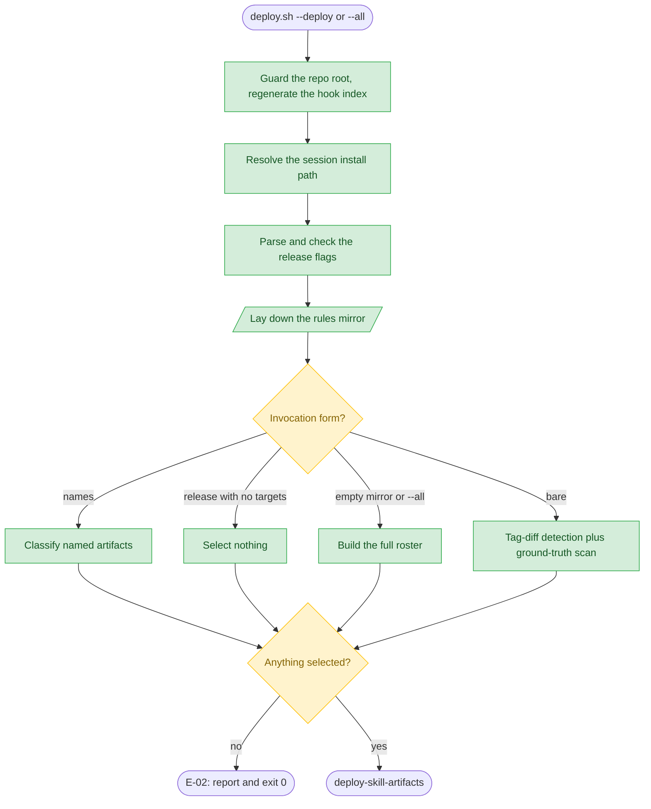

# Select the deploy targets (cmd_deploy entry to the E-02 exit)

## Summary

`cmd_deploy` runs from the repository root. It regenerates the hook-registry index, resolves the desktop app's
session install path (absent on a CLI-only machine), strips and validates the `--release` flags, lays down the rules
mirror before anything else, then selects targets by one of four routes: named artifacts, a declared zero-target
release, the full roster (an empty user-local mirror or `--all`), or the tag-diff window unioned with a ground-truth
drift scan. If nothing is selected it reports what it verified and exits 0 — the no-changes exit, which deploy.sh's
own comments label edge case E-02; otherwise the selected sets flow into the deploy activity. Its [ICOM](/core/process-catalog/definitions/pack.json) table follows.

## ICOM

| Inputs | Controls | Outputs | Mechanisms |
|---|---|---|---|
| The invocation (`--deploy [names]`, `--all`, `--release <slug>`, `--no-targets`); the cwd; `operator.toml` `[paths].cowork_install_path`; the last reachable tag; the user-local mirror; the mirror pair set | Repo-root guard; the stamped-deploy target-set contract; the slug shape; the single pair-set declaration (C-197); the roster arrays | `CHANGED_SKILLS`, `CHANGED_PACKAGES`, `CHANGED_HARNESS`, `DELETED_SKILLS`; the deployed rules mirror and its index; one mirror event row when stamped; an E-02 exit 0 when empty | `deploy.sh` functions `validate_workspace`, `detect_install_path`, `deploy_rules_mirror`, `should_full_roster`, `detect_changed_skills`, `skill_content_drift`; [`build-hook-registry.py`](/core/deploy/tools/build-hook-registry.py) |

## Flow

## Steps

| Step | Action | Actor | Inputs → outputs (shape) | Controls | Mechanism | Harness | Model need | Source |
|---|---|---|---|---|---|---|---|---|
| guard-repo-root | Refuse to run outside the repository root | script:deploy.sh | cwd → continue when `CLAUDE.md` or [`core/CLAUDE.md.template`](/core/CLAUDE.md.template) plus the three module dirs exist, else `die` | the repo-root contract (deploy.sh's edge case E-05); the orchestrator supplies the cwd in a subshell | `validate_workspace` | file-and-shell-tools | XS/none/read/scriptable/batch | [deploy.sh](/core/deploy/deploy.sh#L4668)<!-- source-anchor: line=4668; fp=d40eaeba68e3dc13 -->, [deploy.sh](/core/deploy/deploy.sh#L6755)<!-- source-anchor: line=6755; fp=5ad7a9f038b34c7b --> |
| regenerate-hook-registry-index | Rebuild the committed hook-registry index from its sources | script:deploy.sh | `build-hook-registry.py` → [`core/rules/bypass-mode-readiness.md`](/core/rules/bypass-mode-readiness.md) refreshed, or a WARN; never fatal | C-160 (Check 38) verifies freshness afterwards: code-enforce | `/usr/bin/python3 core/deploy/tools/build-hook-registry.py` | file-and-shell-tools | XS/none/write/scriptable/batch | [deploy.sh](/core/deploy/deploy.sh#L6763)<!-- source-anchor: line=6763; fp=b94931b8b5b29bdd --> |
| resolve-session-install-path | Find the desktop app's skills-plugin session, or go user-local only | script:deploy.sh | config base from `operator.toml`, else the default search root → `INSTALL_PATH` by its resolution ladder; none → `COWORK_AVAILABLE=false` and a log line | mtime is a logged last resort, never authoritative | `detect_install_path` | file-and-shell-tools | XS/none/read/scriptable/batch | [deploy.sh](/core/deploy/deploy.sh#L5259)<!-- source-anchor: line=5259; fp=d42fb68b2752dac7 -->, [deploy.sh](/core/deploy/deploy.sh#L6781)<!-- source-anchor: line=6781; fp=3cc3aaed4a3429e1 --> |
| parse-release-flags | Strip `--release` and `--no-targets` before artifact classification | script:deploy.sh | argv → `DEPLOY_RELEASE_SLUG`, `_deploy_no_targets`, the remaining names; an empty slug, a bare `--release`, or `--no-targets` beside a name is refused before any write | a stamped deploy states its target set and never auto-detects | `case` loop | file-and-shell-tools | XS/none/none/scriptable/batch | [deploy.sh](/core/deploy/deploy.sh#L6789)<!-- source-anchor: line=6789; fp=cc5a5674ddd6c2f3 -->, [deploy.sh](/core/deploy/deploy.sh#L6827)<!-- source-anchor: line=6827; fp=e55afeba50275464 --> |
| lay-down-rules-mirror | Copy the admitted rules set and write the operations index, unconditionally | script:deploy.sh | the pair-set rows → `<deploy-root>/.claude/rules/<file>` byte-verified + `_operations-index.md`; `RULES_MIRROR_WROTE`; failures appended; one `deploy-rules-mirror` row per stamped invocation | C-128 (Check 9) verifies the mirror afterwards: code-warn; C-197 (Check 77) parity: code-warn; C-198 (Check 78) budget: code-warn | `deploy_rules_mirror` reading `mirror_pair_set` | file-and-shell-tools | XS/none/write/scriptable/batch | [deploy.sh](/core/deploy/deploy.sh#L6451)<!-- source-anchor: line=6451; fp=9b33ba8775d9d265 -->, [deploy.sh](/core/deploy/deploy.sh#L6859)<!-- source-anchor: line=6859; fp=a1d32c573b2174be --> |
| validate-release-slug | Reject a malformed join key at the boundary | script:deploy.sh | slug → `OK`, else `die` (rows are append-only) | non-empty, no whitespace, no pipe | `_ds_validate_slug` | none | XS/none/none/scriptable/batch | [deploy.sh](/core/deploy/deploy.sh#L6870)<!-- source-anchor: line=6870; fp=c89f6b4704417a0d --> |
| classify-named-artifacts | Route each named argument to skills or harness | script:deploy.sh | names × three module trees and `harness/` → `CHANGED_SKILLS`, `CHANGED_HARNESS`; packages for the named skills only; unknown or ambiguous names `die`; `_dep_claimed` = the names | the invalid-name contract (deploy.sh's edge case E-08); manual mode claims only its names | `populate_full_roster_packages <names>` | file-and-shell-tools | XS/none/read/scriptable/batch | [deploy.sh](/core/deploy/deploy.sh#L6891)<!-- source-anchor: line=6891; fp=ecca3dc299f972b1 --> |
| select-full-roster | Deploy everything when the mirror is empty or `--all` was given | script:deploy.sh | `should_full_roster` (no roster skill under the user-local mirror, or `FORCE_ALL`) → the three module arrays as `CHANGED_SKILLS` + every package; `--no-targets` selects nothing instead | the roster is read from the arrays, never a hardcoded name list: prose-only | `build_full_roster_skills`, `populate_full_roster_packages` | file-and-shell-tools | XS/none/read/scriptable/batch | [deploy.sh](/core/deploy/deploy.sh#L6957)<!-- source-anchor: line=6957; fp=fd942a52f07a46e4 -->, [deploy.sh](/core/deploy/deploy.sh#L5073)<!-- source-anchor: line=5073; fp=74d12f09e6f34ce5 --> |
| detect-tag-diff-changes | Diff the repository since the last deployment reference | script:deploy.sh | last tag (the previous tag when HEAD is tagged; `HEAD~1` with none) → changed skills, packages (`*.skill` anchored), deleted skills, harness names | the documented auto-detect window | `detect_changed_skills` | git-and-gh-cli | XS/none/read/scriptable/batch | [deploy.sh](/core/deploy/deploy.sh#L5385)<!-- source-anchor: line=5385; fp=de3dfbdf759dac45 -->, [deploy.sh](/core/deploy/deploy.sh#L6969)<!-- source-anchor: line=6969; fp=d0aa906c43d12479 --> |
| scan-ground-truth-drift | Union in roster skills whose installed copy is stale | script:deploy.sh | `skill_content_drift` over the full roster and each resolved target → names added to `CHANGED_SKILLS`, a log line naming them and the roster size | adds only; the tag diff stays the sole source of deletions and packages | `skill_content_drift` | file-and-shell-tools | XS/none/read/scriptable/batch | [deploy.sh](/core/deploy/deploy.sh#L6979)<!-- source-anchor: line=6979; fp=3dff53bee40dcd3f -->, [deploy.sh](/core/deploy/deploy.sh#L6632)<!-- source-anchor: line=6632; fp=7efbe6fd2cabd1a6 --> |
| exit-when-nothing-selected | Report the verified population and exit 0 (E-02) | script:deploy.sh | empty sets → "Nothing to deploy" with the roster denominator and target count, the mirror write count, the unstamped warning when stamping was expected, the composition-surface out-of-scope note; `die` if the mirror carrier failed | the first sentence is a test-matched literal; composition surfaces are a fourth category `--deploy` never reads | `log` | file-and-shell-tools | XS/none/none/scriptable/batch | [deploy.sh](/core/deploy/deploy.sh#L7037)<!-- source-anchor: line=7037; fp=d4b5c1b78adbc33d --> |

## Step profile

| Field | Value |
|---|---|
| Deterministic steps | 11 of 11 (determinism `scriptable`, counted from the Steps table) |
| Judgment steps | 0 |
| Harness features relied on | file-and-shell-tools, git-and-gh-cli (portable) |
| Context read | S (2k–8k tokens): the argument list, a diff listing, the roster arrays, the pair-set rows |

## Evidence

| Lens | Source | Observation | Label |
|---|---|---|---|
| designed | [`core/rules/skill-deployment.md`](/core/rules/skill-deployment.md), "Auto-detect window semantics" and "Initial bootstrap" | the auto-detect window (tag, previous tag when HEAD is tagged, `HEAD~1`); a release-stamped deploy never auto-detects; a fresh clone bootstraps the full roster; `--all` forces it | [SOURCE] |
| designed | [`core/rules/harness-deployment.md`](/core/rules/harness-deployment.md), "Drift Check Semantics" and "Account-switcher (relocated)" | the rules mirror is deploy-produced from the single pair-set declaration; `HARNESS_LIST` is empty | [SOURCE] |
| built | [`core/deploy/deploy.sh`](/core/deploy/deploy.sh), `cmd_deploy` | the ordering is load-bearing: the mirror carrier and the ground-truth scan both run before the E-02 exit, so an absent mirror or a stale installed copy is repaired even when the tag window is empty | [SOURCE] |
| executed | measure `event-log-deploy-status` — [event-log-deploy-status.py](/core/deploy/tools/process-catalog-measures/event-log-deploy-status.py) (population: the deployment-status rows of the pipeline event log, among rows whose release key is a milestone title or a tag name on the host; a key another repository shares is counted, and a legacy row older than the host's tags is not) | The measure reports the deployment-status rows by subtype. The mirror carrier's row is the one trace a selection leaves, and it is written only on a stamped deploy; one install's working state; supports no verdict on this page | [SOURCE] |
| designed vs built | [`core/rules/skill-deployment.md`](/core/rules/skill-deployment.md), "Auto-detect window semantics"; [`core/deploy/deploy.sh`](/core/deploy/deploy.sh), `cmd_deploy`, the ground-truth selection block | the rule gives the tag diff as how a no-argument deploy determines what changed; the code also unions a ground-truth drift scan of the installed copies into the selection, a built step neither deployment rule describes | [SOURCE] |

## Navigation

<!-- nav:begin -->
Up: [deploy-merged-changes](deploy-merged-changes.md) · Previous: [trigger-post-merge-deploy](trigger-post-merge-deploy.md) · Next: [deploy-skill-artifacts](deploy-skill-artifacts.md)
<!-- nav:end -->

## Sources

- [`core/deploy/deploy.sh`](/core/deploy/deploy.sh) — `cmd_deploy` and the helpers it calls
- [`core/rules/skill-deployment.md`](/core/rules/skill-deployment.md) — the auto-detect window, initial bootstrap and `--all`
- [`core/rules/harness-deployment.md`](/core/rules/harness-deployment.md) — the mirror as a deploy-produced artifact
- [`core/deploy/tools/build-hook-registry.py`](/core/deploy/tools/build-hook-registry.py), [`core/rules/bypass-mode-readiness.md`](/core/rules/bypass-mode-readiness.md) — the index generator and the index it rewrites
- [`core/process-catalog/definitions/controls-register.tsv`](/core/process-catalog/definitions/controls-register.tsv) — C-128, C-160, C-197, C-198
