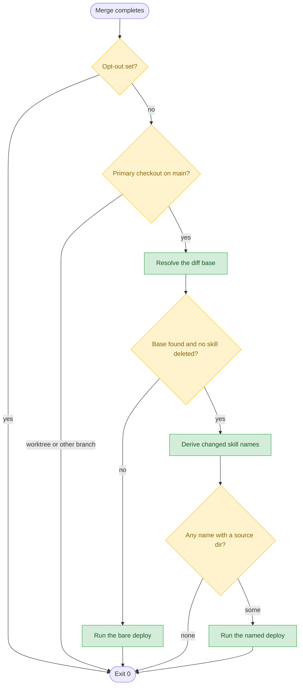

# Trigger a deploy from a merge on main (the post-merge git hook)

## Summary

A git `post-merge` hook, symlinked into the source repository's hooks directory by the installer, closes the window
between a merge landing and someone remembering to deploy. Three guards gate it — an opt-out variable, primary
checkout only, `main` only — and then it diffs `ORIG_HEAD..HEAD` under the three skill trees, drops names with no
source directory, and runs `deploy.sh --deploy <names>`. A deleted skill or an unresolvable diff base falls back to
the no-argument deploy. Every path exits 0: the merge has already happened. It passes no release identity, so the
deploys it runs write no event-log row. Its
[ICOM](/core/process-catalog/definitions/pack.json) table follows.

## ICOM

| Inputs | Controls | Outputs | Mechanisms |
|---|---|---|---|
| `ORIG_HEAD` (else the reflog), `HEAD`, the current branch, git-dir vs git-common-dir, the three `*/skills/` trees | Opt-out variable; primary-checkout-only; main-only; never a non-zero exit; no release identity ever | A `deploy.sh --deploy` invocation (named or bare) and `[post-merge-deploy]` notes on stderr | `git rev-parse`, `git diff`, `sed`, `sort`; the installer's symlink into the hooks directory |

## Flow

## Steps

| Step | Action | Actor | Inputs → outputs (shape) | Controls | Mechanism | Harness | Model need | Source |
|---|---|---|---|---|---|---|---|---|
| skip-on-opt-out | Exit when the operator opted this merge out | hook:git-post-merge-deploy | `PMO_SKIP_POST_MERGE_DEPLOY=1` → exit 0 | guard C of the hook's contract | variable test | file-and-shell-tools | XS/none/none/scriptable/batch | [hook](/core/hooks/git-post-merge-deploy.sh#L60)<!-- source-anchor: line=60; fp=bab5cd1b626b44dd --> |
| probe-environment | Exit silently unless git, sed, sort and bash resolve | hook:git-post-merge-deploy | `command -v` × 4 → continue or exit 0 | a minimal environment is a no-op, never an error; the hook pins no search path | `command -v` | file-and-shell-tools | XS/none/read/scriptable/batch | [hook](/core/hooks/git-post-merge-deploy.sh#L63)<!-- source-anchor: line=63; fp=7abfe5214cd3e550 --> |
| assert-primary-checkout | Skip linked worktrees | hook:git-post-merge-deploy | `--git-dir` vs `--git-common-dir`, both through `pwd -P` → equal: continue; else a note and exit 0 | guard A: a worktree merge carries unmerged work | `git rev-parse` | git-and-gh-cli | XS/none/read/scriptable/batch | [hook](/core/hooks/git-post-merge-deploy.sh#L68)<!-- source-anchor: line=68; fp=c3b9d25dc31fcab8 --> |
| assert-main-branch | Skip any branch but main | hook:git-post-merge-deploy | `--abbrev-ref HEAD` → `main`: continue; else exit 0 | guard B | `git rev-parse` | git-and-gh-cli | XS/none/read/scriptable/batch | [hook](/core/hooks/git-post-merge-deploy.sh#L80)<!-- source-anchor: line=80; fp=9078dbf0c24881de --> |
| locate-deploy-script | Resolve the top level and the deploy script | hook:git-post-merge-deploy | `--show-toplevel` → `<top>/core/deploy/deploy.sh` readable, else a note and exit 0 | — | `git rev-parse` | git-and-gh-cli | XS/none/read/scriptable/batch | [hook](/core/hooks/git-post-merge-deploy.sh#L83)<!-- source-anchor: line=83; fp=f6da7967145b373a --> |
| resolve-diff-base | Pick the merge's own base, not the release tag | hook:git-post-merge-deploy | `ORIG_HEAD`, else `HEAD@{1}`, else empty → `_base`; empty routes to the bare deploy | the tag-diff window answers a different question than "what did this merge bring in" | `git rev-parse --verify` | git-and-gh-cli | XS/none/read/scriptable/batch | [hook](/core/hooks/git-post-merge-deploy.sh#L94)<!-- source-anchor: line=94; fp=712a3590d58eed9a --> |
| detect-deleted-skills | Route a deletion to the bare deploy | hook:git-post-merge-deploy | `git diff --diff-filter=D` over the three skill trees, anchored at the top level → non-empty: run the bare deploy and exit 0 | the named form empties the deleted-skill set; the bare form keeps it, but deploy.sh only warns on each deleted skill and removes nothing ([deploy.sh](/core/deploy/deploy.sh), [deploy.sh](/core/deploy/deploy.sh#L7355)<!-- source-anchor: line=7355; fp=5dd73f1d1bcc7dd9 -->) | `git -C <top> diff` | git-and-gh-cli | XS/none/read/scriptable/batch | [hook](/core/hooks/git-post-merge-deploy.sh#L115)<!-- source-anchor: line=115; fp=c6645b45060c03b9 --> |
| derive-changed-skill-names | Reduce changed paths to unique skill names | hook:git-post-merge-deploy | `git diff --name-only` → `<skill>` names via `sed`, `sort -u`; none → exit 0 | pathspecs anchored with `git -C` so a subdirectory cwd cannot blank the result | `git diff` + `sed` | git-and-gh-cli | XS/none/read/scriptable/batch | [hook](/core/hooks/git-post-merge-deploy.sh#L119)<!-- source-anchor: line=119; fp=0a8c3a39995a2b54 --> |
| filter-to-present-skills | Keep names that still have a source directory | hook:git-post-merge-deploy | names × three trees → `_present` list; empty → exit 0 | `cmd_deploy` dies on an unknown name, so a renamed roster must not reach it | directory tests | file-and-shell-tools | XS/none/read/scriptable/batch | [hook](/core/hooks/git-post-merge-deploy.sh#L127)<!-- source-anchor: line=127; fp=c49d77e40b294bae --> |
| invoke-named-deploy | Run the named deploy and exit 0 whatever it returns | hook:git-post-merge-deploy | `bash deploy.sh --deploy <names>` → a note on a non-zero exit; no `--release`, so no event row | C-379: prose-only | `bash` | file-and-shell-tools | XS/none/write/scriptable/batch | [hook](/core/hooks/git-post-merge-deploy.sh#L140)<!-- source-anchor: line=140; fp=c67c89461e28a173 --> |

## Step profile

| Field | Value |
|---|---|
| Deterministic steps | 10 of 10 (determinism `scriptable`, counted from the Steps table) |
| Judgment steps | 0 |
| Harness features relied on | git-and-gh-cli, file-and-shell-tools (both portable) — a plain git hook, not a tool-event hook |
| Context read | XS (under 2k tokens): a diff listing and a few ref names |

## Evidence

| Lens | Source | Observation | Label |
|---|---|---|---|
| designed | [`core/rules/skill-deployment.md`](/core/rules/skill-deployment.md), "Automatic post-merge deploy" | the hook is installed by the installer and re-installed by [`update.sh`](/update.sh); three gating conditions; derives its change set from `ORIG_HEAD`; never fails a merge; deploys but never rebuilds a package; carries no release identity | [SOURCE] |
| designed | [`docs/scripts/setup-workspace.sh`](/docs/scripts/setup-workspace.sh), the post-merge block of `install_hooks` | the installer symlinks the hook only when the source repository sits inside the workspace root (or `PMO_INSTALL_GIT_HOOKS=1`); otherwise it prints the one-line manual install | [SOURCE] |
| built | [`core/hooks/git-post-merge-deploy.sh`](/core/hooks/git-post-merge-deploy.sh) | the guards, the diff base, the deletion fallback, the present-skill filter and the named invocation match the rule's description line for line | [SOURCE] |
| built vs described | [hook](/core/hooks/git-post-merge-deploy.sh#L113)<!-- source-anchor: line=113; fp=cd32009d695808be -->; [deploy.sh](/core/deploy/deploy.sh#L5441)<!-- source-anchor: line=5441; fp=01b704f6169d5a6f -->, [deploy.sh](/core/deploy/deploy.sh#L7359)<!-- source-anchor: line=7359; fp=a507e505e017da79 --> | the hook's comment says only the bare form "prunes"; the bare form collects the deleted skills but only logs a warning for each — nothing is removed, so the fallback reaches a warning, not a cleanup | [SOURCE] |
| built | [`controls-register.tsv`](/core/process-catalog/definitions/controls-register.tsv), C-084, C-379 | the register carries the hook as an automation (`not-a-control`); the no-release-identity rule is `prose-only` | [SOURCE] |
| executed | measure `event-log-deploy-status` — [event-log-deploy-status.py](/core/deploy/tools/process-catalog-measures/event-log-deploy-status.py) (population: the deployment-status rows of the pipeline event log, among rows whose release key is a milestone title or a tag name on the host; a key another repository shares is counted, and a legacy row older than the host's tags is not) | The measure reports deployment-status rows, which only a release-stamped deploy writes. The hook passes no release key, so a deploy it runs writes no row the measure could read; one install's working state; supports no verdict on this page | [SOURCE] |

## Navigation

<!-- nav:begin -->
Up: [deploy-merged-changes](deploy-merged-changes.md) · Next: [select-deploy-targets](select-deploy-targets.md)
<!-- nav:end -->

## Sources

- [`core/hooks/git-post-merge-deploy.sh`](/core/hooks/git-post-merge-deploy.sh) — the hook and its guard rationale
- [`core/rules/skill-deployment.md`](/core/rules/skill-deployment.md), "Automatic post-merge deploy" — the designed contract
- [`docs/scripts/setup-workspace.sh`](/docs/scripts/setup-workspace.sh), `install_hooks` — the scoped symlink install
- [`core/deploy/deploy.sh`](/core/deploy/deploy.sh) — the deploy the hook runs, and its handling of a deleted skill
- [`update.sh`](/update.sh) — the updater that re-installs the hook
- [`core/process-catalog/definitions/controls-register.tsv`](/core/process-catalog/definitions/controls-register.tsv) — C-084, C-379
