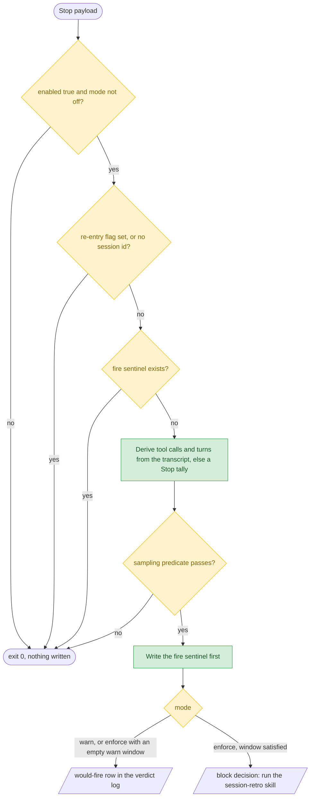

# Trigger the session retro at a Stop boundary

## Summary

The settings template registers a Stop hook at workspace scope, and the hook ships inert: unless the operator has set
`enabled = true` in the `[session_retro]` table, it reads its config and exits. When active, it runs on every Stop
— not once per session, because a Stop hook cannot see the last turn — and re-evaluates one predicate each time:
derive the session's tool-call and turn counts from the transcript the payload points at, compare them with the
sampling floors, and fire at the first crossing. A skip writes nothing, so the decision stays open; a fire writes a
per-session sentinel before anything else, so the retro's own closing turn cannot re-trigger. In warn mode the
would-fire verdict is logged; in enforce mode — and only after the warn window holds a verdict — the hook returns a
block decision that re-enters the agent with the instruction to run the skill. Every error path exits 0. Its
[ICOM](/core/process-catalog/definitions/pack.json) table (inputs, controls, outputs, mechanisms)
follows.

## ICOM

| Inputs | Controls | Outputs | Mechanisms |
|---|---|---|---|
| The Stop payload on stdin (session id, transcript path, the harness re-entry flag); the `[session_retro]` keys of the operator config (`enabled`, `mode`, `sample`, `min_tool_calls`, `min_turns`); the session transcript; the hook state directory | The inert default; the fire-path-only sentinel; the fail-open and fail-quiet rules; the warn window before enforce; the once-per-session guard; the activation boundary as an operator-instance decision | Nothing on skip; a `fired/<session>` sentinel; a `would-fire` row in the verdict log; a block decision on stdout that re-enters the agent | The hook script (line-oriented grep, sort and wc; no JSON parser); the Stop registration in the settings template; the pinned payload fixture and self-test |

## Flow

## Steps

| Step | Action | Actor | Inputs → outputs (shape) | Controls | Mechanism | Harness | Model need | Source |
|---|---|---|---|---|---|---|---|---|
| register-stop-hook | Register the hook on the Stop event at workspace scope | operator | the settings template → a Stop entry naming the deployed hook script, rendered at install; deliberately not re-homed to the user-scope surface | C-111: code-off | [setup-workspace.sh](/docs/scripts/setup-workspace.sh) rendering the template | hook-loading-surface | human | [settings.json.template](/core/settings.json.template#L244)<!-- source-anchor: line=244; fp=1396175662cd459a --> |
| read-activation-config | Read the activation keys | hook:session-retro-trigger | the `[session_retro]` table, section-scoped → `enabled` (default false) and `mode` (default warn); exit 0 when disabled or off | C-078: code-off | `read_cfg` with a section-scoped awk | file-and-shell-tools | XS/none/read/scriptable/batch | [session-retro-trigger.sh](/core/hooks/session-retro-trigger.sh#L469)<!-- source-anchor: line=469; fp=c52768c6fe6973a8 --> |
| read-stop-payload | Read the Stop payload and honor the re-entry guard | hook:session-retro-trigger | stdin JSON → session id (sanitized) and transcript path; exit 0 when the harness re-entry flag is true or no id is present | C-078: code-off | tolerant scalar-key `sed` matches, no `jq` | tool-event-hooks | XS/none/read/scriptable/batch | [session-retro-trigger.sh](/core/hooks/session-retro-trigger.sh#L474)<!-- source-anchor: line=474; fp=3d3cb2a21c82e32c --> |
| check-fire-sentinel | Check the once-per-session fire sentinel | hook:session-retro-trigger | `fired/<session-id>` → exit 0 when present; the sentinel means only "this session has fired" | C-078: code-off | a file-existence test in the hook state directory | file-and-shell-tools | XS/none/read/scriptable/batch | [session-retro-trigger.sh](/core/hooks/session-retro-trigger.sh#L498)<!-- source-anchor: line=498; fp=48529a30bf0b0da6 --> |
| derive-session-size | Derive the session's size from the transcript | hook:session-retro-trigger | the transcript JSONL → tool calls (occurrences of tool-use blocks) and turns (distinct request ids); oversize or unreadable → a per-session Stop tally as the turn proxy with tool calls 0 | C-078: code-off | `derive_counts`, `bump_stop_count` | file-and-shell-tools | XS/none/read/scriptable/batch | [session-retro-trigger.sh](/core/hooks/session-retro-trigger.sh#L136)<!-- source-anchor: line=136; fp=e148a9d3d642e3ab --> |
| evaluate-sampling-predicate | Evaluate the sampling predicate | hook:session-retro-trigger | counts × `sample` (all, almost_all, significant_only) × floors (12 tool calls, 4 turns) → run or skip; a skip writes nothing so the next Stop re-evaluates | C-078: code-off | `should_run` | file-and-shell-tools | XS/none/read/scriptable/batch | [session-retro-trigger.sh](/core/hooks/session-retro-trigger.sh#L184)<!-- source-anchor: line=184; fp=4e70f172760eed78 --> |
| write-fire-sentinel | Write the fire sentinel before any decision | hook:session-retro-trigger | a passing predicate → `fired/<session-id>` created; a retro that fails midway cannot loop | C-078: code-off | `mkdir -p` and a touch | file-and-shell-tools | XS/none/write/scriptable/batch | [session-retro-trigger.sh](/core/hooks/session-retro-trigger.sh#L531)<!-- source-anchor: line=531; fp=1504149f14d2fa84 --> |
| check-warn-window | Require a satisfied warn window before enforcing | hook:session-retro-trigger | the verdict log → enforce proceeds only when at least one `would-fire` row exists; otherwise degrade to warn and record `warn-window-unsatisfied` | C-078: code-off | a grep over the verdict log | file-and-shell-tools | XS/none/read/scriptable/batch | [session-retro-trigger.sh](/core/hooks/session-retro-trigger.sh#L539)<!-- source-anchor: line=539; fp=58772a1edf73e0de --> |
| record-or-block | Record the verdict, or re-enter the agent | hook:session-retro-trigger | warn → a `would-fire` row with the sample and size source, exit 0; enforce → a block decision whose reason instructs the agent to run the skill, emit rows through the event writer and stop | C-078: code-off | a `printf` of the decision JSON | tool-event-hooks | XS/none/write/scriptable/batch | [session-retro-trigger.sh](/core/hooks/session-retro-trigger.sh#L561)<!-- source-anchor: line=561; fp=2930fc86f47ea256 --> |
| run-trigger-self-test | Run the hook's self-test | operator | the pinned Stop-payload fixture and a growing synthetic transcript → the predicate, section-scoped config, inert default, multi-Stop sequence, skip-writes-nothing, warn-window degrade and fail-quiet arms, exit 0 or 1, with no side effects | prose-only | `session-retro-trigger.sh --self-test` | file-and-shell-tools | human | [session-retro-trigger.sh](/core/hooks/session-retro-trigger.sh#L206)<!-- source-anchor: line=206; fp=d7bc31eb630c2c76 --> |

## Step profile

| Field | Value |
|---|---|
| Deterministic steps | 8 of 10 (determinism `scriptable`, counted from the Steps table) |
| Judgment steps | 0 — the other rows are the operator's registration and self-test run, written `human` |
| Operator steps | 2 |
| Harness features relied on | tool-event-hooks, hook-loading-surface, file-and-shell-tools |
| Context read | XS (under 2k tokens): the hook reads counts, never content |

## Evidence

| Lens | Source | Observation | Label |
|---|---|---|---|
| designed | [`core/skills/session-retro/references/sampling-and-trigger.md`](/core/skills/session-retro/references/sampling-and-trigger.md) §§ 2–6; [`core/hooks/session-retro-trigger.sh`](/core/hooks/session-retro-trigger.sh), its header comment | the fire point is a threshold crossing, not the session's end; three operator steps activate the trigger; the floors are initial values, not measured ones | [SOURCE] |
| built | [`core/hooks/session-retro-trigger.sh`](/core/hooks/session-retro-trigger.sh), its main sequence; [`core/settings.json.template`](/core/settings.json.template), the Stop entry; [the controls register](/core/process-catalog/definitions/controls-register.tsv), C-078 and C-111; [`selftest-coverage-exclusions.txt`](/core/deploy/allowlists/selftest-coverage-exclusions.txt) | the hook and its Stop registration ship, both classed `code-off`; the registration stays at workspace scope by design, so a session that resolves no settings surface declaring the wiring loads no Stop hook; the exclusion list of the self-test discovery gate names the hook as outside that gate's scope, a hook runtime | [SOURCE] |
| executed | no measure — what would show an activation and a firing is the operator config's `[session_retro]` keys and the hook's state directory: its fire sentinels and its verdict log. | No measure in the measures register reads those surfaces, so the page reads `unobserved` | [SOURCE] |
| executed | held local — what would show how often the skill is invoked, and by which route, is the record of sessions across an install. | Nothing from that store is published | [SOURCE] |

## Navigation

<!-- nav:begin -->
Up: [run-session-retro](run-session-retro.md) · Next: [emit-session-learnings](emit-session-learnings.md)
<!-- nav:end -->

## Sources

- [`core/hooks/session-retro-trigger.sh`](/core/hooks/session-retro-trigger.sh) — the hook body, its state layout, the self-test and the fail-open contract
- [`core/settings.json.template`](/core/settings.json.template) — the Stop registration and the scope note
- [`core/skills/session-retro/references/sampling-and-trigger.md`](/core/skills/session-retro/references/sampling-and-trigger.md) — the config surface, the predicate, the fire point and the activation conditions
- [`core/process-catalog/definitions/controls-register.tsv`](/core/process-catalog/definitions/controls-register.tsv) — C-078, C-111
- [`core/deploy/allowlists/selftest-coverage-exclusions.txt`](/core/deploy/allowlists/selftest-coverage-exclusions.txt) — the discovery gate's exclusion entry for the hook; [`docs/scripts/setup-workspace.sh`](/docs/scripts/setup-workspace.sh) — the installer that renders the settings template
