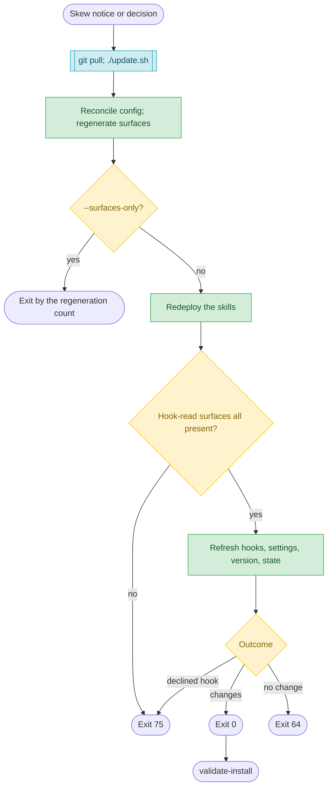

# Update an installed workspace to a newer version

## Summary

The sub-process starts when the operator, prompted by the SessionStart skew notice or by choice, pulls a newer
version and runs `./update.sh`, and ends with the workspace at that version and an exit code that says what
happened: 0 applied, 64 nothing to do, 75 a control left on superseded bytes. Three activities carry it: the config
reconcile and composition-surface regeneration (Phases 1–3), the skill redeploy (Phase 5 — the deploy sub-process
entered bare), and the hook-bundle and settings refresh with the finalization (Phases 5b0–5d, 5b, 4). The one
decision inside it is the operator's answer to a schema key that has no default; `--surfaces-only` and `--dry-run`
narrow the blast radius. The Windows entry point only previews.

## Entry and exit

| Side | Criteria | Source |
|---|---|---|
| Entry | A workspace previously bootstrapped (`operator.toml` present, else exit 65); the clone pulled to the newer version; `./update.sh` run from the clone root with the composition library and manifest present; on Windows only `update.ps1 -DryRun` | [update.sh](/update.sh#L203)<!-- source-anchor: line=203; fp=6212afec21124365 -->; [UPDATE.md](/docs/UPDATE.md#L9)<!-- source-anchor: line=9; fp=0e2101f4400c0f83 -->; [update.ps1](/update.ps1#L113)<!-- source-anchor: line=113; fp=02716d08fd049e2e --> |
| Exit | Exit 0 with ≥ 1 regeneration, skill deploy, hook refresh, settings delta or legacy retirement; or 64 with none; or 75 naming an absent escape surface, a non-executable hook or a declined hook; `.last-update` written on completion; the documented follow-up is `validate-install.sh` | [update.sh](/update.sh#L1344)<!-- source-anchor: line=1344; fp=3c5bdc08997df139 -->; [UPDATE.md](/docs/UPDATE.md#L95)<!-- source-anchor: line=95; fp=6d4085a98571fd15 --> |

## Flow

## Activities

| Activity | Primary actor | Purpose | Page |
|---|---|---|---|
| Reconcile the operator config and regenerate composition surfaces (Phases 1–3) | script:update.sh | Converge `operator.toml` on the schema; regenerate drifted or tampered managed sections, preserving operator additions | [regenerate-composition-surfaces](regenerate-composition-surfaces.md) |
| Redeploy the skills (Phase 5) | script:deploy.sh | The deploy sub-process entered bare through the orchestrator; its `Deployed: N skills` line feeds the exit code — shared with `deploy-merged-changes` | [select-deploy-targets](select-deploy-targets.md) · [deploy-skill-artifacts](deploy-skill-artifacts.md) |
| Refresh the hook bundle and settings, then finalize (Phases 5b0–5d, 5b, 4) | script:update.sh | Gate, refresh, assert, retire, re-render, snapshot, record, and pick the exit code | [refresh-hook-bundle](refresh-hook-bundle.md) |

## Controls

| Control | Source | Enforcement class | Surface | Applies to |
|---|---|---|---|---|
| The install/onboarding/update regression suite and the cross-platform update steps pass on every pull request | [`.github/workflows/install-tests.yml`](/.github/workflows/install-tests.yml) (C-216, C-217) | code-enforce | merge-gate | every activity |
| The update path seeds managed Layer-2 files install-if-missing and never writes operator content | [`core/rules/operations-bridge.md`](/core/rules/operations-bridge.md) (C-367) | prose-only | — | regenerate-composition-surfaces |
| The operator config matches its declared schema and template | [`core/deploy/deploy.sh`](/core/deploy/deploy.sh) Check 70 (C-190) | code-enforce (parity arms) / code-warn (schema arm) | deploy-run | regenerate-composition-surfaces |
| The deployed hook tree's publish map closes; byte parity with source is advisory | `core/deploy/deploy.sh` Check 79 (C-199) | code-enforce (map-closure arm) / code-warn (byte-parity arm) | deploy-run | refresh-hook-bundle |
| A hook refresh never ships enforcement whose escape surface is absent | [`update.sh`](/update.sh), `assert_install_complete`; [`docs/UPDATE.md`](/docs/UPDATE.md), the exit-75 troubleshooting entry | code-enforce | — | refresh-hook-bundle |
| Operator settings live in the overlay; the managed file is re-rendered whole | `docs/UPDATE.md`, "Customizing your settings"; [`core/settings.json.template`](/core/settings.json.template) `_comment` | prose-only | — | refresh-hook-bundle |

## Evidence

| Lens | Source | Observation | Label |
|---|---|---|---|
| designed | [`docs/UPDATE.md`](/docs/UPDATE.md), "TL;DR" and "Procedure" | pull then `./update.sh`; the five-step summary and the full effect list; `--surfaces-only`; validation as a required follow-up | [SOURCE] |
| designed | [`core/standards/composition-surface-spec.md`](/core/standards/composition-surface-spec.md), "The four file categories" | the per-category update contract; `settings.json` refreshed without being a manifest row (ADR-121); `CLAUDE.md` a composition surface (ADR-122) | [SOURCE] |
| built | [`update.sh`](/update.sh), the main sequence and `surfaces_only_flow`; [`core/deploy/orchestrate.sh`](/core/deploy/orchestrate.sh), `phase_deploy_skills` | the full sequence and the surfaces-only flow; Phase 5 calls `deploy.sh --deploy` in a subshell at the repo root | [SOURCE] |
| executed | measure `workflow-runs-install-security` — [workflow-run-history.py](/core/deploy/tools/process-catalog-measures/workflow-run-history.py) (population: every run of each named workflow created in the trailing window, split by trigger event, read in slices and verified against the host's total for each slice) · [`install-tests.yml`](/.github/workflows/install-tests.yml) | The measure reports the runs of the install-test workflow by trigger event and conclusion. Its regression suite runs install-then-update in sandboxes; a run shows nothing of an operator's own update | [SOURCE] |
| executed | no measure — what would show an operator's own update is the `.last-update` marker that update writes on its own install. | No measure in the measures register reads an operator's own update | [SOURCE] |
| designed vs built | [UPDATE.md](/docs/UPDATE.md#L25)<!-- source-anchor: line=25; fp=b1aa2fa0a5d1922c -->; [update.sh](/update.sh#L964)<!-- source-anchor: line=964; fp=e1880cb678df0caa --> | the category table's "refreshed by `git pull`; no separate action" for hook scripts describes the source copies; the deployed bundle needs Phase 5c, which the same document's section on the blast radius of a full update lists — an internal inconsistency rather than a mechanism gap | [SOURCE] |

## Navigation

<!-- nav:begin -->
Up: [install-or-update-workspace](install-or-update-workspace.md) · Previous: [install-platform](install-platform.md) · Next: [deploy-merged-changes](deploy-merged-changes.md) · Down: [regenerate-composition-surfaces](regenerate-composition-surfaces.md) · [refresh-hook-bundle](refresh-hook-bundle.md)
<!-- nav:end -->

## Sources

- [`update.sh`](/update.sh), [`update.ps1`](/update.ps1) — the two entry points
- [`docs/scripts/setup-workspace.sh`](/docs/scripts/setup-workspace.sh) — the reconcile, refresh-hooks and refresh-settings flows
- [`core/deploy/orchestrate.sh`](/core/deploy/orchestrate.sh), [`core/deploy/deploy.sh`](/core/deploy/deploy.sh) — the shared skill-deploy phase and the deploy it runs
- [`docs/UPDATE.md`](/docs/UPDATE.md), [`core/standards/composition-surface-spec.md`](/core/standards/composition-surface-spec.md) — the procedure and the contract
- [`docs/scripts/validate-install.sh`](/docs/scripts/validate-install.sh) — the documented follow-up
- [`core/rules/operations-bridge.md`](/core/rules/operations-bridge.md), [`core/settings.json.template`](/core/settings.json.template) — the writer invariant and the managed-file contract
- [`.github/workflows/install-tests.yml`](/.github/workflows/install-tests.yml) — the CI suites; [`controls-register.tsv`](/core/process-catalog/definitions/controls-register.tsv) — C-190, C-199, C-216, C-217, C-367
