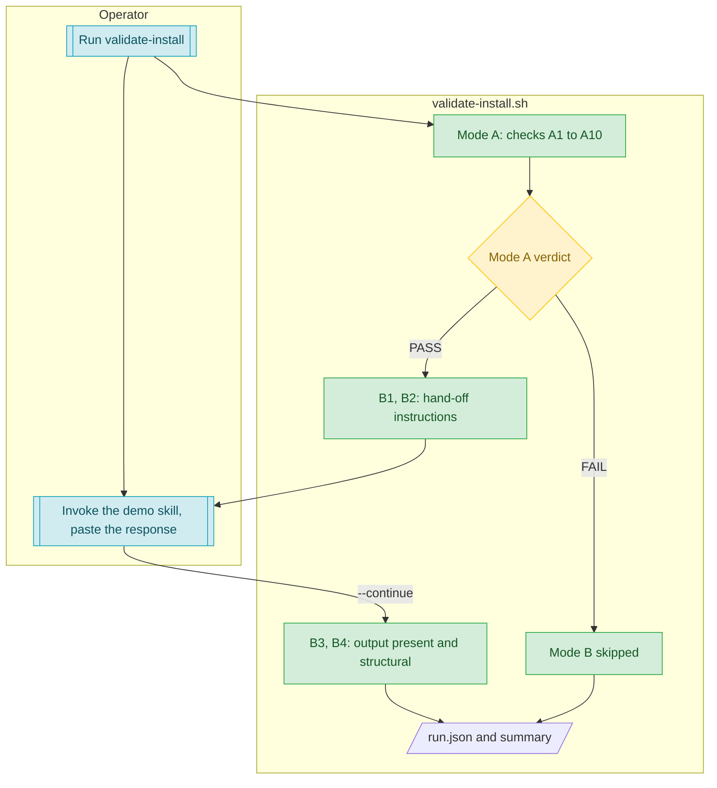

# Validate the install and the first task

## Summary

The operator runs `validate-install.sh` after the install (the documented fourth command) and after every update.
Mode A asserts fifteen install facts (A1–A10 with five sub-checks), including a `deploy.sh --check --warn` run
and the skill roster; Mode B hands the operator a demo-skill invocation and, on `--continue`, reads the pasted
response back and checks its structure. Every run writes a timestamped `run.json`, the machine-readable verdict.
Diagnosing a broken install read-only (`doctor.sh`, then the QA-as-code registry through `qa.sh`) is not part of
this activity. This activity's
[ICOM](/core/process-catalog/definitions/pack.json) table follows.

## ICOM

| Inputs | Controls | Outputs | Mechanisms |
|---|---|---|---|
| The workspace root, the source repo, the mode (`install`, `first-task`, `all`, `operator-pre-existing`), the pasted demo response on `--continue` | Darwin-only unless `PMO_ALLOW_NON_DARWIN` is set; `jq` required; read-only on operator state except the validation directory; per-mode verdict semantics with no skip flag | Per-check PASS/FAIL/SKIP lines, `run.json`, the aggregate verdict and exit code | `validate-install.sh` (bash 3.2); [`deploy.sh`](/core/deploy/deploy.sh) `--check --warn`; `pbpaste` or stdin |

## Flow

## Steps

| Step | Action | Actor | Inputs → outputs (shape) | Controls | Mechanism | Harness | Model need | Source |
|---|---|---|---|---|---|---|---|---|
| invoke-validation | Run the validator in the mode that fits the workspace | operator | `./docs/scripts/validate-install.sh [--mode …] [--continue] [--dry-run]` → a run directory under the validation dir | a pre-installer workspace uses `operator-pre-existing`; there is no skip flag | shell | none | human | [INSTALL.md](/docs/INSTALL.md#L149)<!-- source-anchor: line=149; fp=b565fa398edd1369 -->; [validator](/docs/scripts/validate-install.sh#L69)<!-- source-anchor: line=69; fp=7fc867e9f22f488f --> |
| assert-platform-and-layout | A1 platform, A2 workspace layout | script:validate-install.sh | `uname`, the workspace children and the operations tiers → PASS/FAIL each | Darwin-only (exit 78) unless `PMO_ALLOW_NON_DARWIN` is set, which warns and proceeds | `check_a1_platform`, `check_a2_workspace_layout` | file-and-shell-tools | XS/none/read/scriptable/batch | [validator](/docs/scripts/validate-install.sh#L489)<!-- source-anchor: line=489; fp=1883ef136d131d84 -->, [validate-install.sh](/docs/scripts/validate-install.sh#L524)<!-- source-anchor: line=524; fp=3f5117cf36977cbd -->, [validate-install.sh](/docs/scripts/validate-install.sh#L91)<!-- source-anchor: line=91; fp=f79ce59bc226bbd4 --> |
| assert-hooks-and-surfaces | A3 hook layout, A3b composition surfaces, A3c hook-library closure, A3d PII pre-commit guard wired | script:validate-install.sh | deployed hooks (executable; sourced libs readable), every manifest row's target by tier, every library a deployed hook sources, the source repo's pre-commit hook resolved through every link → PASS/FAIL/SKIP | an unhandled manifest tier is verified by nothing (the tier `case` falls through) | `check_a3_hooks_layout`, `check_a3b_composition_surface`, `check_a3c_hook_lib_closure`, `check_a3d_pii_precommit_wired` | file-and-shell-tools | XS/none/read/scriptable/batch | [validator](/docs/scripts/validate-install.sh#L601)<!-- source-anchor: line=601; fp=34cd09ae8b806dcc -->, [validate-install.sh](/docs/scripts/validate-install.sh#L669)<!-- source-anchor: line=669; fp=cfe0b5afa6c1671d -->, [validate-install.sh](/docs/scripts/validate-install.sh#L735)<!-- source-anchor: line=735; fp=cfc0a05d0a150988 -->, [validate-install.sh](/docs/scripts/validate-install.sh#L850)<!-- source-anchor: line=850; fp=5308259d3ef7783a --> |
| assert-state-and-config | A4 state marker, A10 operator config | script:validate-install.sh | `.workspace-setup.state`, `operator.toml` → PASS/FAIL; both SKIP on `operator-pre-existing` | — | `check_a4_state_marker`, `check_a10_operator_toml` | file-and-shell-tools | XS/none/read/scriptable/batch | [validator](/docs/scripts/validate-install.sh#L837)<!-- source-anchor: line=837; fp=1208295aae9b2187 -->, [validate-install.sh](/docs/scripts/validate-install.sh#L1275)<!-- source-anchor: line=1275; fp=0593c6a6f87d7b5f --> |
| assert-context-files | A5 charter, A5b operations anchor | script:validate-install.sh | `CLAUDE.md` tokens resolved; the anchor present, non-trivial, token-free (SKIP on pre-existing workspaces) → PASS/FAIL | the anchor is installer-produced only | `check_a5_claude_md`, `check_a5b_operations_anchor` | file-and-shell-tools | XS/none/read/scriptable/batch | [validator](/docs/scripts/validate-install.sh#L866)<!-- source-anchor: line=866; fp=289d1bdca2d4f792 -->, [validate-install.sh](/docs/scripts/validate-install.sh#L906)<!-- source-anchor: line=906; fp=6c4bcd7f7d8a807a --> |
| assert-settings | A6 settings file, A6b hook-wiring re-home posture | script:validate-install.sh | valid JSON with the hook registrations; whether the PreToolUse object is re-homed to user scope → PASS/FAIL/INFO | the re-home is a one-time operator act | `check_a6_settings_json`, `check_a6b_hook_wiring_rehome` | file-and-shell-tools | XS/none/read/scriptable/batch | [validator](/docs/scripts/validate-install.sh#L935)<!-- source-anchor: line=935; fp=9145f2e1a2591f49 -->, [validate-install.sh](/docs/scripts/validate-install.sh#L1038)<!-- source-anchor: line=1038; fp=742512ccf5988381 --> |
| run-deploy-check | A7 source repo, A8 the deploy-time check suite in warn mode | script:validate-install.sh | `deploy.sh` present and executable → `deploy.sh --check --warn` exit code → PASS (0) / FAIL (non-zero); SKIP under `--dry-run` | the suite's own classes apply ([run-check-suite](run-check-suite.md)); this step reads only the exit code | `check_a7_source_repo`, `check_a8_deploy_check` | file-and-shell-tools | XS/none/read/scriptable/batch | [validator](/docs/scripts/validate-install.sh#L1094)<!-- source-anchor: line=1094; fp=a1068180a63b82dd -->, [validate-install.sh](/docs/scripts/validate-install.sh#L1110)<!-- source-anchor: line=1110; fp=9a7020c5205ff215 --> |
| assert-skill-roster | A9 the deployed roster against the module arrays | script:validate-install.sh | user-local mirror × roster → PASS/FAIL | C-131 (Check 12) is the deploy-time twin: code-enforce | `check_a9_skill_roster` | file-and-shell-tools | XS/none/read/scriptable/batch | [validator](/docs/scripts/validate-install.sh#L1142)<!-- source-anchor: line=1142; fp=ff0d5615d23ce52a --> |
| hand-off-first-task | B1 prerequisites, B2 the invocation instructions | script:validate-install.sh | the demo skill's presence → printed instructions; B3 and B4 SKIP pending the operator's return | the demo skill answers in response text, not a file, so the hand-off is a clipboard pipe | `check_b1_prereqs`, `check_b2_invoke_instructions` | file-and-shell-tools | XS/none/read/scriptable/batch | [validator](/docs/scripts/validate-install.sh#L1478)<!-- source-anchor: line=1478; fp=63f1c225f0999646 -->, [validate-install.sh](/docs/scripts/validate-install.sh#L1352)<!-- source-anchor: line=1352; fp=0a752cb66a796496 --> |
| run-demo-skill | Invoke the demo skill in a session and return with the response | operator | the instructions → a session invoking the demo skill, the response copied, `validate-install.sh --mode first-task --continue` | the first-look demonstration is the value of Mode B | an agent session | explicit-skill-call | human | [validator](/docs/scripts/validate-install.sh#L1488)<!-- source-anchor: line=1488; fp=8b1fd34b860139f8 --> |
| assert-first-task-output | B3 output captured, B4 minimum-viable structure | script:validate-install.sh | stdin or `pbpaste` → an artifact file; non-empty, a heading or fenced block, no `[INSERT]`/`[TBD]` → PASS/FAIL; the skill version captured into `run.json` | version-tolerant signals, not a keyword list | `capture_from_stdin_or_pbpaste`, `check_b3_output_exists`, `check_b4_output_structural` | file-and-shell-tools | XS/low/read/scriptable/batch | [validator](/docs/scripts/validate-install.sh#L1454)<!-- source-anchor: line=1454; fp=ff6a7cf3d645c1c8 -->, [validate-install.sh](/docs/scripts/validate-install.sh#L1429)<!-- source-anchor: line=1429; fp=0cef72bb1560ca30 --> |
| record-run-and-verdict | Write the run record and exit | script:validate-install.sh | step records → `run.json` (authoritative) and a human summary; exit 0 on all PASS or PASS-with-SKIP, 1 on any FAIL | stdout is for people; the JSON sidecar is the contract | `record_step`, `log_summary` | file-and-shell-tools | XS/none/write/scriptable/batch | [validator](/docs/scripts/validate-install.sh#L424)<!-- source-anchor: line=424; fp=b94da558db39b4e6 -->, [validate-install.sh](/docs/scripts/validate-install.sh#L1508)<!-- source-anchor: line=1508; fp=2fb969a1e4a8c305 --> |

## Step profile

| Field | Value |
|---|---|
| Deterministic steps | 10 of 12 (determinism `scriptable`, counted from the Steps table) |
| Judgment steps | 0 |
| Operator steps | 2 (`human`): the invocation and the demo-skill round trip |
| Harness features relied on | file-and-shell-tools (portable); explicit-skill-call (rebuild) for the one agent step |
| Context read | S (2k–8k tokens): the per-check lines and the demo response |

## Evidence

| Lens | Source | Observation | Label |
|---|---|---|---|
| designed | [`docs/INSTALL.md`](/docs/INSTALL.md), "Verify install"; [`docs/UPDATE.md`](/docs/UPDATE.md), "Verify" | the validator is the documented post-install step and a required post-update follow-up; A5b's FAIL-not-silent posture is called out | [SOURCE] |
| designed | [`docs/scripts/validate-install.sh`](/docs/scripts/validate-install.sh), the header comment | the absorbed counter-designs: clipboard hand-off for Mode B, modal sub-mode instead of a skip flag, minimum-viable-artifact signals, `run.json` as the machine surface | [SOURCE] |
| built | [`docs/scripts/validate-install.sh`](/docs/scripts/validate-install.sh), `mode_a_install_verify`, `mode_a_operator_pre_existing` and `mode_all` | fifteen Mode A records in both sub-modes; Mode B skipped whole on a Mode A FAIL | [SOURCE] |
| executed | measure `workflow-runs-install-security` — [workflow-run-history.py](/core/deploy/tools/process-catalog-measures/workflow-run-history.py) (population: every run of each named workflow created in the trailing window, split by trigger event, read in slices and verified against the host's total for each slice) · [`install-tests.yml`](/.github/workflows/install-tests.yml) | The measure reports the runs of the install-test workflow by trigger event and conclusion. Its regression suite runs the validator's own test and a full install in a sandbox; a run shows nothing of an operator's own validation run | [SOURCE] |
| executed | no measure — what would show an operator's run is the `run.json` the validator writes under that workspace's validation directory. | No measure in the measures register reads an operator's run of the validator | [SOURCE] |

## Navigation

<!-- nav:begin -->
Up: [install-platform](install-platform.md) · Previous: [bootstrap-workspace](bootstrap-workspace.md)
<!-- nav:end -->

## Sources

- [`docs/scripts/validate-install.sh`](/docs/scripts/validate-install.sh) — Modes A and B, the check functions, the run record
- [`docs/INSTALL.md`](/docs/INSTALL.md), "Verify install"; [`docs/UPDATE.md`](/docs/UPDATE.md), "Verify" — when the validator runs
- [`doctor.sh`](/doctor.sh), [`qa.sh`](/qa.sh) — the read-only diagnosis scripts the Summary sets outside this activity
- [`core/deploy/deploy.sh`](/core/deploy/deploy.sh) — the check suite the validator's A8 step runs in warn mode
- [`.github/workflows/install-tests.yml`](/.github/workflows/install-tests.yml) — the workflow whose run history the executed row reads
